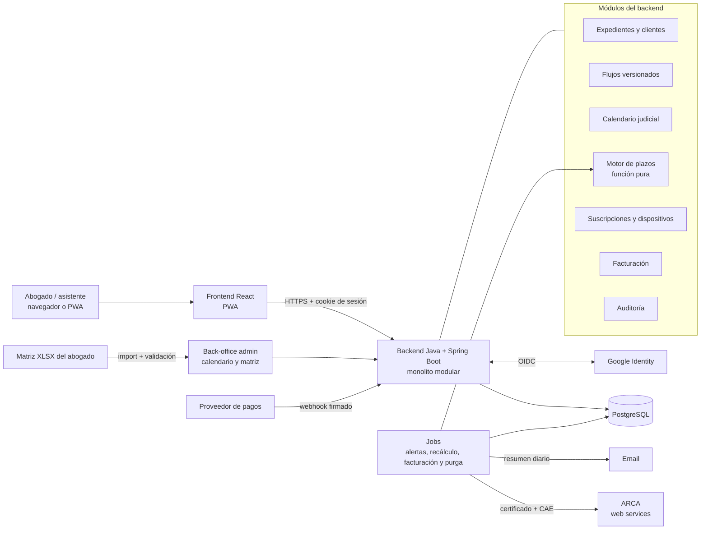

# Análisis de la Documentación y Definiciones Pendientes (V1)

**Estado:** borrador para revisión · **Fecha:** 11/11/2026

Este documento revisa los cuatro documentos del proyecto (visión, lógica de plazos, modelo de datos y UI/UX), registra las decisiones ya tomadas y lista lo que falta definir para empezar a desarrollar la V1.

Convención: **[LEGAL]** = lo debe resolver el equipo legal · **[PRODUCTO]** = decisión de producto · **[TÉCNICO]** = decisión de arquitectura/ingeniería.

---

## 1. Resumen

**Estado al 11/11/2026: alcanza para empezar a desarrollar el lunes 16/11.** La V1 está definida de punta a punta en borrador:

- el producto y la matriz del flujo laboral (Ley 11.653, 38 hitos);
- el motor de plazos, con 23 casos de prueba en verde en la implementación de referencia;
- el modelo de datos y el contrato de API, que cubre todas las pantallas;
- el diseño de las 18 pantallas, con maquetas y capturas;
- las tareas del backend (BE-01 a BE-67) y del frontend (FE-01 a FE-65), de 1 a 3 días cada una;
- el modelado de amenazas y los documentos legales.

Lo que falta no frena el arranque, pero sí partes concretas del desarrollo. Algunas cosas tardan semanas en conseguirse, así que hay que pedirlas ya. Por orden de urgencia:

1. **Validación legal de la matriz y de las reglas del motor.** Reunión con el abogado el 12/11/2026, preparada en [`reunion_validacion_12_11_2026.md`](reunion_validacion_12_11_2026.md). Las respuestas cambian parámetros del motor (que se programa en las primeras semanas) y valores de la matriz. Sin la firma no se importa el flujo real. Conviene firmar antes de la feria judicial de enero. **[LEGAL]**
2. **Trámites largos:** la empresa emisora y el contador, el certificado de ARCA, la marca en el INPI y el dominio, el hosting, los proveedores de pagos y de email, y el cliente OAuth de Google. Cada uno tiene una fecha límite en la sección 13. **[PRODUCTO] [TÉCNICO]**
3. **Decisiones de producto:** los precios y los cortes de los tramos (antes de marzo), y las herramientas del frontend (el primer día). **[PRODUCTO] [TÉCNICO]**
4. **Antes de tener usuarios reales:** el calendario judicial `OFICIAL`, la revisión de los documentos legales por un abogado y la prueba de penetración. **[LEGAL] [TÉCNICO]**

El plan por semanas está en la sección 13.

---

## 2. Registro de decisiones

| Tema | Decisión | Estado |
| ----- | ----- | ----- |
| Backend | Java + Spring Boot | Decidido |
| Base de datos | PostgreSQL | Decidido (ya estaba recomendado) |
| Autenticación | Login con Google (OIDC) para la V1 | Decidido, con las condiciones de la sección 8 |
| Hosting | En Argentina, elegido por precio y calidad según los criterios de la sección 7.3 | Decidido el país; falta elegir el proveedor |
| Frontend | React como PWA (web responsive instalable). Herramientas propuestas (TypeScript, Vite, TanStack Query, MSW, Playwright, entre otras) en [`tareas_frontend_v1.md`](tareas_frontend_v1.md) | Decidido React; las herramientas, propuestas |
| Stack del backend | Java 21, Maven y Flyway | Decidido |
| Recuperación y disponibilidad | 99,5 % mensual, pérdida máxima de 1 hora de datos, recuperación en 4 horas en horario judicial (sección 7.4) | Decidido |
| Repositorio | Este repositorio es solo documental; el código va en otro repositorio | Decidido |
| Modelo de negocio | Planes Individual y Estudio, con tramos de precio por cantidad de clientes activos (por ejemplo, hasta 10 clientes un precio; más clientes, otro). Hasta 3 dispositivos por usuario, prueba gratuita, descuento anual y solo lectura al vencer | Decidido (sección 9). Faltan los precios y confirmar los cortes de los tramos |
| Pagos | Proveedor externo con checkout alojado; propuesta: Mercado Pago Suscripciones | A confirmar |
| Facturación electrónica | La emite la app ante ARCA, por web services, por cada cobro (sección 9.4) | Decidido; falta la condición fiscal del emisor y la validación del contador |
| Documentos legales | Términos y condiciones, política de privacidad y acuerdo de encargo del tratamiento, en `legal/` | Borrador v0.1 listo; falta la revisión de un abogado (sección 10.7) |
| Responsable de seguridad y privacidad | Gerardo Zena | Designación provisoria |
| Nombre y marca | **Foja** ("Cada plazo, a tiempo."), con paleta azul tinta y papel, tipografía Inter e íconos Lucide. Ver [`identidad_y_diseno_v1.md`](identidad_y_diseno_v1.md) | Propuesto; falta verificar el INPI y el dominio |
| Cumplimiento | Ley 25.326 + ISO/IEC 27034, 27001 + 27017 y 27701. **Objetivo: cumplir, sin certificar por ahora.** | Decidido; falta el plan (sección 10) |
| Motor de plazos | Solo en el backend, función pura, principio de "vencimiento más temprano ante la duda" | Corregido en el documento de lógica |
| Vencimiento tipado | Cada plazo tiene vencimiento nominal (fecha de alerta), límite ordinario y límite con gracia. El tipo de límite horario es un dato del hito y las horas son datos de la jurisdicción. | Decidido; resuelve E11 y deja R2 y R3 como parámetros |
| Régimen procesal del expediente | Lo define el tribunal donde tramita. El departamento y la fecha de interposición se usan como control cruzado. Si no se puede determinar, no se asigna el flujo. En la V1 solo hay flujo para la Ley 11.653. | Decidido el diseño; falta el dato (D01) y la regla de transición (D24) |
| Etapa previa | Flujo propio (`PREJUDICIAL`), común a los regímenes; el flujo judicial se elige al interponer la demanda | Propuesto; a confirmar (D25) |
| Calendario judicial | Lo arma el equipo, para 2027–2028. En las primeras fases se usa un calendario `PROVISORIO` que solo excluye sábados y domingos, con aviso visible de cálculo aproximado. | Decidido |
| Validación de la matriz | Reunión con el abogado el 12/11/2026, con las 36 dudas de la hoja `Dudas_a_validar` (incluye el régimen, las reglas R1 a R9 y los casos borde) | Agendado |
| Flujo y rol representado | Un único flujo con `Rol_Responsable` por hito. El rol representado define la perspectiva: "te toca a vos", "le toca a la contraparte" o "esperando al tribunal" | Decidido (E13) |
| Retroceder una etapa | Se puede. Deshace el último avance de un camino; los pasos abiertos quedan `ANULADO`, con motivo y auditoría | Decidido (E16) |
| Plazos simultáneos | Varios hitos activos a la vez por expediente (caminos en paralelo) | Decidido |
| Plazos sueltos | Entran en la V1: un paso sin hito, con el mismo motor, las mismas alertas y el hito actual como contexto. Catálogo de plazos frecuentes en la V1.x | Decidido |
| Tipos de plazo | Nueve tipos: hábiles judiciales, corridos, hábiles administrativos, meses, años, horas, fecha fijada, anticipación en hábiles judiciales y sin plazo. Las reglas nuevas (R6 a R9) se validan con el abogado | Decidido |
| Plazo vencido sin cumplir | Sección fija "Vencidos sin cumplir" en el dashboard y en el email, con acción obligatoria; estado `NO_CUMPLIDO` con motivo | Decidido |
| Casos borde | Varios demandados y ampliación por distancia: carga manual con aviso. Suspensión de plazos: entra en la V1 como período del expediente. El resto queda fuera de la V1 (sección 4, punto 9) | Decidido |
| Alertas | Resumen diario por email en la V1. Umbrales del semáforo en la base (`alert_settings`), globales con ajuste por estudio | Decidido |
| Alta de expediente en curso | Elegir uno o más hitos actuales; Día Cero por hito, o vencimiento manual con motivo. Sin reconstruir el historial; carga uno por uno en la V1 | Decidido (sección 4, punto 11); el régimen de las causas viejas depende de la D24 |

---

## 3. Errores e inconsistencias detectados

| # | Problema | Dónde | Estado |
| ----- | ----- | ----- | ----- |
| E1 | El plazo de gracia figuraba como "12:00 AM" (medianoche). Es 12:00 hs del mediodía. | Lógica de plazos | Corregido |
| E2 | La firma del pseudocódigo era inválida y la prórroga manual nunca se sumaba al plazo. | Lógica de plazos | Corregido |
| E3 | El algoritmo ignoraba `Aplica_Gracia` y `Plazo_Tipo` (corridos). | Lógica de plazos | Corregido |
| E4 | Con plazo 0 devolvía como vencimiento el mismo Día Cero. | Lógica de plazos | Corregido (`SIN_VENCIMIENTO`) |
| E5 | Usaba "feriados del año": fallaba en plazos que cruzan de año (diciembre → feria de enero → febrero). Tampoco contemplaba un año sin cargar. | Lógica de plazos | Corregido (`cubierto_hasta` y `CALENDARIO_NO_CARGADO`) |
| E6 | El Ejemplo 1 decía "sin feriados", pero salteaba el lunes 17/06/2024 (feriado). Sin feriados el resultado correcto es el 17/06. | Lógica de plazos | Corregido (casos 1 y 2) |
| E7 | El Ejemplo 2 usaba un feriado que caía domingo, así que no probaba nada, y el día de gracia (28/03/2024) era Jueves Santo. | Lógica de plazos | Corregido (casos 3 y 3b) |
| E8 | La tabla de ejemplo de la matriz tiene las filas `LAB_010` y `LAB_030` corridas una columna: falta el valor de `Aplica_Gracia`, así que "LCT" queda en esa columna y la condición de salida en `Base_Normativa`. | Documentación de proyecto, sección 5 | Corregido (ejemplo reemplazado por la matriz completa) |
| E9 | La matriz referencia IDs que no existen (`LAB_020`, `LAB_040`, `LAB_060`, `LAB_070`, `LAB_080`). | Documentación de proyecto, sección 5 | Corregido (el importador y la planilla validan las referencias) |
| E10 | La instrucción dice "mismo ID con distinto Paso Siguiente", pero el ejemplo usa `LAB_050-A/B/C`. En la base de datos es un nodo con tres transiciones. | Proyecto vs. modelo de datos | Corregido (formato de dos hojas: `Nodos` y `Transiciones`) |
| E11 | El vencimiento se muestra "a las 23:59 hs", pero el horario judicial documentado es de 08:00 a 14:00. | Lógica de plazos y UI | Corregido por diseño: vencimiento tipado, tipo de límite por hito y horario por jurisdicción (`jurisdiction_schedules`). Los valores se confirman en la D28. |
| E12 | Tabla de feriados con dos nombres: `feriados_judiciales` y `holidays_calendar`. | Lógica vs. modelo de datos | Corregido (se unifica en `holidays_calendar`) |
| E13 | El proyecto dice que el rol adapta la responsabilidad dentro de un mismo flujo; la UI dice que el rol "define qué diagrama de flujo se carga". | Proyecto vs. UI | Corregido: flujo único con `Rol_Responsable` por hito, cruzado con el rol representado. La UI ya lo refleja. |
| E14 | La separación plantilla/instancia no protege los casos en curso: `case_steps` apunta por clave foránea a `flow_nodes`, así que editar un nodo cambia nombre, checklist y transiciones de los expedientes vivos, y borrarlo rompe la referencia. | Modelo de datos, sección 4 | Corregido (`flow_versions` inmutables) |
| E15 | "Agregar inhábil manual a nivel cuenta" (Pantalla 4) no tiene tabla en el modelo. | UI vs. modelo de datos | Corregido (`holidays_calendar` con alcance `ORGANIZACION`) |
| E16 | El proyecto permite "retroceder" de etapa; la UI solo ofrece "Saltear". | Proyecto vs. UI | Corregido: "Retroceder etapa" en la UI y semántica en el modelo (`case_steps`, `origin_step_id` y estado `ANULADO`) |
| E17 | La carga la hace "abogado/asistente", pero el modelo tiene un solo usuario por cartera. | Proyecto vs. modelo de datos | Corregido (`organizations` y `memberships`) |
| E18 | El modelo tiene `password_hash`; con login de Google no se guardan contraseñas. | Modelo de datos | Corregido (`user_identities`) |

---

## 4. Definiciones de dominio pendientes **[LEGAL]**

1. **Régimen procesal por departamento.** Ley 11.653 (Tribunales de Trabajo de instancia única) frente a Ley 15.057 (juzgados unipersonales y cámara de apelación, de implementación gradual). Cambian el flujo, los plazos y el tipo de órgano. **Es el punto más importante a cerrar.**

   **El diseño ya está resuelto** (modelo de datos, `legal_cases`, "Resolución del régimen"):
   * el régimen lo define el tribunal donde tramita la causa;
   * `department_regimes`, con el departamento y la fecha de interposición, sirve de control cruzado;
   * si no se puede determinar, no se asigna flujo;
   * si el régimen no tiene flujo publicado, la app lo informa y permite plazos sueltos.

   **Falta el dato:** qué régimen rige en cada departamento y desde qué fecha (D01), y si las causas iniciadas antes siguen con la ley anterior (D24).

   En el backend, el resultado es un tipo cerrado; la app no adivina:

   ```java
   enum RegimenProcesal { PBA_LAB_LEY_11653, PBA_LAB_LEY_15057 }

   sealed interface ResolucionRegimen {
       record Definido(RegimenProcesal regimen, OrigenRegimen origen) implements ResolucionRegimen {}
       record Inconsistente(RegimenProcesal porTribunal, RegimenProcesal porDepartamento) implements ResolucionRegimen {}
       record SinDefinir() implements ResolucionRegimen {}
   }
   ```

   Relacionado: la etapa previa pasa a ser un flujo propio, común a los regímenes, y el flujo judicial se elige al interponer la demanda (D25).
2. **Matriz completa del fuero laboral PBA**, para el régimen o los regímenes que entren en la V1. Ya hay un borrador para la Ley 11.653 (`matriz_flujo_laboral_pba_ley_11653.xlsx`, 38 hitos y 76 transiciones) con 36 preguntas abiertas. Se valida con el abogado el 12/11/2026: responde las preguntas en la columna `Respuesta_Equipo_Legal` de la hoja `Dudas_a_validar` y después se firma la versión.
3. **Las cinco reglas del motor de plazos** (R1 a R5, sección 4 del documento de lógica, dudas D26 a D30): notificación en día inhábil, plazos corridos que terminan en inhábil, hora límite del vencimiento ordinario, inhábiles variables (Jueves Santo, 24/12, 31/12) y determinación del Día Cero según la forma de notificación. Cada una ya tiene opciones y una recomendación. Con el vencimiento tipado, ninguna respuesta cambia la estructura del motor: a lo sumo cambia un parámetro o una rama del cómputo.
4. **Tipos de plazo. Decidido: entran todos en la V1.** El cómputo de cada uno está en la sección 2 del documento de lógica, con casos de prueba:
   - `HABILES_ADMINISTRATIVOS`: etapa prejudicial (LCT y Ley 24.013). Solo excluye fines de semana y feriados; las ferias judiciales no suspenden (R6).
   - `MESES` y `ANIOS`: de fecha a fecha, como la prescripción de 2 años (art. 256 LCT, `LAB_015`). No se bloquean si el calendario de ese año todavía no está cargado (R7).
   - `HORAS`: intimaciones en horas, corridas desde el instante (R8).
   - `FECHA_FIJADA`: audiencias y otros actos con fecha y hora fijadas por el tribunal. El límite es el acto mismo.
   - `ANTICIPACION_HABILES_JUDICIALES`: plazos contados hacia atrás desde un acto fijado, como citar testigos antes de la audiencia (R9).

   Las cuatro reglas nuevas tienen una postura por defecto (la más temprana) y se validan con el abogado: D31 a D34.
5. **Calendario.** Lo arma el equipo, para 2027–2028. En las primeras fases se trabaja con un calendario `PROVISORIO` que solo excluye sábados y domingos (documento de lógica, sección 6). Ese error va hacia el lado seguro (el vencimiento calculado queda antes que el real), pero con la feria de enero la diferencia es de semanas, así que el modo provisorio no se usa con usuarios reales. Queda por definir:
   - el orden de carga: primero los feriados nacionales y las dos ferias, después los asuetos por departamento y los inhábiles variables;
   - los días no laborables y los feriados puente;
   - la habilitación de feria;
   - quién carga las acordadas extraordinarias y en cuánto tiempo;
   - si hace falta diciembre de 2026 para probar con casos reales antes de 2027.
6. **Plazos simultáneos. Decidido:** varios hitos activos a la vez. Se modelan con caminos en paralelo (transiciones con la misma condición y varios destinos) y la ficha del expediente muestra un panel por cada hito activo.
7. **Plazos sueltos. Decidido: entran en la V1.** Las intimaciones del juzgado ("en 5 días acompañe…") no están en ningún flujo, pero son plazos reales, y sin ellos el abogado tiene que llevarlos por fuera de la app. Además, son la salida para los expedientes de un régimen sin flujo publicado (la Ley 15.057 en la V1). Cómo funcionan:
   - son un `case_step` sin hito (`node_id = null`), con título, tipo, inicio, valor y gracia;
   - usan el mismo motor, las mismas alertas, el mismo semáforo y el mismo email que los hitos;
   - quedan asociados al hito actual como contexto (`related_step_id`), pero no cambian la posición en el flujo;
   - se completan, se marcan como no cumplidos o se anulan igual que cualquier paso.

   Para la V1.x queda un catálogo de plazos sueltos frecuentes, con valores sugeridos que defina el abogado.
8. **Plazos de la contraparte. Resuelto por el flujo único (E13):** los hitos de la contraparte se ven en la ficha como seguimiento, sin alerta. Cuando vencen, la app avisa la oportunidad; por ejemplo, pedir que se tenga por no contestada la demanda. El aviso se puede desactivar por usuario (`notification_preferences`).
9. **Casos borde. Decidido:**

   | Caso | V1 | Cómo |
   | ----- | ----- | ----- |
   | Plazos comunes con varios demandados | Parcial | Las partes se cargan en `case_parties`. El abogado carga el Día Cero que corresponde, y la app muestra un aviso cuando hay más de un demandado. El cálculo automático desde la última notificación queda para la V1.x, después de la D35. |
   | Ampliación por distancia | Manual | El abogado edita el valor del plazo con el motivo "Ampliación por distancia" (queda auditado). El cálculo por kilómetros queda para la V1.x, después de la D07. |
   | Suspensión de plazos (acuerdo de partes o resolución del tribunal) | Sí | Se carga como período del expediente (`case_suspensions`); el motor lo trata como días inhábiles de ese expediente y recalcula. Detalles en la D36. |
   | Interrupción de un plazo (vuelve a empezar) | Manual | Se corrige el Día Cero del paso, con motivo. |
   | Habilitación de días u horas inhábiles | No | Fuera de la V1. |
   | Caducidad de instancia y negligencia | No | Fuera de la V1, hasta que se responda la D23. |
   | Otros procesos (accidentes de trabajo, amparos, ejecuciones autónomas) y otras jurisdicciones | No | Fuera de la V1; se cargan como plazos sueltos si hace falta. |

10. **Plazo vencido sin cumplir. Decidido.** "Vencido" se deriva (un paso `PENDIENTE` con el límite ya pasado) y se muestra así:
    - **Mientras corre la gracia**, la tarjeta dice "Último momento: hasta hoy a las 12:00".
    - **Pasado el último límite**, el dashboard tiene una sección fija, "Vencidos sin cumplir", arriba de todo, con el mensaje: "No se cumplió: *acción*. Expediente: *carátula (número)*. Cliente: *nombre*. Venció el *fecha y hora*".
    - **La tarjeta no desaparece sola.** El abogado elige una acción:
      - "Lo cumplí": carga la fecha y hora del cargo, por si lo presentó y no lo marcó;
      - "No se cumplió": pasa a `NO_CUMPLIDO`, con motivo, y si el hito tiene una salida para ese caso (por ejemplo, "No contesta en término") la ofrece;
      - "Corregir plazo": abre la calculadora.
    - **Entra en el resumen diario por email** hasta que se resuelva.
    - **Los plazos de la contraparte vencidos no son incumplimientos:** se muestran como oportunidades (punto 8).
11. **Alta de un expediente en curso.** El flujo base ya está definido: se eligen uno o más hitos actuales, se carga el Día Cero de cada uno y los hitos anteriores se muestran como "anteriores a la carga" (UI, pantalla 2). Decidido:
    1. **Si no se conoce el Día Cero:** se permite cargar el vencimiento a mano, con motivo, en estado `MANUAL`. La app lo muestra como "cargado a mano, no calculado", sin gracia salvo que el abogado la indique.
    2. **Historial previo:** no se reconstruye. Solo se piden los datos que el sistema usa: la fecha de interposición (para el régimen) y la fecha fijada de una audiencia, si hay una por delante.
    3. **Carga de la cartera existente:** en la V1, uno por uno, con un formulario corto. En la V1.x, importación desde una planilla, con la misma validación del alta.
    4. **Régimen de las causas viejas (pendiente [LEGAL]):** una causa iniciada antes de la Ley 15.057 en un departamento donde ya rige: se resuelve con la D24.

---

## 5. Modelo de datos

**Incorporado en `modelo_de_base_de_datos_relacional.md`.** El modelo pasó de tres a seis dominios:

| Dominio | Tablas |
| ----- | ----- |
| Identidad y acceso | `users` (sin contraseña), `user_identities`, `organizations`, `memberships`, `user_devices`, `user_sessions` |
| Suscripciones | `plans`, `subscriptions`, `payment_events` |
| Catálogos | `jurisdictions`, `jurisdiction_schedules`, `judicial_departments`, `legal_branches`, `procedural_regimes`, `department_regimes`, `courts`, `holidays_calendar`, `calendar_coverage` |
| Motor de flujos | `flows`, `flow_versions`, `flow_nodes`, `flow_node_checklist_items`, `flow_transitions` |
| Datos del estudio | `clients`, `legal_cases`, `case_parties`, `case_steps`, `case_step_checklist_items`, `case_suspensions`, `alert_settings`, `notification_preferences`, `deadline_change_notices`, `deadline_change_notice_reads`, `data_exports` |
| Auditoría | `audit_events` |

Decisiones que se tomaron al detallar el modelo y conviene revisar:

1. **El tenant es siempre el estudio.** Un abogado independiente tiene un estudio de tipo `INDIVIDUAL` con un solo miembro. Así hay una única regla de aislamiento.
2. **Rol `TITULAR` en el estudio**, además de `ABOGADO` y `ASISTENTE`: es quien gestiona la suscripción y los miembros.
3. **El inhábil manual es del estudio, no del usuario.** El vencimiento de un expediente tiene que ser el mismo para todos los que lo miran.
4. **El checklist se normalizó** en `flow_node_checklist_items` (reemplaza a `checklist_json`), separando tareas y documentación y con un ID estable para tildarlas por expediente.
5. **"Vencido" no se guarda:** se deriva de un paso pendiente con el vencimiento ya pasado.
6. **`case_steps` copia los datos del cálculo** (`term_type`, `applies_grace_period`, `term_value`), así el historial de cada plazo no depende del flujo.
7. **Defensa en profundidad del aislamiento:** claves foráneas compuestas con `organization_id` y Row-Level Security de PostgreSQL obligatorio (`FORCE ROW LEVEL SECURITY`).
8. **Webhooks de pago idempotentes:** `UNIQUE (provider, provider_event_id)` y firma verificada antes de procesar.
9. **Vencimiento tipado en `case_steps`:**
   * `nominal_due_date` es la fecha de alerta;
   * `effective_due_date`, `ordinary_limit_at` y `grace_limit_at` son los límites;
   * `calculated_with_provisional_calendar` marca los cálculos aproximados;
   * el tipo de límite (`deadline_limit_type`) se copia del hito, y las horas salen de `jurisdiction_schedules`.
10. **Dos flujos por expediente:** `legal_cases` tiene `prejudicial_flow_version_id` y `judicial_flow_version_id`, más `procedural_regime_id`, `regime_source` y `claim_filed_on` para resolver y auditar el régimen. `court_id` solo puede ser `null` en la etapa previa.
11. **Estado del calendario:** `calendar_coverage.status` es `PROVISORIO` u `OFICIAL`, y solo el oficial exige validador.
12. **Estados de un paso:** `PENDIENTE`, `COMPLETADO`, `SALTEADO`, `NO_CUMPLIDO` y `ANULADO`, con motivo obligatorio en los tres últimos. `origin_step_id` registra qué avance abrió cada paso, que es lo que permite retroceder.
13. **Perspectiva por rol:** `case_steps.responsible_role`, cruzado con `legal_cases.represented_role`, define si el paso es propio, de la contraparte o del tribunal.
14. **Inicio según el tipo de plazo:** `start_date` (Día Cero, fecha del hecho o del acto de referencia) y `start_at` (fecha y hora, para horas y fechas fijadas).
15. **Configuración en la base:** los umbrales del semáforo y la hora del resumen están en `alert_settings`. Las preferencias de cada usuario están en `notification_preferences`; el email no incluye carátula ni cliente salvo que el usuario lo active.

---

## 6. UI/UX: qué falta **[PRODUCTO]**

**Resuelto.** Todos los puntos de esta lista están diseñados en [`diseno_de_pantallas_v1.md`](diseno_de_pantallas_v1.md), con maquetas en `diseno/pantallas/`. Lo que queda (pantallas no maquetadas, prueba con usuarios) está en la sección 7 de ese documento. La lista original:

- Inicio de sesión con Google, onboarding (creación del estudio, aceptación de términos y política de privacidad) y perfil.
- **Gestión de dispositivos:** ver dónde está abierta la sesión y cerrarla.
- Gestión de la suscripción: tramo y contador de clientes activos, cambio de plan, datos fiscales, facturas, botón de baja y botón de arrepentimiento. Definida en la UI (pantalla 5).
- Listado y ficha de **clientes**. En el alta de expediente se debe poder elegir un cliente existente.
- **Alta de un expediente que ya está en curso**: definida en la UI (pantalla 2, bloque 3). Quedan los cuatro puntos de la sección 4, punto 11.
- Agenda con los vencimientos propios (vista de calendario). La sección "Vencidos sin cumplir" ya está definida en el dashboard.
- Configuración del resumen diario y de los avisos de la contraparte en el perfil del usuario.
- Pantalla "por qué vence ese día": la lista de días computados que devuelve el motor.
- Aviso legal ("herramienta de ayuda; verificá el plazo") y la leyenda "calendario actualizado al dd/mm".
- Alerta bloqueante cuando el calendario no está cargado (`CALENDARIO_NO_CARGADO`).
- Exportación de los datos del usuario (portabilidad, Ley 25.326 e ISO 27701).
- Estados vacíos, mensajes de error y accesibilidad.

---

## 7. Arquitectura y definiciones técnicas

### 7.1 Estado de las definiciones

| Definición | Estado / propuesta |
| ----- | ----- |
| Backend | **Java 21 + Spring Boot 3** (decidido), con **Maven**. Monolito modular para la V1. |
| Frontend | **React como PWA** (decidido): web responsive e instalable. App nativa más adelante, si hace falta. |
| Base de datos | PostgreSQL gestionado, con migraciones versionadas con **Flyway** (decidido). |
| Autenticación | **Google OIDC** con Spring Security y sesión propia del backend (sección 8). |
| Motor de plazos | Módulo Java puro dentro del backend. El frontend pide la vista previa a la API. |
| Tareas programadas | Job diario que recalcula alertas y vencimientos tras cambios de calendario y envía el resumen diario por email. Job de facturación que pide la autorización de las facturas pendientes a ARCA. Job de purga de los estudios dados de baja. |
| Back-office | Carga del calendario e importación de la matriz (XLSX → validación → publicación de una versión). Solo para el rol `ADMIN`, con MFA obligatorio. |
| Pagos | Proveedor externo con checkout alojado (propuesta: Mercado Pago Suscripciones, a confirmar). La app no ve ni guarda datos de tarjeta. |
| Facturación | Módulo propio de la app contra los web services de ARCA (autenticación con certificado y factura electrónica). Sección 9.4. |
| Hosting | En Argentina (decidido); el proveedor se elige con los criterios de la sección 7.3. |
| Entornos y CI/CD | dev / stg / prod. Pipeline con build, tests, análisis de seguridad (SAST y dependencias) y despliegue. Infraestructura como código. |
| Observabilidad | Logs estructurados sin datos personales, métricas, trazas y alertas. |
| API | REST versionada (`/api/v1`, y `/api/admin/v1` para el back-office). Contrato en [`api/openapi_v1.yaml`](api/openapi_v1.yaml). |

### 7.2 Diagrama de arquitectura (propuesta V1)



### 7.3 Criterios para elegir el hosting

**Decidido:** el hosting va en Argentina y se elige por precio y calidad. Con los datos en el país no hay transferencia internacional para el alojamiento, lo que simplifica el cumplimiento de la Ley 25.326. El proveedor de email puede seguir estando afuera; en ese caso aplica la cláusula 7 del acuerdo de encargo.

**Con un equipo chico, los servicios gestionados valen más que el precio:** cada cosa que el proveedor no gestione (base de datos, backups, certificados, parches), la tiene que operar el equipo.

| Criterio | Peso | Qué pedirle al proveedor |
| ----- | ----- | ----- |
| Datos y backups en Argentina | Obligatorio | La ubicación de los centros de datos, por contrato |
| Certificación ISO/IEC 27001 vigente | Obligatorio | El certificado y su alcance. La 27017 y la 27018 suman, pero los proveedores locales no siempre las tienen. |
| PostgreSQL gestionado, con backups automáticos y restauración a un punto en el tiempo | Obligatorio | La versión de PostgreSQL, la retención de backups y si permite restaurar a un minuto dado |
| Copia de backups en otra ubicación | Alto | Otro centro de datos del proveedor, también en Argentina |
| Gestor de secretos y cifrado en reposo con claves gestionadas | Alto | Si no lo tiene, hace falta una alternativa (brecha B3 del modelado de amenazas) |
| Protección contra DDoS y WAF | Alto | Propia, o compatible con una CDN adelante (brecha B2) |
| Contenedores o aplicaciones gestionadas | Medio | Desplegar la imagen del backend sin administrar servidores |
| Soporte en español, con tiempos de respuesta por contrato | Medio | Canales, horarios y tiempos de respuesta |
| Facturación en pesos y factura A | Medio | Para el gasto de la empresa |
| Costo mensual para la V1 | Medio | Cotización de: 1 base chica, 2 instancias de la app, almacenamiento de objetos y transferencia |

**Opciones a relevar:**
- **Proveedores locales** con centros de datos en Argentina. Hay que verificar los obligatorios uno por uno, en especial el PostgreSQL gestionado y la certificación.
- **Nubes globales con presencia en Buenos Aires**, por ejemplo una Local Zone de AWS. Suelen ofrecer solo una parte de sus servicios ahí: hay que confirmar si la base gestionada y los backups quedan en el país.

Si ningún proveedor cumple los obligatorios, la alternativa es una región en el exterior (por ejemplo, San Pablo) con las cláusulas contractuales de la Ley 25.326. Esa decisión la toma el negocio, con asesoría legal.

### 7.4 Recuperación y disponibilidad

Valores pensados para un servicio con pocos clientes al principio y un equipo chico, sin guardia las 24 horas:

| Objetivo | Valor | Qué significa |
| ----- | ----- | ----- |
| Disponibilidad | **99,5 % mensual** | Hasta unas 3 horas y media de corte por mes. Lo mide un monitor externo cada minuto. |
| Pérdida máxima de datos (RPO) | **1 hora** | Ante una falla grave se pierde, como máximo, la última hora de cambios. Requiere restauración a un punto en el tiempo; si el proveedor no la tiene, un backup cada hora. |
| Tiempo de recuperación (RTO) | **4 horas** en horario judicial; **12 horas** fuera de él | Horario judicial: días hábiles de 7 a 14 h, cuando más importan los vencimientos del día. |
| Respuesta a una alerta | **30 minutos** en horario judicial | Fuera de ese horario, en cuanto se pueda. |

**Cómo se sostiene:**
- **Backups:** diarios y completos, con retención de 35 días, más la restauración a un punto en el tiempo. Una copia semanal va a otra ubicación en Argentina. Todos cifrados.
- **Prueba de restauración:** una vez por mes, en un entorno aparte, midiendo cuánto tarda. El resultado queda como evidencia (ISO 27001).
- **Mantenimiento:** nunca en días hábiles entre las 7 y las 14 h. Se avisa con 48 horas de anticipación y se hace de noche o el fin de semana.
- **Si la app no está disponible:** el resumen diario de las 07:00 ya está en el email de cada usuario, con sus vencimientos del día. Si un corte afecta el horario judicial, se avisa por email a todos los usuarios.
- **Si una restauración pierde cambios:** se avisa a los estudios que tuvieron actividad en esa franja, para que revisen lo que cargaron.

Estos valores se revisan cuando la cantidad de clientes lo justifique.

---

## 8. Autenticación con Google: evaluación

**Veredicto: sí, es una buena opción para la V1**, siempre que se cumplan las condiciones de esta sección.

**A favor**
- No se guardan contraseñas: se elimina una superficie de ataque entera (hash, recuperación, fuerza bruta).
- La verificación en dos pasos la provee Google.
- Compartir la cuenta es más difícil, porque implica entregar la cuenta de Google entera. Eso ayuda al modelo de suscripción.
- Se implementa rápido con Spring Security.

**Riesgos**
- **No se puede exigir MFA** a cuentas personales de Gmail; depende de cada usuario. La app debería recomendarlo en el onboarding.
- **Dependencia de un solo proveedor.** Si Google suspende la cuenta del abogado, pierde acceso a sus vencimientos. Hay que definir un proceso de recuperación verificado por soporte.
- Algunos estudios usan Microsoft 365. Conviene dejar el modelo listo (`user_identities`) para sumar Microsoft en una V1.x.

**Condiciones de implementación**
1. Flujo *Authorization Code* con PKCE mediante `spring-boot-starter-oauth2-client`. Nunca el flujo implícito.
2. Validar el ID token: firma, `iss`, `aud` (el client ID propio) y `exp`. Spring Security lo hace; no desactivarlo.
3. Identificar al usuario por `sub`, no por email, y exigir `email_verified = true`.
4. Pedir solo los scopes `openid email profile`. No guardar los access ni refresh tokens de Google si no se usan.
5. La app emite **su propia sesión**: cookie `__Host-` con `HttpOnly`, `Secure` y `SameSite=Lax`, protección CSRF, expiración por inactividad y revocación desde el servidor. No usar `localStorage` para la sesión.
6. El client secret de Google vive en el gestor de secretos del hosting, nunca en el repositorio.
7. El back-office de administración exige MFA siempre. Si el admin entra con Google, usar una cuenta de Google Workspace con 2SV obligatoria por política.

---

## 9. Modelo de suscripción, cobro y facturación

### 9.1 Planes

**Decidido:** planes con tramos de precio según la cantidad de clientes activos. Por ejemplo, hasta 10 clientes un precio y, con más clientes, otro.

**Dispositivos.** La propuesta original era una sola sesión activa a la vez: si el abogado entra desde otro dispositivo, se cierra la anterior.
- Es demasiado restrictivo. El abogado trabaja en la PC del estudio, pero consulta los vencimientos desde el celular en tribunales o desde su casa, y cada cambio de dispositivo lo desconectaría.
- Contra las cuentas compartidas ya protege, en buena parte, el login con Google.
- Por eso se permiten **hasta 3 dispositivos simultáneos por usuario**. Al superar el límite se cierra la sesión más antigua, con aviso. El usuario ve y revoca sus dispositivos desde su perfil, y hay detección básica de abuso (muchos dispositivos nuevos en poco tiempo o ubicaciones incompatibles).

**Familias de planes:**
1. **Individual:** un usuario.
2. **Estudio:** cartera compartida y asistentes. Incluye 3 usuarios, y cada usuario adicional tiene un precio. El asistente es el usuario que más carga datos, así que este plan resuelve el uso compartido de forma legítima en lugar de prohibirlo.

**Otras condiciones:**
- **Prueba gratuita de 30 días**, sin pedir medio de pago. El abogado necesita tiempo para cargar su cartera y confiar en el cálculo.
- **Descuento por pago anual.**
- **Suscripción vencida no es bloqueo total.** Durante 30 días el estudio tiene acceso de solo lectura, puede exportar sus datos y sigue recibiendo el resumen diario. Cortar de golpe el acceso a plazos procesales expone al cliente final, y la portabilidad es un requisito de la Ley 25.326 y de la ISO 27701.

**Tramos propuestos.** El corte de 10 clientes es el ejemplo que diste; los demás cortes son una propuesta a confirmar:

| Plan | Usuarios | Clientes activos | Precio mensual | Precio anual |
| ----- | ----- | ----- | ----- | ----- |
| Individual 10 | 1 | Hasta 10 | [A DEFINIR] | [A DEFINIR] |
| Individual 30 | 1 | Hasta 30 | [A DEFINIR] | [A DEFINIR] |
| Individual 100 | 1 | Hasta 100 | [A DEFINIR] | [A DEFINIR] |
| Individual a medida | 1 | Más de 100 | A convenir | A convenir |
| Estudio 50 | 3 incluidos, más adicionales | Hasta 50 | [A DEFINIR] + [A DEFINIR] por usuario adicional | [A DEFINIR] |
| Estudio 150 | 3 incluidos, más adicionales | Hasta 150 | [A DEFINIR] + [A DEFINIR] por usuario adicional | [A DEFINIR] |
| Estudio a medida | A convenir | Más de 150 | A convenir | A convenir |

Los precios se publican como precio final, con impuestos incluidos. En el modelo de datos, cada tramo es una fila de `plans`.

### 9.2 Límite de clientes

- **Qué cuenta:** un **cliente activo** es un cliente con al menos un expediente activo o pausado. Un cliente con varios expedientes cuenta una vez.
- **Por qué activos y no todos:** si contaran todos los clientes, el abogado tendría incentivos para borrar los expedientes terminados, y perdería el historial que le sirve de respaldo ante un reclamo. Así, terminar un expediente libera el lugar sin borrar nada.
- **Al llegar al límite:**
  - no se pueden iniciar ni reactivar expedientes de un cliente que todavía no cuenta, y la app ofrece subir de plan;
  - **nunca se bloquean los expedientes ya cargados:** sus plazos, sus alertas y la lectura siguen funcionando;
  - la app avisa al llegar al 80 % del límite.
- **Cambio de plan:** la subida tiene efecto inmediato, con la diferencia del período informada antes de confirmar. La bajada se aplica al comienzo del período siguiente, y solo si en ese momento los clientes activos entran en el nuevo límite.
- **Prueba gratuita:** usa el tramo Individual 30 (o Estudio 50, si se eligió el plan Estudio). Al terminar, el estudio elige un tramo que alcance para sus clientes activos.

**Riesgo a confirmar.** Un abogado de la parte demandada puede tener un solo cliente, por ejemplo una empresa, con decenas de expedientes. Contando solo clientes, pagaría el tramo más bajo con un uso alto. **Recomendación:** prever un tope de uso razonable de expedientes activos por tramo (`plans.max_active_cases`), desactivado por defecto, y activarlo solo si los datos de uso lo justifican.

### 9.3 Cobro

- Proveedor externo con checkout alojado. **Propuesta: Mercado Pago Suscripciones, a confirmar.** La app no ve ni guarda datos de tarjeta.
- Los avisos del proveedor (webhooks) se procesan solo con firma válida y una sola vez por evento (`payment_events`).
- **Falta de pago:** se avisa y se reintenta durante 7 días. Después, la cuenta pasa a solo lectura durante 30 días y, luego, se borran los datos del estudio dentro de los 30 días siguientes, con aviso previo.
- **Baja y arrepentimiento:**
  - El botón "Dar de baja" está siempre visible y tiene efecto al final del período pagado.
  - El botón "Arrepentimiento" está disponible durante los 10 días corridos posteriores a la contratación o al primer cobro, y devuelve lo cobrado.
  - Las dos acciones se confirman por email, con un número de trámite.

### 9.4 Facturación electrónica ante ARCA

**Decidido:** la app emite la factura de cada cobro, sin depender del proveedor de pagos.

**Integración** con los web services de ARCA:
- **WSAA (autenticación):** la app firma el pedido con su certificado digital y recibe un ticket de acceso, que dura unas 12 horas. El ticket se guarda en caché y nunca se escribe en los logs.
- **WSFEv1 (factura electrónica):**
  - `FECAESolicitar` autoriza el comprobante y devuelve el CAE (código de autorización electrónico) y su vencimiento;
  - `FECompUltimoAutorizado` devuelve el último número autorizado. Se usa para numerar y, antes de cada reintento, para no duplicar una factura que ya quedó autorizada.
- **Ambientes:** homologación y producción, con certificados distintos. El certificado y su clave privada viven en el gestor de secretos, nunca en la base ni en el repositorio.
- **Punto de venta:** uno habilitado para web services.
- **Cliente SOAP:** se genera desde los WSDL de ARCA con las herramientas estándar de Java (JAX-WS o Spring Web Services).

**Circuito:**
1. Un cobro confirmado crea una factura `PENDIENTE`, en la misma transacción que registra el cobro.
2. Un job pide la autorización. Si ARCA no responde, la factura sigue pendiente y se reintenta; eso nunca afecta el acceso del estudio.
3. Con el CAE, se genera el PDF con el código QR y se envía por email. El PDF queda disponible en la pantalla de facturación.
4. Un reembolso (por ejemplo, por arrepentimiento) genera una **nota de crédito** asociada a la factura original. Una factura autorizada no se modifica ni se borra.

**Tipo de comprobante:** si el emisor es monotributista, emite factura C. Si es responsable inscripto, emite A o B según la condición frente al IVA del receptor. La regla exacta la valida el contador.

**Datos que se le piden al titular:** CUIT, nombre o razón social, condición frente al IVA, domicilio fiscal y email de facturación (`billing_profiles`).

**Conservación:** las facturas se conservan durante el plazo que exige la normativa, aunque el estudio se dé de baja. Propuesta: 10 años, a validar con el contador.

**Pendiente [PRODUCTO], a validar con un contador:**
- la condición fiscal del emisor: monotributo o responsable inscripto (ojo con los topes de facturación del monotributo);
- la alícuota de IVA y los ingresos brutos;
- el plazo para emitir la factura después de cada cobro.

---

## 10. Seguridad, privacidad y cumplimiento

### 10.1 Alcance: cumplir, sin certificar

**Decisión:** el objetivo es **cumplir** las normas, es decir, diseñar, desarrollar y operar según sus controles. En principio **no se va a certificar** (no habrá auditoría externa).

Qué implica:

- **Los controles se aplican igual.** Todo lo de las secciones 10.3 a 10.6 sigue vigente; lo único que cambia es que no hay un auditor que lo verifique.
- **El cumplimiento se demuestra con una autoevaluación interna.**
  - Responsable de seguridad y privacidad: **Gerardo Zena** (designación provisoria). Puede ser una persona del equipo con otro rol.
  - Se mantiene una declaración de aplicabilidad interna: qué controles aplican y cuáles no, con el motivo.
  - Se revisa al menos una vez por año y ante cada cambio importante.
- **Se guarda la evidencia de todos modos:** auditoría, revisiones de código, resultados de los análisis de seguridad, pruebas de restauración de backups e incidentes. Los estudios más grandes pueden pedirla al contratar, y deja abierta la puerta a certificar más adelante sin rehacer trabajo.
- **Comunicación comercial.** Sin certificado no se puede decir que la app está "certificada ISO". Lo correcto es algo como "desarrollada siguiendo los lineamientos de ISO/IEC 27001, 27017, 27034 y 27701". Conviene validar la redacción con el área legal.
- **Al hosting sí se le exigen sus certificaciones** (sección 7.3). Ese es un requisito sobre el proveedor, no una certificación propia.

### 10.2 Roles frente a los datos personales

- **Datos de los abogados** (usuarios, suscripción, uso): la empresa es **responsable del tratamiento**.
- **Datos de los clientes del abogado** (nombre, DNI/CUIT, contacto, datos del juicio): el abogado es el responsable y la app es **encargada del tratamiento**. Lo regula el [acuerdo de encargo del tratamiento](legal/acuerdo_de_encargo_del_tratamiento.md), que acepta el titular del estudio.
- **Datos sensibles:** los juicios laborales pueden incluir datos de salud (accidentes, enfermedades). La V1 no tiene notas ni adjuntos, pero el abogado puede escribir esos datos en un campo libre (un motivo o el título de un plazo suelto). En ese caso aplica el régimen de datos sensibles de la Ley 25.326; la app lo desaconseja con un aviso junto a esos campos. Además rige el **secreto profesional** del abogado.

### 10.3 Ley 25.326 (Protección de Datos Personales)

- Inscripción de las bases de datos ante la AAIP.
- Política de privacidad y consentimiento informado.
- Derechos de acceso, rectificación y supresión, con un procedimiento y plazos de respuesta.
- Transferencia internacional de datos (ver criterios de hosting).
- Medidas de seguridad y confidencialidad.

### 10.4 ISO/IEC 27001 + ISO/IEC 27017 (seguridad de la información y nube)

**Organización (SGSI)**
- Alcance del sistema de gestión.
- Análisis y tratamiento de riesgos.
- Declaración de aplicabilidad de los controles del Anexo A.
- Políticas: acceso, contraseñas y MFA, uso aceptable, backups, gestión de cambios, gestión de incidentes, continuidad del negocio.
- Gestión de proveedores: Google, hosting y pagos.
- Capacitación del equipo.

**Producto**
- Control de acceso por roles con denegación por defecto.
- Aislamiento por organización en cada consulta, con tests que lo prueben.
- Auditoría inmutable.
- Cifrado en tránsito (TLS 1.2+) y en reposo.
- Backups probados con restauraciones periódicas.
- Gestión de vulnerabilidades y parches.
- Monitoreo y alertas.

**27017 (nube)**
- Documentar el modelo de responsabilidad compartida con el hosting.
- Segregación entre entornos y entre clientes.
- Protección de las cuentas administrativas de la nube (MFA y mínimo privilegio).
- Monitoreo de la infraestructura.
- Borrado verificable de los datos cuando un cliente se da de baja.

### 10.5 ISO/IEC 27034 (seguridad de aplicaciones)

Exige integrar la seguridad al ciclo de desarrollo:

- **Marco normativo de la organización:** el conjunto de reglas de desarrollo seguro que aplica a todos los proyectos.
- **Nivel de confianza objetivo de la aplicación:** cuánto riesgo se acepta para esta app.
- **Controles de seguridad por aplicación**, verificables.

En la práctica, para este proyecto:

- requisitos de seguridad en cada historia de usuario, con criterios de aceptación;
- modelado de amenazas (STRIDE) por módulo: el inicial, con autenticación, aislamiento entre estudios, motor de plazos, pagos, facturación y back-office, está en [`modelado_de_amenazas_v1.md`](modelado_de_amenazas_v1.md);
- revisión de código obligatoria;
- análisis estático (por ejemplo, Semgrep o CodeQL) y de dependencias (por ejemplo, OWASP Dependency-Check) en cada pull request, con los hallazgos críticos bloqueantes;
- análisis dinámico (por ejemplo, OWASP ZAP) en staging;
- secretos solo en el gestor de secretos, con escaneo de secretos en el repositorio;
- prueba de penetración antes del lanzamiento.

### 10.6 ISO/IEC 27701 (gestión de la privacidad)

Extiende el sistema de gestión hacia la privacidad, con controles para el rol de responsable y para el de encargado. Hay que confirmar a qué edición se apunta: la de 2019 es una extensión de 27001/27002; verificar cuál está vigente y tomar esa como referencia para la autoevaluación.

- Registro de actividades de tratamiento.
- Evaluación de impacto en la privacidad para el tratamiento de datos de clientes y datos sensibles.
- Privacidad desde el diseño: minimización (no pedir datos que no se usan) y seudonimización en logs y analítica.
- Política de retención y borrado. Los plazos ya están fijados en los documentos legales:
  - 30 días de solo lectura y exportación al terminar la suscripción;
  - borrado de los datos del estudio dentro de los 30 días siguientes;
  - copias de seguridad con rotación de hasta 35 días;
  - logs técnicos, 90 días;
  - eventos de seguridad de la cuenta, 1 año;
  - facturas, el plazo de la normativa fiscal.

  Queda por definir si un expediente terminado se purga mientras la suscripción sigue activa (propuesta: no; lo decide el abogado).
- Atención de derechos de los titulares y exportación de datos.
- Notificación de incidentes de privacidad.
- Contratos con subencargados (hosting y email) y su publicación en el anexo II del acuerdo de encargo. Google y el proveedor de pagos no tratan datos del estudio.

### 10.7 Documentos legales

**Borradores v0.1** en la carpeta `legal/`:

- [Términos y condiciones](legal/terminos_y_condiciones.md): el contrato con el estudio, que incluye los planes, el cobro, la baja, el arrepentimiento y la responsabilidad.
- [Política de privacidad](legal/politica_de_privacidad.md): los datos de los usuarios, de los que la empresa es responsable.
- [Acuerdo de encargo del tratamiento](legal/acuerdo_de_encargo_del_tratamiento.md): los datos de los clientes del estudio, de los que la app es encargada. Incluye las medidas de seguridad y los subencargados.

**Cómo se aceptan en la app:**
- En el onboarding, cada usuario acepta los términos y la política de privacidad. El titular acepta, además, el acuerdo de encargo en nombre del estudio.
- Cada versión publicada se guarda con el hash de su texto (`legal_document_versions`), y cada aceptación queda registrada (`legal_acceptances` y `audit_events`).
- Un cambio que afecta derechos u obligaciones se avisa con 30 días de anticipación y pide una nueva aceptación. Quien no acepta puede darse de baja sin costo.

**Qué los hace válidos.** La normativa que sostiene cada punto:

| Norma | Qué exige | Dónde se cumple |
| ----- | ----- | ----- |
| Ley 25.326, art. 5 | Una base legal para cada tratamiento | Privacidad, sección 3 (tabla de datos, finalidad y base legal) |
| Ley 25.326, art. 6 | Informar al titular quién trata sus datos, para qué y cómo ejercer sus derechos | Privacidad, secciones 1 a 9 |
| Ley 25.326, art. 12, y su reglamentación | Transferir datos al exterior solo a países adecuados o con cláusulas contractuales | Privacidad, sección 6; encargo, cláusula 7 |
| Ley 25.326, arts. 14 y 16 | Responder el acceso en 10 días corridos, y la rectificación o supresión en 5 días hábiles | Privacidad, sección 9 |
| Ley 25.326, art. 25, y Decreto 1558/2001 | Que el encargado use los datos solo para el servicio, no los ceda, aplique medidas de seguridad y los destruya al terminar | Encargo, cláusulas 2, 5 y 11, y anexo I |
| Leyendas de la AAIP | El texto obligatorio sobre el derecho de acceso y el órgano de control | Privacidad, sección 9 |
| Código Civil y Comercial, arts. 984 a 989 | En un contrato por adhesión, lenguaje claro y nada de cláusulas abusivas; ante la duda, se interpreta a favor del adherente | Términos, cláusula 3 y redacción en general |
| Código Civil y Comercial, art. 1110 | Revocación dentro de los 10 días en los contratos a distancia | Términos, cláusula 8 |
| Código Civil y Comercial, art. 1743 | No se puede dispensar por anticipado la responsabilidad por dolo o culpa grave | Términos, cláusula 13.4 |
| Ley 24.240 de Defensa del Consumidor | Información clara, precio final, sin cláusulas abusivas (art. 37), jurisdicción del domicilio del consumidor | Términos, cláusulas 6, 13, 16 y 18 |
| Resolución 316/2018 de la Secretaría de Comercio | Botón de baja visible, por el mismo medio por el que se contrató | Términos, cláusula 9; UI, pantalla 5 |
| Resolución 424/2020 de la Secretaría de Comercio | Botón de arrepentimiento visible | Términos, cláusula 8; UI, pantalla 5 |
| Secreto profesional del abogado | Reserva sobre la información de las causas | Encargo, cláusulas 5.6 y 10 |

**A validar por el abogado:**
- **Si el abogado que usa la app es consumidor.** Lo discute la doctrina, porque contrata para su actividad profesional. Los textos se redactaron para ser válidos en los dos casos: incluyen el arrepentimiento, el botón de baja y la jurisdicción del consumidor, y la limitación de responsabilidad deja a salvo las normas de orden público.
- El tope de responsabilidad (lo pagado en los últimos 12 meses).
- Los plazos de conservación y de borrado.
- Las referencias normativas, que pueden haber cambiado.

**Pendiente para publicar:**
1. Datos de la empresa: razón social, CUIT y domicilio legal.
2. Emails de contacto, privacidad y seguridad (casillas de la empresa, no personales).
3. Proveedor de hosting y región, y proveedor de email (anexo II del encargo).
4. Proveedor de pagos.
5. Inscripción de la base de usuarios en el Registro Nacional de Bases de Datos.
6. Enlace a la ventanilla de reclamos de defensa del consumidor.
7. Canal y horario de soporte.
8. Revisión completa por un abogado.

Si se aprueba una nueva ley de protección de datos personales, hay que revisar los tres documentos.

---

## 11. Mejoras propuestas

1. **Pasar a la V1 al menos un resumen diario por email** o la exportación a calendario. La propuesta de valor es "que no se te pase un plazo"; con alertas solo dentro de la app, si el abogado no la abre no se entera. *Adoptado: resumen diario por email en la V1; la exportación a calendario queda para la V1.x.*
2. **Reemplazar "+1 día hábil" por "marcar día inhábil"**, con fecha y motivo, por caso o por departamento. Es más preciso, queda auditado y le sirve a todos los usuarios de ese departamento. Además, "prórroga" tiene otro significado procesal y conviene no usar esa palabra.
3. **Construir primero el motor de plazos** como módulo aislado, guiado por los tests del documento de lógica, antes que cualquier pantalla.
4. **Entregar la matriz en dos hojas**, nodos y transiciones, que se corresponden uno a uno con la base de datos. Así se evita la regla de duplicar filas y errores como E8. El importador debe rechazar nodos huérfanos, IDs inexistentes, flujos sin nodo inicial y ciclos no permitidos. *Aplicado: formato y validaciones en la sección 4 del documento de proyecto y en la planilla.*
5. **Alertar la prescripción de 2 años** desde la fecha del despido. *Adoptado: tipo `ANIOS` en el motor y hito `LAB_015` en la matriz.*
6. **Registrar la fecha de presentación** al completar un hito, como respaldo ante un reclamo.

---

## 12. Checklist "listo para desarrollar"

| # | Ítem | Responsable | Estado |
| ----- | ----- | ----- | ----- |
| 1 | Régimen procesal por departamento judicial (11.653 / 15.057) | [LEGAL] | Diseño listo (resolución por tribunal con control por departamento y fecha); falta el dato (D01) y la regla de transición (D24) |
| 2 | Matriz completa del fuero laboral, en formato de dos hojas, firmada | [LEGAL] | Borrador listo (Ley 11.653, 36 dudas); se valida con el abogado el 12/11/2026, con la agenda de [`reunion_validacion_12_11_2026.md`](reunion_validacion_12_11_2026.md). Firma propuesta: semana del 23/11 |
| 3 | Confirmación de las reglas R1 a R9 del motor de plazos | [LEGAL] | Opciones, recomendación y postura por defecto listas; se validan el 12/11/2026 (D26 a D34) |
| 4 | Calendario judicial 2027–2028 cargado y validado | Equipo | Lo arma el equipo. Fase inicial con calendario `PROVISORIO` (solo fines de semana); `OFICIAL` antes de tener usuarios reales |
| 5 | Decisión sobre un flujo único con responsable por hito o un flujo por rol (E13) | [PRODUCTO] | Decidido: flujo único. Aplicado en la matriz, el modelo y la UI |
| 6 | Alcance de la V1: plazos simultáneos, plazos sueltos, tipos de plazo, retroceder etapa, vencidos, casos borde, alertas y alta en curso | [PRODUCTO] | Decidido y aplicado. Solo queda el régimen de las causas viejas (D24, [LEGAL]) |
| 7 | Modelo de suscripción final y proveedor de pagos | [PRODUCTO] | Decidido el modelo por tramos de clientes y la facturación propia ante ARCA. Faltan los precios, los cortes de los tramos, el proveedor de pagos y la condición fiscal del emisor |
| 8 | Responsable de seguridad y privacidad designado, y autoevaluación inicial con la declaración de aplicabilidad | [PRODUCTO] | Responsable provisorio: Gerardo Zena. Faltan la autoevaluación inicial y la declaración de aplicabilidad |
| 9 | Frontend (framework, PWA o nativa) | [TÉCNICO] | Decidido: React como PWA. Las herramientas propuestas en `tareas_frontend_v1.md` se confirman el primer día |
| 10 | Hosting y región, según los criterios de la sección 7.3 | [TÉCNICO] | Decidido: Argentina. Falta relevar y elegir el proveedor; los objetivos de recuperación están en la sección 7.4 |
| 11 | Modelo de datos actualizado con los cambios de la sección 5 | [TÉCNICO] | Hecho, en revisión. Incluye las tablas de avisos de cambio y de exportaciones que pidieron las pantallas |
| 12 | Contrato de API (OpenAPI) de la V1 | [TÉCNICO] | v0.1 en `api/openapi_v1.yaml`: 97 operaciones, valida como OpenAPI 3.1 y cubre todas las pantallas (diseño de pantallas, sección 6). En revisión |
| 13 | Modelado de amenazas inicial y declaración de aplicabilidad ISO | [TÉCNICO] | Modelado inicial en `modelado_de_amenazas_v1.md`, con 5 brechas abiertas. Falta la declaración de aplicabilidad |
| 14 | Términos y condiciones, política de privacidad y contrato de encargo | [LEGAL] | Borradores v0.1 en `legal/`. Faltan la revisión de un abogado y los datos de la sección 10.7 |
| 15 | Backlog de historias con criterios de aceptación | [PRODUCTO] | Borrador v0.1 en `backlog_historias_v1.md`, a priorizar |
| 16 | Motor de plazos con los tests del documento de lógica en verde | [TÉCNICO] | Implementación de referencia en Python con los 23 casos y los 2 rechazos en verde (`herramientas/motor_plazos_referencia.py`); falta el módulo Java |
| 17 | Integración con ARCA probada en homologación | [TÉCNICO] | Pendiente |
| 18 | Condición fiscal del emisor, validada con un contador | [PRODUCTO] | Pendiente |
| 19 | Marca "Foja" verificada en el INPI (clases 9 y 42) y dominio registrado | [PRODUCTO] | Pendiente. Alternativas en `identidad_y_diseno_v1.md` |
| 20 | Logo final (texto a curvas) e íconos de la PWA exportados | [DISEÑO] | Propuesta en `diseno/` |
| 21 | Diseño de todas las pantallas | [PRODUCTO] | Hecho: 18 maquetas con capturas en `diseno_de_pantallas_v1.md`. Falta probar Inicio y la ficha con dos o tres abogados |
| 22 | Tareas técnicas del backend y del frontend | [TÉCNICO] | Hecho: `tareas_backend_v1.md` y `tareas_frontend_v1.md` |
| 23 | Empresa emisora (razón social y CUIT), necesaria para ARCA, el proveedor de pagos y los documentos legales | [PRODUCTO] | Pendiente |
| 24 | Cliente OAuth de Google (desarrollo y producción) y dominio de Google Workspace para los administradores | [TÉCNICO] | Pendiente. El de desarrollo hace falta en la semana del 14/12 |
| 25 | Proveedor de email con SPF, DKIM y DMARC en el dominio propio | [TÉCNICO] | Pendiente |
| 26 | Repositorios del código, entornos y acceso del equipo | [TÉCNICO] | Pendiente; primer día del desarrollo |
| 27 | Proveedor y presupuesto de la prueba de penetración (brecha B5) | [PRODUCTO] | Pendiente |

---

## 13. Plan de arranque

**Supuestos:**
- **Equipo:** una persona en el backend y una en el frontend, a tiempo completo. Gerardo Zena lleva producto, los trámites y la seguridad. El abogado valida la matriz y el calendario.
- **Ritmo:** las tareas son de 1 a 3 días; se calcula un promedio de 2 días, es decir, unas 2 o 3 tareas por semana y por persona. Con 67 tareas de backend y 65 de frontend, la V1 lleva **unas 27 semanas**. Con ese ritmo, las pruebas con usuarios reales quedan para junio de 2027.
- **Revisión del plan:** al terminar la semana 4 (11/12), con la velocidad real. Si el equipo es una sola persona, los plazos se duplican.
- El frontend no espera al backend: trabaja contra la API simulada (FE-07), generada desde el contrato.

### 13.1 Antes de empezar (12 y 13/11)

- Reunión con el abogado (12/11) y registro de las decisiones en la sección 2.
- Arrancar los trámites largos de la sección 13.3: la empresa emisora y el contador, la búsqueda en el INPI y el relevamiento del hosting.
- Crear los repositorios del backend y del frontend, y dar acceso al equipo.

### 13.2 Primeras ocho semanas

| Semana | Backend | Frontend | Producto, legal y trámites |
| :--- | :--- | :--- | :--- |
| 1 · 16/11 | BE-01, BE-02 y BE-24 (contrato del motor y sus casos de prueba, con las respuestas del 12/11) | Confirmar las herramientas el primer día. FE-01, FE-02 y FE-03 | Reunión con el contador; búsqueda en el INPI; lista corta de hosting |
| 2 · 23/11 | BE-25 y BE-26: el motor completo, aislado y en verde | FE-04, FE-05 y FE-06 | **Firma de la matriz v1.** Registrar el dominio si el INPI no muestra conflictos |
| 3 · 30/11 | BE-03, BE-04 y BE-05 | FE-07 y FE-08 | Condición fiscal del emisor definida con el contador; pedir el certificado de homologación de ARCA |
| 4 · 07/12 | BE-06, BE-07 y BE-08 | FE-09, FE-10 y FE-11 | Crear el cliente OAuth de Google de desarrollo. **Revisión del plan** |
| 5 · 14/12 | BE-09, BE-10 y BE-11 (login con Google, sesión y dispositivos) | FE-12, FE-13 y FE-14 | Elegir el hosting (sección 7.3) |
| 6 · 21/12 | BE-12 y BE-13 (estudio activo y RLS, con las pruebas de aislamiento) | FE-15 y FE-16 | Semana corta por las fiestas |
| 7 · 28/12 | BE-14 | FE-17 | Semana corta. Vacaciones a acordar |
| 8 · 04/01 | BE-15 y BE-16 | FE-18 y FE-19 | Dominio de Google Workspace para los administradores; carga del calendario 2027 |

**Por qué el motor va primero:** es la pieza de más riesgo y la única que no depende de nada más que del proyecto base. Sus casos de prueba ya existen y las reglas se confirman el 12/11. Así, a fin de noviembre el cálculo de plazos está terminado y probado, antes de cualquier pantalla (mejora 3 de la sección 11).

**Enero es feria judicial:** el abogado va a estar menos disponible, así que todo lo que necesita su validación (la matriz y las fuentes del calendario) se cierra antes del 18/12.

### 13.3 Trámites largos

| Qué | Para qué tarea | Hace falta para | Arrancar |
| :--- | :--- | :--- | :--- |
| Empresa emisora y contador (condición fiscal, IVA, ingresos brutos) | BE-59 a BE-62; documentos legales | Diciembre | Semana 1 |
| Certificado de ARCA de homologación y punto de venta para web services | BE-60 | Enero, para arrancar temprano la autenticación | Semana 3 |
| Marca en el INPI (clases 9 y 42) y dominio | OAuth de producción, emails, documentos legales | Antes de marzo | Semana 1 |
| Hosting en Argentina, con WAF y gestor de secretos (brechas B2 y B3) | BE-02 (despliegue), staging para FE-62 | Enero | Semana 1 |
| Cliente OAuth de Google de desarrollo | BE-09 y FE-15 | 14/12 | Semana 4 |
| Proveedor de email y DNS (SPF, DKIM y DMARC) | BE-52 y BE-53 | Abril | Febrero |
| Precios, cortes de los tramos y proveedor de pagos | BE-54 a BE-58; FE-49 a FE-51 | Mayo (los precios aparecen antes, en la pantalla del plan) | Antes de marzo |
| Certificado de ARCA de producción | Lanzamiento | Junio | Abril |
| Revisión de los documentos legales por un abogado e inscripción en el Registro Nacional de Bases de Datos | Lanzamiento | Junio | Febrero |
| Proveedor de la prueba de penetración | BE-67 | Junio | Abril |
| Calendario judicial 2027 `OFICIAL`, con validador | Pruebas con usuarios reales | Antes de las pruebas | Enero |

### 13.4 De enero a junio

| Mes | Backend | Frontend |
| :--- | :--- | :--- |
| Enero | Cierre de identidad (BE-17 y BE-18) y catálogos, calendario y back-office (bloque 2) | Estados transversales, permisos y PWA (bloque 3), e Inicio (bloque 4) |
| Febrero | Flujos e importación de la matriz firmada (bloque 4); clientes y altas de expediente (BE-32 a BE-36) | Clientes y expedientes (bloque 5) |
| Marzo | Resto de expedientes (BE-37 a BE-39); ficha y pasos (bloque 6) | Ficha del expediente (bloque 6) |
| Abril | Recálculo (bloque 7); alertas y emails (bloque 8) | Calendario (bloque 7) y cuenta (bloque 8) |
| Mayo | Suscripción y cobro (bloque 9); facturación con ARCA (bloque 10) | Back-office (bloque 9) y emails (bloque 10) |
| Junio | Privacidad y retención (bloque 11); alertas de seguridad, prueba del contrato y pentest (bloque 12) | Flujos punta a punta contra staging (FE-62); accesibilidad, CSP y rendimiento (FE-63 a FE-65). Pruebas con dos o tres estudios |
