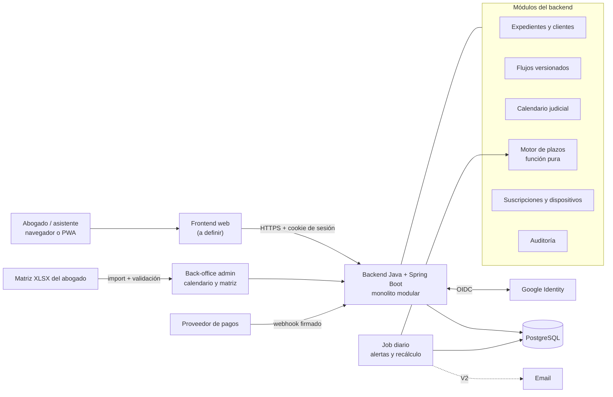

# Análisis de la Documentación y Definiciones Pendientes (V1)

**Estado:** borrador para revisión · **Fecha:** 10/11/2026

Este documento revisa los cuatro documentos del proyecto (visión, lógica de plazos, modelo de datos y UI/UX), registra las decisiones ya tomadas y lista lo que falta definir para empezar a desarrollar la V1.

Convención: **[LEGAL]** = lo debe resolver el equipo legal · **[PRODUCTO]** = decisión de producto · **[TÉCNICO]** = decisión de arquitectura/ingeniería.

---

## 1. Resumen

La base de producto es buena: el alcance de la V1 es acotado, la separación entre la "receta" procesal y el expediente concreto es correcta y el foco en el plazo de gracia ataca el dolor real del abogado. Pero **todavía no alcanza para empezar a desarrollar**. Hay tres bloqueantes:

1. **La matriz de flujos del fuero laboral está incompleta.** Hay 5 filas de ejemplo, dos mal armadas, y no se define qué régimen procesal (Ley 11.653 o Ley 15.057) aplica en cada departamento judicial. **[LEGAL]**
2. **El motor de plazos tenía errores y casos sin definir.** Se corrigió en `logica_matematica_calculadora_de_dias_habiles_judiciales.md`, pero quedan cinco reglas jurídicas por confirmar (sección 4 de ese documento). **[LEGAL]**
3. **Faltan definiciones técnicas y de cumplimiento:** hosting, frontend, modelo de suscripción final y el plan para las normas ISO. **[TÉCNICO] [PRODUCTO]**

---

## 2. Registro de decisiones

| Tema | Decisión | Estado |
| ----- | ----- | ----- |
| Backend | Java + Spring Boot | Decidido |
| Base de datos | PostgreSQL | Decidido (ya estaba recomendado) |
| Autenticación | Login con Google (OIDC) para la V1 | Decidido, con las condiciones de la sección 8 |
| Hosting | — | A definir (criterios en la sección 7.3) |
| Frontend | — | A definir (propuesta: React como PWA) |
| Modelo de negocio | Suscripción por usuario con una sesión por dispositivo | En revisión (recomendación en la sección 9) |
| Cumplimiento | Ley 25.326 + ISO/IEC 27034, 27001 + 27017 y 27701. **Objetivo: cumplir, sin certificar por ahora.** | Decidido; falta el plan (sección 10) |
| Motor de plazos | Solo en el backend, función pura, principio de "vencimiento más temprano ante la duda" | Corregido en el documento de lógica |

---

## 3. Errores e inconsistencias detectados

| # | Problema | Dónde | Estado |
| ----- | ----- | ----- | ----- |
| E1 | El plazo de gracia figuraba como "12:00 AM" (medianoche). Es 12:00 hs del mediodía. | Lógica de plazos | Corregido |
| E2 | La firma del pseudocódigo era inválida y la prórroga manual nunca se sumaba al plazo. | Lógica de plazos | Corregido |
| E3 | El algoritmo ignoraba `Aplica_Gracia` y `Plazo_Tipo` (corridos). | Lógica de plazos | Corregido |
| E4 | Con plazo 0 devolvía como vencimiento el mismo Día Cero. | Lógica de plazos | Corregido (`SIN_VENCIMIENTO`) |
| E5 | Usaba "feriados del año": fallaba en plazos que cruzan de año (diciembre → feria de enero → febrero). Tampoco contemplaba un año sin cargar. | Lógica de plazos | Corregido (`cubierto_hasta` y `CALENDARIO_NO_CARGADO`) |
| E6 | El Ejemplo 1 decía "sin feriados", pero salteaba el lunes 17/06/2024 (feriado). Sin feriados el resultado correcto es el 17/06. | Lógica de plazos | Corregido (casos 1 y 2) |
| E7 | El Ejemplo 2 usaba un feriado que caía domingo, así que no probaba nada, y el día de gracia (28/03/2024) era Jueves Santo. | Lógica de plazos | Corregido (casos 3 y 3b) |
| E8 | La tabla de ejemplo de la matriz tiene las filas `LAB_010` y `LAB_030` corridas una columna: falta el valor de `Aplica_Gracia`, así que "LCT" queda en esa columna y la condición de salida en `Base_Normativa`. | Documentación de proyecto, sección 5 | Corregido (ejemplo reemplazado por la matriz completa) |
| E9 | La matriz referencia IDs que no existen (`LAB_020`, `LAB_040`, `LAB_060`, `LAB_070`, `LAB_080`). | Documentación de proyecto, sección 5 | Corregido (el importador y la planilla validan las referencias) |
| E10 | La instrucción dice "mismo ID con distinto Paso Siguiente", pero el ejemplo usa `LAB_050-A/B/C`. En la base de datos es un nodo con tres transiciones. | Proyecto vs. modelo de datos | Corregido (formato de dos hojas: `Nodos` y `Transiciones`) |
| E11 | El vencimiento se muestra "a las 23:59 hs", pero el horario judicial documentado es de 08:00 a 14:00. | Lógica de plazos y UI | Pendiente (regla R3) |
| E12 | Tabla de feriados con dos nombres: `feriados_judiciales` y `holidays_calendar`. | Lógica vs. modelo de datos | Corregido (se unifica en `holidays_calendar`) |
| E13 | El proyecto dice que el rol adapta la responsabilidad dentro de un mismo flujo; la UI dice que el rol "define qué diagrama de flujo se carga". | Proyecto vs. UI | Pendiente **[PRODUCTO]**. La matriz propone un flujo único con `Rol_Responsable` por hito. |
| E14 | La separación plantilla/instancia no protege los casos en curso: `case_steps` apunta por clave foránea a `flow_nodes`, así que editar un nodo cambia nombre, checklist y transiciones de los expedientes vivos, y borrarlo rompe la referencia. | Modelo de datos, sección 4 | Corregido (`flow_versions` inmutables) |
| E15 | "Agregar inhábil manual a nivel cuenta" (Pantalla 4) no tiene tabla en el modelo. | UI vs. modelo de datos | Corregido (`holidays_calendar` con alcance `ORGANIZACION`) |
| E16 | El proyecto permite "retroceder" de etapa; la UI solo ofrece "Saltear". | Proyecto vs. UI | Pendiente **[PRODUCTO]** |
| E17 | La carga la hace "abogado/asistente", pero el modelo tiene un solo usuario por cartera. | Proyecto vs. modelo de datos | Corregido (`organizations` y `memberships`) |
| E18 | El modelo tiene `password_hash`; con login de Google no se guardan contraseñas. | Modelo de datos | Corregido (`user_identities`) |

---

## 4. Definiciones de dominio pendientes **[LEGAL]**

1. **Régimen procesal por departamento.** Ley 11.653 (Tribunales de Trabajo de instancia única) frente a Ley 15.057 (juzgados unipersonales y cámara de apelación, de implementación gradual). Cambian el flujo, los plazos y el tipo de órgano. Hace falta una tabla que diga qué régimen rige en cada departamento judicial y desde qué fecha. **Es el punto más importante a cerrar.**
2. **Matriz completa del fuero laboral PBA**, para el régimen o los regímenes que entren en la V1. Ya hay un borrador para la Ley 11.653 (`matriz_flujo_laboral_pba_ley_11653.xlsx`, 38 hitos y 76 transiciones) con 23 preguntas abiertas. Falta que el equipo legal lo valide, responda las preguntas y firme la versión. También hay que definir responsable y fecha de entrega.
3. **Las cinco reglas del motor de plazos** (R1 a R5, sección 4 del documento de lógica): notificación en día inhábil, plazos corridos que terminan en inhábil, hora límite del vencimiento ordinario, inhábiles variables (Jueves Santo, 24/12, 31/12) y determinación del Día Cero según la forma de notificación.
4. **Tipos de plazo que faltan.**
   - Hábiles administrativos, para la etapa prejudicial (intimaciones de la LCT y la Ley 24.013), que no siguen el calendario judicial.
   - Meses y años: la prescripción de 2 años (art. 256 LCT). Hoy el ejemplo `LAB_030` la cita con plazo 0, y es el vencimiento más caro de perder.
   - Horas.
   - **Fecha fijada** (`FECHA_FIJADA`): actos con fecha y hora que fija el tribunal, como la audiencia de vista de causa. La alerta es la fecha misma.
   - **Plazos hacia atrás**: plazos que se cuentan antes de una fecha fijada, por ejemplo la anticipación para citar testigos antes de la audiencia.

   Para cada uno: ¿entra en la V1? La matriz de ejemplo ya usa `HABILES_ADMINISTRATIVOS`, `ANIOS` y `FECHA_FIJADA`, marcados como pendientes de soporte en el motor.
5. **Calendario.**
   - Asuetos por departamento judicial.
   - Días no laborables y feriados puente.
   - Habilitación de feria.
   - Quién carga las acordadas extraordinarias y en cuánto tiempo.
6. **Plazos simultáneos.** En la práctica corren varios plazos a la vez (por ejemplo, distintas pruebas). Hay que definir si la V1 muestra un solo "hito actual" o varios en paralelo. **Propuesta:** caminos en paralelo mediante transiciones con la misma condición y varios destinos (documento de proyecto, sección 4, y modelo de datos, `flow_transitions`). La ficha del expediente tendría que mostrar varios hitos activos a la vez.
7. **Plazos sueltos.** Las intimaciones del juzgado ("en 5 días acompañe…") no están en ningún flujo, pero el abogado necesita cargarlas.
8. **Plazos de la contraparte.** Si represento a la actora, ¿veo cuándo vence la contestación de la demandada para pedir la rebeldía?
9. **Casos borde** (incluir o excluir explícitamente de la V1):
   - plazos comunes con varios demandados;
   - ampliación por distancia;
   - suspensión de plazos por acuerdo de partes.
10. **Plazo vencido sin cumplir.** Qué estado tiene y qué muestra la app.

---

## 5. Modelo de datos

**Incorporado en `modelo_de_base_de_datos_relacional.md`.** El modelo pasó de tres a seis dominios:

| Dominio | Tablas |
| ----- | ----- |
| Identidad y acceso | `users` (sin contraseña), `user_identities`, `organizations`, `memberships`, `user_devices`, `user_sessions` |
| Suscripciones | `plans`, `subscriptions`, `payment_events` |
| Catálogos | `jurisdictions`, `judicial_departments`, `legal_branches`, `procedural_regimes`, `department_regimes`, `courts`, `holidays_calendar`, `calendar_coverage` |
| Motor de flujos | `flows`, `flow_versions`, `flow_nodes`, `flow_node_checklist_items`, `flow_transitions` |
| Datos del estudio | `clients`, `legal_cases`, `case_parties`, `case_steps`, `case_step_checklist_items` |
| Auditoría | `audit_events` |

Decisiones que se tomaron al detallar el modelo y conviene revisar:

1. **El tenant es siempre el estudio.** Un abogado independiente tiene un estudio de tipo `INDIVIDUAL` con un solo miembro. Así hay una única regla de aislamiento.
2. **Rol `TITULAR` en el estudio**, además de `ABOGADO` y `ASISTENTE`: es quien gestiona la suscripción y los miembros.
3. **El inhábil manual es del estudio, no del usuario.** El vencimiento de un expediente tiene que ser el mismo para todos los que lo miran.
4. **El checklist se normalizó** en `flow_node_checklist_items` (reemplaza a `checklist_json`), separando tareas y documentación y con un ID estable para tildarlas por expediente.
5. **"Vencido" no se guarda:** se deriva de un paso pendiente con el vencimiento ya pasado.
6. **`case_steps` copia los datos del cálculo** (`term_type`, `applies_grace_period`, `term_value`), así el historial de cada plazo no depende del flujo.
7. **Defensa en profundidad del aislamiento:** claves foráneas compuestas con `organization_id` y Row-Level Security de PostgreSQL recomendada.
8. **Webhooks de pago idempotentes:** `UNIQUE (provider, provider_event_id)` y firma verificada antes de procesar.

---

## 6. UI/UX: qué falta **[PRODUCTO]**

- Inicio de sesión con Google, onboarding (creación del estudio, aceptación de términos y política de privacidad) y perfil.
- **Gestión de dispositivos:** ver dónde está abierta la sesión y cerrarla.
- Gestión de la suscripción: plan, medio de pago, facturas y estado.
- Listado y ficha de **clientes**. En el alta de expediente se debe poder elegir un cliente existente.
- **Alta de un expediente que ya está en curso**, eligiendo la etapa actual. Sin esto el abogado no puede cargar su cartera existente; es crítico para la adopción.
- Vista de plazos vencidos y agenda con los vencimientos propios.
- Deshacer o retroceder una etapa (ver E16).
- Semáforo: hoy dice "2 a 3 días hábiles"; definir el número exacto o hacerlo configurable.
- Pantalla "por qué vence ese día": la lista de días computados que devuelve el motor.
- Aviso legal ("herramienta de ayuda; verificá el plazo") y la leyenda "calendario actualizado al dd/mm".
- Alerta bloqueante cuando el calendario no está cargado (`CALENDARIO_NO_CARGADO`).
- Exportación de los datos del usuario (portabilidad, Ley 25.326 e ISO 27701).
- Estados vacíos, mensajes de error y accesibilidad.

---

## 7. Arquitectura y definiciones técnicas

### 7.1 Estado de las definiciones

| Definición | Estado / propuesta |
| ----- | ----- |
| Backend | **Java + Spring Boot** (decidido). Monolito modular para la V1. |
| Frontend | A definir. Propuesta: React como PWA (web responsive instalable); app nativa más adelante. |
| Base de datos | PostgreSQL gestionado, con migraciones versionadas (Flyway o Liquibase). |
| Autenticación | **Google OIDC** con Spring Security y sesión propia del backend (sección 8). |
| Motor de plazos | Módulo Java puro dentro del backend. El frontend pide la vista previa a la API. |
| Tareas programadas | Job diario que recalcula alertas y vencimientos tras cambios de calendario. En la V2 envía emails. |
| Back-office | Carga del calendario e importación de la matriz (XLSX → validación → publicación de una versión). Solo para el rol `ADMIN`, con MFA obligatorio. |
| Pagos | Proveedor externo con checkout alojado (por ejemplo, Mercado Pago Suscripciones). Facturación electrónica ante ARCA. |
| Hosting | A definir (sección 7.3). |
| Entornos y CI/CD | dev / stg / prod. Pipeline con build, tests, análisis de seguridad (SAST y dependencias) y despliegue. Infraestructura como código. |
| Observabilidad | Logs estructurados sin datos personales, métricas, trazas y alertas. |
| API | REST versionada (`/api/v1`), contrato OpenAPI, validación de entrada y paginación. |

### 7.2 Diagrama de arquitectura (propuesta V1)

### 7.3 Criterios para elegir el hosting

1. Certificaciones **ISO/IEC 27001, 27017 y 27018** del proveedor, verificadas en su portal de cumplimiento. Son la base del modelo de responsabilidad compartida que exige la 27017.
2. Región y **transferencia internacional de datos**. Si los datos quedan fuera de Argentina (por ejemplo, en la región de San Pablo), la Ley 25.326 exige que el país tenga nivel de protección adecuado o que existan cláusulas contractuales. A validar con asesoría legal.
3. PostgreSQL gestionado con backups automáticos y restauración a un punto en el tiempo.
4. Gestión de claves (KMS) y cifrado en reposo.
5. Costo para el volumen de la V1 y conocimiento del equipo.

Las opciones naturales son AWS, Google Cloud y Azure. Ninguna es obligatoria por usar Google como proveedor de identidad.

Además hay que fijar los objetivos de recuperación (RPO / RTO) y la disponibilidad esperada.

---

## 8. Autenticación con Google: evaluación

**Veredicto: sí, es una buena opción para la V1**, siempre que se cumplan las condiciones de esta sección.

**A favor**
- No se guardan contraseñas: se elimina una superficie de ataque entera (hash, recuperación, fuerza bruta).
- La verificación en dos pasos la provee Google.
- Compartir la cuenta es más difícil, porque implica entregar la cuenta de Google entera. Eso ayuda al modelo de suscripción.
- Se implementa rápido con Spring Security.

**Riesgos**
- **No se puede exigir MFA** a cuentas personales de Gmail; depende de cada usuario. La app debería recomendarlo en el onboarding.
- **Dependencia de un solo proveedor.** Si Google suspende la cuenta del abogado, pierde acceso a sus vencimientos. Hay que definir un proceso de recuperación verificado por soporte.
- Algunos estudios usan Microsoft 365. Conviene dejar el modelo listo (`user_identities`) para sumar Microsoft en una V1.x.

**Condiciones de implementación**
1. Flujo *Authorization Code* con PKCE mediante `spring-boot-starter-oauth2-client`. Nunca el flujo implícito.
2. Validar el ID token: firma, `iss`, `aud` (el client ID propio) y `exp`. Spring Security lo hace; no desactivarlo.
3. Identificar al usuario por `sub`, no por email, y exigir `email_verified = true`.
4. Pedir solo los scopes `openid email profile`. No guardar los access ni refresh tokens de Google si no se usan.
5. La app emite **su propia sesión**: cookie `__Host-` con `HttpOnly`, `Secure` y `SameSite=Lax`, protección CSRF, expiración por inactividad y revocación desde el servidor. No usar `localStorage` para la sesión.
6. El client secret de Google vive en el gestor de secretos del hosting, nunca en el repositorio.
7. El back-office de administración exige MFA siempre. Si el admin entra con Google, usar una cuenta de Google Workspace con 2SV obligatoria por política.

---

## 9. Modelo de suscripción: recomendación

Entiendo la propuesta como **una suscripción por usuario que permite una sola sesión activa a la vez**: si el abogado entra desde otro dispositivo, se cierra la anterior.

**Es demasiado restrictivo para este uso.** El abogado trabaja en la PC del estudio, pero consulta los vencimientos desde el celular en tribunales o desde su casa. Si cada cambio de dispositivo lo desconecta, la fricción diaria genera reclamos y bajas. Además, la protección contra cuentas compartidas ya la da en buena parte el login con Google.

**Recomendación**

1. **Plan Individual:** una suscripción por usuario con hasta **2 o 3 dispositivos simultáneos** (por ejemplo, una computadora y un celular).
   - Al superar el límite, se cierra la sesión más antigua con un aviso.
   - El usuario ve y revoca sus dispositivos desde su perfil.
   - Detección básica de abuso: muchos dispositivos nuevos en poco tiempo o ubicaciones incompatibles.
2. **Plan Estudio:** precio por usuario (*seat*), con cartera compartida y asistentes. El asistente es el usuario que más carga datos, así que este plan resuelve el uso compartido de forma legítima en lugar de prohibirlo.
3. **Prueba gratuita** de 14 a 30 días. El abogado necesita tiempo para cargar su cartera y confiar en el cálculo.
4. **Descuento por pago anual.**
5. **Suscripción vencida ≠ bloqueo total.** Durante un período de gracia el usuario mantiene acceso de solo lectura a sus vencimientos y puede exportar sus datos. Cortar de golpe el acceso a plazos procesales expone al cliente final, y la portabilidad es un requisito de la Ley 25.326 y de la ISO 27701.

Si la propuesta original era otra cosa —una sesión por cada dispositivo, sin límite de dispositivos—, ese esquema no restringe nada y no protege contra cuentas compartidas.

---

## 10. Seguridad, privacidad y cumplimiento

### 10.1 Alcance: cumplir, sin certificar

**Decisión:** el objetivo es **cumplir** las normas, es decir, diseñar, desarrollar y operar según sus controles. En principio **no se va a certificar** (no habrá auditoría externa).

Qué implica:

- **Los controles se aplican igual.** Todo lo de las secciones 10.3 a 10.6 sigue vigente; lo único que cambia es que no hay un auditor que lo verifique.
- **El cumplimiento se demuestra con una autoevaluación interna.**
  - Hay que designar un responsable de seguridad y privacidad (puede ser una persona del equipo con otro rol).
  - Se mantiene una declaración de aplicabilidad interna: qué controles aplican y cuáles no, con el motivo.
  - Se revisa al menos una vez por año y ante cada cambio importante.
- **Se guarda la evidencia de todos modos:** auditoría, revisiones de código, resultados de los análisis de seguridad, pruebas de restauración de backups e incidentes. Los estudios más grandes pueden pedirla al contratar, y deja abierta la puerta a certificar más adelante sin rehacer trabajo.
- **Comunicación comercial.** Sin certificado no se puede decir que la app está "certificada ISO". Lo correcto es algo como "desarrollada siguiendo los lineamientos de ISO/IEC 27001, 27017, 27034 y 27701". Conviene validar la redacción con el área legal.
- **Al hosting sí se le exigen sus certificaciones** (sección 7.3). Ese es un requisito sobre el proveedor, no una certificación propia.

### 10.2 Roles frente a los datos personales

- **Datos de los abogados** (usuarios, suscripción, uso): la empresa es **responsable del tratamiento**.
- **Datos de los clientes del abogado** (nombre, DNI/CUIT, contacto, datos del juicio): el abogado es el responsable y la app es **encargada del tratamiento**. Esto requiere un contrato de encargo dentro de los términos y condiciones.
- **Datos sensibles:** los juicios laborales pueden incluir datos de salud (accidentes, enfermedades). Si hay notas o adjuntos libres, aplica el régimen de datos sensibles de la Ley 25.326. Además rige el **secreto profesional** del abogado.

### 10.3 Ley 25.326 (Protección de Datos Personales)

- Inscripción de las bases de datos ante la AAIP.
- Política de privacidad y consentimiento informado.
- Derechos de acceso, rectificación y supresión, con un procedimiento y plazos de respuesta.
- Transferencia internacional de datos (ver criterios de hosting).
- Medidas de seguridad y confidencialidad.

### 10.4 ISO/IEC 27001 + ISO/IEC 27017 (seguridad de la información y nube)

**Organización (SGSI)**
- Alcance del sistema de gestión.
- Análisis y tratamiento de riesgos.
- Declaración de aplicabilidad de los controles del Anexo A.
- Políticas: acceso, contraseñas y MFA, uso aceptable, backups, gestión de cambios, gestión de incidentes, continuidad del negocio.
- Gestión de proveedores: Google, hosting y pagos.
- Capacitación del equipo.

**Producto**
- Control de acceso por roles con denegación por defecto.
- Aislamiento por organización en cada consulta, con tests que lo prueben.
- Auditoría inmutable.
- Cifrado en tránsito (TLS 1.2+) y en reposo.
- Backups probados con restauraciones periódicas.
- Gestión de vulnerabilidades y parches.
- Monitoreo y alertas.

**27017 (nube)**
- Documentar el modelo de responsabilidad compartida con el hosting.
- Segregación entre entornos y entre clientes.
- Protección de las cuentas administrativas de la nube (MFA y mínimo privilegio).
- Monitoreo de la infraestructura.
- Borrado verificable de los datos cuando un cliente se da de baja.

### 10.5 ISO/IEC 27034 (seguridad de aplicaciones)

Exige integrar la seguridad al ciclo de desarrollo:

- **Marco normativo de la organización:** el conjunto de reglas de desarrollo seguro que aplica a todos los proyectos.
- **Nivel de confianza objetivo de la aplicación:** cuánto riesgo se acepta para esta app.
- **Controles de seguridad por aplicación**, verificables.

En la práctica, para este proyecto:

- requisitos de seguridad en cada historia de usuario, con criterios de aceptación;
- modelado de amenazas (STRIDE) por módulo, empezando por autenticación, aislamiento entre organizaciones, motor de plazos, pagos y back-office;
- revisión de código obligatoria;
- análisis estático (por ejemplo, Semgrep o CodeQL) y de dependencias (por ejemplo, OWASP Dependency-Check) en cada pull request, con los hallazgos críticos bloqueantes;
- análisis dinámico (por ejemplo, OWASP ZAP) en staging;
- secretos solo en el gestor de secretos, con escaneo de secretos en el repositorio;
- prueba de penetración antes del lanzamiento.

### 10.6 ISO/IEC 27701 (gestión de la privacidad)

Extiende el sistema de gestión hacia la privacidad, con controles para el rol de responsable y para el de encargado. Hay que confirmar a qué edición se apunta: la de 2019 es una extensión de 27001/27002; verificar cuál está vigente y tomar esa como referencia para la autoevaluación.

- Registro de actividades de tratamiento.
- Evaluación de impacto en la privacidad para el tratamiento de datos de clientes y datos sensibles.
- Privacidad desde el diseño: minimización (no pedir datos que no se usan) y seudonimización en logs y analítica.
- Política de retención y borrado: cuánto se guarda un expediente cerrado, purga automática y borrado al terminar la suscripción (luego del período de exportación).
- Atención de derechos de los titulares y exportación de datos.
- Notificación de incidentes de privacidad.
- Contratos con subencargados (hosting, Google, pagos) y su publicación en la política de privacidad.

---

## 11. Mejoras propuestas

1. **Pasar a la V1 al menos un resumen diario por email** o la exportación a calendario. La propuesta de valor es "que no se te pase un plazo"; con alertas solo dentro de la app, si el abogado no la abre no se entera.
2. **Reemplazar "+1 día hábil" por "marcar día inhábil"**, con fecha y motivo, por caso o por departamento. Es más preciso, queda auditado y le sirve a todos los usuarios de ese departamento. Además, "prórroga" tiene otro significado procesal y conviene no usar esa palabra.
3. **Construir primero el motor de plazos** como módulo aislado, guiado por los tests del documento de lógica, antes que cualquier pantalla.
4. **Entregar la matriz en dos hojas**, nodos y transiciones, que se corresponden uno a uno con la base de datos. Así se evita la regla de duplicar filas y errores como E8. El importador debe rechazar nodos huérfanos, IDs inexistentes, flujos sin nodo inicial y ciclos no permitidos. *Aplicado: formato y validaciones en la sección 4 del documento de proyecto y en la planilla.*
5. **Alertar la prescripción de 2 años** desde la fecha del despido.
6. **Registrar la fecha de presentación** al completar un hito, como respaldo ante un reclamo.

---

## 12. Checklist "listo para desarrollar"

| # | Ítem | Responsable | Estado |
| ----- | ----- | ----- | ----- |
| 1 | Régimen procesal por departamento judicial (11.653 / 15.057) | [LEGAL] | Pendiente |
| 2 | Matriz completa del fuero laboral, en formato de dos hojas, firmada | [LEGAL] | Borrador listo (Ley 11.653); pendiente de validación |
| 3 | Confirmación de las reglas R1 a R5 del motor de plazos | [LEGAL] | Pendiente |
| 4 | Calendario judicial 2026–2027 cargado y validado | [LEGAL] / Operaciones | Pendiente |
| 5 | Decisión sobre un flujo único con responsable por hito o un flujo por rol (E13) | [PRODUCTO] | Pendiente |
| 6 | Alcance de la V1: plazos simultáneos, plazos sueltos, prescripción, retroceder etapa, email | [PRODUCTO] | Pendiente |
| 7 | Modelo de suscripción final y proveedor de pagos | [PRODUCTO] | En revisión |
| 8 | Responsable de seguridad y privacidad designado, y autoevaluación inicial con la declaración de aplicabilidad | [PRODUCTO] | Pendiente (se decidió cumplir sin certificar) |
| 9 | Frontend (framework, PWA o nativa) | [TÉCNICO] | Pendiente |
| 10 | Hosting y región, según los criterios de la sección 7.3 | [TÉCNICO] | Pendiente |
| 11 | Modelo de datos actualizado con los cambios de la sección 5 | [TÉCNICO] | Hecho, en revisión |
| 12 | Contrato de API (OpenAPI) de la V1 | [TÉCNICO] | Pendiente |
| 13 | Modelado de amenazas inicial y declaración de aplicabilidad ISO | [TÉCNICO] | Pendiente |
| 14 | Términos y condiciones, política de privacidad y contrato de encargo | [LEGAL] | Pendiente |
| 15 | Backlog de historias con criterios de aceptación | [PRODUCTO] | Pendiente |
| 16 | Motor de plazos con los tests del documento de lógica en verde | [TÉCNICO] | Pendiente |
