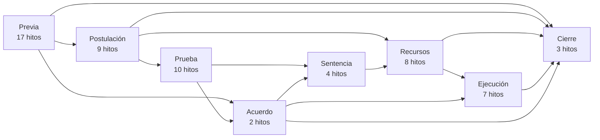
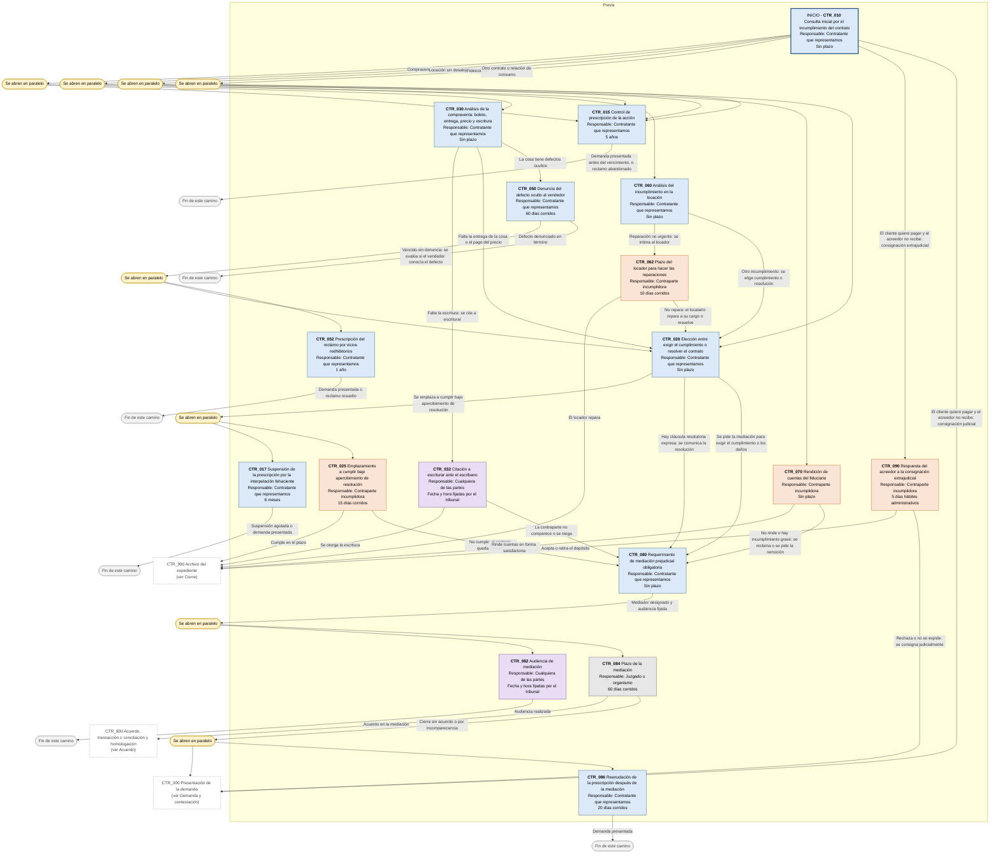
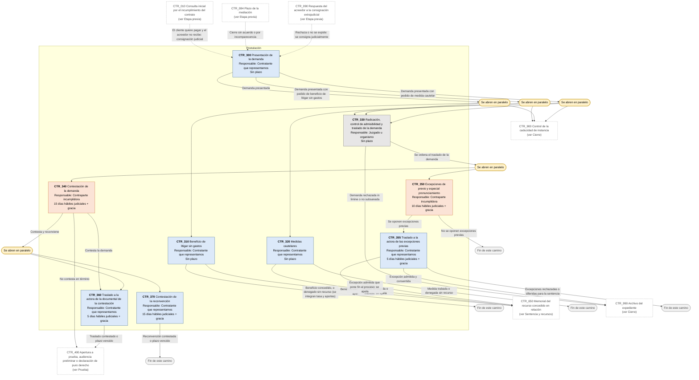
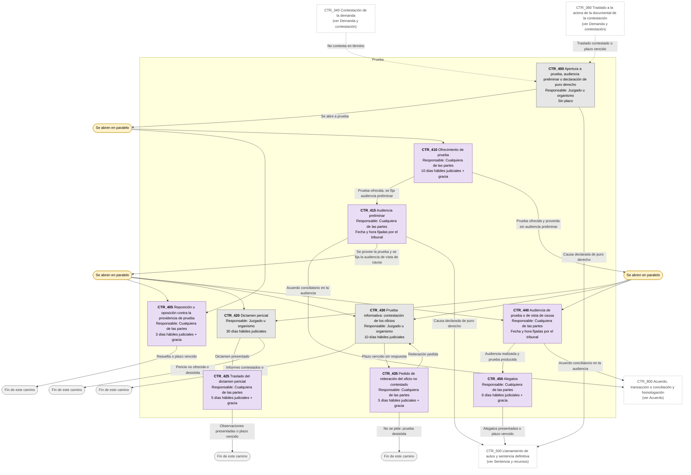
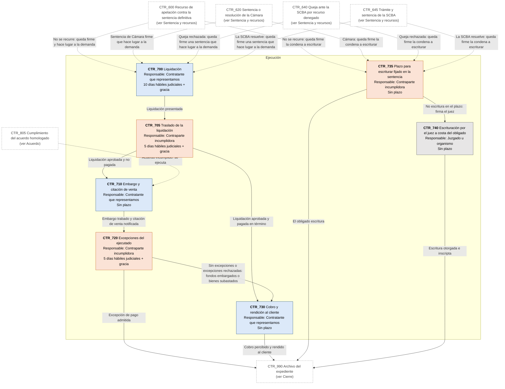
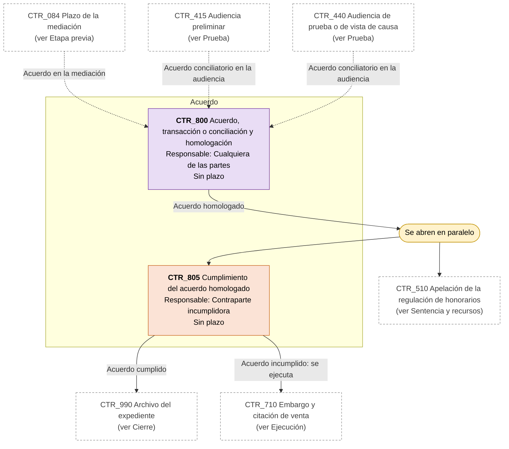

# Diagrama de Flujo: Incumplimiento contractual (compraventa, locación sin desalojo y fideicomiso) - Provincia de Buenos Aires

**Régimen:** CPCCBA (Decreto-Ley 7425/68), juicio ordinario (art. 319); CCyC arts. 1031, 1077 a 1090, 1137 a 1171, 1201, 1666 a 1678; Ley 13.951 (mediación); Ley 24.240 · **Versión:** 1 (borrador)

> Este documento se genera a partir de `matriz_civil_contratos_pba.xlsx`. No se edita a mano: las correcciones se hacen en la planilla y luego se vuelve a generar el diagrama.

## Cómo leer los diagramas

* **Cada caja es un hito** de la hoja `Nodos`: muestra el ID, el nombre, quién debe actuar y el plazo.
* **Cada flecha es un camino** de la hoja `Transiciones`, rotulado con su condición de salida.
* **Color de la caja según el responsable:** celeste = el contratante que reclama y al que representamos: comprador, vendedor, locatario, fiduciante, beneficiario o deudor que consigna (ACTORA); naranja = la contraparte incumplidora o el acreedor que no recibe el pago (DEMANDADA); gris = el juzgado, el mediador, el escribano o un registro (TRIBUNAL); violeta = cualquiera de las partes (AMBAS).
* **Borde grueso:** hito inicial o hito final.
* **"Se abren en paralelo"** (amarillo): esa condición abre varios hitos a la vez; por ejemplo, la prescripción queda suspendida por la interpelación mientras corre el emplazamiento para cumplir.
* **"Fin de este camino"** (gris claro): el camino paralelo termina sin abrir otro hito.
* **Cajas blancas con borde discontinuo:** hitos de otra etapa; el texto indica en qué diagrama están. Las flechas punteadas muestran desde dónde se llega a esta etapa.

## Vista general por fases

## 1. Etapa previa

## 2. Demanda y contestación

## 3. Prueba

## 4. Sentencia y recursos

```mermaid
flowchart TD
  subgraph F_0["Sentencia"]
    CTR_500["<b>CTR_500</b> Llamamiento de autos y sentencia definitiva<br/>Responsable: Juzgado u organismo<br/>Sin plazo"]:::tribunal
    CTR_505["<b>CTR_505</b> Aclaratoria<br/>Responsable: Cualquiera de las partes<br/>3 días hábiles judiciales + gracia"]:::ambas
    CTR_510["<b>CTR_510</b> Apelación de la regulación de honorarios<br/>Responsable: Cualquiera de las partes<br/>5 días hábiles judiciales + gracia"]:::ambas
    CTR_515["<b>CTR_515</b> Pago de los honorarios firmes<br/>Responsable: Cualquiera de las partes<br/>10 días hábiles judiciales"]:::ambas
  end
  subgraph F_1["Recursos"]
    CTR_600["<b>CTR_600</b> Recurso de apelación contra la sentencia definitiva<br/>Responsable: Cualquiera de las partes<br/>5 días hábiles judiciales + gracia"]:::ambas
    CTR_610["<b>CTR_610</b> Expresión de agravios<br/>Responsable: Cualquiera de las partes<br/>10 días hábiles judiciales + gracia"]:::ambas
    CTR_615["<b>CTR_615</b> Contestación de la expresión de agravios<br/>Responsable: Cualquiera de las partes<br/>10 días hábiles judiciales + gracia"]:::ambas
    CTR_620["<b>CTR_620</b> Sentencia o resolución de la Cámara<br/>Responsable: Juzgado u organismo<br/>Sin plazo"]:::tribunal
    CTR_630["<b>CTR_630</b> Recursos extraordinarios ante la SCBA<br/>Responsable: Cualquiera de las partes<br/>10 días hábiles judiciales + gracia"]:::ambas
    CTR_640["<b>CTR_640</b> Queja ante la SCBA por recurso denegado<br/>Responsable: Cualquiera de las partes<br/>5 días hábiles judiciales + gracia"]:::ambas
    CTR_645["<b>CTR_645</b> Trámite y sentencia de la SCBA<br/>Responsable: Cualquiera de las partes<br/>10 días hábiles judiciales + gracia"]:::ambas
    CTR_650["<b>CTR_650</b> Memorial del recurso concedido en relación<br/>Responsable: Cualquiera de las partes<br/>5 días hábiles judiciales + gracia"]:::ambas
  end
  EXT_CTR_310_origen["CTR_310 Beneficio de litigar sin gastos<br/>(ver Demanda y contestación)"]:::externo
  EXT_CTR_310_origen -.->|"Beneficio denegado: se apela"| CTR_650
  EXT_CTR_320_origen["CTR_320 Medidas cautelares<br/>(ver Demanda y contestación)"]:::externo
  EXT_CTR_320_origen -.->|"Medida denegada o trabada: se apela"| CTR_650
  EXT_CTR_355_origen["CTR_355 Traslado a la actora de las excepciones previas<br/>(ver Demanda y contestación)"]:::externo
  EXT_CTR_355_origen -.->|"Excepción admitida que pone fin al proceso: se apela"| CTR_650
  EXT_CTR_400_origen["CTR_400 Apertura a prueba, audiencia preliminar o declaración de puro derecho<br/>(ver Prueba)"]:::externo
  EXT_CTR_400_origen -.->|"Causa declarada de puro derecho"| CTR_500
  EXT_CTR_415_origen["CTR_415 Audiencia preliminar<br/>(ver Prueba)"]:::externo
  EXT_CTR_415_origen -.->|"Causa declarada de puro derecho"| CTR_500
  EXT_CTR_450_origen["CTR_450 Alegatos<br/>(ver Prueba)"]:::externo
  EXT_CTR_450_origen -.->|"Alegatos presentados o plazo vencido"| CTR_500
  P_CTR_500_1(["Se abren en paralelo"]):::paralelo
  CTR_500 -->|"Sentencia notificada"| P_CTR_500_1
  P_CTR_500_1 --> CTR_505
  P_CTR_500_1 --> CTR_510
  P_CTR_500_1 --> CTR_600
  FIN_CTR_505_1(["Fin de este camino"]):::fin
  CTR_505 -->|"Aclaratoria resuelta o plazo vencido"| FIN_CTR_505_1
  CTR_510 -->|"Regulación firme"| CTR_515
  FIN_CTR_515_1(["Fin de este camino"]):::fin
  CTR_515 -->|"Honorarios pagados o en ejecución"| FIN_CTR_515_1
  EXT_CTR_700_destino["CTR_700 Liquidación<br/>(ver Ejecución)"]:::externo
  CTR_600 -->|"No se recurre: queda firme y hace lugar a la demanda"| EXT_CTR_700_destino
  EXT_CTR_990_destino["CTR_990 Archivo del expediente<br/>(ver Cierre)"]:::externo
  CTR_600 -->|"No se recurre: queda firme y rechaza la demanda"| EXT_CTR_990_destino
  CTR_600 -->|"Se interpone apelación"| CTR_610
  EXT_CTR_735_destino["CTR_735 Plazo para escriturar fijado en la sentencia<br/>(ver Ejecución)"]:::externo
  CTR_600 -->|"No se recurre: queda firme la condena a escriturar"| EXT_CTR_735_destino
  CTR_610 -->|"Agravios presentados"| CTR_615
  CTR_610 -->|"No expresa agravios: deserción"| CTR_620
  CTR_615 -->|"Contestados o plazo vencido"| CTR_620
  CTR_620 -->|"Sentencia de Cámara firme que hace lugar a la demanda"| EXT_CTR_700_destino
  CTR_620 -->|"Sentencia de Cámara firme que rechaza la demanda"| EXT_CTR_990_destino
  FIN_CTR_620_3(["Fin de este camino"]):::fin
  CTR_620 -->|"Cámara resuelve la apelación de una resolución interlocutoria: sigue el trámite"| FIN_CTR_620_3
  CTR_620 -->|"Se interponen recursos extraordinarios"| CTR_630
  CTR_620 -->|"Cámara: queda firme la condena a escriturar"| EXT_CTR_735_destino
  CTR_630 -->|"Recurso concedido"| CTR_645
  CTR_630 -->|"Recurso denegado"| CTR_640
  CTR_640 -->|"Queja admitida"| CTR_645
  CTR_640 -->|"Queja rechazada: queda firme una sentencia que hace lugar a la demanda"| EXT_CTR_700_destino
  CTR_640 -->|"Queja rechazada: queda firme una sentencia que rechaza la demanda"| EXT_CTR_990_destino
  CTR_640 -->|"Queja rechazada: queda firme la condena a escriturar"| EXT_CTR_735_destino
  CTR_645 -->|"La SCBA resuelve: queda firme una sentencia que hace lugar a la demanda"| EXT_CTR_700_destino
  CTR_645 -->|"La SCBA resuelve: queda firme una sentencia que rechaza la demanda"| EXT_CTR_990_destino
  CTR_645 -->|"La SCBA anula y reenvía para nuevo pronunciamiento"| CTR_620
  CTR_645 -->|"La SCBA resuelve: queda firme la condena a escriturar"| EXT_CTR_735_destino
  CTR_650 -->|"Memorial presentado o plazo vencido"| CTR_620
  EXT_CTR_800_origen["CTR_800 Acuerdo, transacción o conciliación y homologación<br/>(ver Acuerdo)"]:::externo
  EXT_CTR_800_origen -.->|"Acuerdo homologado"| CTR_510
  classDef actora fill:#DCE9F9,stroke:#1F4E79,color:#000
  classDef demandada fill:#FBE3D6,stroke:#C55A11,color:#000
  classDef tribunal fill:#E7E6E6,stroke:#595959,color:#000
  classDef ambas fill:#E9DDF5,stroke:#7030A0,color:#000
  classDef externo fill:#FFFFFF,stroke:#8C8C8C,color:#404040,stroke-dasharray:4 3
  classDef paralelo fill:#FFF2CC,stroke:#BF9000,color:#000
  classDef fin fill:#F2F2F2,stroke:#A6A6A6,color:#404040
```

## 5. Ejecución

## 6. Acuerdo

## 7. Cierre

```mermaid
flowchart TD
  subgraph F_0["Cierre"]
    CTR_900["<b>CTR_900</b> Control de la caducidad de instancia<br/>Responsable: Contratante que representamos<br/>6 meses"]:::actora
    CTR_905["<b>CTR_905</b> Intimación a activar el proceso<br/>Responsable: Contratante que representamos<br/>5 días hábiles judiciales + gracia"]:::actora
    CTR_990["<b>CTR_990</b> Archivo del expediente<br/>Responsable: Cualquiera de las partes<br/>Sin plazo"]:::ambas
  end
  EXT_CTR_025_origen["CTR_025 Emplazamiento a cumplir bajo apercibimiento de resolución<br/>(ver Etapa previa)"]:::externo
  EXT_CTR_025_origen -.->|"Cumple en el plazo"| CTR_990
  EXT_CTR_032_origen["CTR_032 Citación a escriturar ante el escribano<br/>(ver Etapa previa)"]:::externo
  EXT_CTR_032_origen -.->|"Se otorga la escritura"| CTR_990
  EXT_CTR_062_origen["CTR_062 Plazo del locador para hacer las reparaciones<br/>(ver Etapa previa)"]:::externo
  EXT_CTR_062_origen -.->|"El locador repara"| CTR_990
  EXT_CTR_070_origen["CTR_070 Rendición de cuentas del fiduciario<br/>(ver Etapa previa)"]:::externo
  EXT_CTR_070_origen -.->|"Rinde cuentas en forma satisfactoria"| CTR_990
  EXT_CTR_090_origen["CTR_090 Respuesta del acreedor a la consignación extrajudicial<br/>(ver Etapa previa)"]:::externo
  EXT_CTR_090_origen -.->|"Acepta o retira el depósito"| CTR_990
  EXT_CTR_300_origen["CTR_300 Presentación de la demanda<br/>(ver Demanda y contestación)"]:::externo
  EXT_CTR_300_origen -.->|"Demanda presentada"| CTR_900
  EXT_CTR_300_origen -.->|"Demanda presentada con pedido de beneficio de litigar sin gastos"| CTR_900
  EXT_CTR_300_origen -.->|"Demanda presentada con pedido de medida cautelar"| CTR_900
  EXT_CTR_330_origen["CTR_330 Radicación, control de admisibilidad y traslado de la demanda<br/>(ver Demanda y contestación)"]:::externo
  EXT_CTR_330_origen -.->|"Demanda rechazada in limine o no subsanada"| CTR_990
  EXT_CTR_355_origen["CTR_355 Traslado a la actora de las excepciones previas<br/>(ver Demanda y contestación)"]:::externo
  EXT_CTR_355_origen -.->|"Excepción admitida y consentida"| CTR_990
  EXT_CTR_600_origen["CTR_600 Recurso de apelación contra la sentencia definitiva<br/>(ver Sentencia y recursos)"]:::externo
  EXT_CTR_600_origen -.->|"No se recurre: queda firme y rechaza la demanda"| CTR_990
  EXT_CTR_620_origen["CTR_620 Sentencia o resolución de la Cámara<br/>(ver Sentencia y recursos)"]:::externo
  EXT_CTR_620_origen -.->|"Sentencia de Cámara firme que rechaza la demanda"| CTR_990
  EXT_CTR_640_origen["CTR_640 Queja ante la SCBA por recurso denegado<br/>(ver Sentencia y recursos)"]:::externo
  EXT_CTR_640_origen -.->|"Queja rechazada: queda firme una sentencia que rechaza la demanda"| CTR_990
  EXT_CTR_645_origen["CTR_645 Trámite y sentencia de la SCBA<br/>(ver Sentencia y recursos)"]:::externo
  EXT_CTR_645_origen -.->|"La SCBA resuelve: queda firme una sentencia que rechaza la demanda"| CTR_990
  EXT_CTR_720_origen["CTR_720 Excepciones del ejecutado<br/>(ver Ejecución)"]:::externo
  EXT_CTR_720_origen -.->|"Excepción de pago admitida"| CTR_990
  EXT_CTR_730_origen["CTR_730 Cobro y rendición al cliente<br/>(ver Ejecución)"]:::externo
  EXT_CTR_730_origen -.->|"Cobro percibido y rendido al cliente"| CTR_990
  EXT_CTR_735_origen["CTR_735 Plazo para escriturar fijado en la sentencia<br/>(ver Ejecución)"]:::externo
  EXT_CTR_735_origen -.->|"El obligado escritura"| CTR_990
  EXT_CTR_740_origen["CTR_740 Escrituración por el juez a costa del obligado<br/>(ver Ejecución)"]:::externo
  EXT_CTR_740_origen -.->|"Escritura otorgada e inscripta"| CTR_990
  EXT_CTR_805_origen["CTR_805 Cumplimiento del acuerdo homologado<br/>(ver Acuerdo)"]:::externo
  EXT_CTR_805_origen -.->|"Acuerdo cumplido"| CTR_990
  FIN_CTR_900_1(["Fin de este camino"]):::fin
  CTR_900 -->|"Proceso terminado antes del vencimiento"| FIN_CTR_900_1
  CTR_900 -->|"Plazo vencido: se intima a activar el proceso"| CTR_905
  FIN_CTR_905_1(["Fin de este camino"]):::fin
  CTR_905 -->|"Proceso activado en término"| FIN_CTR_905_1
  CTR_905 -->|"No se activa: se decreta la caducidad"| CTR_990
  style CTR_990 stroke-width:3px
  classDef actora fill:#DCE9F9,stroke:#1F4E79,color:#000
  classDef demandada fill:#FBE3D6,stroke:#C55A11,color:#000
  classDef tribunal fill:#E7E6E6,stroke:#595959,color:#000
  classDef ambas fill:#E9DDF5,stroke:#7030A0,color:#000
  classDef externo fill:#FFFFFF,stroke:#8C8C8C,color:#404040,stroke-dasharray:4 3
  classDef paralelo fill:#FFF2CC,stroke:#BF9000,color:#000
  classDef fin fill:#F2F2F2,stroke:#A6A6A6,color:#404040
```

