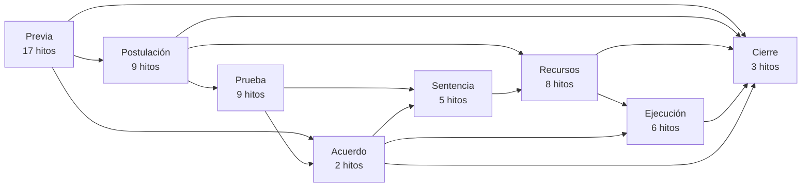
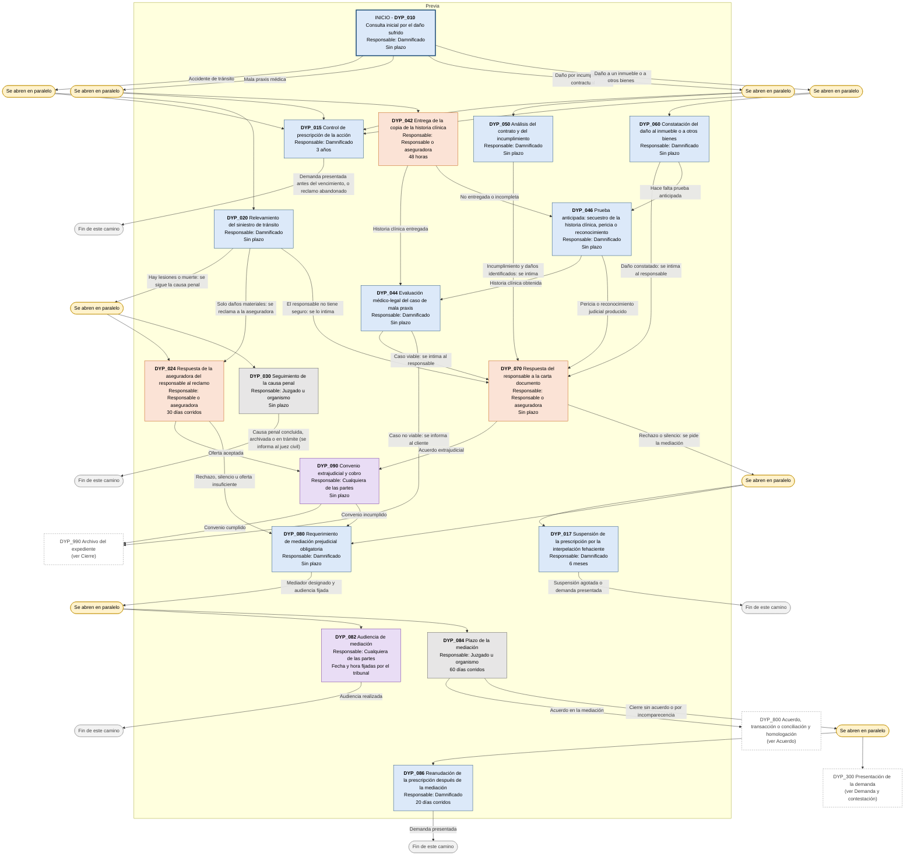
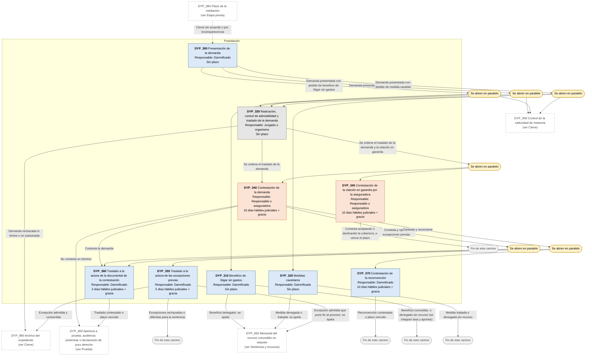
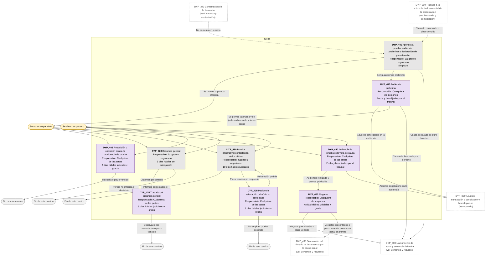
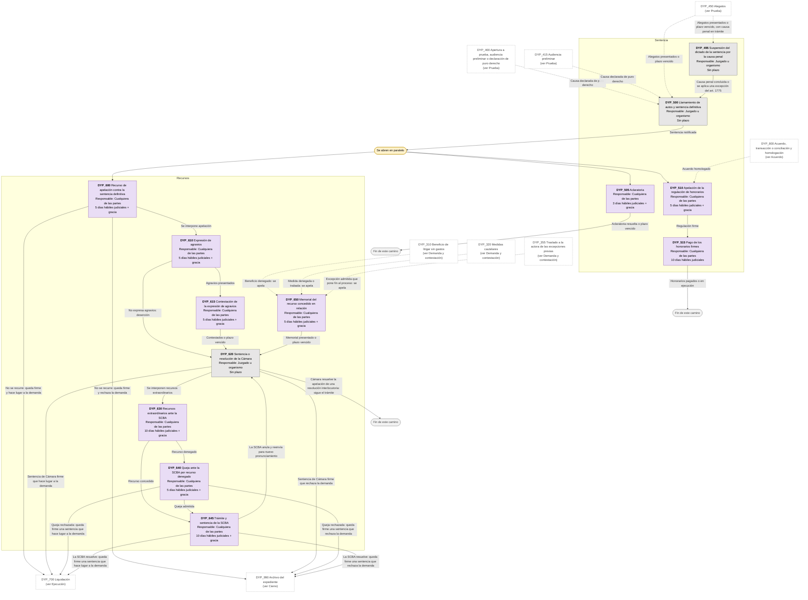
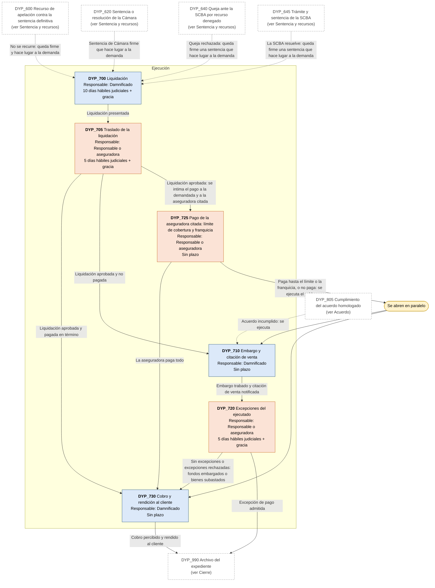
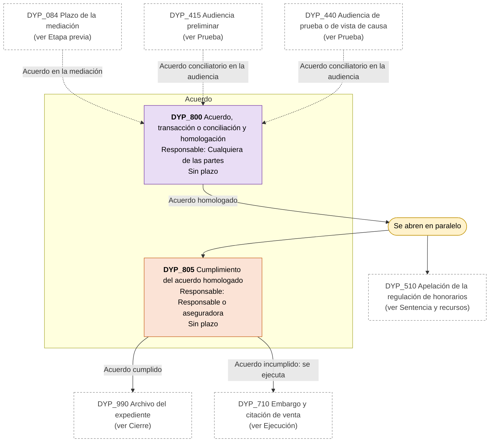

# Diagrama de Flujo: Daños y perjuicios (tránsito, mala praxis, contractual y daños a bienes) - Provincia de Buenos Aires

**Régimen:** CPCCBA (Decreto-Ley 7425/68), juicio sumario (art. 320 inc. 2 k); CCyC arts. 1708 a 1780; Ley 17.418 (art. 118); Ley 13.951 (mediación) · **Versión:** 1 (borrador)

> Este documento se genera a partir de `matriz_civil_danos_y_perjuicios_pba.xlsx`. No se edita a mano: las correcciones se hacen en la planilla y luego se vuelve a generar el diagrama.

## Cómo leer los diagramas

* **Cada caja es un hito** de la hoja `Nodos`: muestra el ID, el nombre, quién debe actuar y el plazo.
* **Cada flecha es un camino** de la hoja `Transiciones`, rotulado con su condición de salida.
* **Color de la caja según el responsable:** celeste = el damnificado que reclama (ACTORA); naranja = el responsable del daño o su aseguradora, también la citada en garantía (DEMANDADA); gris = el juzgado, el mediador o un organismo (TRIBUNAL); violeta = cualquiera de las partes (AMBAS).
* **Borde grueso:** hito inicial o hito final.
* **"Se abren en paralelo"** (amarillo): esa condición abre varios hitos a la vez; por ejemplo, la prescripción de 3 años sigue corriendo mientras se reclama a la aseguradora.
* **"Fin de este camino"** (gris claro): el camino paralelo termina sin abrir otro hito.
* **Cajas blancas con borde discontinuo:** hitos de otra etapa; el texto indica en qué diagrama están. Las flechas punteadas muestran desde dónde se llega a esta etapa.

## Vista general por fases

## 1. Etapa previa

## 2. Demanda y contestación

## 3. Prueba

## 4. Sentencia y recursos

## 5. Ejecución

## 6. Acuerdo

## 7. Cierre

```mermaid
flowchart TD
  subgraph F_0["Cierre"]
    DYP_900["<b>DYP_900</b> Control de la caducidad de instancia<br/>Responsable: Damnificado<br/>3 meses"]:::actora
    DYP_905["<b>DYP_905</b> Intimación a activar el proceso<br/>Responsable: Damnificado<br/>5 días hábiles judiciales + gracia"]:::actora
    DYP_990["<b>DYP_990</b> Archivo del expediente<br/>Responsable: Cualquiera de las partes<br/>Sin plazo"]:::ambas
  end
  EXT_DYP_044_origen["DYP_044 Evaluación médico-legal del caso de mala praxis<br/>(ver Etapa previa)"]:::externo
  EXT_DYP_044_origen -.->|"Caso no viable: se informa al cliente"| DYP_990
  EXT_DYP_090_origen["DYP_090 Convenio extrajudicial y cobro<br/>(ver Etapa previa)"]:::externo
  EXT_DYP_090_origen -.->|"Convenio cumplido"| DYP_990
  EXT_DYP_300_origen["DYP_300 Presentación de la demanda<br/>(ver Demanda y contestación)"]:::externo
  EXT_DYP_300_origen -.->|"Demanda presentada"| DYP_900
  EXT_DYP_300_origen -.->|"Demanda presentada con pedido de beneficio de litigar sin gastos"| DYP_900
  EXT_DYP_300_origen -.->|"Demanda presentada con pedido de medida cautelar"| DYP_900
  EXT_DYP_330_origen["DYP_330 Radicación, control de admisibilidad y traslado de la demanda<br/>(ver Demanda y contestación)"]:::externo
  EXT_DYP_330_origen -.->|"Demanda rechazada in limine o no subsanada"| DYP_990
  EXT_DYP_355_origen["DYP_355 Traslado a la actora de las excepciones previas<br/>(ver Demanda y contestación)"]:::externo
  EXT_DYP_355_origen -.->|"Excepción admitida y consentida"| DYP_990
  EXT_DYP_600_origen["DYP_600 Recurso de apelación contra la sentencia definitiva<br/>(ver Sentencia y recursos)"]:::externo
  EXT_DYP_600_origen -.->|"No se recurre: queda firme y rechaza la demanda"| DYP_990
  EXT_DYP_620_origen["DYP_620 Sentencia o resolución de la Cámara<br/>(ver Sentencia y recursos)"]:::externo
  EXT_DYP_620_origen -.->|"Sentencia de Cámara firme que rechaza la demanda"| DYP_990
  EXT_DYP_640_origen["DYP_640 Queja ante la SCBA por recurso denegado<br/>(ver Sentencia y recursos)"]:::externo
  EXT_DYP_640_origen -.->|"Queja rechazada: queda firme una sentencia que rechaza la demanda"| DYP_990
  EXT_DYP_645_origen["DYP_645 Trámite y sentencia de la SCBA<br/>(ver Sentencia y recursos)"]:::externo
  EXT_DYP_645_origen -.->|"La SCBA resuelve: queda firme una sentencia que rechaza la demanda"| DYP_990
  EXT_DYP_720_origen["DYP_720 Excepciones del ejecutado<br/>(ver Ejecución)"]:::externo
  EXT_DYP_720_origen -.->|"Excepción de pago admitida"| DYP_990
  EXT_DYP_730_origen["DYP_730 Cobro y rendición al cliente<br/>(ver Ejecución)"]:::externo
  EXT_DYP_730_origen -.->|"Cobro percibido y rendido al cliente"| DYP_990
  EXT_DYP_805_origen["DYP_805 Cumplimiento del acuerdo homologado<br/>(ver Acuerdo)"]:::externo
  EXT_DYP_805_origen -.->|"Acuerdo cumplido"| DYP_990
  FIN_DYP_900_1(["Fin de este camino"]):::fin
  DYP_900 -->|"Proceso terminado antes del vencimiento"| FIN_DYP_900_1
  DYP_900 -->|"Plazo vencido: se intima a activar el proceso"| DYP_905
  FIN_DYP_905_1(["Fin de este camino"]):::fin
  DYP_905 -->|"Proceso activado en término"| FIN_DYP_905_1
  DYP_905 -->|"No se activa: se decreta la caducidad"| DYP_990
  style DYP_990 stroke-width:3px
  classDef actora fill:#DCE9F9,stroke:#1F4E79,color:#000
  classDef demandada fill:#FBE3D6,stroke:#C55A11,color:#000
  classDef tribunal fill:#E7E6E6,stroke:#595959,color:#000
  classDef ambas fill:#E9DDF5,stroke:#7030A0,color:#000
  classDef externo fill:#FFFFFF,stroke:#8C8C8C,color:#404040,stroke-dasharray:4 3
  classDef paralelo fill:#FFF2CC,stroke:#BF9000,color:#000
  classDef fin fill:#F2F2F2,stroke:#A6A6A6,color:#404040
```

