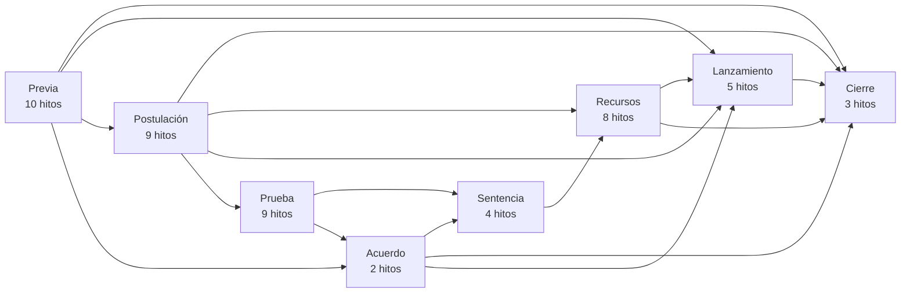
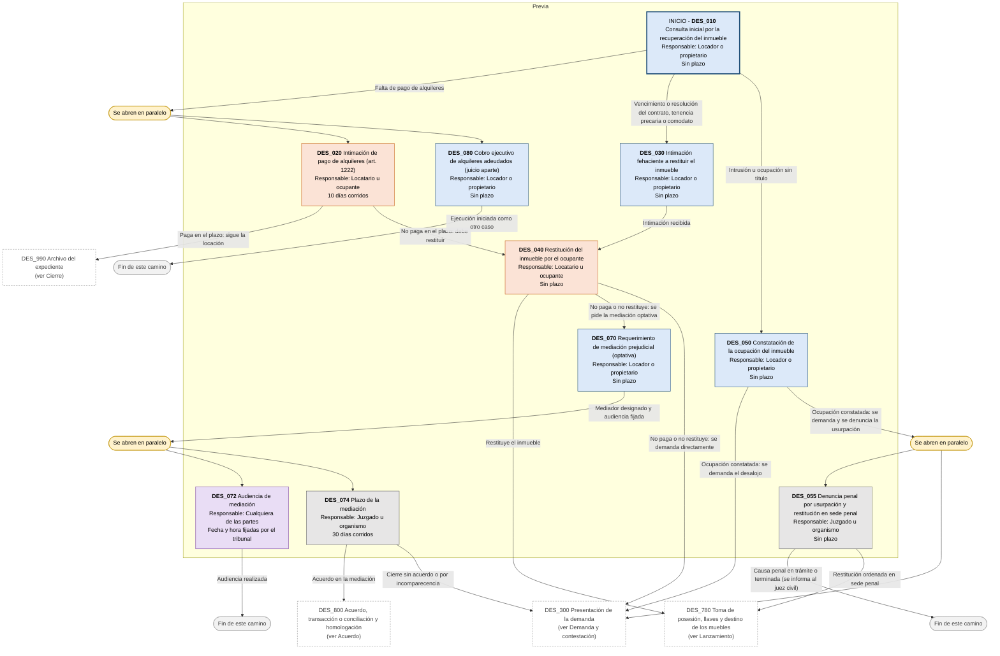
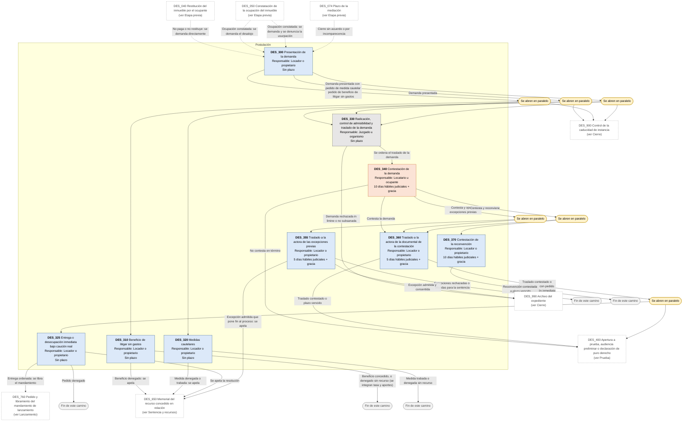
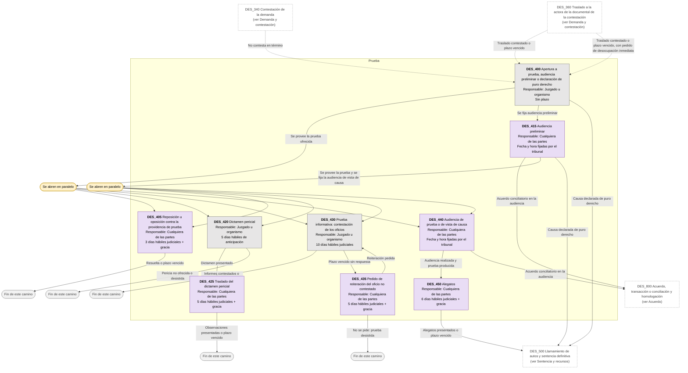
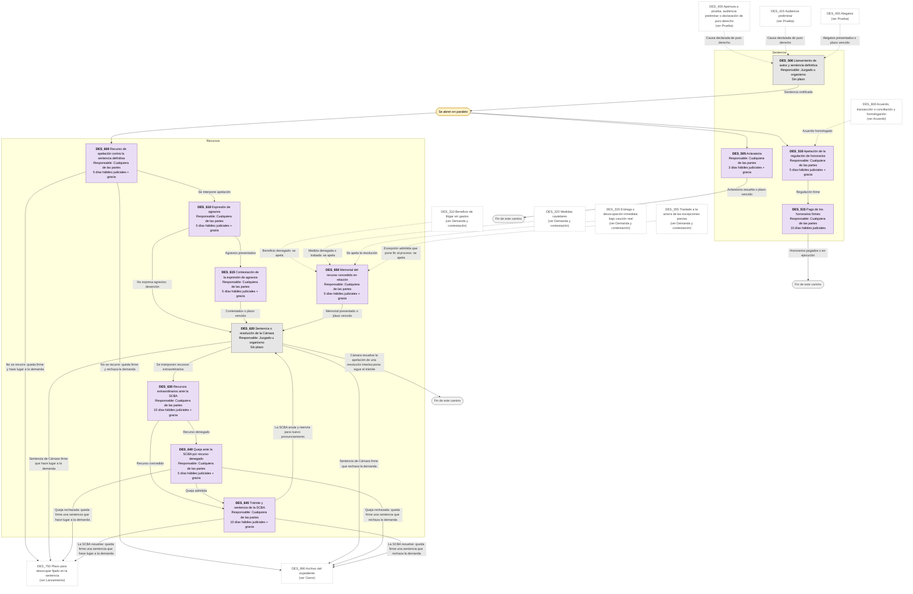
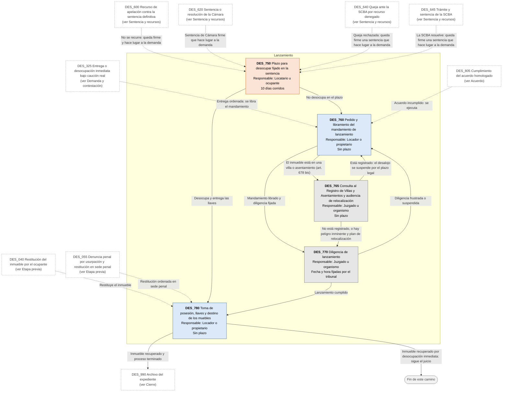
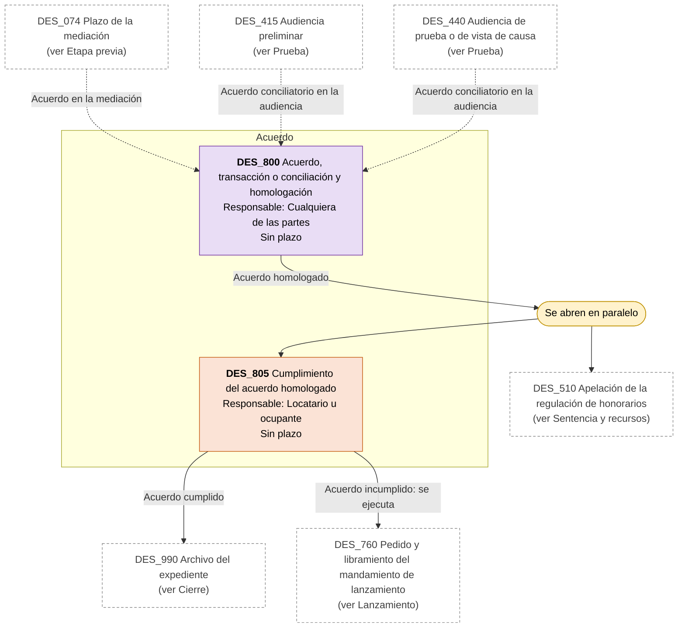

# Diagrama de Flujo: Desalojo de inmuebles (falta de pago, vencimiento, intrusión, tenencia precaria o comodato) - Provincia de Buenos Aires

**Régimen:** CPCCBA (Decreto-Ley 7425/68), juicio sumario (arts. 676 a 678 bis); CCyC arts. 1217 a 1225 (texto según DNU 70/2023, a verificar); Ley 13.951 (mediación optativa) · **Versión:** 1 (borrador)

> Este documento se genera a partir de `matriz_civil_desalojo_pba.xlsx`. No se edita a mano: las correcciones se hacen en la planilla y luego se vuelve a generar el diagrama.

## Cómo leer los diagramas

* **Cada caja es un hito** de la hoja `Nodos`: muestra el ID, el nombre, quién debe actuar y el plazo.
* **Cada flecha es un camino** de la hoja `Transiciones`, rotulado con su condición de salida.
* **Color de la caja según el responsable:** celeste = el locador, propietario o comodante que pide el desalojo (ACTORA); naranja = el locatario, sublocatario, intruso, tenedor precario u otro ocupante (DEMANDADA); gris = el juzgado, el oficial de justicia, el mediador o un organismo (TRIBUNAL); violeta = cualquiera de las partes (AMBAS).
* **Borde grueso:** hito inicial o hito final.
* **"Se abren en paralelo"** (amarillo): esa condición abre varios hitos a la vez; por ejemplo, el cobro ejecutivo de los alquileres adeudados se inicia mientras corre la intimación de pago previa al desalojo.
* **"Fin de este camino"** (gris claro): el camino paralelo termina sin abrir otro hito.
* **Cajas blancas con borde discontinuo:** hitos de otra etapa; el texto indica en qué diagrama están. Las flechas punteadas muestran desde dónde se llega a esta etapa.

## Vista general por fases

## 1. Etapa previa

## 2. Demanda y contestación

## 3. Prueba

## 4. Sentencia y recursos

## 5. Lanzamiento

## 6. Acuerdo

## 7. Cierre

```mermaid
flowchart TD
  subgraph F_0["Cierre"]
    DES_900["<b>DES_900</b> Control de la caducidad de instancia<br/>Responsable: Locador o propietario<br/>3 meses"]:::actora
    DES_905["<b>DES_905</b> Intimación a activar el proceso<br/>Responsable: Locador o propietario<br/>5 días hábiles judiciales + gracia"]:::actora
    DES_990["<b>DES_990</b> Archivo del expediente<br/>Responsable: Cualquiera de las partes<br/>Sin plazo"]:::ambas
  end
  EXT_DES_020_origen["DES_020 Intimación de pago de alquileres (art. 1222)<br/>(ver Etapa previa)"]:::externo
  EXT_DES_020_origen -.->|"Paga en el plazo: sigue la locación"| DES_990
  EXT_DES_300_origen["DES_300 Presentación de la demanda<br/>(ver Demanda y contestación)"]:::externo
  EXT_DES_300_origen -.->|"Demanda presentada"| DES_900
  EXT_DES_300_origen -.->|"Demanda presentada con pedido de beneficio de litigar sin gastos"| DES_900
  EXT_DES_300_origen -.->|"Demanda presentada con pedido de medida cautelar"| DES_900
  EXT_DES_330_origen["DES_330 Radicación, control de admisibilidad y traslado de la demanda<br/>(ver Demanda y contestación)"]:::externo
  EXT_DES_330_origen -.->|"Demanda rechazada in limine o no subsanada"| DES_990
  EXT_DES_355_origen["DES_355 Traslado a la actora de las excepciones previas<br/>(ver Demanda y contestación)"]:::externo
  EXT_DES_355_origen -.->|"Excepción admitida y consentida"| DES_990
  EXT_DES_600_origen["DES_600 Recurso de apelación contra la sentencia definitiva<br/>(ver Sentencia y recursos)"]:::externo
  EXT_DES_600_origen -.->|"No se recurre: queda firme y rechaza la demanda"| DES_990
  EXT_DES_620_origen["DES_620 Sentencia o resolución de la Cámara<br/>(ver Sentencia y recursos)"]:::externo
  EXT_DES_620_origen -.->|"Sentencia de Cámara firme que rechaza la demanda"| DES_990
  EXT_DES_640_origen["DES_640 Queja ante la SCBA por recurso denegado<br/>(ver Sentencia y recursos)"]:::externo
  EXT_DES_640_origen -.->|"Queja rechazada: queda firme una sentencia que rechaza la demanda"| DES_990
  EXT_DES_645_origen["DES_645 Trámite y sentencia de la SCBA<br/>(ver Sentencia y recursos)"]:::externo
  EXT_DES_645_origen -.->|"La SCBA resuelve: queda firme una sentencia que rechaza la demanda"| DES_990
  EXT_DES_780_origen["DES_780 Toma de posesión, llaves y destino de los muebles<br/>(ver Lanzamiento)"]:::externo
  EXT_DES_780_origen -.->|"Inmueble recuperado y proceso terminado"| DES_990
  EXT_DES_805_origen["DES_805 Cumplimiento del acuerdo homologado<br/>(ver Acuerdo)"]:::externo
  EXT_DES_805_origen -.->|"Acuerdo cumplido"| DES_990
  FIN_DES_900_1(["Fin de este camino"]):::fin
  DES_900 -->|"Proceso terminado antes del vencimiento"| FIN_DES_900_1
  DES_900 -->|"Plazo vencido: se intima a activar el proceso"| DES_905
  FIN_DES_905_1(["Fin de este camino"]):::fin
  DES_905 -->|"Proceso activado en término"| FIN_DES_905_1
  DES_905 -->|"No se activa: se decreta la caducidad"| DES_990
  style DES_990 stroke-width:3px
  classDef actora fill:#DCE9F9,stroke:#1F4E79,color:#000
  classDef demandada fill:#FBE3D6,stroke:#C55A11,color:#000
  classDef tribunal fill:#E7E6E6,stroke:#595959,color:#000
  classDef ambas fill:#E9DDF5,stroke:#7030A0,color:#000
  classDef externo fill:#FFFFFF,stroke:#8C8C8C,color:#404040,stroke-dasharray:4 3
  classDef paralelo fill:#FFF2CC,stroke:#BF9000,color:#000
  classDef fin fill:#F2F2F2,stroke:#A6A6A6,color:#404040
```

