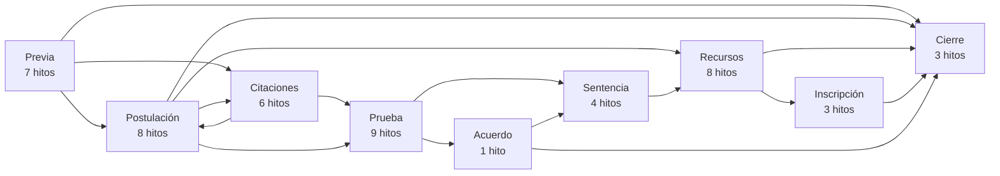
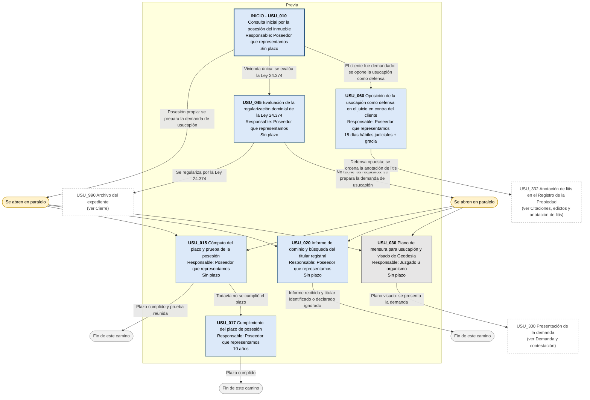
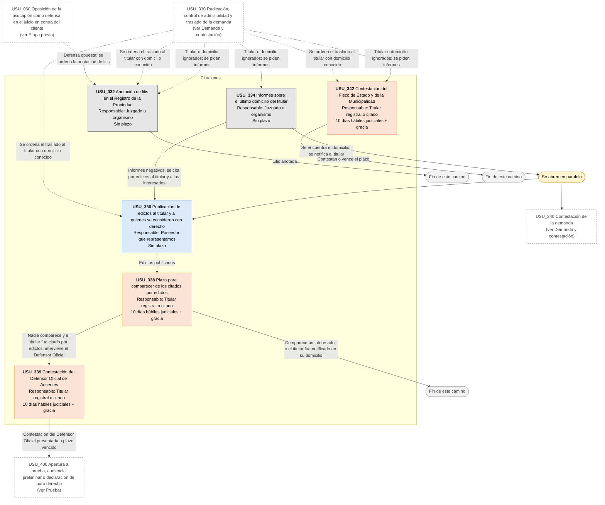
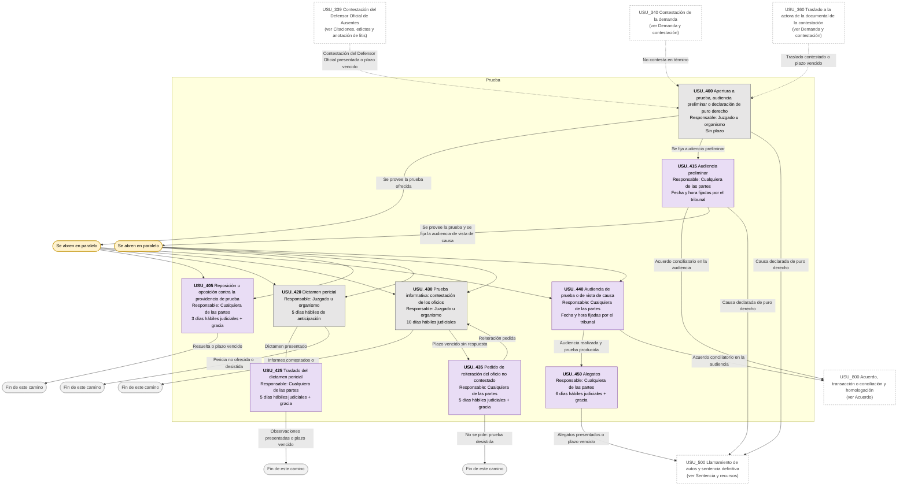
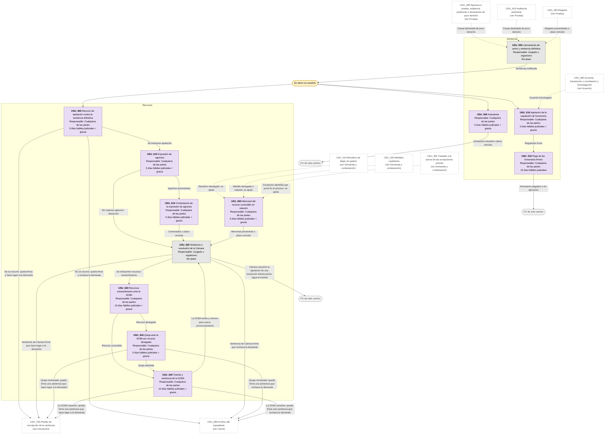
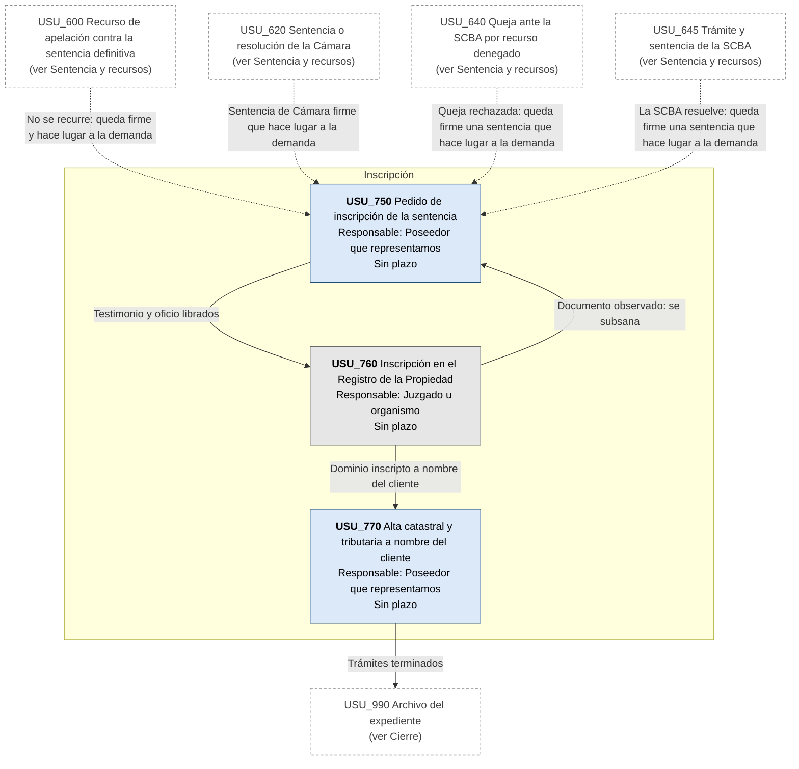
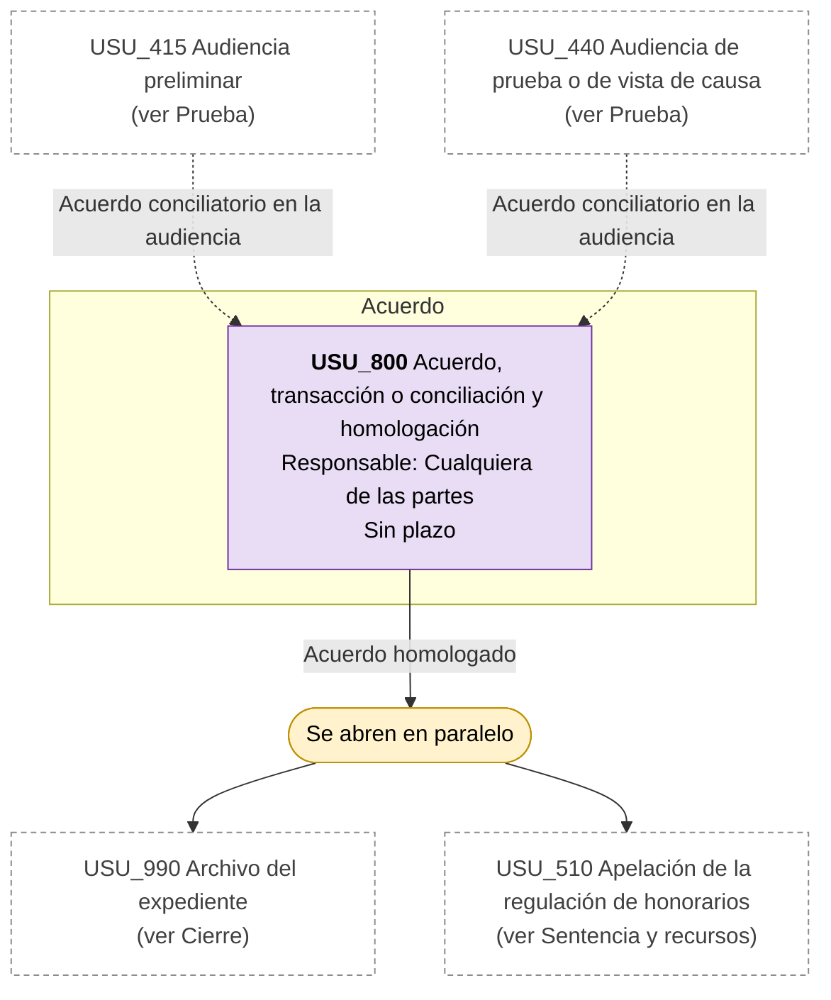

# Diagrama de Flujo: Prescripción adquisitiva de inmuebles (usucapión) - Provincia de Buenos Aires

**Régimen:** CPCCBA (Decreto-Ley 7425/68), juicio sumario con las reglas de los arts. 679 a 682; CCyC arts. 1897 a 1905; Ley 14.159 (art. 24) · **Versión:** 1 (borrador)

> Este documento se genera a partir de `matriz_civil_prescripcion_adquisitiva_pba.xlsx`. No se edita a mano: las correcciones se hacen en la planilla y luego se vuelve a generar el diagrama.

## Cómo leer los diagramas

* **Cada caja es un hito** de la hoja `Nodos`: muestra el ID, el nombre, quién debe actuar y el plazo.
* **Cada flecha es un camino** de la hoja `Transiciones`, rotulado con su condición de salida.
* **Color de la caja según el responsable:** celeste = el poseedor que pide la usucapión y al que representamos (ACTORA); naranja = el titular registral, sus herederos, los citados por edictos, el Defensor Oficial de Ausentes, el Fisco de Estado o la Municipalidad (DEMANDADA); gris = el juzgado o un organismo: Registro de la Propiedad, Geodesia, ARBA (TRIBUNAL); violeta = cualquiera de las partes (AMBAS).
* **Borde grueso:** hito inicial o hito final.
* **"Se abren en paralelo"** (amarillo): esa condición abre varios hitos a la vez; por ejemplo, los edictos al titular y a quienes se consideren con derecho corren mientras se cita al Fisco de Estado y a la Municipalidad.
* **"Fin de este camino"** (gris claro): el camino paralelo termina sin abrir otro hito.
* **Cajas blancas con borde discontinuo:** hitos de otra etapa; el texto indica en qué diagrama están. Las flechas punteadas muestran desde dónde se llega a esta etapa.

## Vista general por fases

## 1. Etapa previa

## 2. Demanda y contestación

```mermaid
flowchart TD
  subgraph F_0["Postulación"]
    USU_300["<b>USU_300</b> Presentación de la demanda<br/>Responsable: Poseedor que representamos<br/>Sin plazo"]:::actora
    USU_310["<b>USU_310</b> Beneficio de litigar sin gastos<br/>Responsable: Poseedor que representamos<br/>Sin plazo"]:::actora
    USU_320["<b>USU_320</b> Medidas cautelares<br/>Responsable: Poseedor que representamos<br/>Sin plazo"]:::actora
    USU_330["<b>USU_330</b> Radicación, control de admisibilidad y traslado de la demanda<br/>Responsable: Juzgado u organismo<br/>Sin plazo"]:::tribunal
    USU_340["<b>USU_340</b> Contestación de la demanda<br/>Responsable: Titular registral o citado<br/>10 días hábiles judiciales + gracia"]:::demandada
    USU_355["<b>USU_355</b> Traslado a la actora de las excepciones previas<br/>Responsable: Poseedor que representamos<br/>5 días hábiles judiciales + gracia"]:::actora
    USU_360["<b>USU_360</b> Traslado a la actora de la documental de la contestación<br/>Responsable: Poseedor que representamos<br/>5 días hábiles judiciales + gracia"]:::actora
    USU_370["<b>USU_370</b> Contestación de la reconvención<br/>Responsable: Poseedor que representamos<br/>10 días hábiles judiciales + gracia"]:::actora
  end
  EXT_USU_030_origen["USU_030 Plano de mensura para usucapión y visado de Geodesia<br/>(ver Etapa previa)"]:::externo
  EXT_USU_030_origen -.->|"Plano visado: se presenta la demanda"| USU_300
  P_USU_300_1(["Se abren en paralelo"]):::paralelo
  USU_300 -->|"Demanda presentada"| P_USU_300_1
  P_USU_300_1 --> USU_330
  EXT_USU_900_destino["USU_900 Control de la caducidad de instancia<br/>(ver Cierre)"]:::externo
  P_USU_300_1 --> EXT_USU_900_destino
  P_USU_300_2(["Se abren en paralelo"]):::paralelo
  USU_300 -->|"Demanda presentada con pedido de beneficio de litigar sin gastos"| P_USU_300_2
  P_USU_300_2 --> USU_330
  P_USU_300_2 --> USU_310
  P_USU_300_2 --> EXT_USU_900_destino
  P_USU_300_3(["Se abren en paralelo"]):::paralelo
  USU_300 -->|"Demanda presentada con pedido de medida cautelar"| P_USU_300_3
  P_USU_300_3 --> USU_330
  P_USU_300_3 --> USU_320
  P_USU_300_3 --> EXT_USU_900_destino
  FIN_USU_310_1(["Fin de este camino"]):::fin
  USU_310 -->|"Beneficio concedido, o denegado sin recurso (se integran tasa y aportes)"| FIN_USU_310_1
  EXT_USU_650_destino["USU_650 Memorial del recurso concedido en relación<br/>(ver Sentencia y recursos)"]:::externo
  USU_310 -->|"Beneficio denegado: se apela"| EXT_USU_650_destino
  FIN_USU_320_1(["Fin de este camino"]):::fin
  USU_320 -->|"Medida trabada o denegada sin recurso"| FIN_USU_320_1
  USU_320 -->|"Medida denegada o trabada: se apela"| EXT_USU_650_destino
  EXT_USU_990_destino["USU_990 Archivo del expediente<br/>(ver Cierre)"]:::externo
  USU_330 -->|"Demanda rechazada in limine o no subsanada"| EXT_USU_990_destino
  P_USU_330_2(["Se abren en paralelo"]):::paralelo
  USU_330 -->|"Se ordena el traslado al titular con domicilio conocido"| P_USU_330_2
  P_USU_330_2 --> USU_340
  EXT_USU_332_destino["USU_332 Anotación de litis en el Registro de la Propiedad<br/>(ver Citaciones, edictos y anotación de litis)"]:::externo
  P_USU_330_2 --> EXT_USU_332_destino
  EXT_USU_336_destino["USU_336 Publicación de edictos al titular y a quienes se consideren con derecho<br/>(ver Citaciones, edictos y anotación de litis)"]:::externo
  P_USU_330_2 --> EXT_USU_336_destino
  EXT_USU_342_destino["USU_342 Contestación del Fisco de Estado y de la Municipalidad<br/>(ver Citaciones, edictos y anotación de litis)"]:::externo
  P_USU_330_2 --> EXT_USU_342_destino
  P_USU_330_3(["Se abren en paralelo"]):::paralelo
  USU_330 -->|"Titular o domicilio ignorados: se piden informes"| P_USU_330_3
  EXT_USU_334_destino["USU_334 Informes sobre el último domicilio del titular<br/>(ver Citaciones, edictos y anotación de litis)"]:::externo
  P_USU_330_3 --> EXT_USU_334_destino
  P_USU_330_3 --> EXT_USU_332_destino
  P_USU_330_3 --> EXT_USU_342_destino
  EXT_USU_334_origen["USU_334 Informes sobre el último domicilio del titular<br/>(ver Citaciones, edictos y anotación de litis)"]:::externo
  EXT_USU_334_origen -.->|"Se encuentra el domicilio: se notifica al titular"| USU_340
  USU_340 -->|"Contesta la demanda"| USU_360
  P_USU_340_2(["Se abren en paralelo"]):::paralelo
  USU_340 -->|"Contesta y opone excepciones previas"| P_USU_340_2
  P_USU_340_2 --> USU_360
  P_USU_340_2 --> USU_355
  P_USU_340_3(["Se abren en paralelo"]):::paralelo
  USU_340 -->|"Contesta y reconviene"| P_USU_340_3
  P_USU_340_3 --> USU_360
  P_USU_340_3 --> USU_370
  EXT_USU_400_destino["USU_400 Apertura a prueba, audiencia preliminar o declaración de puro derecho<br/>(ver Prueba)"]:::externo
  USU_340 -->|"No contesta en término"| EXT_USU_400_destino
  FIN_USU_355_1(["Fin de este camino"]):::fin
  USU_355 -->|"Excepciones rechazadas o diferidas para la sentencia"| FIN_USU_355_1
  USU_355 -->|"Excepción admitida que pone fin al proceso: se apela"| EXT_USU_650_destino
  USU_355 -->|"Excepción admitida y consentida"| EXT_USU_990_destino
  USU_360 -->|"Traslado contestado o plazo vencido"| EXT_USU_400_destino
  FIN_USU_370_1(["Fin de este camino"]):::fin
  USU_370 -->|"Reconvención contestada o plazo vencido"| FIN_USU_370_1
  classDef actora fill:#DCE9F9,stroke:#1F4E79,color:#000
  classDef demandada fill:#FBE3D6,stroke:#C55A11,color:#000
  classDef tribunal fill:#E7E6E6,stroke:#595959,color:#000
  classDef ambas fill:#E9DDF5,stroke:#7030A0,color:#000
  classDef externo fill:#FFFFFF,stroke:#8C8C8C,color:#404040,stroke-dasharray:4 3
  classDef paralelo fill:#FFF2CC,stroke:#BF9000,color:#000
  classDef fin fill:#F2F2F2,stroke:#A6A6A6,color:#404040
```

## 3. Citaciones, edictos y anotación de litis

## 4. Prueba

## 5. Sentencia y recursos

## 6. Inscripción

## 7. Acuerdo

## 8. Cierre

```mermaid
flowchart TD
  subgraph F_0["Cierre"]
    USU_900["<b>USU_900</b> Control de la caducidad de instancia<br/>Responsable: Poseedor que representamos<br/>3 meses"]:::actora
    USU_905["<b>USU_905</b> Intimación a activar el proceso<br/>Responsable: Poseedor que representamos<br/>5 días hábiles judiciales + gracia"]:::actora
    USU_990["<b>USU_990</b> Archivo del expediente<br/>Responsable: Cualquiera de las partes<br/>Sin plazo"]:::ambas
  end
  EXT_USU_045_origen["USU_045 Evaluación de la regularización dominial de la Ley 24.374<br/>(ver Etapa previa)"]:::externo
  EXT_USU_045_origen -.->|"Se regulariza por la Ley 24.374"| USU_990
  EXT_USU_300_origen["USU_300 Presentación de la demanda<br/>(ver Demanda y contestación)"]:::externo
  EXT_USU_300_origen -.->|"Demanda presentada"| USU_900
  EXT_USU_300_origen -.->|"Demanda presentada con pedido de beneficio de litigar sin gastos"| USU_900
  EXT_USU_300_origen -.->|"Demanda presentada con pedido de medida cautelar"| USU_900
  EXT_USU_330_origen["USU_330 Radicación, control de admisibilidad y traslado de la demanda<br/>(ver Demanda y contestación)"]:::externo
  EXT_USU_330_origen -.->|"Demanda rechazada in limine o no subsanada"| USU_990
  EXT_USU_355_origen["USU_355 Traslado a la actora de las excepciones previas<br/>(ver Demanda y contestación)"]:::externo
  EXT_USU_355_origen -.->|"Excepción admitida y consentida"| USU_990
  EXT_USU_600_origen["USU_600 Recurso de apelación contra la sentencia definitiva<br/>(ver Sentencia y recursos)"]:::externo
  EXT_USU_600_origen -.->|"No se recurre: queda firme y rechaza la demanda"| USU_990
  EXT_USU_620_origen["USU_620 Sentencia o resolución de la Cámara<br/>(ver Sentencia y recursos)"]:::externo
  EXT_USU_620_origen -.->|"Sentencia de Cámara firme que rechaza la demanda"| USU_990
  EXT_USU_640_origen["USU_640 Queja ante la SCBA por recurso denegado<br/>(ver Sentencia y recursos)"]:::externo
  EXT_USU_640_origen -.->|"Queja rechazada: queda firme una sentencia que rechaza la demanda"| USU_990
  EXT_USU_645_origen["USU_645 Trámite y sentencia de la SCBA<br/>(ver Sentencia y recursos)"]:::externo
  EXT_USU_645_origen -.->|"La SCBA resuelve: queda firme una sentencia que rechaza la demanda"| USU_990
  EXT_USU_770_origen["USU_770 Alta catastral y tributaria a nombre del cliente<br/>(ver Inscripción)"]:::externo
  EXT_USU_770_origen -.->|"Trámites terminados"| USU_990
  EXT_USU_800_origen["USU_800 Acuerdo, transacción o conciliación y homologación<br/>(ver Acuerdo)"]:::externo
  EXT_USU_800_origen -.->|"Acuerdo homologado"| USU_990
  FIN_USU_900_1(["Fin de este camino"]):::fin
  USU_900 -->|"Proceso terminado antes del vencimiento"| FIN_USU_900_1
  USU_900 -->|"Plazo vencido: se intima a activar el proceso"| USU_905
  FIN_USU_905_1(["Fin de este camino"]):::fin
  USU_905 -->|"Proceso activado en término"| FIN_USU_905_1
  USU_905 -->|"No se activa: se decreta la caducidad"| USU_990
  style USU_990 stroke-width:3px
  classDef actora fill:#DCE9F9,stroke:#1F4E79,color:#000
  classDef demandada fill:#FBE3D6,stroke:#C55A11,color:#000
  classDef tribunal fill:#E7E6E6,stroke:#595959,color:#000
  classDef ambas fill:#E9DDF5,stroke:#7030A0,color:#000
  classDef externo fill:#FFFFFF,stroke:#8C8C8C,color:#404040,stroke-dasharray:4 3
  classDef paralelo fill:#FFF2CC,stroke:#BF9000,color:#000
  classDef fin fill:#F2F2F2,stroke:#A6A6A6,color:#404040
```

