# Diagrama de Flujo: Concursos y quiebras - Provincia de Buenos Aires

**Régimen:** Ley 24.522 de Concursos y Quiebras; CPCCBA (Decreto-Ley 7425/68) supletorio (art. 278 LCQ) · **Versión:** 1 (borrador)

> Este documento se genera a partir de `matriz_comercial_concursos_pba.xlsx`. No se edita a mano: las correcciones se hacen en la planilla y luego se vuelve a generar el diagrama.

## Cómo leer los diagramas

* **Cada caja es un hito** de la hoja `Nodos`: muestra el ID, el nombre, quién debe actuar y el plazo.
* **Cada flecha es un camino** de la hoja `Transiciones`, rotulado con su condición de salida.
* **Color de la caja según el responsable:** celeste = deudor (concursado o fallido); naranja = acreedores; gris = juzgado, síndico, comité de control o enajenador; violeta = cualquier interesado.
* **Borde grueso:** hito inicial o hito final.
* **"Se abren en paralelo"** (amarillo): esa condición abre varios hitos a la vez; por ejemplo, al abrirse el concurso corren a la vez la publicación de edictos, la entrega de libros, la carta del síndico, el plazo de verificación y los efectos sobre los juicios.
* **"Fin de este camino"** (gris claro): el camino paralelo termina sin abrir otro hito.
* **Cajas blancas con borde discontinuo:** hitos de otra etapa; el texto indica en qué diagrama están. Las flechas punteadas muestran desde dónde se llega a esta etapa.
* **Hitos "Sigue en la matriz de ...":** son finales. El expediente continúa con el flujo de otra matriz comercial y hay que vincular los dos expedientes en la app (ver las dudas de producto de la matriz de concursos).
* **Cronograma del juez ("Fecha y hora fijadas por el tribunal"):** el auto de apertura o la sentencia de quiebra fija de una vez las fechas de verificación, informes y audiencia informativa; cada fecha se carga en su hito al abrirse (duda D03).
* **Hitos compartidos:** la verificación y el informe general valen para el concurso preventivo y para la quiebra; la condición de salida dice por qué camino sigue.

## Vista general por fases

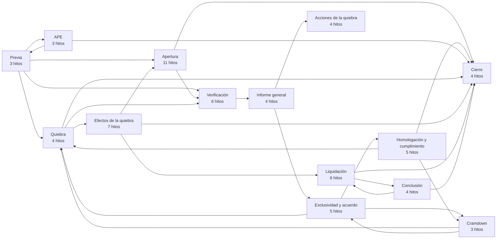

## 1. Etapa previa

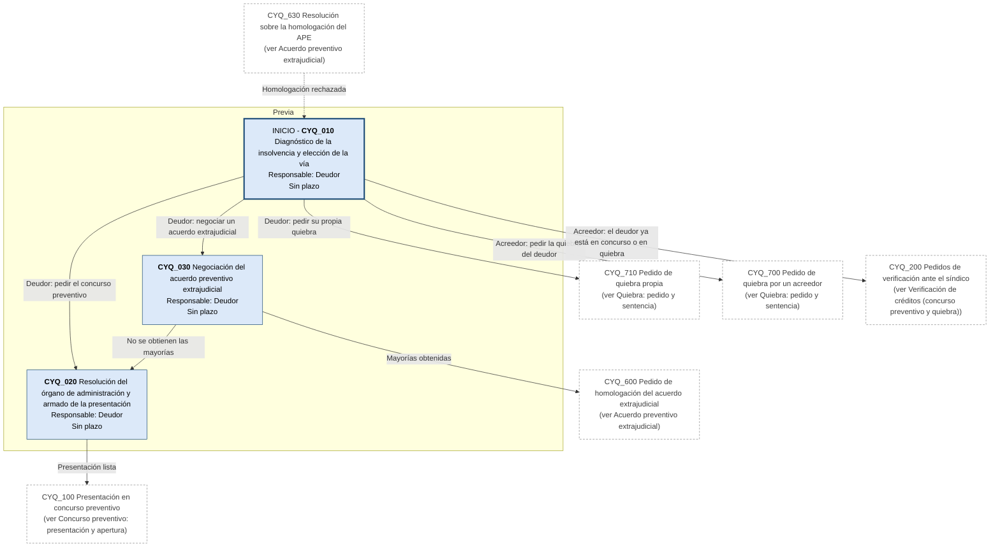

## 2. Concurso preventivo: presentación y apertura

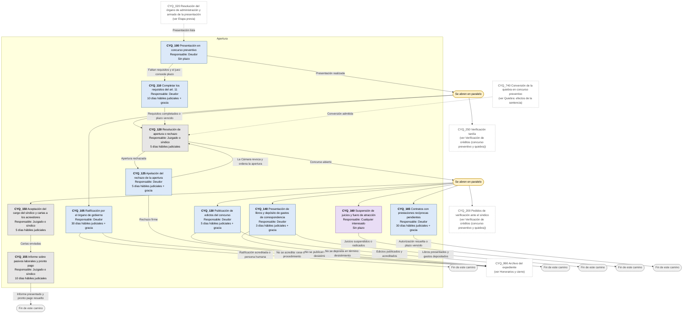

## 3. Verificación de créditos (concurso preventivo y quiebra)

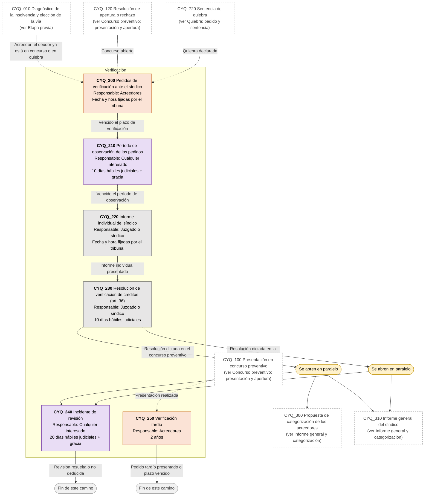

## 4. Informe general y categorización

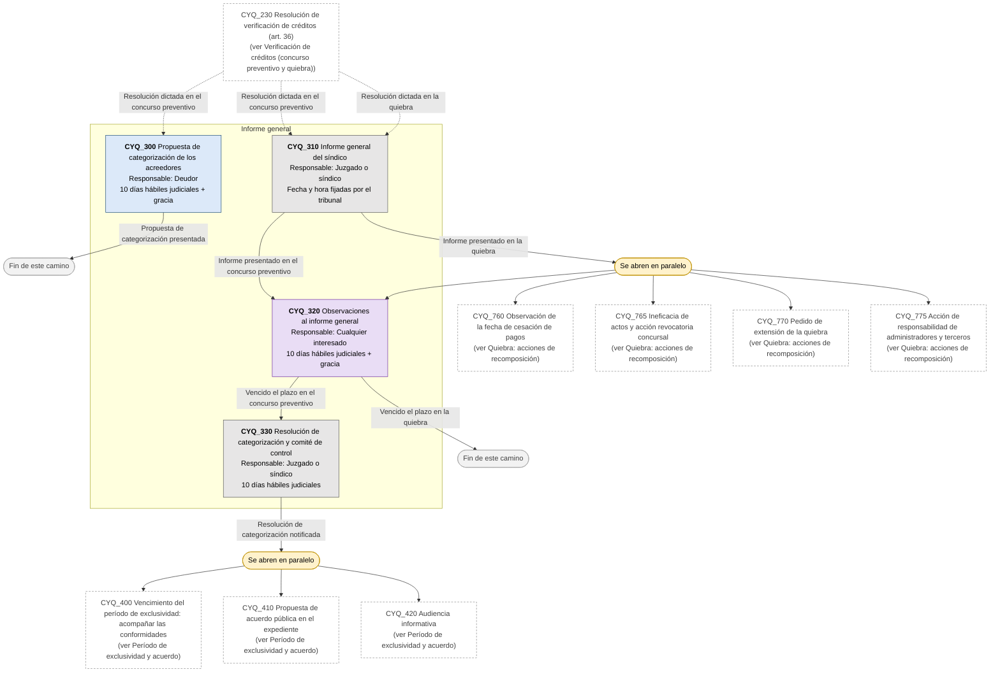

## 5. Período de exclusividad y acuerdo

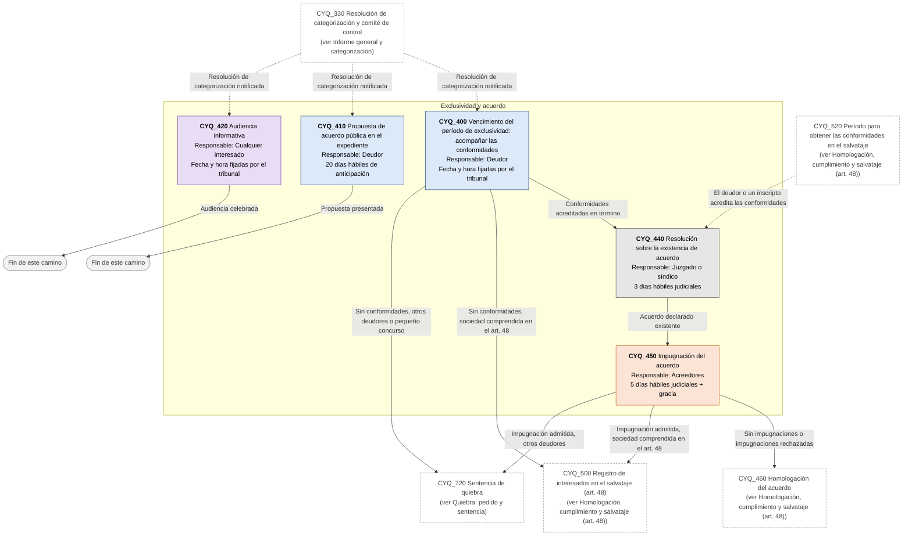

## 6. Homologación, cumplimiento y salvataje (art. 48)

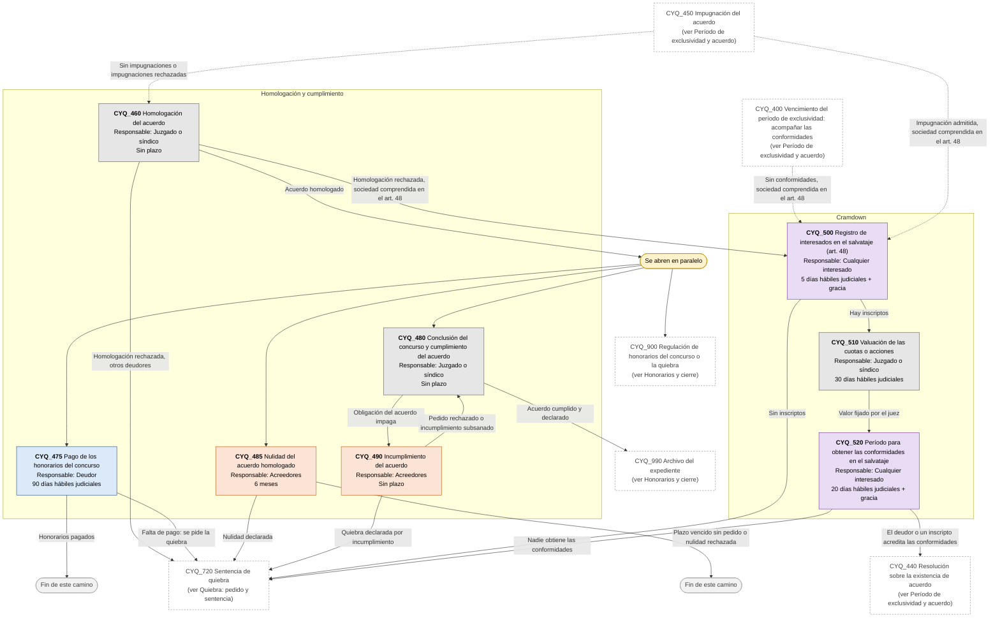

## 7. Acuerdo preventivo extrajudicial

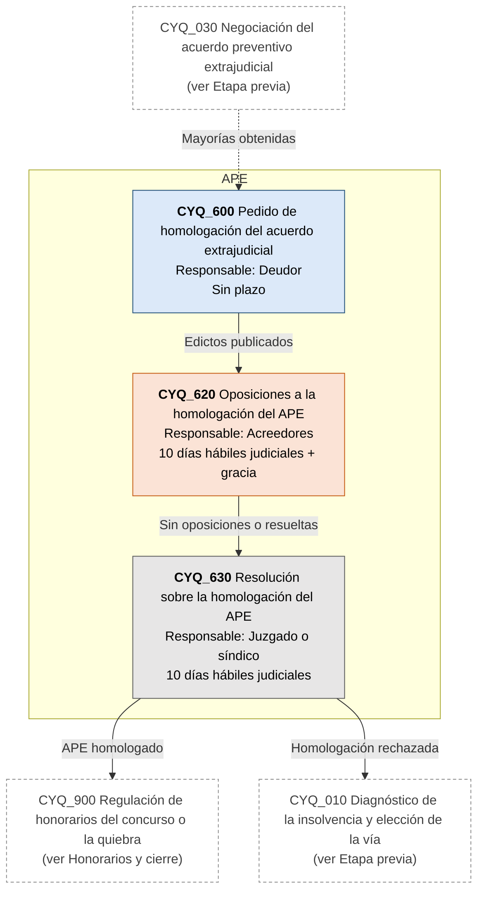

## 8. Quiebra: pedido y sentencia

```mermaid
flowchart TD
  subgraph F_0["Quiebra"]
    CYQ_700["<b>CYQ_700</b> Pedido de quiebra por un acreedor<br/>Responsable: Acreedores<br/>Sin plazo"]:::demandada
    CYQ_705["<b>CYQ_705</b> Citación al deudor (art. 84)<br/>Responsable: Deudor<br/>5 días hábiles judiciales + gracia"]:::actora
    CYQ_710["<b>CYQ_710</b> Pedido de quiebra propia<br/>Responsable: Deudor<br/>Sin plazo"]:::actora
    CYQ_720["<b>CYQ_720</b> Sentencia de quiebra<br/>Responsable: Juzgado o síndico<br/>Sin plazo"]:::tribunal
  end
  EXT_CYQ_010_origen["CYQ_010 Diagnóstico de la insolvencia y elección de la vía<br/>(ver Etapa previa)"]:::externo
  EXT_CYQ_010_origen -.->|"Deudor: pedir su propia quiebra"| CYQ_710
  EXT_CYQ_010_origen -.->|"Acreedor: pedir la quiebra del deudor"| CYQ_700
  EXT_CYQ_400_origen["CYQ_400 Vencimiento del período de exclusividad: acompañar las conformidades<br/>(ver Período de exclusividad y acuerdo)"]:::externo
  EXT_CYQ_400_origen -.->|"Sin conformidades, otros deudores o pequeño concurso"| CYQ_720
  EXT_CYQ_450_origen["CYQ_450 Impugnación del acuerdo<br/>(ver Período de exclusividad y acuerdo)"]:::externo
  EXT_CYQ_450_origen -.->|"Impugnación admitida, otros deudores"| CYQ_720
  EXT_CYQ_460_origen["CYQ_460 Homologación del acuerdo<br/>(ver Homologación, cumplimiento y salvataje (art. 48))"]:::externo
  EXT_CYQ_460_origen -.->|"Homologación rechazada, otros deudores"| CYQ_720
  EXT_CYQ_475_origen["CYQ_475 Pago de los honorarios del concurso<br/>(ver Homologación, cumplimiento y salvataje (art. 48))"]:::externo
  EXT_CYQ_475_origen -.->|"Falta de pago: se pide la quiebra"| CYQ_720
  EXT_CYQ_485_origen["CYQ_485 Nulidad del acuerdo homologado<br/>(ver Homologación, cumplimiento y salvataje (art. 48))"]:::externo
  EXT_CYQ_485_origen -.->|"Nulidad declarada"| CYQ_720
  EXT_CYQ_490_origen["CYQ_490 Incumplimiento del acuerdo<br/>(ver Homologación, cumplimiento y salvataje (art. 48))"]:::externo
  EXT_CYQ_490_origen -.->|"Quiebra declarada por incumplimiento"| CYQ_720
  EXT_CYQ_500_origen["CYQ_500 Registro de interesados en el salvataje (art. 48)<br/>(ver Homologación, cumplimiento y salvataje (art. 48))"]:::externo
  EXT_CYQ_500_origen -.->|"Sin inscriptos"| CYQ_720
  EXT_CYQ_520_origen["CYQ_520 Período para obtener las conformidades en el salvataje<br/>(ver Homologación, cumplimiento y salvataje (art. 48))"]:::externo
  EXT_CYQ_520_origen -.->|"Nadie obtiene las conformidades"| CYQ_720
  CYQ_700 -->|"Pedido admitido formalmente"| CYQ_705
  CYQ_705 -->|"Quiebra declarada"| CYQ_720
  EXT_CYQ_990_destino["CYQ_990 Archivo del expediente<br/>(ver Honorarios y cierre)"]:::externo
  CYQ_705 -->|"Pedido rechazado o desistido"| EXT_CYQ_990_destino
  CYQ_710 -->|"Pedido presentado"| CYQ_720
  P_CYQ_720_1(["Se abren en paralelo"]):::paralelo
  CYQ_720 -->|"Quiebra declarada"| P_CYQ_720_1
  EXT_CYQ_200_destino["CYQ_200 Pedidos de verificación ante el síndico<br/>(ver Verificación de créditos (concurso preventivo y quiebra))"]:::externo
  P_CYQ_720_1 --> EXT_CYQ_200_destino
  EXT_CYQ_725_destino["CYQ_725 Entrega de libros y constitución de domicilio por el fallido<br/>(ver Quiebra: efectos de la sentencia)"]:::externo
  P_CYQ_720_1 --> EXT_CYQ_725_destino
  EXT_CYQ_730_destino["CYQ_730 Publicación de edictos de la quiebra<br/>(ver Quiebra: efectos de la sentencia)"]:::externo
  P_CYQ_720_1 --> EXT_CYQ_730_destino
  EXT_CYQ_745_destino["CYQ_745 Incautación, inventario y desapoderamiento<br/>(ver Quiebra: efectos de la sentencia)"]:::externo
  P_CYQ_720_1 --> EXT_CYQ_745_destino
  EXT_CYQ_750_destino["CYQ_750 Inhabilitación del fallido<br/>(ver Quiebra: efectos de la sentencia)"]:::externo
  P_CYQ_720_1 --> EXT_CYQ_750_destino
  classDef actora fill:#DCE9F9,stroke:#1F4E79,color:#000
  classDef demandada fill:#FBE3D6,stroke:#C55A11,color:#000
  classDef tribunal fill:#E7E6E6,stroke:#595959,color:#000
  classDef ambas fill:#E9DDF5,stroke:#7030A0,color:#000
  classDef externo fill:#FFFFFF,stroke:#8C8C8C,color:#404040,stroke-dasharray:4 3
  classDef paralelo fill:#FFF2CC,stroke:#BF9000,color:#000
  classDef fin fill:#F2F2F2,stroke:#A6A6A6,color:#404040
```

## 9. Quiebra: efectos de la sentencia

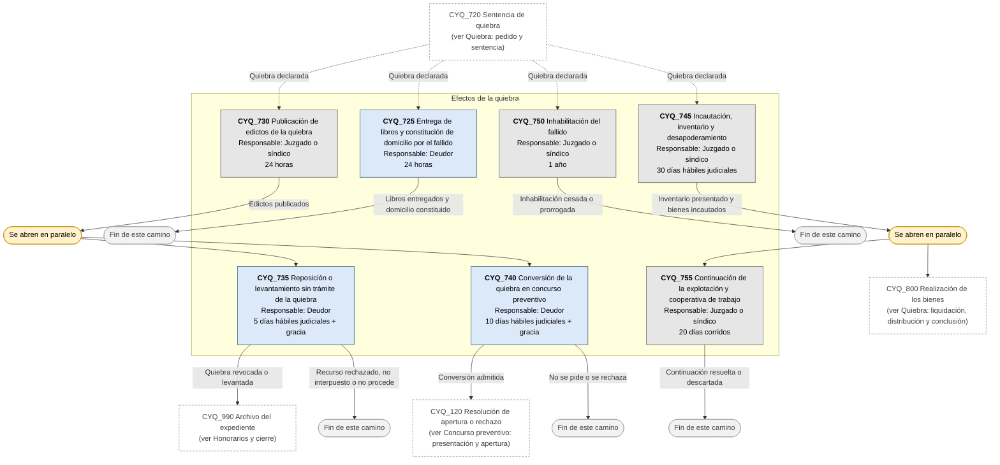

## 10. Quiebra: acciones de recomposición

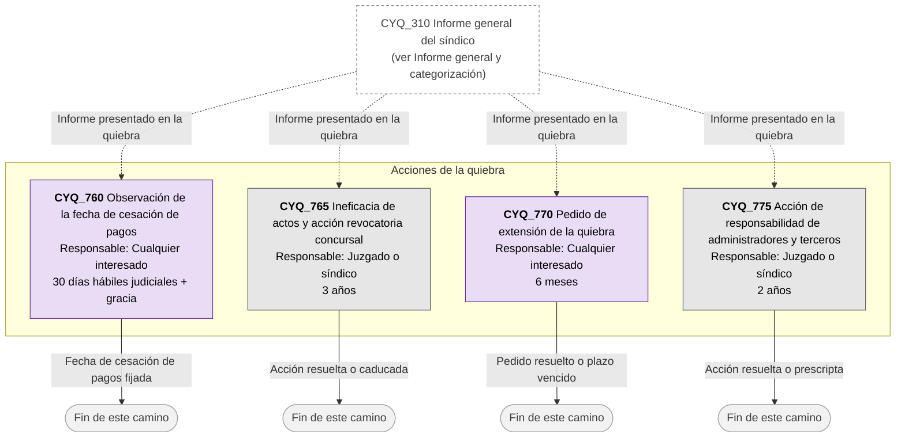

## 11. Quiebra: liquidación, distribución y conclusión

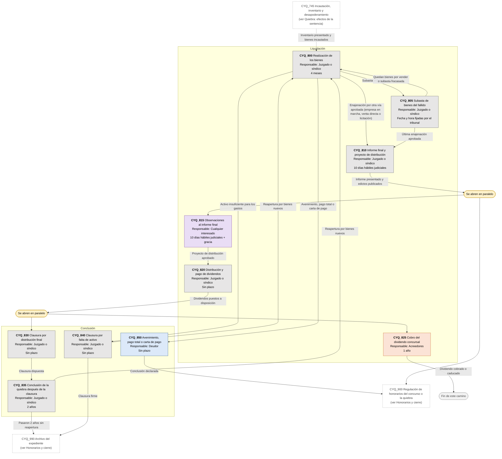

## 12. Honorarios y cierre

```mermaid
flowchart TD
  subgraph F_0["Cierre"]
    CYQ_900["<b>CYQ_900</b> Regulación de honorarios del concurso o la quiebra<br/>Responsable: Juzgado o síndico<br/>Sin plazo"]:::tribunal
    CYQ_905["<b>CYQ_905</b> Apelación de honorarios<br/>Responsable: Cualquier interesado<br/>5 días hábiles judiciales + gracia"]:::ambas
    CYQ_910["<b>CYQ_910</b> Pago de aportes de la Ley 6716<br/>Responsable: Cualquier interesado<br/>60 días corridos"]:::ambas
    CYQ_990["<b>CYQ_990</b> Archivo del expediente<br/>Responsable: Juzgado o síndico<br/>Sin plazo"]:::tribunal
  end
  EXT_CYQ_105_origen["CYQ_105 Ratificación por el órgano de gobierno<br/>(ver Concurso preventivo: presentación y apertura)"]:::externo
  EXT_CYQ_105_origen -.->|"No se acredita: cese del procedimiento"| CYQ_990
  EXT_CYQ_125_origen["CYQ_125 Apelación del rechazo de la apertura<br/>(ver Concurso preventivo: presentación y apertura)"]:::externo
  EXT_CYQ_125_origen -.->|"Rechazo firme"| CYQ_990
  EXT_CYQ_130_origen["CYQ_130 Publicación de edictos del concurso<br/>(ver Concurso preventivo: presentación y apertura)"]:::externo
  EXT_CYQ_130_origen -.->|"No se publican en término: desistimiento"| CYQ_990
  EXT_CYQ_140_origen["CYQ_140 Presentación de libros y depósito de gastos de correspondencia<br/>(ver Concurso preventivo: presentación y apertura)"]:::externo
  EXT_CYQ_140_origen -.->|"No se deposita en término: desistimiento"| CYQ_990
  EXT_CYQ_460_origen["CYQ_460 Homologación del acuerdo<br/>(ver Homologación, cumplimiento y salvataje (art. 48))"]:::externo
  EXT_CYQ_460_origen -.->|"Acuerdo homologado"| CYQ_900
  EXT_CYQ_480_origen["CYQ_480 Conclusión del concurso y cumplimiento del acuerdo<br/>(ver Homologación, cumplimiento y salvataje (art. 48))"]:::externo
  EXT_CYQ_480_origen -.->|"Acuerdo cumplido y declarado"| CYQ_990
  EXT_CYQ_630_origen["CYQ_630 Resolución sobre la homologación del APE<br/>(ver Acuerdo preventivo extrajudicial)"]:::externo
  EXT_CYQ_630_origen -.->|"APE homologado"| CYQ_900
  EXT_CYQ_705_origen["CYQ_705 Citación al deudor (art. 84)<br/>(ver Quiebra: pedido y sentencia)"]:::externo
  EXT_CYQ_705_origen -.->|"Pedido rechazado o desistido"| CYQ_990
  EXT_CYQ_735_origen["CYQ_735 Reposición o levantamiento sin trámite de la quiebra<br/>(ver Quiebra: efectos de la sentencia)"]:::externo
  EXT_CYQ_735_origen -.->|"Quiebra revocada o levantada"| CYQ_990
  EXT_CYQ_810_origen["CYQ_810 Informe final y proyecto de distribución<br/>(ver Quiebra: liquidación, distribución y conclusión)"]:::externo
  EXT_CYQ_810_origen -.->|"Informe presentado y edictos publicados"| CYQ_900
  EXT_CYQ_835_origen["CYQ_835 Conclusión de la quiebra después de la clausura<br/>(ver Quiebra: liquidación, distribución y conclusión)"]:::externo
  EXT_CYQ_835_origen -.->|"Pasaron 2 años sin reapertura"| CYQ_990
  EXT_CYQ_840_origen["CYQ_840 Clausura por falta de activo<br/>(ver Quiebra: liquidación, distribución y conclusión)"]:::externo
  EXT_CYQ_840_origen -.->|"Clausura firme"| CYQ_990
  EXT_CYQ_850_origen["CYQ_850 Avenimiento, pago total o carta de pago<br/>(ver Quiebra: liquidación, distribución y conclusión)"]:::externo
  EXT_CYQ_850_origen -.->|"Conclusión declarada"| CYQ_900
  CYQ_900 -->|"Regulación notificada"| CYQ_905
  CYQ_905 -->|"Regulación firme"| CYQ_910
  CYQ_910 -->|"Aportes pagados y acreditados"| CYQ_990
  style CYQ_990 stroke-width:3px
  classDef actora fill:#DCE9F9,stroke:#1F4E79,color:#000
  classDef demandada fill:#FBE3D6,stroke:#C55A11,color:#000
  classDef tribunal fill:#E7E6E6,stroke:#595959,color:#000
  classDef ambas fill:#E9DDF5,stroke:#7030A0,color:#000
  classDef externo fill:#FFFFFF,stroke:#8C8C8C,color:#404040,stroke-dasharray:4 3
  classDef paralelo fill:#FFF2CC,stroke:#BF9000,color:#000
  classDef fin fill:#F2F2F2,stroke:#A6A6A6,color:#404040
```
