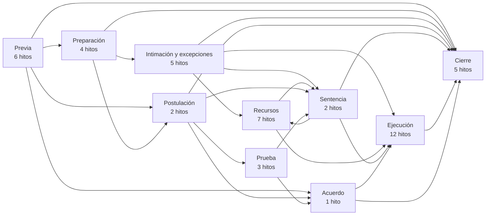
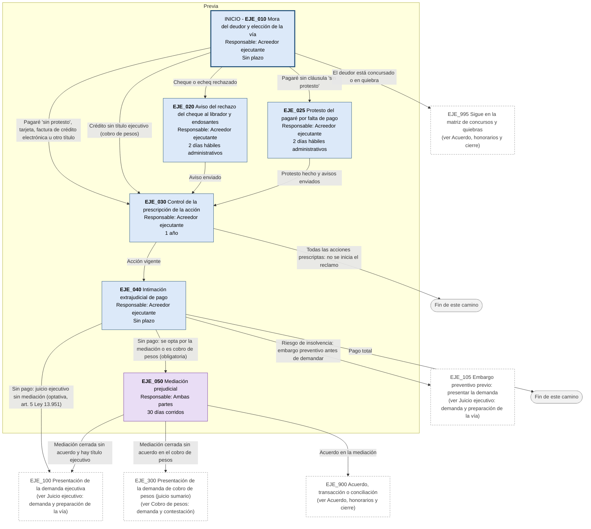
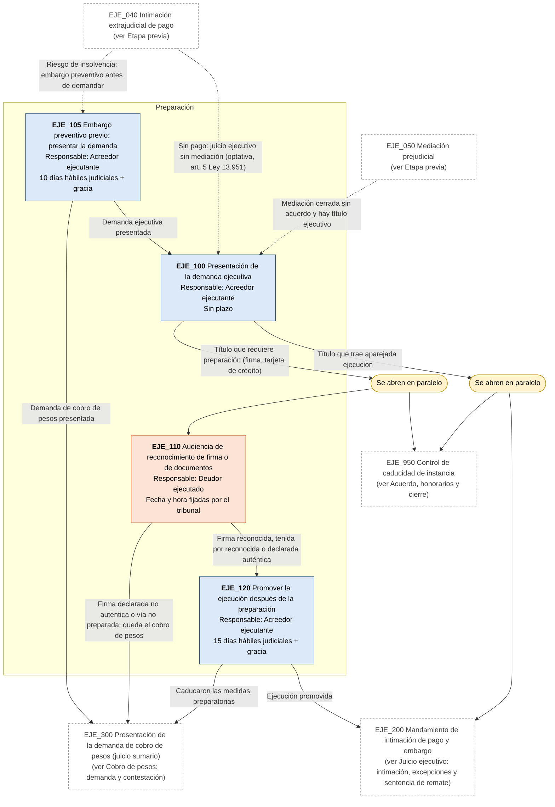
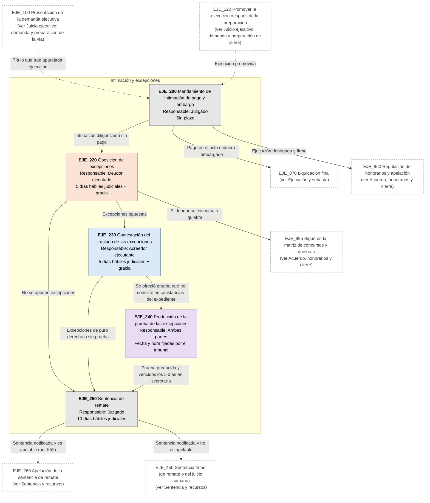
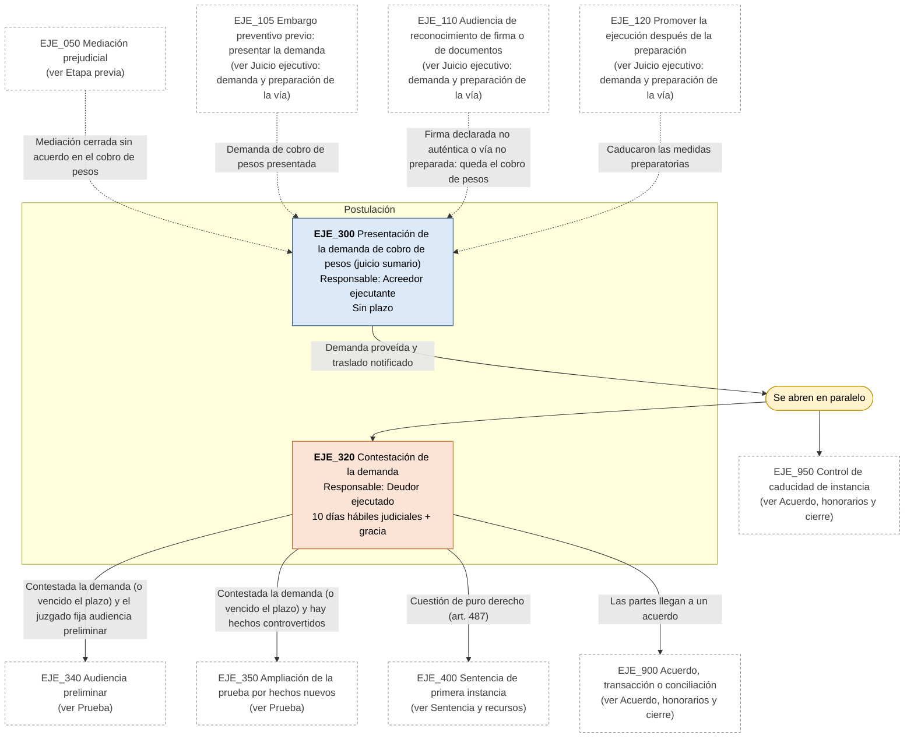
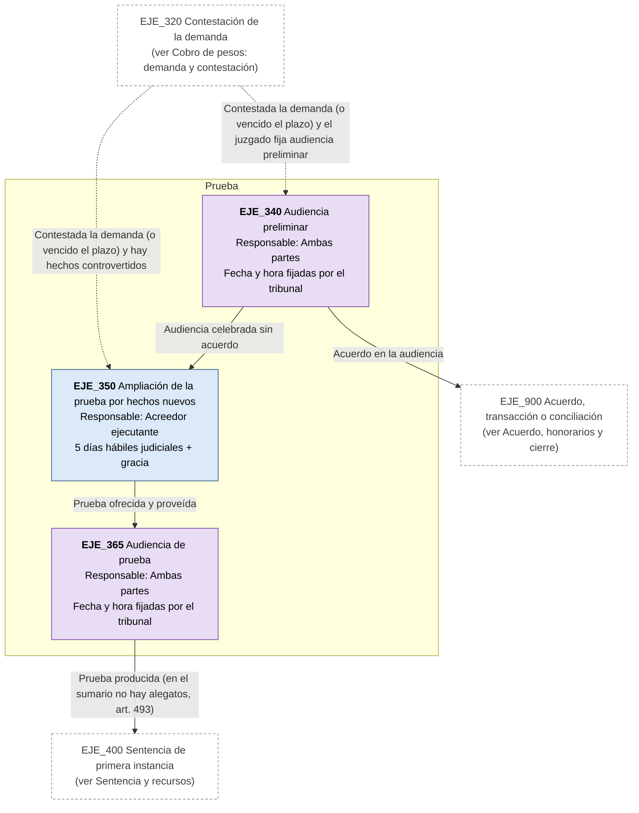
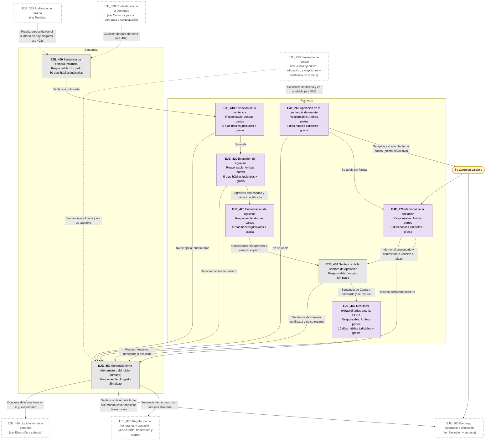
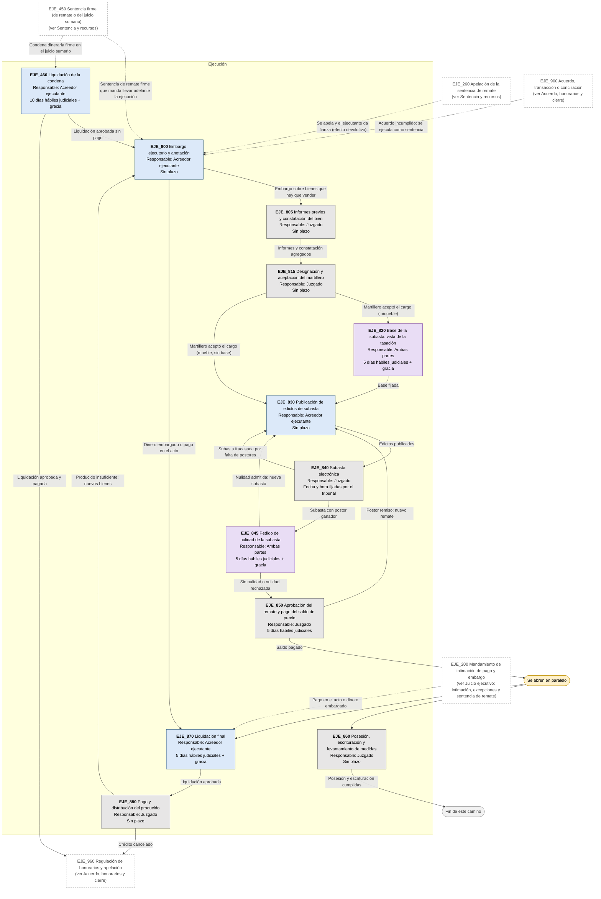

# Diagrama de Flujo: Juicios ejecutivos y cobro de pesos - Provincia de Buenos Aires

**Régimen:** CPCCBA (Decreto-Ley 7425/68), arts. 518 a 593 (juicio ejecutivo) y 484 a 495 (sumario); Ley 24.452 (cheques); Decreto-Ley 5965/63 (pagaré); Ley 25.065 (tarjetas de crédito); Ley 27.440 (factura de crédito electrónica); Ley 13.951 (mediación) · **Versión:** 1 (borrador)

> Este documento se genera a partir de `matriz_comercial_ejecutivos_pba.xlsx`. No se edita a mano: las correcciones se hacen en la planilla y luego se vuelve a generar el diagrama.

## Cómo leer los diagramas

* **Cada caja es un hito** de la hoja `Nodos`: muestra el ID, el nombre, quién debe actuar y el plazo.
* **Cada flecha es un camino** de la hoja `Transiciones`, rotulado con su condición de salida.
* **Color de la caja según el responsable:** celeste = acreedor ejecutante; naranja = deudor ejecutado (librador, suscriptor, avalistas o endosantes); gris = juzgado, oficial de justicia o martillero; violeta = cualquiera de las partes.
* **Borde grueso:** hito inicial o hito final.
* **"Se abren en paralelo"** (amarillo): esa condición abre varios hitos a la vez; por ejemplo, al presentar la demanda corre la caducidad de instancia mientras avanza la ejecución.
* **"Fin de este camino"** (gris claro): el camino paralelo termina sin abrir otro hito.
* **Cajas blancas con borde discontinuo:** hitos de otra etapa; el texto indica en qué diagrama están. Las flechas punteadas muestran desde dónde se llega a esta etapa.
* **Hitos "Sigue en la matriz de ...":** son finales. El expediente continúa con el flujo de otra matriz comercial y hay que vincular los dos expedientes en la app (ver las dudas de producto de la matriz de concursos).
* **Dos puertas al juicio:** el juicio ejecutivo (título que trae aparejada ejecución) y el cobro de pesos por juicio sumario (sin título ejecutivo o con la vía ejecutiva frustrada). Las dos terminan en la sentencia firme y comparten la ejecución, la subasta y el cierre.

## Vista general por fases

## 1. Etapa previa

## 2. Juicio ejecutivo: demanda y preparación de la vía

## 3. Juicio ejecutivo: intimación, excepciones y sentencia de remate

## 4. Cobro de pesos: demanda y contestación

## 5. Prueba

## 6. Sentencia y recursos

## 7. Ejecución y subasta

## 8. Acuerdo, honorarios y cierre

```mermaid
flowchart TD
  subgraph F_0["Acuerdo"]
    EJE_900["<b>EJE_900</b> Acuerdo, transacción o conciliación<br/>Responsable: Ambas partes<br/>Sin plazo"]:::ambas
  end
  subgraph F_1["Cierre"]
    EJE_950["<b>EJE_950</b> Control de caducidad de instancia<br/>Responsable: Acreedor ejecutante<br/>3 meses"]:::actora
    EJE_960["<b>EJE_960</b> Regulación de honorarios y apelación<br/>Responsable: Ambas partes<br/>5 días hábiles judiciales + gracia"]:::ambas
    EJE_970["<b>EJE_970</b> Pago de aportes de la Ley 6716<br/>Responsable: Acreedor ejecutante<br/>60 días corridos"]:::actora
    EJE_990["<b>EJE_990</b> Archivo del expediente<br/>Responsable: Juzgado<br/>Sin plazo"]:::tribunal
    EJE_995["<b>EJE_995</b> Sigue en la matriz de concursos y quiebras<br/>Responsable: Juzgado<br/>Sin plazo"]:::tribunal
  end
  EXT_EJE_010_origen["EJE_010 Mora del deudor y elección de la vía<br/>(ver Etapa previa)"]:::externo
  EXT_EJE_010_origen -.->|"El deudor está concursado o en quiebra"| EJE_995
  EXT_EJE_050_origen["EJE_050 Mediación prejudicial<br/>(ver Etapa previa)"]:::externo
  EXT_EJE_050_origen -.->|"Acuerdo en la mediación"| EJE_900
  EXT_EJE_100_origen["EJE_100 Presentación de la demanda ejecutiva<br/>(ver Juicio ejecutivo: demanda y preparación de la vía)"]:::externo
  EXT_EJE_100_origen -.->|"Título que trae aparejada ejecución"| EJE_950
  EXT_EJE_100_origen -.->|"Título que requiere preparación (firma, tarjeta de crédito)"| EJE_950
  EXT_EJE_200_origen["EJE_200 Mandamiento de intimación de pago y embargo<br/>(ver Juicio ejecutivo: intimación, excepciones y sentencia de remate)"]:::externo
  EXT_EJE_200_origen -.->|"Ejecución denegada y firme"| EJE_960
  EXT_EJE_220_origen["EJE_220 Oposición de excepciones<br/>(ver Juicio ejecutivo: intimación, excepciones y sentencia de remate)"]:::externo
  EXT_EJE_220_origen -.->|"El deudor se concursa o quiebra"| EJE_995
  EXT_EJE_300_origen["EJE_300 Presentación de la demanda de cobro de pesos (juicio sumario)<br/>(ver Cobro de pesos: demanda y contestación)"]:::externo
  EXT_EJE_300_origen -.->|"Demanda proveída y traslado notificado"| EJE_950
  EXT_EJE_320_origen["EJE_320 Contestación de la demanda<br/>(ver Cobro de pesos: demanda y contestación)"]:::externo
  EXT_EJE_320_origen -.->|"Las partes llegan a un acuerdo"| EJE_900
  EXT_EJE_340_origen["EJE_340 Audiencia preliminar<br/>(ver Prueba)"]:::externo
  EXT_EJE_340_origen -.->|"Acuerdo en la audiencia"| EJE_900
  EXT_EJE_450_origen["EJE_450 Sentencia firme (de remate o del juicio sumario)<br/>(ver Sentencia y recursos)"]:::externo
  EXT_EJE_450_origen -.->|"Sentencia de rechazo o sin condena dineraria"| EJE_960
  EXT_EJE_460_origen["EJE_460 Liquidación de la condena<br/>(ver Ejecución y subasta)"]:::externo
  EXT_EJE_460_origen -.->|"Liquidación aprobada y pagada"| EJE_960
  EXT_EJE_880_origen["EJE_880 Pago y distribución del producido<br/>(ver Ejecución y subasta)"]:::externo
  EXT_EJE_880_origen -.->|"Crédito cancelado"| EJE_960
  EJE_900 -->|"Acuerdo homologado y cumplido"| EJE_960
  EXT_EJE_800_destino["EJE_800 Embargo ejecutorio y anotación<br/>(ver Ejecución y subasta)"]:::externo
  EJE_900 -->|"Acuerdo incumplido: se ejecuta como sentencia"| EXT_EJE_800_destino
  FIN_EJE_950_1(["Fin de este camino"]):::fin
  EJE_950 -->|"Se dicta sentencia o termina el proceso"| FIN_EJE_950_1
  EJE_950 -->|"Caducidad declarada"| EJE_960
  EJE_960 -->|"Regulación firme"| EJE_970
  EJE_970 -->|"Aportes pagados y acreditados"| EJE_990
  style EJE_990 stroke-width:3px
  style EJE_995 stroke-width:3px
  classDef actora fill:#DCE9F9,stroke:#1F4E79,color:#000
  classDef demandada fill:#FBE3D6,stroke:#C55A11,color:#000
  classDef tribunal fill:#E7E6E6,stroke:#595959,color:#000
  classDef ambas fill:#E9DDF5,stroke:#7030A0,color:#000
  classDef externo fill:#FFFFFF,stroke:#8C8C8C,color:#404040,stroke-dasharray:4 3
  classDef paralelo fill:#FFF2CC,stroke:#BF9000,color:#000
  classDef fin fill:#F2F2F2,stroke:#A6A6A6,color:#404040
```

