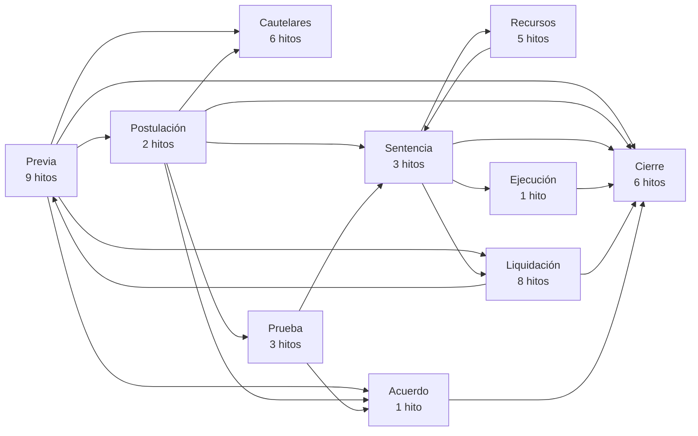
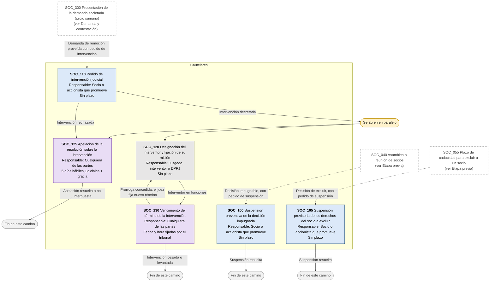
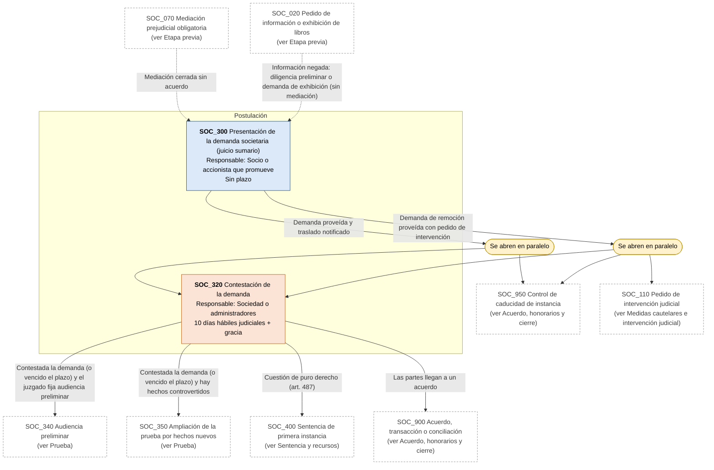
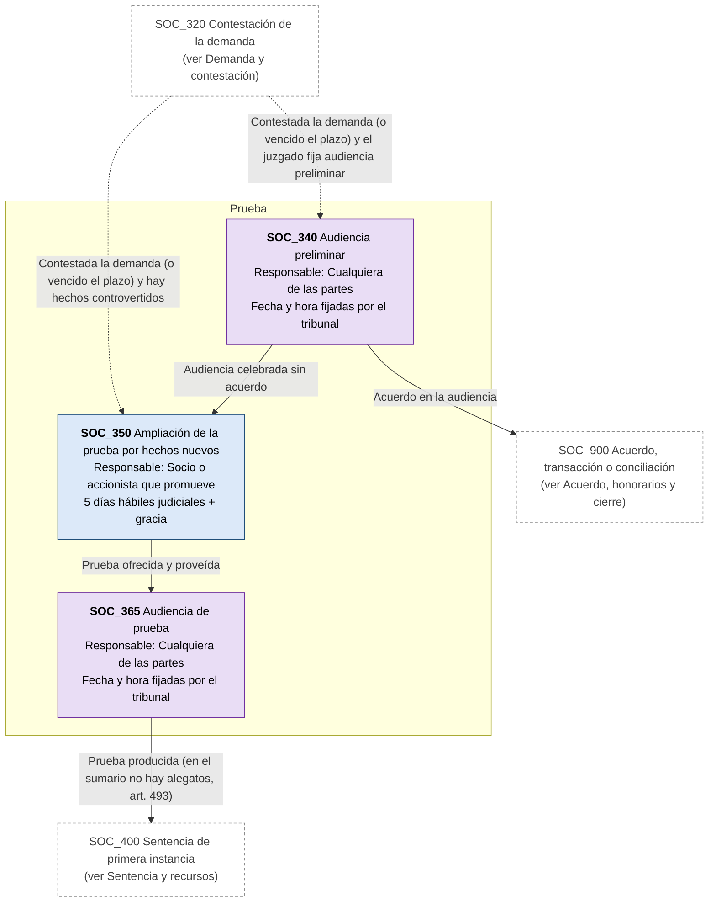
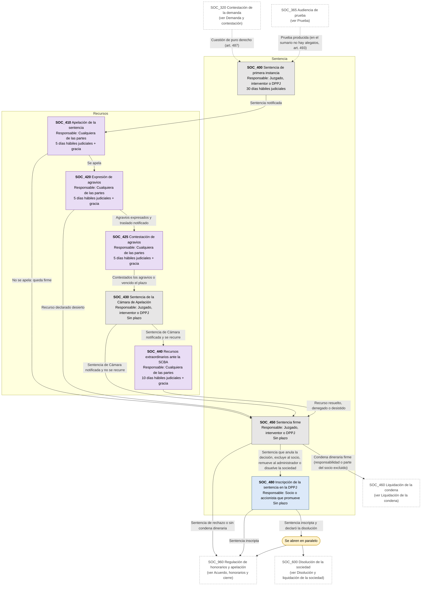
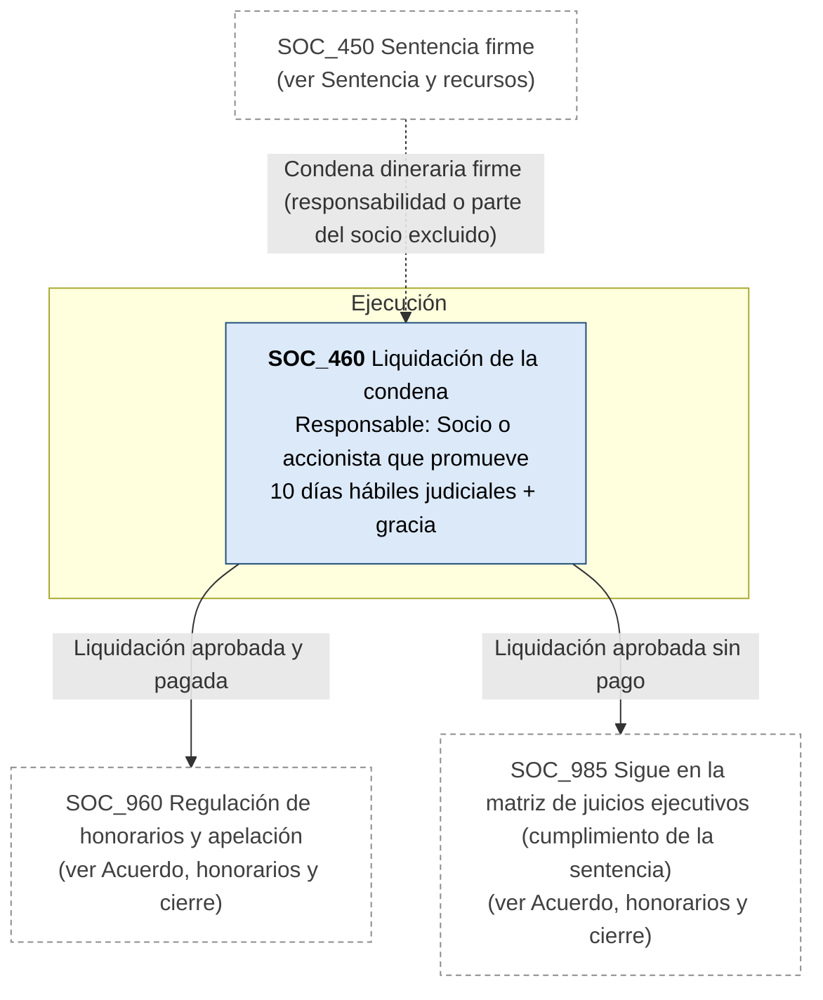
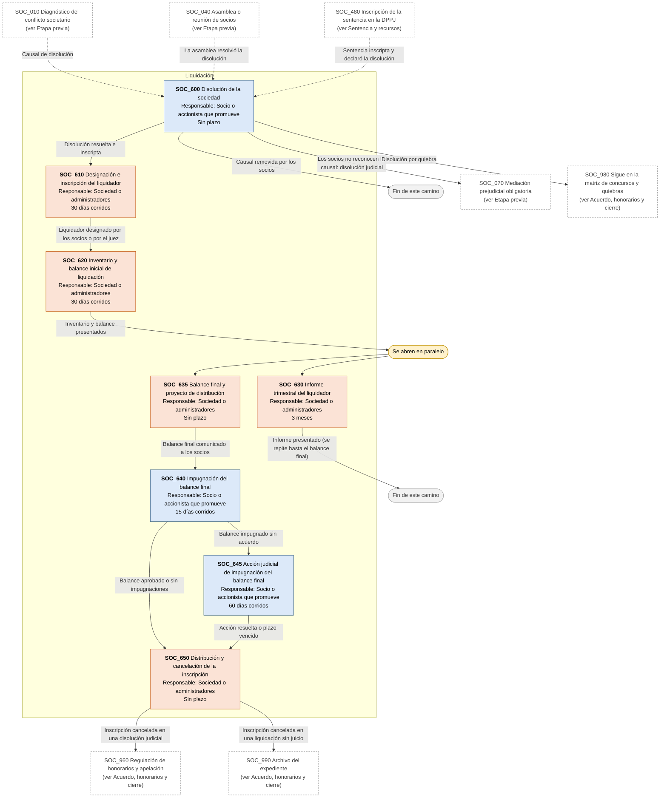

# Diagrama de Flujo: Conflictos societarios - Provincia de Buenos Aires

**Régimen:** Ley General de Sociedades 19.550 (t.o. 1984, con las reformas de las Leyes 26.994 y 27.077); CPCCBA (Decreto-Ley 7425/68), juicio sumario (art. 15 LGS); Ley 13.951 (mediación) · **Versión:** 1 (borrador)

> Este documento se genera a partir de `matriz_comercial_societarios_pba.xlsx`. No se edita a mano: las correcciones se hacen en la planilla y luego se vuelve a generar el diagrama.

## Cómo leer los diagramas

* **Cada caja es un hito** de la hoja `Nodos`: muestra el ID, el nombre, quién debe actuar y el plazo.
* **Cada flecha es un camino** de la hoja `Transiciones`, rotulado con su condición de salida.
* **Color de la caja según el responsable:** celeste = socio, accionista o director que promueve (o la sociedad, en la acción social y en la exclusión); naranja = sociedad, administradores, liquidadores o socio excluido; gris = juzgado, veedor, interventor o Dirección Provincial de Personas Jurídicas (DPPJ); violeta = cualquiera de las partes.
* **Borde grueso:** hito inicial o hito final.
* **"Se abren en paralelo"** (amarillo): esa condición abre varios hitos a la vez; por ejemplo, al clausurarse la asamblea corre la caducidad de 3 meses de la impugnación mientras se pide la suspensión de la decisión y se hace la mediación.
* **"Fin de este camino"** (gris claro): el camino paralelo termina sin abrir otro hito.
* **Cajas blancas con borde discontinuo:** hitos de otra etapa; el texto indica en qué diagrama están. Las flechas punteadas muestran desde dónde se llega a esta etapa.
* **Hitos "Sigue en la matriz de ...":** son finales. El expediente continúa con el flujo de otra matriz comercial y hay que vincular los dos expedientes en la app (ver las dudas de producto de la matriz de concursos).
* **Cobro de la condena:** si la sentencia condena a pagar y no se paga, el expediente sigue en la matriz de juicios ejecutivos, en el bloque de embargo y subasta.

## Vista general por fases

## 1. Etapa previa

```mermaid
flowchart TD
  subgraph F_0["Previa"]
    SOC_010["INICIO - <b>SOC_010</b> Diagnóstico del conflicto societario<br/>Responsable: Socio o accionista que promueve<br/>Sin plazo"]:::actora
    SOC_020["<b>SOC_020</b> Pedido de información o exhibición de libros<br/>Responsable: Socio o accionista que promueve<br/>Sin plazo"]:::actora
    SOC_030["<b>SOC_030</b> Plazo para celebrar la asamblea pedida por accionistas<br/>Responsable: Sociedad o administradores<br/>40 días corridos"]:::demandada
    SOC_035["<b>SOC_035</b> Convocatoria a asamblea por la DPPJ o por el juez<br/>Responsable: Socio o accionista que promueve<br/>Sin plazo"]:::actora
    SOC_040["<b>SOC_040</b> Asamblea o reunión de socios<br/>Responsable: Cualquiera de las partes<br/>Fecha y hora fijadas por el tribunal"]:::ambas
    SOC_050["<b>SOC_050</b> Plazo de caducidad para impugnar la decisión<br/>Responsable: Socio o accionista que promueve<br/>3 meses"]:::actora
    SOC_055["<b>SOC_055</b> Plazo de caducidad para excluir a un socio<br/>Responsable: Socio o accionista que promueve<br/>90 días corridos"]:::actora
    SOC_060["<b>SOC_060</b> Plazo para que el accionista promueva la acción social<br/>Responsable: Socio o accionista que promueve<br/>3 meses"]:::actora
    SOC_070["<b>SOC_070</b> Mediación prejudicial obligatoria<br/>Responsable: Cualquiera de las partes<br/>60 días corridos"]:::ambas
  end
  SOC_010 -->|"El socio no tiene información sobre la gestión"| SOC_020
  SOC_010 -->|"Hay que pedir una asamblea (temas a tratar, remoción o acción social)"| SOC_030
  SOC_010 -->|"Hay una asamblea convocada o ya celebrada"| SOC_040
  SOC_010 -->|"Exclusión de un socio por justa causa"| SOC_055
  SOC_010 -->|"Remoción judicial del administrador o acción individual de responsabilidad"| SOC_070
  EXT_SOC_600_destino["SOC_600 Disolución de la sociedad<br/>(ver Disolución y liquidación de la sociedad)"]:::externo
  SOC_010 -->|"Causal de disolución"| EXT_SOC_600_destino
  EXT_SOC_980_destino["SOC_980 Sigue en la matriz de concursos y quiebras<br/>(ver Acuerdo, honorarios y cierre)"]:::externo
  SOC_010 -->|"Sociedad en cesación de pagos"| EXT_SOC_980_destino
  FIN_SOC_020_1(["Fin de este camino"]):::fin
  SOC_020 -->|"Información obtenida sin irregularidades"| FIN_SOC_020_1
  SOC_020 -->|"Información obtenida: se pide una asamblea"| SOC_030
  SOC_020 -->|"Información obtenida: acción contra los administradores"| SOC_070
  EXT_SOC_300_destino["SOC_300 Presentación de la demanda societaria (juicio sumario)<br/>(ver Demanda y contestación)"]:::externo
  SOC_020 -->|"Información negada: diligencia preliminar o demanda de exhibición (sin mediación)"| EXT_SOC_300_destino
  SOC_030 -->|"Asamblea convocada"| SOC_040
  SOC_030 -->|"El directorio o el síndico no convocan en término"| SOC_035
  SOC_035 -->|"Asamblea convocada por la DPPJ o por el juez"| SOC_040
  P_SOC_040_1(["Se abren en paralelo"]):::paralelo
  SOC_040 -->|"Decisión impugnable, con pedido de suspensión"| P_SOC_040_1
  P_SOC_040_1 --> SOC_050
  EXT_SOC_100_destino["SOC_100 Suspensión preventiva de la decisión impugnada<br/>(ver Medidas cautelares e intervención judicial)"]:::externo
  P_SOC_040_1 --> EXT_SOC_100_destino
  P_SOC_040_1 --> SOC_070
  P_SOC_040_2(["Se abren en paralelo"]):::paralelo
  SOC_040 -->|"Decisión impugnable, sin pedido de suspensión"| P_SOC_040_2
  P_SOC_040_2 --> SOC_050
  P_SOC_040_2 --> SOC_070
  SOC_040 -->|"La asamblea resolvió promover la acción de responsabilidad"| SOC_060
  SOC_040 -->|"La asamblea resolvió la disolución"| EXT_SOC_600_destino
  FIN_SOC_040_5(["Fin de este camino"]):::fin
  SOC_040 -->|"Sin decisiones para impugnar"| FIN_SOC_040_5
  FIN_SOC_050_1(["Fin de este camino"]):::fin
  SOC_050 -->|"Demanda presentada en término o decisión revocada"| FIN_SOC_050_1
  FIN_SOC_050_2(["Fin de este camino"]):::fin
  SOC_050 -->|"Plazo vencido sin demanda: caducó la acción"| FIN_SOC_050_2
  P_SOC_055_1(["Se abren en paralelo"]):::paralelo
  SOC_055 -->|"Decisión de excluir, con pedido de suspensión"| P_SOC_055_1
  EXT_SOC_105_destino["SOC_105 Suspensión provisoria de los derechos del socio a excluir<br/>(ver Medidas cautelares e intervención judicial)"]:::externo
  P_SOC_055_1 --> EXT_SOC_105_destino
  P_SOC_055_1 --> SOC_070
  SOC_055 -->|"Decisión de excluir, sin pedido de suspensión"| SOC_070
  FIN_SOC_055_3(["Fin de este camino"]):::fin
  SOC_055 -->|"Plazo vencido sin demanda: caducó el derecho"| FIN_SOC_055_3
  SOC_060 -->|"Acción promovida por la sociedad o por el accionista"| SOC_070
  FIN_SOC_060_2(["Fin de este camino"]):::fin
  SOC_060 -->|"Plazo vencido sin acción del accionista"| FIN_SOC_060_2
  SOC_070 -->|"Mediación cerrada sin acuerdo"| EXT_SOC_300_destino
  EXT_SOC_900_destino["SOC_900 Acuerdo, transacción o conciliación<br/>(ver Acuerdo, honorarios y cierre)"]:::externo
  SOC_070 -->|"Acuerdo en la mediación"| EXT_SOC_900_destino
  EXT_SOC_600_origen["SOC_600 Disolución de la sociedad<br/>(ver Disolución y liquidación de la sociedad)"]:::externo
  EXT_SOC_600_origen -.->|"Los socios no reconocen la causal: disolución judicial"| SOC_070
  style SOC_010 stroke-width:3px
  classDef actora fill:#DCE9F9,stroke:#1F4E79,color:#000
  classDef demandada fill:#FBE3D6,stroke:#C55A11,color:#000
  classDef tribunal fill:#E7E6E6,stroke:#595959,color:#000
  classDef ambas fill:#E9DDF5,stroke:#7030A0,color:#000
  classDef externo fill:#FFFFFF,stroke:#8C8C8C,color:#404040,stroke-dasharray:4 3
  classDef paralelo fill:#FFF2CC,stroke:#BF9000,color:#000
  classDef fin fill:#F2F2F2,stroke:#A6A6A6,color:#404040
```

## 2. Medidas cautelares e intervención judicial

## 3. Demanda y contestación

## 4. Prueba

## 5. Sentencia y recursos

## 6. Liquidación de la condena

## 7. Disolución y liquidación de la sociedad

## 8. Acuerdo, honorarios y cierre

```mermaid
flowchart TD
  subgraph F_0["Acuerdo"]
    SOC_900["<b>SOC_900</b> Acuerdo, transacción o conciliación<br/>Responsable: Cualquiera de las partes<br/>Sin plazo"]:::ambas
  end
  subgraph F_1["Cierre"]
    SOC_950["<b>SOC_950</b> Control de caducidad de instancia<br/>Responsable: Socio o accionista que promueve<br/>3 meses"]:::actora
    SOC_960["<b>SOC_960</b> Regulación de honorarios y apelación<br/>Responsable: Cualquiera de las partes<br/>5 días hábiles judiciales + gracia"]:::ambas
    SOC_970["<b>SOC_970</b> Pago de aportes de la Ley 6716<br/>Responsable: Socio o accionista que promueve<br/>60 días corridos"]:::actora
    SOC_990["<b>SOC_990</b> Archivo del expediente<br/>Responsable: Juzgado, interventor o DPPJ<br/>Sin plazo"]:::tribunal
    SOC_980["<b>SOC_980</b> Sigue en la matriz de concursos y quiebras<br/>Responsable: Juzgado, interventor o DPPJ<br/>Sin plazo"]:::tribunal
    SOC_985["<b>SOC_985</b> Sigue en la matriz de juicios ejecutivos (cumplimiento de la sentencia)<br/>Responsable: Socio o accionista que promueve<br/>Sin plazo"]:::actora
  end
  EXT_SOC_010_origen["SOC_010 Diagnóstico del conflicto societario<br/>(ver Etapa previa)"]:::externo
  EXT_SOC_010_origen -.->|"Sociedad en cesación de pagos"| SOC_980
  EXT_SOC_070_origen["SOC_070 Mediación prejudicial obligatoria<br/>(ver Etapa previa)"]:::externo
  EXT_SOC_070_origen -.->|"Acuerdo en la mediación"| SOC_900
  EXT_SOC_300_origen["SOC_300 Presentación de la demanda societaria (juicio sumario)<br/>(ver Demanda y contestación)"]:::externo
  EXT_SOC_300_origen -.->|"Demanda de remoción proveída con pedido de intervención"| SOC_950
  EXT_SOC_300_origen -.->|"Demanda proveída y traslado notificado"| SOC_950
  EXT_SOC_320_origen["SOC_320 Contestación de la demanda<br/>(ver Demanda y contestación)"]:::externo
  EXT_SOC_320_origen -.->|"Las partes llegan a un acuerdo"| SOC_900
  EXT_SOC_340_origen["SOC_340 Audiencia preliminar<br/>(ver Prueba)"]:::externo
  EXT_SOC_340_origen -.->|"Acuerdo en la audiencia"| SOC_900
  EXT_SOC_450_origen["SOC_450 Sentencia firme<br/>(ver Sentencia y recursos)"]:::externo
  EXT_SOC_450_origen -.->|"Sentencia de rechazo o sin condena dineraria"| SOC_960
  EXT_SOC_460_origen["SOC_460 Liquidación de la condena<br/>(ver Liquidación de la condena)"]:::externo
  EXT_SOC_460_origen -.->|"Liquidación aprobada y pagada"| SOC_960
  EXT_SOC_460_origen -.->|"Liquidación aprobada sin pago"| SOC_985
  EXT_SOC_480_origen["SOC_480 Inscripción de la sentencia en la DPPJ<br/>(ver Sentencia y recursos)"]:::externo
  EXT_SOC_480_origen -.->|"Sentencia inscripta"| SOC_960
  EXT_SOC_480_origen -.->|"Sentencia inscripta y declaró la disolución"| SOC_960
  EXT_SOC_600_origen["SOC_600 Disolución de la sociedad<br/>(ver Disolución y liquidación de la sociedad)"]:::externo
  EXT_SOC_600_origen -.->|"Disolución por quiebra"| SOC_980
  EXT_SOC_650_origen["SOC_650 Distribución y cancelación de la inscripción<br/>(ver Disolución y liquidación de la sociedad)"]:::externo
  EXT_SOC_650_origen -.->|"Inscripción cancelada en una disolución judicial"| SOC_960
  EXT_SOC_650_origen -.->|"Inscripción cancelada en una liquidación sin juicio"| SOC_990
  SOC_900 -->|"Acuerdo homologado y cumplido"| SOC_960
  SOC_900 -->|"Acuerdo incumplido"| SOC_985
  FIN_SOC_950_1(["Fin de este camino"]):::fin
  SOC_950 -->|"Se dicta sentencia o termina el proceso"| FIN_SOC_950_1
  SOC_950 -->|"Caducidad declarada"| SOC_960
  SOC_960 -->|"Regulación firme"| SOC_970
  SOC_970 -->|"Aportes pagados y acreditados"| SOC_990
  style SOC_990 stroke-width:3px
  style SOC_980 stroke-width:3px
  style SOC_985 stroke-width:3px
  classDef actora fill:#DCE9F9,stroke:#1F4E79,color:#000
  classDef demandada fill:#FBE3D6,stroke:#C55A11,color:#000
  classDef tribunal fill:#E7E6E6,stroke:#595959,color:#000
  classDef ambas fill:#E9DDF5,stroke:#7030A0,color:#000
  classDef externo fill:#FFFFFF,stroke:#8C8C8C,color:#404040,stroke-dasharray:4 3
  classDef paralelo fill:#FFF2CC,stroke:#BF9000,color:#000
  classDef fin fill:#F2F2F2,stroke:#A6A6A6,color:#404040
```

