# Diseño de pantallas - Foja (V1)

Este documento es la referencia visual y de comportamiento para construir el frontend (React PWA). Para cada pantalla dice qué muestra, quién la ve, qué acciones tiene, en qué estados puede estar y qué operaciones de la API usa.

| Documento | Qué aporta |
| ----- | ----- |
| [`definicion_de_ui_ux_asistente_legal.md`](definicion_de_ui_ux_asistente_legal.md) | Qué tiene que hacer cada pantalla (requisitos funcionales). |
| [`identidad_y_diseno_v1.md`](identidad_y_diseno_v1.md) | Marca, paleta, tipografía, íconos, componentes base y tono de voz. |
| [`api/openapi_v1.yaml`](api/openapi_v1.yaml) | Contrato de cada operación (`operationId`) y permisos por rol (`x-roles`). |
| [`backlog_historias_v1.md`](backlog_historias_v1.md) | Criterios de aceptación (HU-xx). |
| Este documento y [`diseno/pantallas/`](diseno/pantallas/) | Cómo se ve y cómo se comporta cada pantalla. |

## 0. Cómo usar este documento

- **Las maquetas son HTML estático** en `diseno/pantallas/` (se abren con doble clic, sin servidor ni JavaScript). Las imágenes de este documento salen de ahí con `herramientas/pantallas/capturar.cjs` (ver [`herramientas/README.md`](herramientas/README.md)).
- **Los estilos de las maquetas no son el código de producción.** `diseno/pantallas/base.css` muestra la intención (espaciados, jerarquía, estados) usando los tokens de `diseno/tokens.css`. El frontend usa los mismos tokens con sus propios componentes.
- **Los textos son finales**, salvo los que están entre corchetes (`[precio]`, `[dominio]`). Si un texto necesita cambiar, se cambia acá y en la maqueta.
- **Los datos son de ejemplo**: personas, CUIT, números de expediente y resoluciones de la SCBA son inventados. La fecha de las maquetas es el miércoles 11/11/2026 a las 09:15, y el viernes 13/11 es asueto en San Isidro, por eso los vencimientos de esa semana se corren.
- **Si este documento y una maqueta no coinciden**, vale este documento y se corrige la maqueta. Si este documento contradice los requisitos funcionales o el contrato de API, es un error: se corrige el que esté mal, sin elegir uno en silencio.

## 1. Estructura global

### 1.1 Marco de la aplicación

| Zona | Escritorio (más de 760 px) | Celular (hasta 760 px) |
| ----- | ----- | ----- |
| Navegación | Barra lateral fija de 240 px: Inicio, Expedientes, Clientes, Calendario, Cuenta. Abajo, el selector de estudio. | Barra inferior fija de 72 px con 5 lugares: Inicio, Expedientes, **+** (nuevo expediente), Calendario, Cuenta. Clientes se abre desde un chip en Expedientes. |
| Barra superior | Buscador global, botón "Nuevo expediente" y avatar (menú de usuario). | Barra simple: logo, título de la pantalla y avatar. El buscador se abre con el ícono de lupa. |
| Contenido | Ancho máximo 1280 px, márgenes de 24 px. | Una columna, márgenes de 16 px. Los paneles laterales pasan arriba o abajo del contenido principal, según la pantalla. |
| Diálogos | Centrados, de 480 a 560 px de ancho, con fondo oscurecido. | Hoja inferior (*bottom sheet*) de ancho completo, con los botones abajo. |

**Tablet (761 a 1199 px), no maquetado:** la barra lateral se reduce a 72 px, con solo íconos y la etiqueta como *tooltip*. Las pantallas de dos columnas (ficha, clientes, alta) pasan a una columna cuando el contenido mide menos de 960 px.

**El contador de la navegación** (el "2" junto a Inicio) es la cantidad de vencidos sin cumplir más los de último momento, del usuario en el estudio activo. Desaparece cuando es cero.

### 1.2 Buscador global

- Busca expedientes (carátula, número, cliente) y clientes (nombre, DNI o CUIT) con `listarExpedientes` y `listarClientes`, usando el parámetro `q`, a partir de 3 caracteres y con 300 ms de espera después de la última tecla.
- Muestra hasta 5 resultados de cada tipo, agrupados, con "Ver todos" hacia la lista filtrada.
- Se navega con el teclado (flechas, Enter, Escape). Atajo: `/` enfoca el buscador.

### 1.3 Selector de estudio y menú de usuario

- **Selector de estudio** (abajo en la barra lateral; en celular, dentro de Cuenta): nombre del estudio, plan y rol del usuario. Si el usuario es miembro de más de un estudio, lista los demás y cambia con `elegirEstudioActivo`. Al cambiar, se descarta todo lo cacheado y se vuelve a Inicio.
- **Menú del avatar:** nombre y email, "Mi perfil y avisos", "Mis dispositivos", "Cerrar sesión" (`cerrarSesion`).

## 2. Mapa de rutas

Roles del estudio: **T** titular, **A** abogado, **As** asistente. "Todos" significa los tres. Lo que un rol no puede hacer no se muestra (ver 3.6).

| Ruta | Pantalla | Quién | Operaciones principales | HU |
| ----- | ----- | ----- | ----- | ----- |
| `/ingresar` | [P01 Ingreso](#p01-ingreso) | Sin sesión | `iniciarLogin` | HU-04 |
| `/bienvenida` | [P02 Bienvenida](#p02-bienvenida-crear-el-estudio) | Con sesión y sin estudio | `listarDocumentosVigentes`, `aceptarDocumentos`, `crearEstudio` | HU-06, HU-07 |
| `/invitacion?token=` | Aceptar invitación (variante de P02) | Con sesión | `aceptarInvitacion`, `aceptarDocumentos` | HU-08 |
| `/inicio` | [P03 Inicio](#p03-inicio) | Todos | `obtenerDashboard`, `listarExpedientes` | HU-31 a HU-33 |
| `/expedientes` | [P04 Expedientes](#p04-expedientes) | Todos | `listarExpedientes` | HU-17, HU-20 |
| `/expedientes/nuevo` | [P05 y P06 Nuevo expediente](#p05-nuevo-expediente) | Todos | `listarClientes`, `crearCliente`, `listarDepartamentos`, `listarTribunales`, `resolverRegimen`, `crearExpediente`, `obtenerVersionFlujo`, `calcularPlazo` | HU-17 a HU-19 |
| `/expedientes/:id` | [P07 Ficha](#p07-ficha-del-expediente) | Todos | `obtenerExpediente`, `obtenerMapa`, `listarPasos`, `calcularPlazo` y las acciones de pasos | HU-20 a HU-30 |
| `/expedientes/:id/partes`, `/suspensiones`, `/historial` | Pestañas de la ficha | Todos | `listarPartes`, `listarSuspensiones`, `obtenerHistorial` | HU-22, HU-28, HU-30 |
| `/clientes` y `/clientes/:id` | [P09 Clientes](#p09-clientes) | Todos | `listarClientes`, `obtenerCliente`, `actualizarCliente`, `eliminarCliente` (T, A) | HU-16 |
| `/calendario` | [P10 Calendario](#p10-calendario) | Todos (marcar inhábil: T, A) | `obtenerCalendario`, `crearInhabilEstudio`, `borrarInhabilEstudio` | HU-35 |
| `/cuenta/plan` | [P11 Plan](#p11-cuenta--plan) | Todos (acciones: T) | `obtenerSuscripcion`, `listarPlanes`, `simularCambioPlan`, `cambiarPlan`, `iniciarCheckout`, `darDeBaja`, `anularBaja`, `arrepentirse`, `pedirExportacion`, `obtenerExportacion` | HU-36 a HU-40, HU-45 |
| `/cuenta/equipo` | [P13 Equipo](#p13-cuenta--equipo) | Todos (acciones: T) | `listarMiembros`, `invitarMiembro`, `cambiarRolMiembro`, `revocarMiembro`, `listarDispositivos`, `revocarDispositivo` | HU-05, HU-08 |
| `/cuenta/facturacion` | [P12 Facturación](#p12-cuenta--facturación) | Solo T | `obtenerDatosFiscales`, `actualizarDatosFiscales`, `listarFacturas`, `descargarFactura` | HU-42, HU-44 |
| `/cuenta/perfil` | [P14 Perfil y avisos](#p14-cuenta--perfil-y-avisos) | Todos (semáforo: T) | `obtenerPerfil`, `obtenerPreferencias`, `actualizarPreferencias`, `obtenerParametrosAlertas`, `actualizarParametrosAlertas` | HU-32, HU-34 |
| `/admin/calendario` | [P16 Calendario judicial](#p16-back-office--calendario-judicial) | ADMIN | `simularCambioCalendario`, `aplicarCambioCalendario`, `listarCobertura`, `actualizarCobertura` | HU-11 |
| `/admin/flujos` | [P17 Flujos y matriz](#p17-back-office--flujos-y-matriz) | ADMIN | `importarMatriz`, `obtenerImportacion`, `publicarVersionFlujo` | HU-12 |
| `/admin/tribunales`, `/admin/horarios` | Catálogos (no maquetado; tablas con alta y edición, como P16) | ADMIN | `crearTribunal`, `actualizarTribunal`, `listarRegimenesDepartamento`, `crearRegimenDepartamento`, `listarHorarios`, `crearHorario` | HU-10 |

**Reglas de navegación:**
- Sin sesión, cualquier ruta lleva a `/ingresar` y, después del login, vuelve a la ruta pedida si es interna de la app (nunca a una URL externa que venga en un parámetro).
- Con documentos legales pendientes (`listarAceptacionesPendientes`), se muestra primero el diálogo de aceptación (P15, pieza 3) y no se puede seguir sin aceptar o salir.
- El back-office vive en un subdominio propio, con su propio login y MFA (HU-09). No comparte sesión ni navegación con la app de los estudios.
- Las rutas usan IDs (UUID), nunca el número de expediente ni el nombre del cliente, para que la URL no exponga datos.

## 3. Patrones transversales

### 3.1 Carga

- La primera carga de una pantalla muestra **esqueletos** con la forma del contenido (P15, pieza 10). Nunca una pantalla en blanco ni un indicador que gira sin contexto.
- Al cambiar un filtro o una página, la lista mantiene los datos anteriores con opacidad reducida hasta que llegan los nuevos.
- Los botones que mandan una petición se deshabilitan y muestran "Guardando…" para evitar el doble envío.

### 3.2 Vacíos

Cada lista vacía explica qué va ahí y ofrece la acción para llenarla (P15, pieza 9). Si está vacía por un filtro, dice "No hay resultados con estos filtros" y ofrece "Quitar filtros".

### 3.3 Errores

| Respuesta | Qué ve el usuario |
| ----- | ----- |
| 400 con errores por campo | El mensaje debajo de cada campo (borde rojo, ícono y texto), y el foco en el primer campo con error. |
| 401 | Diálogo "Tu sesión terminó" (P15, pieza 5). Al volver a ingresar, regresa a la misma ruta. Lo que estaba sin guardar en un formulario se conserva en memoria, nunca en `localStorage`. |
| 403 | "No tenés permiso para hacer esto" (P15, pieza 7). Si es por el rol, dice quién puede hacerlo. |
| 404 | "No encontramos este expediente" (o cliente), con un enlace a la lista. El mismo mensaje para "no existe" y para "es de otro estudio". |
| 409 | El motivo concreto que viene en el problema (RFC 9457), por ejemplo "El tribunal no se puede cambiar porque el expediente ya tiene un flujo judicial". |
| 429 | "Hiciste muchos pedidos seguidos. Probá de nuevo en un minuto." |
| 500 o sin respuesta | Franja de error con el código de la petición (P15, pieza 6). Nunca detalles técnicos. |

### 3.4 Confirmaciones

- **Acciones que se pueden deshacer** (avanzar etapa, marcar cumplido, tildar el checklist): se ejecutan y muestran un *toast* de 6 segundos (P15, pieza 11). "Deshacer" abre "Retroceder etapa", que pide motivo.
- **Acciones que piden motivo o que pierden información** (saltear, retroceder, no se cumplió, cambiar el plazo, eliminar, dar de baja): diálogo con el motivo obligatorio y el botón con el verbo concreto ("Retroceder", "Eliminar cliente"), nunca "Aceptar".
- **Acciones destructivas:** botón rojo (`btn-peligro-lleno`) y explicación de qué se pierde. Eliminar un expediente o un cliente pide escribir el número de expediente o el nombre del cliente para habilitar el botón.

### 3.5 Formularios

- Etiqueta siempre visible arriba del campo (nunca solo *placeholder*). Los opcionales dicen "(opcional)"; los obligatorios no llevan asterisco.
- Validación al salir del campo y al enviar; nunca mientras se escribe.
- Fechas con formato `DD/MM/AAAA` y el día de la semana al lado ("Lun 09/11/2026"). Horas en 24 h.
- Al lado de cada texto libre (motivos, títulos de plazos sueltos, notas), la ayuda "No incluyas datos de salud ni otros datos sensibles".
- Si el usuario intenta salir con cambios sin guardar: "Tenés cambios sin guardar. ¿Salir igual?".

### 3.6 Permisos

- **Por rol:** lo que el rol no puede hacer **no se muestra** (por ejemplo, el asistente no ve "No se cumplió" ni "Eliminar", y ni el abogado ni el asistente ven la pestaña Facturación). Si se llega por un enlace directo, se muestra P15, pieza 7.
- **Por plan:** lo que el plan no permite **se muestra deshabilitado con la explicación** y el camino para habilitarlo (por ejemplo, el límite de clientes en P15, pieza 2).
- La interfaz oculta por comodidad; **la seguridad la aplica el backend** (`x-roles` y RLS). Ninguna decisión de permisos se toma solo en el frontend.

### 3.7 Solo lectura

Cuando la suscripción terminó, todas las pantallas muestran la franja de P15, pieza 1, debajo de la barra superior. Los botones que modifican datos se ven deshabilitados con el *tooltip* "No disponible en solo lectura". Exportar y volver a contratar siguen activos.

### 3.8 "Tu vencimiento cambió"

Cuando un recálculo (feriado nuevo, suspensión, inhábil del estudio) mueve un vencimiento:
- Inicio muestra la franja "Cambió 1 vencimiento por un asueto en San Isidro" con "Ver cambios".
- La tarjeta y el paso afectado muestran "Cambió: antes Vie 13/11, ahora Lun 16/11 (asueto)" con el ícono de historial, hasta que el usuario lo ve.
- Si el cambio adelanta un vencimiento, la franja es roja.

### 3.9 Sin conexión

En la V1 no se cargan datos sin conexión. La PWA guarda en caché solo la interfaz (no los datos del estudio). Sin conexión muestra la franja de P15, pieza 4, sobre la última pantalla que tenía en memoria, y bloquea las acciones. Al volver la conexión, recarga los datos.

### 3.10 Estados de un vencimiento

Cada vencimiento se muestra con **color, ícono y texto** a la vez (nunca solo color):

| Estado | Etiqueta | Cuándo |
| ----- | ----- | ----- |
| Vencido sin cumplir | `e-vencido` + "Venció el …" | Pasó el vencimiento y la gracia, y no hay acción elegida. |
| Último momento | `e-vencido` + "Último momento: hasta hoy a las 12:00" | Corre la gracia. |
| Rojo | `e-vencido` + "Hoy" o "En N días hábiles" | Hasta el umbral rojo del estudio (por defecto, 2 días hábiles). |
| Amarillo | `e-atencion` + "En N días hábiles" | Hasta el umbral amarillo (por defecto, 5). |
| Más adelante | `e-neutro` + fecha | Después del amarillo. |
| Cumplido | `e-cumplido` + "Cumplido el …" | Con acción "Lo cumplí". |
| Oportunidad | `e-oportunidad` + "Oportunidad" | Venció un plazo de la contraparte. |
| Cálculo aproximado | Borde punteado + "Cálculo aproximado: no considera feriados ni ferias" | Calendario `PROVISORIO` (P15, pieza 8 bis). |
| A confirmar | `e-neutro` + "A confirmar" | Plazo en meses o años que vence después del calendario cargado. |
| Calendario no cargado | Franja roja, sin fecha | `CALENDARIO_NO_CARGADO` (P15, pieza 8). |
| Cargado a mano | Ícono de lápiz + "Vencimiento cargado a mano, no calculado" | `MANUAL`. |
| Plazo modificado | Ícono de lápiz + "Plazo modificado a mano" | El plazo legal se cambió con motivo. |

### 3.11 Accesibilidad

- Contraste AA verificado en la paleta (ver la identidad, sección 11). Foco visible (anillo de 3 px en Tinta 200) en todos los controles, y uso completo con teclado.
- Objetivos táctiles de 44 × 44 px como mínimo.
- Los diálogos atrapan el foco, se cierran con Escape y devuelven el foco al botón que los abrió.
- Los avisos que aparecen solos (franjas de estado, *toasts*) usan `role="status"`; los errores, `role="alert"`.
- El mapa del flujo es una lista ordenada: el lector de pantalla anuncia "Paso 3 de 21, Traslado del dictamen pericial, actual, te toca a vos".

---

## 4. Pantallas

### P01 Ingreso

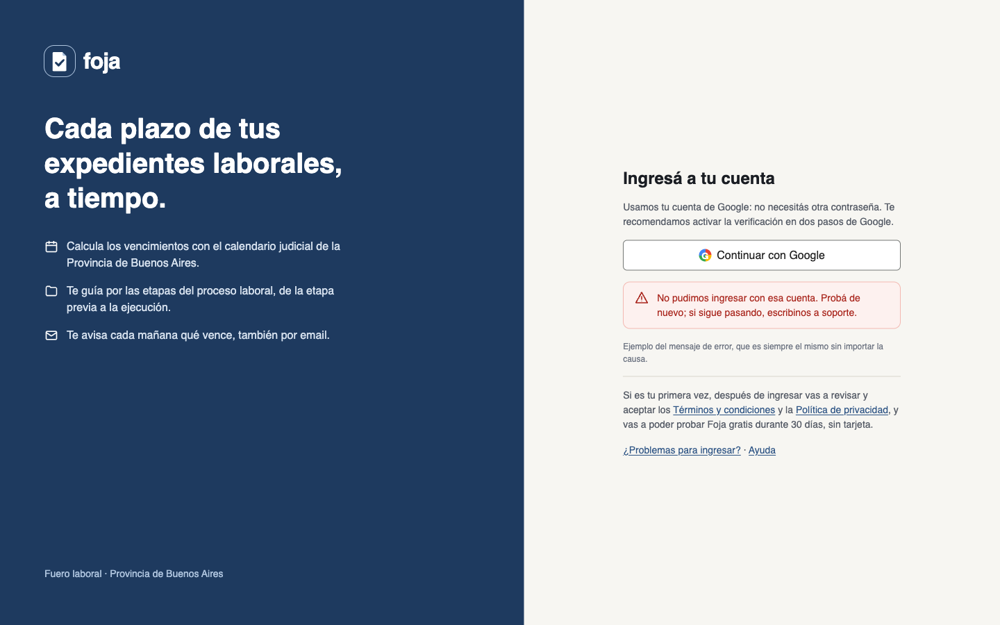

- **Ruta:** `/ingresar`. **Quién:** sin sesión. **HU:** HU-04. **Maqueta:** `01_ingreso.html`.
- **Objetivo:** entrar con Google en un clic, entendiendo qué es Foja.
- **Contenido:** panel de marca (logo, lema, tres beneficios) y panel de ingreso con el botón "Ingresar con Google" (`iniciarLogin`), la recomendación de activar la verificación en dos pasos de Google, los enlaces a Términos y Política de privacidad, y "¿Problemas para ingresar?".
- **Estados:** error de login genérico ("No pudimos ingresar con Google. Probá de nuevo."), sin indicar si la cuenta existe. En celular, la marca se reduce a una franja arriba.

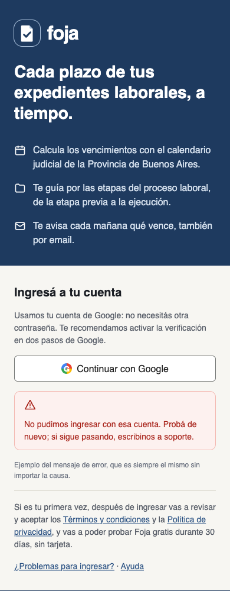

### P02 Bienvenida (crear el estudio)

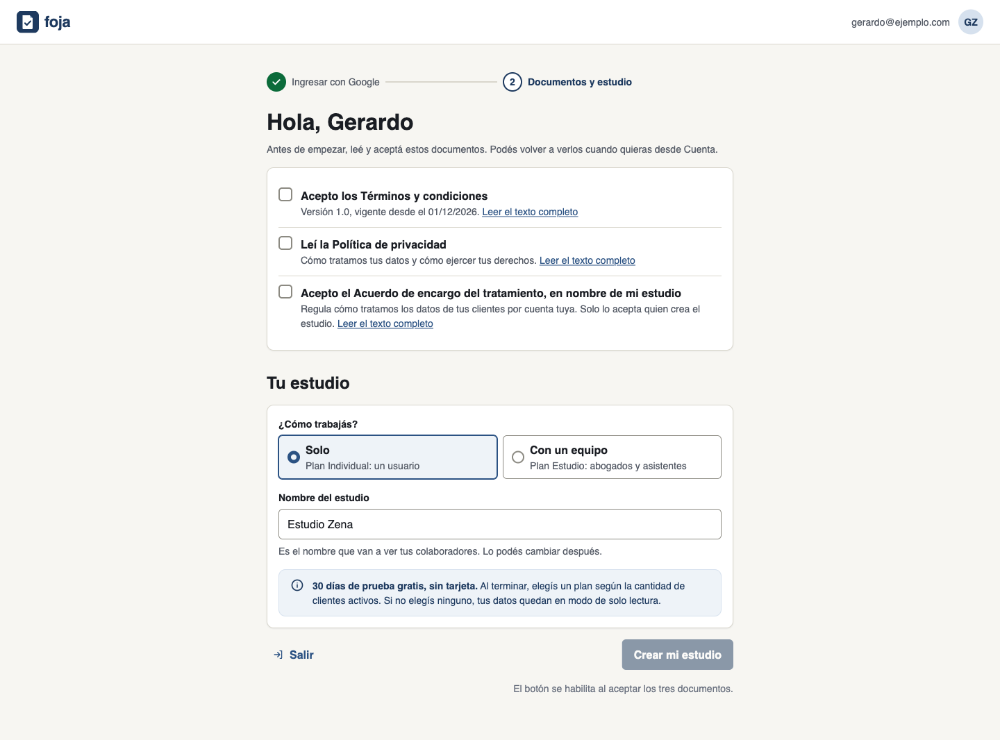

- **Ruta:** `/bienvenida`. **Quién:** con sesión y sin estudio. **HU:** HU-06, HU-07. **Maqueta:** `02_bienvenida.html`.
- **Paso 1, documentos legales:** casillas sin tildar para Términos y condiciones y Política de privacidad; para quien crea el estudio, también el Acuerdo de encargo del tratamiento. Cada documento tiene "Leer el texto completo", que lo abre en un panel sin perder lo cargado.
- **Paso 2, el estudio:** "Trabajo solo" o "Con un equipo" (define el plan sugerido), nombre del estudio y el aviso de 30 días de prueba sin tarjeta.
- **Acción:** "Crear mi estudio" (`aceptarDocumentos` y `crearEstudio`), deshabilitado hasta completar todo.
- **Variante invitación:** si llega con un token de invitación, muestra "María te invitó a Estudio Zena como Abogado", pide solo los documentos del paso 1 y llama a `aceptarInvitacion`.

### P03 Inicio

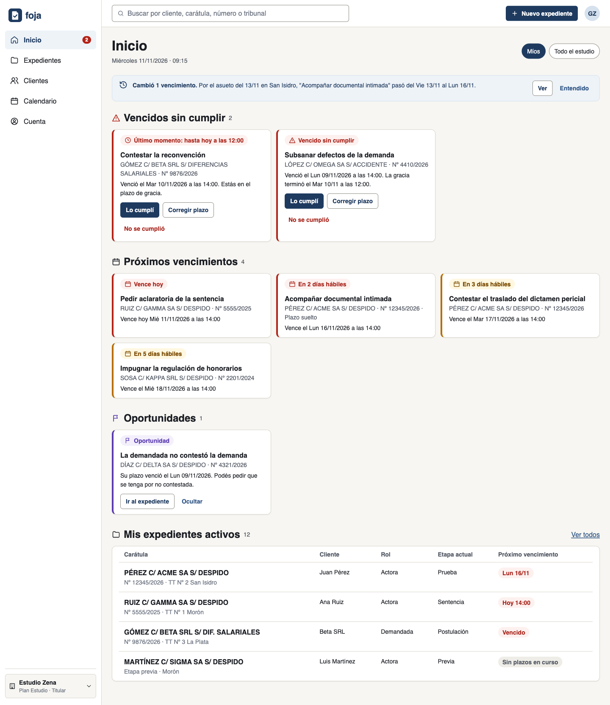

- **Ruta:** `/inicio`. **Quién:** todos. **HU:** HU-31 a HU-33. **Maqueta:** `03_inicio.html`.
- **Objetivo:** responder "¿qué se me vence y qué tengo que hacer hoy?".
- **Contenido, en este orden fijo:**
  1. Franja "Cambió 1 vencimiento", si hay avisos sin ver (3.8).
  2. **Vencidos sin cumplir** (`overdueUnfulfilled` y `lastMoment`): siempre arriba y no se puede ocultar. Cada tarjeta tiene "Lo cumplí", "No se cumplió" (T, A) y "Corregir plazo". No desaparece hasta que se elige una acción.
  3. **Próximos vencimientos** (`red` y `yellow`), ordenados por fecha. Incluyen los plazos sueltos.
  4. **Oportunidades** (`opportunities`), con la acción sugerida.
  5. **Expedientes activos**: tabla con los 10 de vencimiento más próximo (`listarExpedientes`, `sort=PROXIMO_VENCIMIENTO`) y "Ver todos".
- **Filtro "Míos / Todo el estudio":** solo en el plan Estudio. "Míos" muestra los expedientes en los que el usuario es responsable.
- **Acciones:** tocar una tarjeta lleva a la ficha, con el paso seleccionado (`/expedientes/:id?paso=:stepId`).
- **Estados:** vacío (P15, pieza 9); calendario no cargado (aviso arriba, con `calendarStatus`); solo lectura.

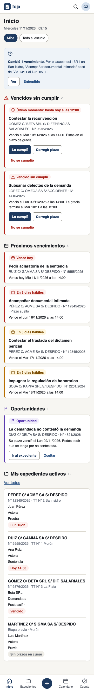

### P04 Expedientes

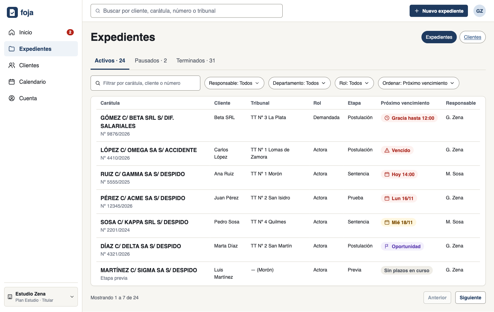

- **Ruta:** `/expedientes`. **Quién:** todos. **HU:** HU-17, HU-20. **Maqueta:** `04_expedientes.html`.
- **Contenido:** pestañas Activos, Pausados y Terminados con la cantidad de cada una (`status`); filtro de texto (`q`); chips de responsable, departamento y rol; orden (`sort`); tabla con carátula y número, cliente, tribunal, rol, etapa, próximo vencimiento (con su etiqueta de estado) y responsable; páginas de 20 (el valor por defecto de la API).
- **En celular:** la tabla pasa a tarjetas (`tabla-movil`); el chip "Clientes" lleva a P09.
- **Los filtros viven en la URL** (`?estado=PAUSADO&q=perez`), para que se puedan compartir y sobrevivan a "Atrás".

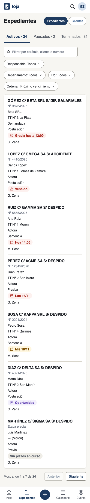

### P05 Nuevo expediente

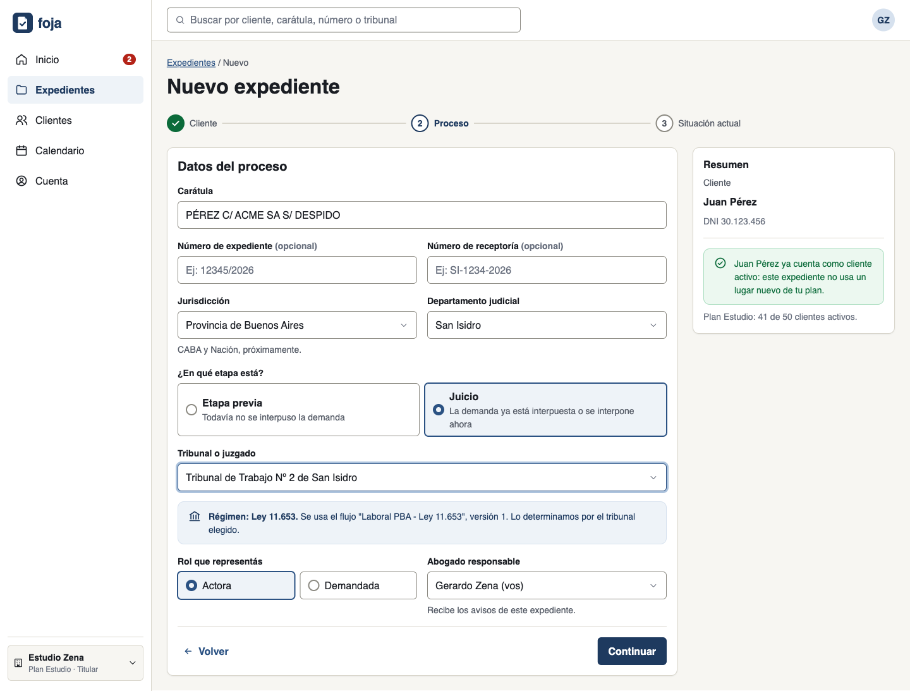

- **Ruta:** `/expedientes/nuevo`. **Quién:** todos. **HU:** HU-17, HU-18. **Maqueta:** `05_nuevo_expediente.html`.
- **Pasos:** 1 Cliente (elegir uno existente con `listarClientes` o crearlo con `crearCliente`), 2 Proceso, 3 Situación. El paso actual se marca en el indicador de arriba; se puede volver a un paso hecho sin perder datos.
- **Paso 2, Proceso:** carátula, número (opcional), jurisdicción (PBA fija; CABA y Federal como "Próximamente", deshabilitadas), departamento, tribunal (depende del departamento), rol (Actora o Demandada), responsable (plan Estudio).
- **Resolución del régimen:** al elegir el tribunal, `resolverRegimen` muestra en una franja qué flujo se va a usar ("Ley 11.653, Tribunal de Trabajo, flujo v1"). Si no se puede resolver, lo explica y no deja continuar.
- **Resumen lateral:** lo cargado hasta ahora y si el cliente ya cuenta como activo en el plan.
- **Límite de clientes:** P15, pieza 2, en lugar del botón "Crear expediente".

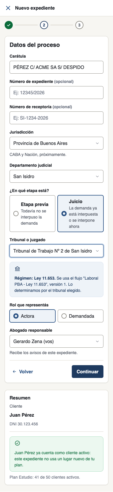

### P06 Nuevo expediente en curso

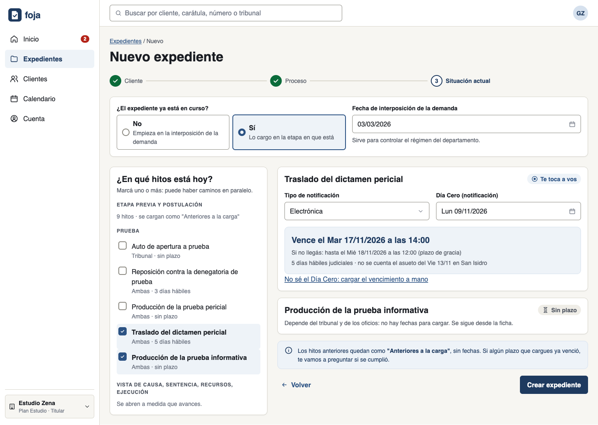

- **Ruta:** `/expedientes/nuevo` (paso 3, opción "Ya está en trámite"). **HU:** HU-19. **Maqueta:** `06_nuevo_en_curso.html`.
- **Contenido:** fecha de interposición de la demanda; mapa del flujo (`obtenerVersionFlujo`) para elegir uno o más hitos actuales; por cada hito elegido, su Día Cero y el vencimiento calculado (`calcularPlazo`), o "No sé el Día Cero", que pide el vencimiento y un motivo (queda como `MANUAL`).
- **Hitos sin plazo** (`SIN_PLAZO`) muestran "Esperando al tribunal" y no piden fecha.
- **Hitos anteriores:** "Anteriores a la carga", sin fechas.
- **Vencido al cargar:** si un vencimiento calculado ya pasó, en ese momento pregunta "¿Se cumplió?" (Sí, con la fecha del cargo; No, con motivo).

### P07 Ficha del expediente

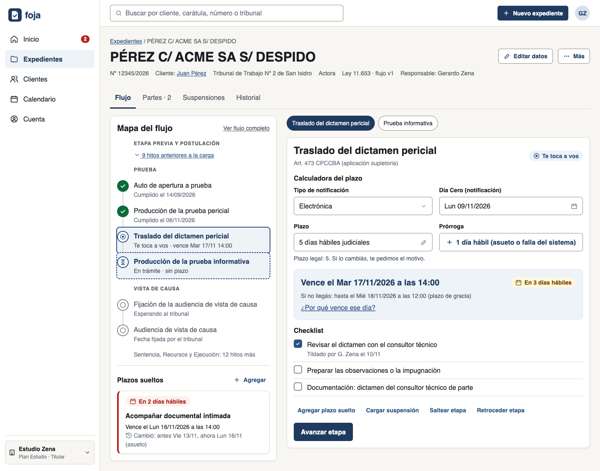

- **Ruta:** `/expedientes/:id`. **Quién:** todos. **HU:** HU-20 a HU-30. **Maqueta:** `07_ficha.html`.
- **Cabecera:** carátula, número, cliente (enlace a P09), tribunal, rol, versión del flujo y responsable. "Editar datos" (`actualizarExpediente`) y "Más": Pausar o Reactivar (`actualizarExpediente` con `currentStatus`, `reactivarExpediente`), Terminar (`terminarExpediente`, pide motivo y fecha) y Eliminar (T, A; `eliminarExpediente`).
- **Pestañas:** Flujo, Partes (`listarPartes`, `crearParte`, `actualizarParte`, `borrarParte`), Suspensiones (`listarSuspensiones`, `crearSuspension`, `borrarSuspension`) e Historial (`obtenerHistorial`).
- **Mapa del flujo** (`obtenerMapa`): lista vertical agrupada por fase. Cada nodo muestra su estado (completado, actual, futuro, vencido, anulado), de quién es ("Te toca a vos", "Le toca a la contraparte", "Esperando al tribunal") y la fecha. Las fases sin actividad se colapsan ("9 hitos anteriores a la carga", "Sentencia, Recursos y Ejecución: 12 hitos más"). Debajo, los plazos sueltos.
- **Panel de acción:** si hay varios hitos actuales, chips para elegir cuál. Para el elegido:
  - título, referencia normativa y de quién es;
  - **calculadora** con los campos que pide el tipo de plazo (Día Cero, fecha del hecho, fecha y hora, audiencia de referencia), el plazo editable con motivo (`actualizarPlazo`) y la prórroga de "+1 día hábil";
  - **resultado:** vencimiento, etiqueta de estado, gracia y "¿Por qué vence ese día?";
  - **checklist** (`actualizarItemChecklist`), con quién tildó y cuándo;
  - **acciones:** "Avanzar etapa" (principal, `avanzarEtapa`) y, como secundarias, "Agregar plazo suelto" (`crearPlazoSuelto`), "Cargar suspensión", "Saltear etapa" (`saltearEtapa`) y "Retroceder etapa" (`retrocederEtapa`).
- **Avisos del panel:** varios demandados ("Revisá desde qué notificación corre el plazo"), fecha fijada en día inhábil (advierte sin bloquear), calendario provisorio o no cargado.
- **En celular:** el panel de acción va primero y el mapa debajo; las acciones secundarias quedan en un menú "Más acciones".

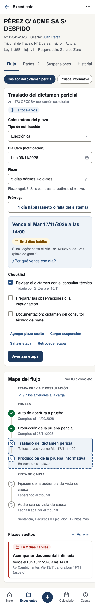

### P08 Diálogos del flujo

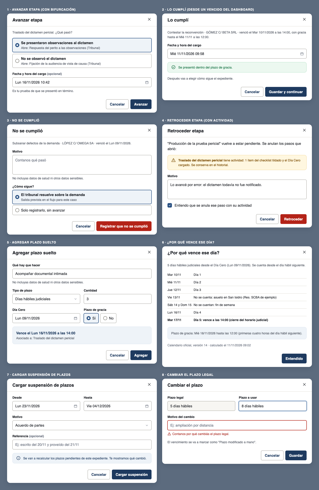

**Maqueta:** `08_dialogos.html`. Ver el catálogo completo en la [sección 5](#5-catálogo-de-diálogos).

### P09 Clientes

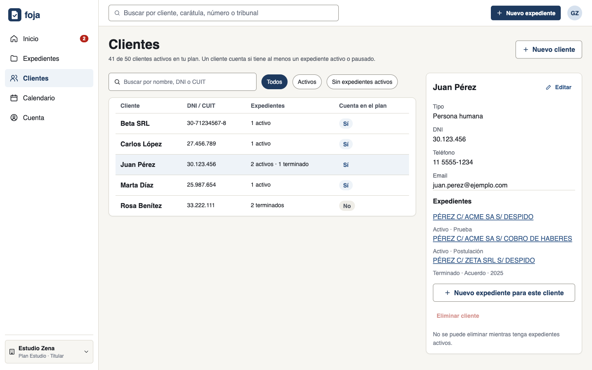

- **Ruta:** `/clientes` y `/clientes/:id`. **Quién:** todos. **HU:** HU-16. **Maqueta:** `09_clientes.html`.
- **Contenido:** el contador "41 de 50 clientes activos en tu plan" y qué cuenta como activo; buscador (`q`); chips Todos, Activos y Sin expedientes activos; tabla con nombre, DNI o CUIT, expedientes y si cuenta en el plan.
- **Detalle (panel derecho; en celular, pantalla propia):** datos del cliente (`obtenerCliente`), "Editar" (`actualizarCliente`), sus expedientes con estado y etapa, "Nuevo expediente para este cliente" (abre P05 con el cliente elegido) y "Eliminar cliente" (T, A; `eliminarCliente`), deshabilitado con la explicación si tiene expedientes activos.
- **Datos personales:** el DNI, el teléfono y el email se muestran solo en el detalle, no en la tabla de expedientes ni en el resumen por email.

### P10 Calendario

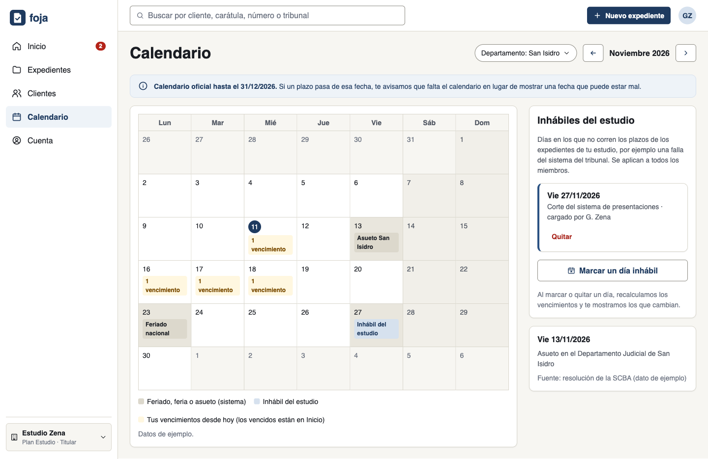

- **Ruta:** `/calendario`. **Quién:** todos; marcar o quitar inhábiles: T, A. **HU:** HU-35. **Maqueta:** `10_calendario.html`.
- **Contenido:** selector de departamento y de mes; franja con la cobertura del calendario (oficial o provisorio, y hasta cuándo); grilla mensual con feriados y asuetos del sistema (gris), inhábiles del estudio (azul) y vencimientos del usuario desde hoy (amarillo, con la cantidad); leyenda.
- **Panel lateral:** inhábiles del estudio con motivo y quién lo cargó, "Quitar" (`borrarInhabilEstudio`) y "Marcar un día inhábil" (`crearInhabilEstudio`). Tocar un día muestra su detalle (qué es, fuente o norma).
- **Al marcar o quitar un inhábil:** se recalculan los vencimientos y se muestra cuáles cambiaron (3.8).
- **En celular:** la grilla muestra un punto por día con eventos, y la lista del día tocado aparece debajo.

### P11 Cuenta · Plan

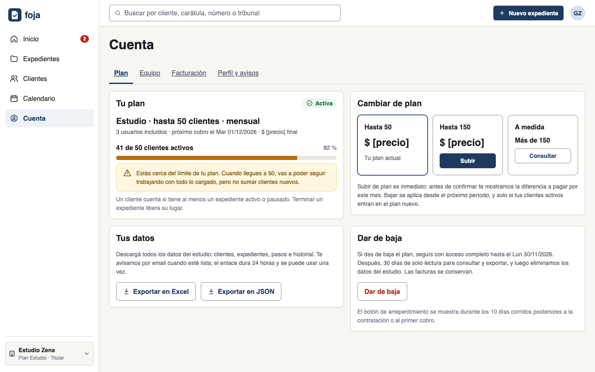

- **Ruta:** `/cuenta/plan`. **Quién:** todos lo ven; solo T actúa. **HU:** HU-36 a HU-40, HU-45. **Maqueta:** `11_cuenta_plan.html`.
- **Tu plan** (`obtenerSuscripcion`): plan, tramo, período, usuarios incluidos, próximo cobro y precio final; barra de clientes activos con el aviso al 80 %.
- **Cambiar de plan** (`listarPlanes`): tramos con precio final. "Subir" muestra primero la diferencia a pagar (`simularCambioPlan`) y después confirma (`cambiarPlan`). Bajar se programa para el próximo período, y se bloquea con la explicación si los clientes activos superan el nuevo límite.
- **Tus datos:** "Exportar en Excel" y "Exportar en JSON" (`pedirExportacion`); el estado del pedido (`obtenerExportacion`) se muestra en el mismo panel y avisa por email cuando está listo.
- **Dar de baja** (`darDeBaja`): siempre visible. Informa hasta cuándo hay acceso completo, el período de solo lectura y la fecha de borrado. Al confirmar, muestra el número de trámite. Si la baja está programada, ofrece "Anular la baja" (`anularBaja`).
- **Arrepentimiento** (`arrepentirse`): solo durante los 10 días corridos posteriores a la contratación o al primer cobro.
- **Prueba gratuita:** en lugar de "Tu plan", "Te quedan N días de prueba" y "Elegir un plan" (`iniciarCheckout`).

### P12 Cuenta · Facturación

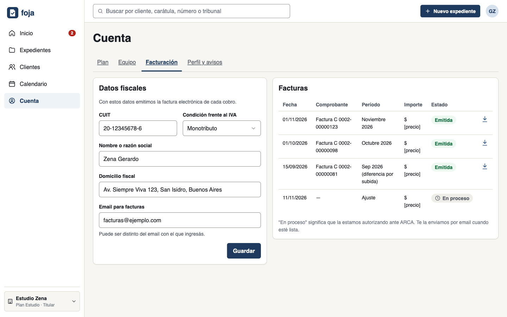

- **Ruta:** `/cuenta/facturacion`. **Quién:** solo T (la pestaña no aparece para los demás). **HU:** HU-42, HU-44. **Maqueta:** `12_cuenta_facturacion.html`.
- **Datos fiscales** (`obtenerDatosFiscales`, `actualizarDatosFiscales`): CUIT (valida el dígito verificador al salir del campo), condición frente al IVA, nombre o razón social, domicilio fiscal y email para facturas. Se piden antes del primer cobro.
- **Facturas** (`listarFacturas`): fecha, comprobante, período, importe y estado, y descarga del PDF (`descargarFactura`) solo para las autorizadas. `AUTORIZADA` se muestra como "Emitida"; `PENDIENTE`, `RECHAZADA` y `ERROR`, como "En proceso", porque los rechazos los resuelve el equipo y no el cliente. Las notas de crédito son filas propias, con el comprobante que anulan.

### P13 Cuenta · Equipo

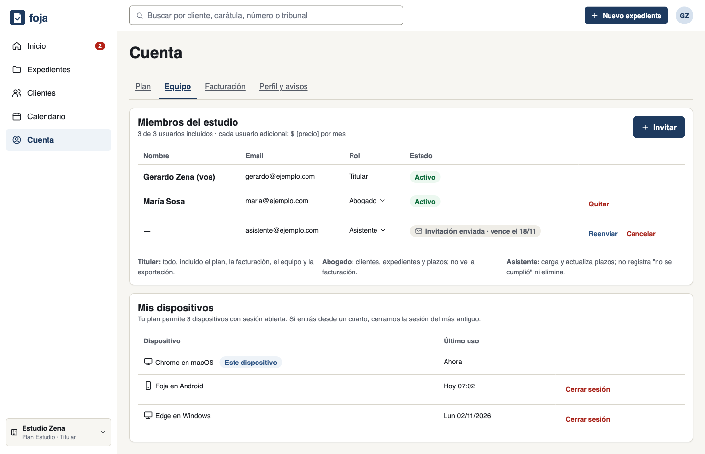

- **Ruta:** `/cuenta/equipo`. **Quién:** todos ven la lista; solo T invita, cambia roles y quita. **HU:** HU-05, HU-08. **Maqueta:** `13_cuenta_equipo.html`.
- **Miembros** (`listarMiembros`): nombre, email, rol (selector para T, `cambiarRolMiembro`), estado (Activo, Invitación enviada con vencimiento) y acciones (Quitar con `revocarMiembro`; Reenviar y Cancelar la invitación). "Invitar" (`invitarMiembro`) pide email y rol, y avisa el costo si supera los usuarios incluidos. Debajo, qué puede hacer cada rol.
- **Mis dispositivos** (`listarDispositivos`, `revocarDispositivo`): del usuario actual, con "Este dispositivo" marcado y "Cerrar sesión" en los demás. Explica el límite de 3.
- **Plan Individual:** la sección Miembros se reemplaza por "Tu plan es para una persona. Para sumar a tu equipo, pasá al plan Estudio."

### P14 Cuenta · Perfil y avisos

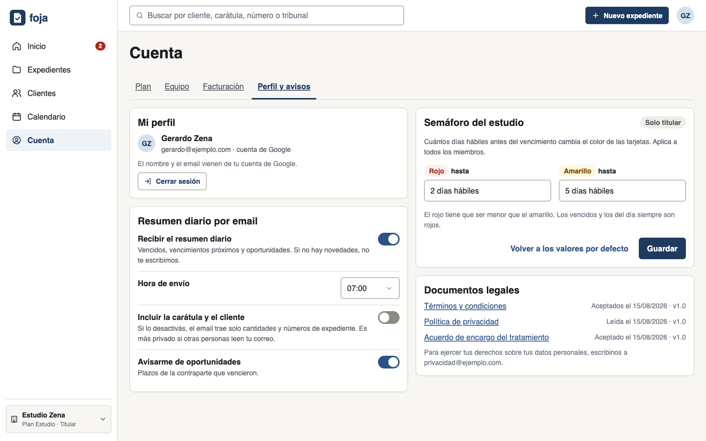

- **Ruta:** `/cuenta/perfil`. **Quién:** todos; el semáforo solo lo edita T. **HU:** HU-32, HU-34. **Maqueta:** `14_cuenta_avisos.html`.
- **Mi perfil** (`obtenerPerfil`): nombre y email de Google (no editables) y "Cerrar sesión".
- **Resumen diario por email** (`obtenerPreferencias`, `actualizarPreferencias`): activarlo, hora de envío, incluir carátula y cliente (desactivado por defecto, con la explicación de privacidad) y avisos de oportunidades. Los interruptores guardan solos y confirman con un *toast*.
- **Semáforo del estudio** (`obtenerParametrosAlertas`, `actualizarParametrosAlertas`): días hábiles para rojo y amarillo, la regla "el rojo tiene que ser menor que el amarillo" y "Volver a los valores por defecto". Los demás roles lo ven como texto, sin campos.
- **Documentos legales:** los aceptados, con fecha y versión, y el contacto para ejercer los derechos sobre los datos personales.

### P15 Estados transversales

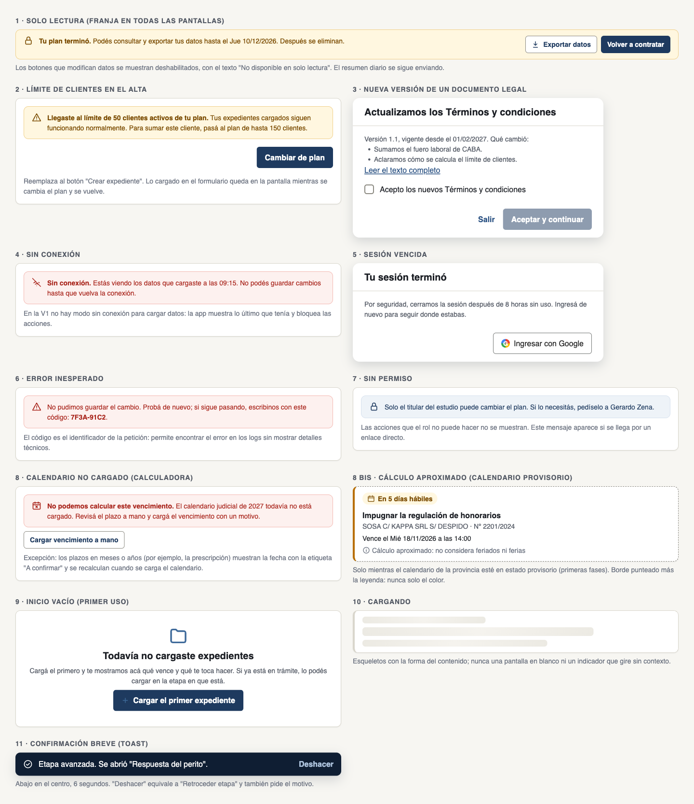

**Maqueta:** `15_estados.html`. Las piezas de esta lámina se usan en todas las pantallas:

| Pieza | Dónde aparece | Ver |
| ----- | ----- | ----- |
| 1 Solo lectura | Debajo de la barra superior, en todas las pantallas | 3.7 |
| 2 Límite de clientes | Alta de expediente, reactivar expediente | P05, HU-18 |
| 3 Nueva versión de un documento legal | Al ingresar, si hay aceptaciones pendientes | HU-06 |
| 4 Sin conexión | Debajo de la barra superior | 3.9 |
| 5 Sesión vencida | Ante un 401 | 3.3 |
| 6 Error inesperado | Ante un 500 o sin respuesta | 3.3 |
| 7 Sin permiso | Ante un 403 o una ruta del rol equivocado | 3.6 |
| 8 Calendario no cargado | Calculadora y tarjetas | 3.10 |
| 8 bis Cálculo aproximado | Tarjetas y resultado de la calculadora | 3.10 |
| 9 Vacío | Inicio y listas | 3.2 |
| 10 Cargando | Primera carga de cada pantalla | 3.1 |
| 11 *Toast* | Después de una acción que se puede deshacer | 3.4 |

### P16 Back-office · Calendario judicial

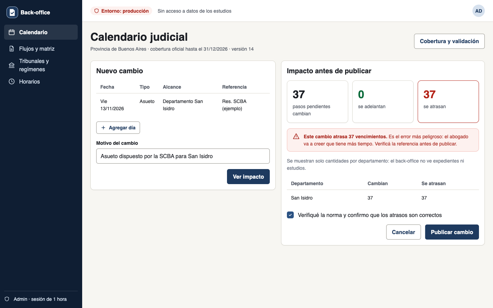

- **Ruta:** `/admin/calendario`, en el subdominio del back-office. **Quién:** ADMIN con MFA. **HU:** HU-09, HU-11. **Maqueta:** `16_admin_calendario.html`.
- **Marco:** barra lateral oscura, para que no se confunda con la app; etiqueta del entorno ("producción" en rojo); "Sin acceso a datos de los estudios"; sesión de 1 hora.
- **Nuevo cambio:** filas con fecha, tipo (feriado, asueto, feria), alcance (nacional, provincial, departamento) y referencia (obligatoria para asuetos y ferias), más el motivo.
- **Ver impacto** (`simularCambioCalendario`): cuántos pasos pendientes cambian, cuántos se adelantan y cuántos se atrasan, por departamento, sin mostrar expedientes ni estudios. Si hay atrasos, la franja roja y la casilla "Verifiqué la norma y confirmo que los atrasos son correctos" son obligatorias para "Publicar cambio" (`aplicarCambioCalendario` con `confirmDelays`).
- **Cobertura y validación** (`listarCobertura`, `actualizarCobertura`): estado (provisorio u oficial) y "cubierto hasta". Pasar a oficial pide un validador distinto de quien cargó el cambio.

### P17 Back-office · Flujos y matriz

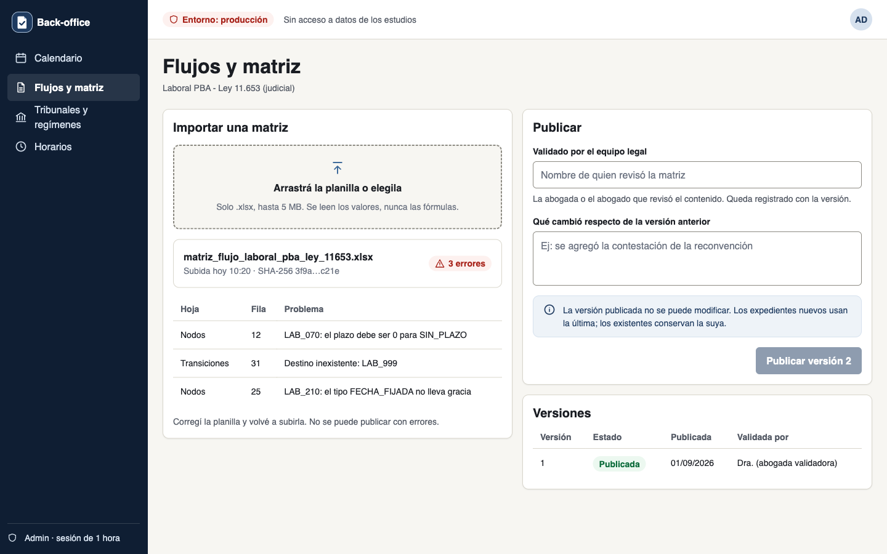

- **Ruta:** `/admin/flujos`. **Quién:** ADMIN. **HU:** HU-12. **Maqueta:** `17_admin_matriz.html`.
- **Importar** (`importarMatriz`): zona para arrastrar o elegir la planilla (.xlsx, hasta 5 MB). Muestra el nombre del archivo, la hora y el SHA-256 abreviado. Si hay errores (`obtenerImportacion`), los lista por hoja y fila con un mensaje que se entiende sin abrir el código.
- **Publicar** (`publicarVersionFlujo`): quién del equipo legal validó (`approvedByLegal`) y qué cambió (`notes`). El botón queda deshabilitado mientras la importación tenga errores. Aclara que la versión publicada es inmutable y que los expedientes existentes conservan la suya.
- **Versiones:** número, estado, fecha y quién validó (`listarFlujos`).

### P18 Email del resumen diario

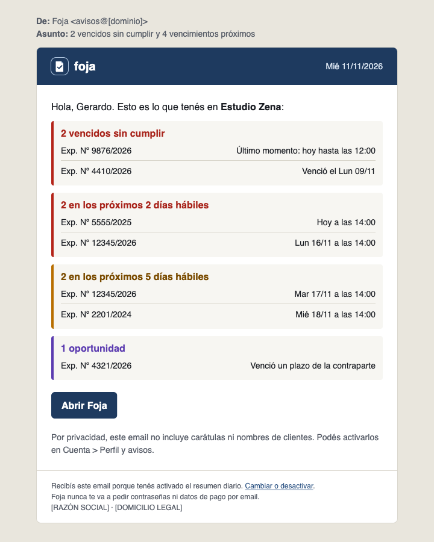

- **HU:** HU-34. **Maqueta:** `18_email_resumen.html` (ancho 600 px).
- **Asunto:** las cantidades ("2 vencidos sin cumplir y 4 vencimientos próximos"), nunca carátulas ni nombres.
- **Cuerpo:** bloques por estado con el borde del color y el título en texto (vencidos, rojo, amarillo, oportunidades); por defecto solo número de expediente y fecha; un botón "Abrir Foja" que lleva a Inicio (no al expediente, para no poner IDs en enlaces de email).
- **Pie:** por qué lo recibe y "Cambiar o desactivar", el aviso antiphishing y los datos del responsable.
- **Construcción:** HTML con tablas y estilos en línea (los clientes de correo no leen hojas externas), versión de texto plano, sin píxel de seguimiento ni enlaces con rastreo. Si no hay novedades, no se envía.

---

## 5. Catálogo de diálogos

Todos siguen 3.4: título con la acción, explicación de qué pasa, motivo cuando corresponde y botón con el verbo. En celular son hojas inferiores.

| Diálogo | Se abre desde | Campos | Operación | Notas |
| ----- | ----- | ----- | ----- | ----- |
| Avanzar etapa | Ficha | Salida (si hay bifurcación), fecha y hora del cargo (opcional) | `avanzarEtapa` | Sin bifurcación y sin cargo, avanza directo con *toast*. |
| Lo cumplí | Inicio, ficha | Fecha y hora del cargo | `marcarCumplido` | Dice si se presentó en término o dentro de la gracia. Después ofrece avanzar. |
| No se cumplió | Inicio, ficha (T, A) | Motivo, cómo sigue (salida prevista o solo registrar) | `registrarNoCumplido` | Botón rojo. |
| Saltear etapa | Ficha | Motivo | `saltearEtapa` | Explica qué pasos quedan sin hacer. |
| Retroceder etapa | Ficha, *toast* | Motivo, confirmación si hay actividad | `retrocederEtapa` | Muestra qué actividad se anula (checklist, Día Cero). |
| Agregar plazo suelto | Ficha | Qué hay que hacer, tipo, cantidad, Día Cero, gracia | `crearPlazoSuelto` | Vista previa del vencimiento (`calcularPlazo`) antes de guardar. |
| Anular plazo suelto | Ficha | Motivo | `anularPlazoSuelto` | |
| ¿Por qué vence ese día? | Resultado de la calculadora | Ninguno | Datos de `calcularPlazo` | Día por día, con los inhábiles y su fuente, y la versión del calendario. |
| Cargar suspensión | Ficha | Desde, hasta, motivo, referencia (opcional) | `crearSuspension` | Avisa que se recalculan los pendientes. |
| Cambiar el plazo | Calculadora | Plazo a usar, motivo | `actualizarPlazo` | El vencimiento queda marcado "Plazo modificado a mano". |
| Terminar expediente | Ficha, "Más" | Motivo (sentencia, acuerdo, desistimiento, otro) y fecha | `terminarExpediente` | Informa si libera el lugar del cliente en el plan. |
| Eliminar expediente o cliente | Ficha o cliente (T, A) | Escribir el número o el nombre para confirmar | `eliminarExpediente`, `eliminarCliente` | Botón rojo lleno. |
| Marcar un día inhábil | Calendario (T, A) | Fecha, motivo | `crearInhabilEstudio` | Después muestra los vencimientos que cambiaron. |
| Invitar | Equipo (T) | Email, rol | `invitarMiembro` | Avisa el costo si supera los incluidos. |
| Cambiar de plan | Plan (T) | Tramo | `simularCambioPlan`, `cambiarPlan` | Muestra la diferencia antes de confirmar. |
| Dar de baja | Plan (T) | Motivo (opcional) | `darDeBaja` | Fechas de acceso, solo lectura y borrado; número de trámite. |
| Arrepentimiento | Plan (T) | Ninguno | `arrepentirse` | Número de trámite e información de la devolución. |

## 6. Lo que las pantallas pidieron al contrato

Al diseñar las pantallas aparecieron necesidades que el contrato de API (`api/openapi_v1.yaml`) no cubría. Ya están en el contrato y en el modelo de datos:

| Pantalla | Necesidad | Dónde quedó |
| ----- | ----- | ----- |
| P03, P07, P18 | Etiquetas "En N días hábiles" (3.10) | `businessDaysRemaining` en `DashboardItem` y `Step`, y `nextDueBusinessDaysRemaining` en `CaseSummary`. Lo calcula el backend; el frontend no cuenta días hábiles. Si falta (vencido, sin calendario), la etiqueta muestra la fecha. |
| P04, P07 | Color del vencimiento en la lista y en el mapa | `alertLevel` en `Step` y `nextDueAlertLevel` en `CaseSummary`, con los mismos umbrales que el dashboard. |
| P03, P07 | Avisos de "tu vencimiento cambió" (3.8) | `listarAvisosCambio` y `marcarAvisosVistos`, sobre las tablas `deadline_change_notices` y `deadline_change_notice_reads`. "Visto" es por usuario. |
| P03 | Filtro "Míos / Todo el estudio" | Parámetro `scope=MIOS|ESTUDIO` en `obtenerDashboard` y `listarAvisosCambio`. Sin el parámetro: `MIOS` para titular y abogado, `ESTUDIO` para asistente. |
| P04 | Filtros por responsable, departamento y rol | Parámetros `responsibleUserId`, `departmentId` y `representedRole` en `listarExpedientes`. |
| P04 | Cantidad por pestaña (Activos 24, Pausados 2, Terminados 31) | `statusCounts` en la respuesta de `listarExpedientes`, con los mismos filtros sin tener en cuenta el estado. |
| Buscador global | Buscar también por tribunal | La búsqueda de `listarExpedientes` incluye el nombre del tribunal. |
| P17 | Lista de versiones publicadas de un flujo | `listarFlujos` (back-office), con cada versión, su fecha, quién publicó, las notas y si la validó el equipo legal. |
| P11 | Estado del pedido de exportación al volver a la pantalla | `listarExportaciones` (últimos 7 días), sobre la tabla `data_exports`. |

## 7. Pendientes

- **Logo final y textos convertidos a curvas** antes de generar los íconos de la PWA (identidad, sección 13).
- **Precios** de cada tramo y **dominio** (aparecen como `[precio]` y `[dominio]`).
- **Pantallas no maquetadas:** variante de invitación de P02, catálogos del back-office (tribunales, regímenes y horarios), pestañas Partes, Suspensiones e Historial de la ficha, y tablet. Siguen los mismos patrones; conviene maquetarlas si el desarrollo encuentra ambigüedades.
- **Tema oscuro:** fuera de la V1 (identidad, sección 4.4).
- **Prueba con usuarios:** conviene probar P03 y P07 con dos o tres abogados antes de construir, con las maquetas en el celular.
