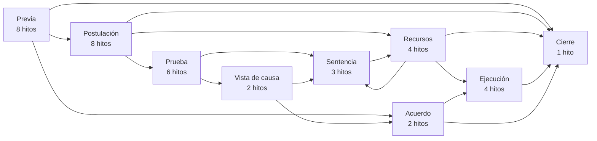

# Documentación de Proyecto: Asistente Legal y Gestor de Procesos (V1)

## 1. Visión General

Aplicación diseñada para abogados en Argentina que funciona como un asistente inteligente. Su objetivo dual es:

1. **Gestión de Cartera:** Mostrar el estado actual de cada cliente y su proceso legal activo.

2. **Motor de Guía y Plazos:** Basado en diagramas de flujo pre-cargados por fuero, guía al abogado paso a paso, calculando los vencimientos legales y recordando las tareas críticas (con foco en el plazo de gracia).

## 2. Alcance de la Versión 1 (MVP)

Para garantizar el lanzamiento ágil y controlar costos, la V1 tendrá el siguiente alcance definido:

* **Fueros y Jurisdicciones:** Únicamente **Fuero Laboral de la Provincia de Buenos Aires (PBA)**. (CABA y otros fueros quedan para V2+).

* **Ingreso de Datos:** 100% manual por parte del abogado/asistente.

* **Integraciones Externas:** **EXCLUIDAS**. No habrá conexión automática con la MEV (Mesa de Entradas Virtual) ni con el portal de Notificaciones Electrónicas de la SCBA en esta fase.

* **Notificaciones:** El sistema generará alertas exclusivamente dentro de la aplicación.

* **Motor de Calendario:** Debe incluir lógica de días hábiles judiciales PBA, ferias judiciales (enero/julio) y feriados nacionales precargados.

## 3. Definiciones Funcionales Acordadas (V1)

El desarrollo del MVP se guiará por las siguientes definiciones de producto:

### A. Perspectiva y Roles
* **Múltiples Roles:** La app permitirá elegir al inicio del proceso si el abogado representa a la **Parte Actora** o a la **Parte Demandada**. El sistema adaptará quién tiene la responsabilidad del plazo perentorio en cada hito según el rol seleccionado.

### B. Mecánica de Cálculo y Sobrescritura
* **Cálculo Automático Híbrido:** El abogado ingresa la fecha del evento disparador (ej. día de notificación) y el sistema suma automáticamente los días hábiles judiciales correspondientes.
* **Sobrescritura Manual (Override):** Aunque el sistema sugiera el plazo legal por defecto (ej. 10 días), **el campo de cantidad de días será editable**. Si el tribunal fijó un plazo atípico (ej. 12 días hábiles), el abogado podrá modificar este valor antes de iniciar la cuenta regresiva.

### C. Calendario Judicial y Contingencias
* **Base Centralizada:** El backend de la app contendrá los feriados y ferias inamovibles.
* **Botón de Prórroga por Asueto:** Ante un asueto imprevisto de la SCBA, paro judicial local o caída del portal, el usuario tendrá un botón dentro del caso procesal para **"Prorrogar plazo (+1 día hábil)"**. Esto recalculará inmediatamente la fecha fatal sin necesidad de que el sistema central se entere del asueto local.

### D. Flexibilidad del Flujo (Roadmap)
* **Navegación Flexible:** La app guiará paso a paso proponiendo el camino lógico siguiente según la matriz, pero siempre existirá la opción de **"Cambiar de etapa manualmente"** (saltar pasos o retroceder). El flujo sugerido no será una camisa de fuerza.

### E. Sistema de Alertas (V1)
* **In-App Exclusivo:** En esta primera versión, todas las alertas (vencimientos del día, plazo de gracia, próximos a vencer) se visualizarán **únicamente dentro de la aplicación** (mediante un panel de control o *dashboard* y listados con indicadores visuales). El envío de correos electrónicos consolidados queda relegado para la V2.

## 4. Matriz de Flujos Procesales (Entregable del Abogado)

El equipo legal completa una planilla por régimen procesal. Para el fuero laboral de PBA bajo la Ley 11.653, el archivo es `matriz_flujo_laboral_pba_ley_11653.xlsx`. El back-office la importa, la valida y la publica como una **versión del flujo**: una vez publicada no se modifica, y cada expediente queda atado a la versión con la que se creó (ver el dominio Motor de Flujos en el modelo de datos).

### Hojas de la planilla

| Hoja | Contenido | Se importa a |
| ----- | ----- | ----- |
| `Instrucciones` | Reglas de carga | No se importa |
| `Flujo` | Régimen, versión, quién validó y cuándo | `flows`, `flow_versions` |
| `Nodos` | Un hito por fila | `flow_nodes`, `flow_node_checklist_items` |
| `Transiciones` | Un camino posible por fila | `flow_transitions` |
| `Dudas_a_validar` | Preguntas abiertas para el equipo legal | No se importa |
| `Valores` | Listas de valores permitidos (desplegables) | No se importa |

### Hoja `Nodos`

#### Bloque 1: Identificación y Estado

* **`ID_Paso`**: Código único alfanumérico (ej: `LAB_050`). Usar saltos de 10 en 10, para poder intercalar hitos sin renumerar (ej: `LAB_015`).
* **`Fase_Proceso`**: Etapa macro. Valores: `Previa`, `Postulación`, `Prueba`, `Vista de causa`, `Sentencia`, `Recursos`, `Ejecución`, `Acuerdo`, `Cierre`.
* **`Nombre_Hito`**: Título corto de la acción o estado actual.
* **`Rol_Responsable`**: Quién debe actuar.
  * `ACTORA`: la parte actora.
  * `DEMANDADA`: la parte demandada.
  * `TRIBUNAL`: depende del tribunal; la app muestra "Esperando resolución".
  * `AMBAS`: puede o debe actuar cualquiera de las partes (recursos, impugnaciones, audiencias).
* **`Es_Inicial`** / **`Es_Final`**: `SI` / `NO`. Hay un solo nodo inicial. Los nodos finales no tienen transiciones de salida.

#### Bloque 2: Reglas de Cómputo del Plazo

* **`Evento_Disparador`**: Hecho exacto que inicia el reloj (el Día Cero).
* **`Plazo_Valor_Default`**: Número entero de días (o años) predeterminado por ley. Es el valor que la app sugiere y que el abogado puede editar en cada expediente.
* **`Plazo_Tipo`**:

  | Valor | Significado | Soporte en el motor V1 |
  | ----- | ----- | ----- |
  | `HABILES_JUDICIALES` | Días hábiles según el calendario judicial PBA | Sí |
  | `CORRIDOS` | Días corridos | Sí |
  | `SIN_PLAZO` | Sin plazo perentorio (valor `0`); depende del tribunal o de la parte | Sí |
  | `HABILES_ADMINISTRATIVOS` | Días hábiles de la LCT (etapa prejudicial) | Pendiente |
  | `ANIOS` | Plazos en años (prescripción) | Pendiente |
  | `FECHA_FIJADA` | Acto con fecha y hora fijadas, como una audiencia (valor `0`); el abogado carga la fecha | Pendiente |

* **`Aplica_Gracia`**: `SI` / `NO`. Habilita las 4 primeras horas del día hábil posterior (art. 124 CPCCBA). Siempre `NO` para `SIN_PLAZO` y `FECHA_FIJADA`.
* **`Base_Normativa`**: Ley y artículo.

#### Bloque 4: Asistente / Guía

* **`Checklist_Abogado`**: Tareas que el profesional debe realizar en este hito. Cada ítem va separado por punto y coma (`;`) y se convierte en una tarea tildable en el expediente.
* **`Documentacion_Requerida`**: Escritos, bonos, tasas o adjuntos obligatorios, con el mismo separador.

#### Columnas de trabajo (no se importan)

* **`Estado_Validacion`**: `PENDIENTE`, `VALIDADO` o `CORREGIR`.
* **`Comentarios_Equipo_Legal`**: observaciones libres.
* **`Control`**: fórmula que marca en rojo los errores de carga (ID duplicado, hito sin salidas o sin entradas, plazo incoherente con su tipo).

### Hoja `Transiciones` (Bloque 3: Flujo y Lógica de Bifurcación)

* **`ID_Paso_Origen`**: hito desde el que se sale.
* **`Condicion_Salida`**: qué evento define el camino a seguir. La app lo muestra como opción al presionar "Avanzar de etapa".
* **`ID_Paso_Destino`**: el hito al que se salta, o `CIERRA_CAMINO` (ver abajo). Nunca queda vacío.
* **`Orden`**: orden en que se muestran las opciones.

Reglas:

1. **Bifurcación:** si un hito tiene 3 salidas posibles, ocupa 3 filas con el mismo origen y distinta condición. Reemplaza a la regla anterior de repetir el hito con sufijos (`LAB_050-A`, `-B`, `-C`).
2. **Caminos en paralelo:** si la misma condición aparece en varias filas con distinto destino, al elegirla se abren **todos** esos hitos a la vez. Así se representan los plazos simultáneos; por ejemplo, la prescripción corre mientras avanza el reclamo.
3. **`CIERRA_CAMINO`:** la fila termina ese camino paralelo sin abrir otro hito (en la base de datos, `target_node_id` queda vacío).

**Relación con el rol representado (propuesta, decisión E13 del análisis):** hay un único flujo para ambos roles. `Rol_Responsable` indica quién debe actuar en cada hito, y la app distingue "te toca a vos" de "le toca a la contraparte" según el rol que el abogado representa en el expediente.

### Validaciones del importador

El back-office rechaza la planilla si no se cumple alguna de estas reglas:

* `ID_Paso` único y un solo nodo con `Es_Inicial = SI`.
* Todo origen y todo destino de `Transiciones` existe en `Nodos`, y ningún destino está vacío.
* Todo nodo no final tiene al menos una salida; ningún nodo final tiene salidas.
* Todos los nodos son alcanzables desde el nodo inicial.
* `SIN_PLAZO` y `FECHA_FIJADA` llevan plazo `0` y gracia `NO`; los demás tipos llevan un plazo mayor que `0`.
* Todos los valores están dentro de las listas permitidas.

Además, **no se publica** una versión que tenga filas en `PENDIENTE` o `CORREGIR`, o sin el campo "Validado por" de la hoja `Flujo`. Los tipos de plazo pendientes de soporte se aceptan con una advertencia hasta que se defina su tratamiento (sección 4 del análisis).

## 5. Ejemplo de Carga: Proceso Laboral Ordinario PBA (Ley 11.653)

Este ejemplo recorre un juicio laboral bonaerense ante un Tribunal de Trabajo de instancia única, completo, en 38 hitos y 76 transiciones:

* intercambio telegráfico, con la prescripción y la entrega de certificados en paralelo;
* conciliación previa;
* demanda, contestación y reconvención;
* prueba pericial e informativa;
* audiencia de vista de causa;
* veredicto y sentencia;
* recursos ante la SCBA;
* liquidación, ejecución y cobro;
* acuerdo conciliatorio, al que se puede llegar desde varias etapas.

> **Estado: borrador para validar.** Todas las filas están en `PENDIENTE`. Las citas normativas son orientativas y deben validarse artículo por artículo. Las 23 preguntas abiertas están en la sección 5.3 y en la hoja `Dudas_a_validar`. Si en algún departamento rige la Ley 15.057, se arma una matriz separada para ese régimen. El contenido es idéntico al de la planilla, que es la fuente de trabajo.

### 5.1 Mapa del flujo

Vista general por fases. El diagrama hito por hito, con colores por responsable, caminos en paralelo y condiciones en cada flecha, está en [`diagrama_flujo_laboral_pba_ley_11653.md`](diagrama_flujo_laboral_pba_ley_11653.md). Ambos se generan desde la planilla con `herramientas/matriz/diagrama.py`.

### 5.2 Hitos (hoja `Nodos`)

| ID_Paso | Fase_Proceso | Nombre_Hito | Rol_Responsable | Evento_Disparador | Plazo_Valor_Default | Plazo_Tipo | Aplica_Gracia | Base_Normativa | Es_Inicial | Es_Final | Checklist_Abogado | Documentacion_Requerida |
| ----- | ----- | ----- | ----- | ----- | ----- | ----- | ----- | ----- | ----- | ----- | ----- | ----- |
| **LAB_010** | Previa | Extinción del vínculo o injuria laboral | ACTORA | Comunicación del despido o hecho de injuria del empleador | 0 | SIN_PLAZO | NO | Arts. 242, 245 y 246 LCT | SI | NO | Registrar la fecha exacta de la extinción o de la injuria; Reunir datos de la relación (ingreso, categoría, convenio colectivo, jornada, remuneración); Evaluar registración deficiente y diferencias salariales | Telegrama o carta documento del empleador; Recibos de sueldo; Constancias de registración (ARCA) |
| **LAB_015** | Previa | Control de prescripción de la acción | ACTORA | Fecha de extinción del vínculo (exigibilidad de los créditos) | 2 | ANIOS | NO | Arts. 256 y 257 LCT | NO | NO | Verificar la fecha de inicio del cómputo; Considerar la suspensión por reclamo ante la autoridad administrativa (máximo 6 meses, art. 257 LCT); Interponer la demanda antes del vencimiento | Constancia de la fecha de extinción |
| **LAB_016** | Previa | Entrega de certificados de trabajo | DEMANDADA | Extinción del vínculo | 30 | CORRIDOS | NO | Art. 80 LCT; art. 3 Dec. 146/01 | NO | NO | Controlar si el empleador entregó el certificado de trabajo y la constancia de aportes | Certificado de trabajo (si fue entregado) |
| **LAB_017** | Previa | Intimación de entrega de certificados | DEMANDADA | Recepción por el empleador de la intimación fehaciente del trabajador | 2 | HABILES_ADMINISTRATIVOS | NO | Art. 80 LCT; art. 3 Dec. 146/01 | NO | NO | Remitir TCL intimando la entrega de los certificados; Guardar la constancia de entrega del telegrama | TCL de intimación; Aviso de entrega del correo |
| **LAB_020** | Previa | Pago de la liquidación final e indemnizaciones | DEMANDADA | Extinción del vínculo | 4 | HABILES_ADMINISTRATIVOS | NO | Arts. 128 y 255 bis LCT | NO | NO | Controlar el pago y el recibo de la liquidación final; Verificar rubros: indemnización por antigüedad, preaviso, integración del mes de despido, SAC y vacaciones proporcionales | Recibo de liquidación final; Constancia de depósito o transferencia |
| **LAB_030** | Previa | Intimación telegráfica del trabajador | DEMANDADA | Recepción por el empleador del telegrama del trabajador | 2 | HABILES_ADMINISTRATIVOS | NO | Art. 57 LCT; Ley 23.789 | NO | NO | Redactar el TCL intimando (pago, registración, aclaración de situación laboral o dación de tareas) bajo apercibimiento; Fijar un plazo no inferior a 2 días hábiles (editar el plazo si se fija uno mayor); Guardar el aviso de entrega | TCL (Ley 23.789); Aviso de entrega del correo |
| **LAB_035** | Previa | Comunicación del despido indirecto | ACTORA | Vencimiento del plazo de la intimación sin respuesta satisfactoria | 0 | SIN_PLAZO | NO | Arts. 242, 243 y 246 LCT | NO | NO | Comunicar por TCL que el trabajador se considera despedido, expresando la causa en forma concreta (art. 243 LCT); Intimar el pago de las indemnizaciones y la entrega de certificados | TCL de despido indirecto; Aviso de entrega del correo |
| **LAB_040** | Previa | Instancia de conciliación laboral previa | ACTORA | Presentación del reclamo ante el organismo de conciliación | 0 | SIN_PLAZO | NO | A validar: obligatoriedad, organismo y norma según el régimen del departamento | NO | NO | Verificar si la instancia es obligatoria en el departamento judicial; Presentar el reclamo y asistir a las audiencias; Obtener el acta de cierre (acuerdo o fracaso) | Formulario de reclamo; DNI del trabajador; Poder; Acta de cierre |
| **LAB_050** | Postulación | Interposición de la demanda | ACTORA | Cierre de la instancia previa o decisión de demandar | 0 | SIN_PLAZO | NO | Art. 26 L.11653 | NO | NO | Redactar objeto, hechos, derecho y liquidación detallada por rubro; Ofrecer toda la prueba con la demanda (documental, informativa, pericial, testimonial, confesional); Constituir domicilio electrónico; Presentar ante la Receptoría General de Expedientes del departamento | Poder o carta poder; DNI del trabajador; TCL y cartas documento intercambiadas; Recibos de sueldo; Acta de cierre de la instancia previa; Bono Ley 8480 y aportes Ley 6716 (verificar exenciones por gratuidad del trabajador) |
| **LAB_060** | Postulación | Radicación y traslado de la demanda | TRIBUNAL | Presentación de la demanda | 0 | SIN_PLAZO | NO | Arts. 27 y 28 L.11653 | NO | NO | Controlar el tribunal asignado y la providencia inicial; Confeccionar y diligenciar la cédula de traslado al domicilio del demandado | Cédula de traslado con copias de la demanda y documental |
| **LAB_065** | Postulación | Subsanación de defectos de la demanda | ACTORA | Notificación de la providencia que intima subsanar | 3 | HABILES_JUDICIALES | SI | Art. 27 L.11653 | NO | NO | Subsanar los defectos u omisiones señalados por el tribunal | Escrito de subsanación |
| **LAB_070** | Postulación | Contestación de la demanda | DEMANDADA | Notificación de la cédula de traslado de la demanda | 10 | HABILES_JUDICIALES | SI | Arts. 28 y 29 L.11653 | NO | NO | Reconocer o negar cada hecho y la autenticidad de la documental; Oponer todas las excepciones; Ofrecer toda la prueba; Reconvenir si corresponde; Acompañar la documentación laboral obligatoria | Poder; Estatuto y designación de autoridades (persona jurídica); Libro de sueldos (art. 52 LCT) y recibos; Formularios F.931; Bono Ley 8480 y aportes Ley 6716 |
| **LAB_075** | Postulación | Demanda no contestada | ACTORA | Vencimiento del plazo de contestación sin presentación | 0 | SIN_PLAZO | NO | Art. 28 L.11653 | NO | NO | Pedir que se haga efectivo el apercibimiento (presunción de veracidad de los hechos); Solicitar la apertura a prueba | Escrito solicitando se tenga por no contestada la demanda |
| **LAB_080** | Postulación | Traslado al actor de la contestación, documental y excepciones | ACTORA | Notificación del traslado de la contestación | 5 | HABILES_JUDICIALES | SI | Art. 29 L.11653 | NO | NO | Reconocer o desconocer la documental acompañada; Contestar las excepciones; Ofrecer prueba sobre hechos nuevos | Escrito de contestación del traslado |
| **LAB_085** | Postulación | Contestación de la reconvención | ACTORA | Notificación del traslado de la reconvención | 10 | HABILES_JUDICIALES | SI | Art. 30 L.11653 | NO | NO | Contestar la reconvención; Ofrecer prueba | Escrito de contestación de la reconvención |
| **LAB_090** | Postulación | Resolución de excepciones de previo pronunciamiento | TRIBUNAL | Contestación del traslado de las excepciones o vencimiento del plazo | 0 | SIN_PLAZO | NO | Art. 31 L.11653 | NO | NO | Controlar la resolución; Evaluar recursos si se admite una excepción que pone fin al proceso | — |
| **LAB_100** | Prueba | Auto de apertura a prueba | TRIBUNAL | Cierre de la etapa de postulación | 0 | SIN_PLAZO | NO | Art. 32 L.11653 | NO | NO | Controlar qué prueba se admitió y cuál se denegó; Registrar las cargas de impulso de cada medio de prueba | — |
| **LAB_105** | Prueba | Reposición contra la denegatoria de prueba | AMBAS | Notificación del auto de apertura a prueba | 3 | HABILES_JUDICIALES | SI | Arts. 238 y 239 CPCCBA (aplicación supletoria) | NO | NO | Fundar la reposición contra la prueba denegada; Hacer reserva de recurrir | Escrito de reposición |
| **LAB_110** | Prueba | Producción de la prueba pericial | AMBAS | Notificación del auto de apertura a prueba | 0 | SIN_PLAZO | NO | Art. 32 L.11653; arts. 457 y ss. CPCCBA | NO | NO | Controlar el sorteo y la aceptación del cargo del perito (contador, médico, ingeniero); Designar consultor técnico; Poner a disposición del perito la documentación; Instar la presentación del dictamen | Escrito designando consultor técnico |
| **LAB_115** | Prueba | Traslado del dictamen pericial | AMBAS | Notificación del traslado del dictamen pericial | 5 | HABILES_JUDICIALES | SI | Art. 473 CPCCBA (aplicación supletoria) | NO | NO | Analizar el dictamen con el consultor técnico; Impugnar o pedir explicaciones | Escrito de impugnación o pedido de explicaciones |
| **LAB_117** | Prueba | Respuesta del perito a las observaciones | TRIBUNAL | Presentación de las observaciones al dictamen | 0 | SIN_PLAZO | NO | Art. 473 CPCCBA (aplicación supletoria) | NO | NO | Controlar la respuesta del perito; Evaluar pedir su comparecencia a la audiencia de vista de causa | — |
| **LAB_120** | Prueba | Producción de la prueba informativa | AMBAS | Notificación del auto de apertura a prueba | 0 | SIN_PLAZO | NO | Arts. 394 a 397 CPCCBA (aplicación supletoria) | NO | NO | Confeccionar y diligenciar los oficios (ARCA, ANSES, bancos, correo, ART); Controlar las respuestas y reiterar los oficios no contestados; Evitar la declaración de negligencia | Oficios diligenciados; Constancias de recepción |
| **LAB_200** | Vista de causa | Fijación de la audiencia de vista de causa | TRIBUNAL | Producción de la prueba previa a la audiencia | 0 | SIN_PLAZO | NO | Art. 44 L.11653 | NO | NO | Instar la fijación de la audiencia cuando la prueba previa esté producida | — |
| **LAB_210** | Vista de causa | Audiencia de vista de causa | AMBAS | Fecha y hora de la audiencia fijada por el tribunal | 0 | FECHA_FIJADA | NO | Art. 44 L.11653 | NO | NO | Citar a los testigos con la anticipación exigida; Preparar interrogatorios y pliego de posiciones; Confirmar la asistencia del cliente; Preparar el alegato oral | Cédulas de citación a testigos; Pliego de posiciones |
| **LAB_600** | Sentencia | Veredicto y sentencia | TRIBUNAL | Cierre de la audiencia de vista de causa | 0 | SIN_PLAZO | NO | Arts. 44 y 47 L.11653 | NO | NO | Controlar la notificación del veredicto y la sentencia; Revisar condena, intereses, costas y honorarios; Informar al cliente | — |
| **LAB_610** | Sentencia | Aclaratoria | AMBAS | Notificación de la sentencia | 3 | HABILES_JUDICIALES | SI | Art. 166 inc. 2 CPCCBA (aplicación supletoria) | NO | NO | Pedir la corrección de errores materiales, conceptos oscuros u omisiones | Escrito de aclaratoria |
| **LAB_700** | Recursos | Recurso extraordinario ante la SCBA | AMBAS | Notificación de la sentencia definitiva | 10 | HABILES_JUDICIALES | SI | Art. 55 L.11653; arts. 278, 279, 296 y 299 CPCCBA | NO | NO | Evaluar la procedencia (inaplicabilidad de ley, nulidad, inconstitucionalidad) y el valor del agravio; Fundar el recurso en el mismo escrito de interposición; Si recurre el empleador, acreditar el depósito previo de capital, intereses y costas (art. 56 L.11653) | Escrito de interposición; Constancia de depósito previo (empleador) |
| **LAB_710** | Recursos | Concesión del recurso | TRIBUNAL | Interposición del recurso | 0 | SIN_PLAZO | NO | Arts. 279 y ss. CPCCBA | NO | NO | Controlar la resolución de concesión o denegatoria | — |
| **LAB_720** | Recursos | Queja por recurso denegado | AMBAS | Notificación de la denegatoria del recurso | 5 | HABILES_JUDICIALES | SI | Art. 292 CPCCBA | NO | NO | Presentar la queja ante la SCBA con las copias requeridas | Escrito de queja; Copias de la sentencia, del recurso y de la denegatoria |
| **LAB_730** | Recursos | Trámite y resolución ante la SCBA | AMBAS | Notificación de la providencia de autos | 10 | HABILES_JUDICIALES | SI | Art. 284 CPCCBA | NO | NO | Presentar memoria (opcional); Controlar la resolución de la SCBA | Memoria |
| **LAB_800** | Ejecución | Liquidación de la condena | AMBAS | Notificación del traslado de la liquidación | 5 | HABILES_JUDICIALES | SI | Art. 48 L.11653 | NO | NO | Revisar capital, tasa de interés aplicada y fechas de cómputo; Impugnar la liquidación si corresponde | Escrito de conformidad o impugnación |
| **LAB_810** | Ejecución | Depósito de la condena | DEMANDADA | Notificación de la liquidación aprobada | 10 | HABILES_JUDICIALES | NO | Plazo fijado en la sentencia | NO | NO | Controlar el depósito en la cuenta judicial del Banco de la Provincia de Buenos Aires | Boleta de depósito judicial |
| **LAB_820** | Ejecución | Ejecución de la sentencia | ACTORA | Vencimiento del plazo de pago sin depósito | 0 | SIN_PLAZO | NO | Arts. 497 y ss. CPCCBA (aplicación supletoria) | NO | NO | Solicitar el embargo de cuentas y bienes; Diligenciar los oficios de embargo; Actualizar la liquidación de intereses | Escrito de ejecución; Oficios de embargo |
| **LAB_830** | Ejecución | Cobro y rendición al cliente | ACTORA | Existencia de fondos depositados en la cuenta judicial | 0 | SIN_PLAZO | NO | Ley 6716 (aportes previsionales) | NO | NO | Solicitar el giro o la transferencia; Controlar el pago de honorarios y aportes previsionales; Rendir cuentas al cliente | Pedido de giro; Recibo de rendición de cuentas al cliente |
| **LAB_850** | Sentencia | Impugnación de la regulación de honorarios | AMBAS | Notificación de la regulación de honorarios | 5 | HABILES_JUDICIALES | SI | Ley 14.967 | NO | NO | Revisar la base regulatoria y los porcentajes; Impugnar si corresponde | Escrito de impugnación |
| **LAB_900** | Acuerdo | Acuerdo conciliatorio y homologación | AMBAS | Firma del acuerdo entre las partes | 0 | SIN_PLAZO | NO | Art. 15 LCT | NO | NO | Redactar el acuerdo (monto, forma de pago, honorarios y costas); Presentarlo para su homologación; Verificar que la homologación sea por resolución fundada (art. 15 LCT) | Acuerdo firmado; Escrito solicitando la homologación |
| **LAB_910** | Acuerdo | Cumplimiento del acuerdo | DEMANDADA | Notificación de la homologación | 0 | SIN_PLAZO | NO | Art. 15 LCT | NO | NO | Cargar como plazos sueltos el vencimiento de cada cuota; Controlar cada pago | Constancias de pago |
| **LAB_990** | Cierre | Archivo del expediente | AMBAS | Finalización del proceso | 0 | SIN_PLAZO | NO | — | NO | SI | Verificar que no queden pagos ni honorarios pendientes; Devolver la documentación original al cliente | — |

### 5.3 Transiciones (hoja `Transiciones`)

| ID_Paso_Origen | Condicion_Salida | ID_Paso_Destino |
| ----- | ----- | ----- |
| **LAB_010** | Despido directo comunicado por el empleador | **LAB_015** (Control de prescripción de la acción) |
| **LAB_010** | Despido directo comunicado por el empleador | **LAB_016** (Entrega de certificados de trabajo) |
| **LAB_010** | Despido directo comunicado por el empleador | **LAB_020** (Pago de la liquidación final e indemnizaciones) |
| **LAB_010** | Injuria del empleador con el vínculo vigente | **LAB_030** (Intimación telegráfica del trabajador) |
| **LAB_015** | Demanda interpuesta en término | `CIERRA_CAMINO` |
| **LAB_016** | Certificados entregados | `CIERRA_CAMINO` |
| **LAB_016** | No entregados en 30 días | **LAB_017** (Intimación de entrega de certificados) |
| **LAB_017** | Certificados entregados | `CIERRA_CAMINO` |
| **LAB_017** | No entregados: se reclaman en la demanda | `CIERRA_CAMINO` |
| **LAB_020** | Pago íntegro, sin reclamo pendiente | **LAB_990** (Archivo del expediente) |
| **LAB_020** | Falta de pago o pago insuficiente | **LAB_030** (Intimación telegráfica del trabajador) |
| **LAB_030** | El empleador regulariza o paga | **LAB_990** (Archivo del expediente) |
| **LAB_030** | Rechazo o silencio con el vínculo vigente | **LAB_035** (Comunicación del despido indirecto) |
| **LAB_030** | Rechazo o silencio con el vínculo ya extinguido | **LAB_040** (Instancia de conciliación laboral previa) |
| **LAB_035** | Despido indirecto comunicado | **LAB_015** (Control de prescripción de la acción) |
| **LAB_035** | Despido indirecto comunicado | **LAB_016** (Entrega de certificados de trabajo) |
| **LAB_035** | Despido indirecto comunicado | **LAB_040** (Instancia de conciliación laboral previa) |
| **LAB_040** | Acuerdo alcanzado | **LAB_900** (Acuerdo conciliatorio y homologación) |
| **LAB_040** | Fracaso de la conciliación o instancia no exigida | **LAB_050** (Interposición de la demanda) |
| **LAB_050** | Demanda interpuesta | **LAB_060** (Radicación y traslado de la demanda) |
| **LAB_060** | Se ordena subsanar defectos | **LAB_065** (Subsanación de defectos de la demanda) |
| **LAB_060** | Se ordena el traslado de la demanda | **LAB_070** (Contestación de la demanda) |
| **LAB_065** | Defectos subsanados en término | **LAB_070** (Contestación de la demanda) |
| **LAB_065** | No subsanados: se tiene por no presentada | **LAB_990** (Archivo del expediente) |
| **LAB_070** | Contesta la demanda (con o sin excepciones) | **LAB_080** (Traslado al actor de la contestación, documental y excepciones) |
| **LAB_070** | Contesta y reconviene | **LAB_080** (Traslado al actor de la contestación, documental y excepciones) |
| **LAB_070** | Contesta y reconviene | **LAB_085** (Contestación de la reconvención) |
| **LAB_070** | No contesta en término | **LAB_075** (Demanda no contestada) |
| **LAB_075** | Se tiene por no contestada la demanda | **LAB_100** (Auto de apertura a prueba) |
| **LAB_080** | Hay excepciones de previo y especial pronunciamiento | **LAB_090** (Resolución de excepciones de previo pronunciamiento) |
| **LAB_080** | Sin excepciones de previo pronunciamiento | **LAB_100** (Auto de apertura a prueba) |
| **LAB_085** | Reconvención contestada o plazo vencido | `CIERRA_CAMINO` |
| **LAB_090** | Excepciones rechazadas | **LAB_100** (Auto de apertura a prueba) |
| **LAB_090** | Excepción admitida que pone fin al proceso | **LAB_700** (Recurso extraordinario ante la SCBA) |
| **LAB_100** | Se provee toda la prueba ofrecida | **LAB_110** (Producción de la prueba pericial) |
| **LAB_100** | Se provee toda la prueba ofrecida | **LAB_120** (Producción de la prueba informativa) |
| **LAB_100** | Se provee toda la prueba ofrecida | **LAB_200** (Fijación de la audiencia de vista de causa) |
| **LAB_100** | Se deniega parte de la prueba ofrecida | **LAB_105** (Reposición contra la denegatoria de prueba) |
| **LAB_100** | Se deniega parte de la prueba ofrecida | **LAB_110** (Producción de la prueba pericial) |
| **LAB_100** | Se deniega parte de la prueba ofrecida | **LAB_120** (Producción de la prueba informativa) |
| **LAB_100** | Se deniega parte de la prueba ofrecida | **LAB_200** (Fijación de la audiencia de vista de causa) |
| **LAB_100** | Causa declarada de puro derecho | **LAB_600** (Veredicto y sentencia) |
| **LAB_105** | Reposición resuelta o plazo vencido | `CIERRA_CAMINO` |
| **LAB_110** | Dictamen pericial presentado | **LAB_115** (Traslado del dictamen pericial) |
| **LAB_110** | No se ofreció pericial o fue desistida | `CIERRA_CAMINO` |
| **LAB_115** | Se impugna o se piden explicaciones | **LAB_117** (Respuesta del perito a las observaciones) |
| **LAB_115** | Sin observaciones | `CIERRA_CAMINO` |
| **LAB_117** | El perito contesta las observaciones | `CIERRA_CAMINO` |
| **LAB_120** | Informes contestados o prueba desistida | `CIERRA_CAMINO` |
| **LAB_200** | Audiencia de vista de causa fijada | **LAB_210** (Audiencia de vista de causa) |
| **LAB_210** | Audiencia realizada; causa en estado de veredicto | **LAB_600** (Veredicto y sentencia) |
| **LAB_210** | Audiencia suspendida o reprogramada | **LAB_200** (Fijación de la audiencia de vista de causa) |
| **LAB_210** | Acuerdo conciliatorio en la audiencia | **LAB_900** (Acuerdo conciliatorio y homologación) |
| **LAB_600** | Veredicto y sentencia notificados | **LAB_610** (Aclaratoria) |
| **LAB_600** | Veredicto y sentencia notificados | **LAB_700** (Recurso extraordinario ante la SCBA) |
| **LAB_600** | Veredicto y sentencia notificados | **LAB_850** (Impugnación de la regulación de honorarios) |
| **LAB_610** | Aclaratoria resuelta o plazo vencido | `CIERRA_CAMINO` |
| **LAB_700** | No se recurre: sentencia firme con condena | **LAB_800** (Liquidación de la condena) |
| **LAB_700** | No se recurre: sentencia firme sin condena a pagar | **LAB_990** (Archivo del expediente) |
| **LAB_700** | Se interpone recurso extraordinario | **LAB_710** (Concesión del recurso) |
| **LAB_710** | Recurso concedido | **LAB_730** (Trámite y resolución ante la SCBA) |
| **LAB_710** | Recurso denegado | **LAB_720** (Queja por recurso denegado) |
| **LAB_720** | Queja admitida | **LAB_730** (Trámite y resolución ante la SCBA) |
| **LAB_720** | Queja rechazada o no interpuesta: sentencia firme | **LAB_800** (Liquidación de la condena) |
| **LAB_730** | La SCBA resuelve: sentencia firme con condena | **LAB_800** (Liquidación de la condena) |
| **LAB_730** | La SCBA resuelve: sin condena a pagar | **LAB_990** (Archivo del expediente) |
| **LAB_730** | La SCBA anula y reenvía para nuevo pronunciamiento | **LAB_600** (Veredicto y sentencia) |
| **LAB_800** | Liquidación aprobada | **LAB_810** (Depósito de la condena) |
| **LAB_810** | Depósito en término | **LAB_830** (Cobro y rendición al cliente) |
| **LAB_810** | Falta de depósito | **LAB_820** (Ejecución de la sentencia) |
| **LAB_820** | Fondos embargados o depositados | **LAB_830** (Cobro y rendición al cliente) |
| **LAB_830** | Cobro percibido y rendido al cliente | **LAB_990** (Archivo del expediente) |
| **LAB_850** | Regulación firme o impugnación resuelta | `CIERRA_CAMINO` |
| **LAB_900** | Acuerdo homologado | **LAB_910** (Cumplimiento del acuerdo) |
| **LAB_910** | Acuerdo cumplido | **LAB_990** (Archivo del expediente) |
| **LAB_910** | Acuerdo incumplido | **LAB_820** (Ejecución de la sentencia) |

### 5.4 Dudas a validar con el equipo legal

| ID | Tema | Pregunta | Nodos |
| ----- | ----- | ----- | ----- |
| D01 | Régimen procesal | ¿En qué departamentos judiciales rige la Ley 11.653 y en cuáles la Ley 15.057, y desde qué fecha? Para cada régimen vigente se arma una matriz separada. | Todos |
| D02 | Citas normativas | Validar artículo por artículo las citas de la Ley 11.653 y del CPCCBA de aplicación supletoria. | Todos |
| D03 | Conciliación previa | ¿La instancia de conciliación previa es obligatoria? ¿Ante qué organismo, con qué norma y con qué plazo? ¿Suspende la prescripción? | LAB_040, LAB_015 |
| D04 | Prescripción | ¿El cómputo es único o por cada crédito (cada salario prescribe desde su vencimiento)? ¿Aplica el plazo de gracia a la demanda presentada el día siguiente al vencimiento? | LAB_015 |
| D05 | Intimaciones prejudiciales | ¿Qué plazo corresponde a cada tipo de intimación (art. 57 LCT; registración, art. 11 Ley 24.013)? Verificar vigencia y efectos tras la reforma laboral de la Ley 27.742. | LAB_030 |
| D06 | Días hábiles de la LCT | ¿Qué calendario se usa para los plazos en días hábiles de la LCT y del Dec. 146/01? ¿Los sábados se cuentan? ¿Afectan las ferias judiciales? | LAB_017, LAB_020, LAB_030 |
| D07 | Ampliación por distancia | ¿Aplica a la contestación de la demanda? ¿Cómo se calcula (días por cada tantos kilómetros)? | LAB_070 |
| D08 | Forma de notificación | ¿La cédula de traslado de la demanda es en papel al domicilio real? ¿Qué día se toma como Día Cero en cada forma de notificación? | LAB_060, LAB_070 |
| D09 | Excepciones | ¿Cuáles son de previo y especial pronunciamiento en este régimen? ¿El traslado al actor es de 5 días? | LAB_080, LAB_090 |
| D10 | Reconvención | Confirmar el plazo para contestar la reconvención. | LAB_085 |
| D11 | Reposición | ¿Qué recurso procede contra la denegatoria de prueba en instancia única y en qué plazo? | LAB_105 |
| D12 | Pericia | Confirmar el plazo del traslado del dictamen pericial en el régimen laboral. | LAB_115 |
| D13 | Vista de causa | ¿Con cuánta anticipación hay que citar a los testigos? Es un plazo contado hacia atrás desde la audiencia; el motor todavía no lo soporta. | LAB_210 |
| D14 | Veredicto y sentencia | ¿Qué plazos tiene el tribunal para dictarlos? Sirve para alertar demoras. | LAB_600 |
| D15 | Aclaratoria | Confirmar el plazo. ¿Suspende o interrumpe el plazo para interponer el recurso extraordinario? | LAB_610, LAB_700 |
| D16 | Recurso extraordinario | Confirmar el plazo, el depósito previo del empleador (art. 56 L.11653), las exenciones y el valor mínimo del agravio. | LAB_700 |
| D17 | Queja y memoria | Confirmar los plazos de la queja y de la memoria ante la SCBA. | LAB_720, LAB_730 |
| D18 | Liquidación | ¿Quién practica la liquidación (secretaría o partes) y cuál es el plazo del traslado? | LAB_800 |
| D19 | Depósito de la condena | ¿El plazo de pago lo fija la sentencia? ¿Aplica el plazo de gracia al depósito? | LAB_810 |
| D20 | Honorarios | ¿Qué recurso procede contra la regulación de honorarios en instancia única y en qué plazo (Ley 14.967)? | LAB_850 |
| D21 | Homologación denegada | Si se deniega la homologación del acuerdo, ¿a qué etapa vuelve el expediente? | LAB_900 |
| D22 | Gratuidad | En la demanda del trabajador, ¿el bono Ley 8480 y los aportes Ley 6716 se pagan, se difieren o están exentos? | LAB_050 |
| D23 | Negligencia y caducidad | ¿Hay plazos de negligencia (por ejemplo, en la prueba informativa) o de caducidad que la app debería alertar? | LAB_110, LAB_120 |

## 6. Instrucciones para el Equipo Legal

1. **Bifurcaciones:** cada salida posible de un hito es una fila en `Transiciones`, con el mismo origen y distinta condición (ver `LAB_070`, con tres salidas).
2. **Plazos en paralelo:** repetir la misma condición en varias filas para abrir varios hitos a la vez (ver `LAB_010` y `LAB_100`). Cerrar cada camino paralelo con `CIERRA_CAMINO`.
3. **Día Cero:** el sistema calcula que los plazos comienzan a correr a partir del día hábil siguiente al `Evento_Disparador` (según normativa procesal bonaerense).
4. **Casos sin plazo:** usar `SIN_PLAZO` con valor `0` y gracia `NO` para etapas que dependen de los tiempos del juzgado (ej. dictado de un proveído simple).
5. **Audiencias:** usar `FECHA_FIJADA` con valor `0`; el abogado carga la fecha y hora en cada expediente.
6. **Checklist y documentación:** separar cada ítem con punto y coma (`;`).
7. **Validación:** revisar cada fila y marcar `Estado_Validacion`. Responder las preguntas de `Dudas_a_validar`. Al terminar, completar "Validado por" y la fecha en la hoja `Flujo`.
8. **Controles:** antes de entregar la planilla, corregir toda celda en rojo de las columnas `Control`.
9. **Un archivo por régimen:** no mezclar hitos de la Ley 11.653 y de la Ley 15.057 en la misma planilla.
