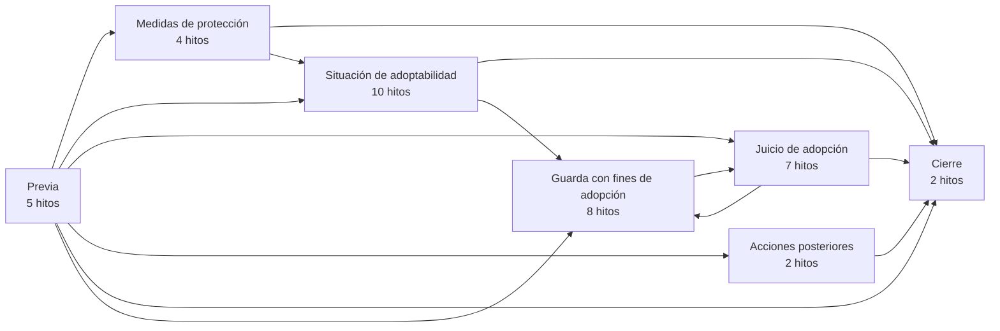
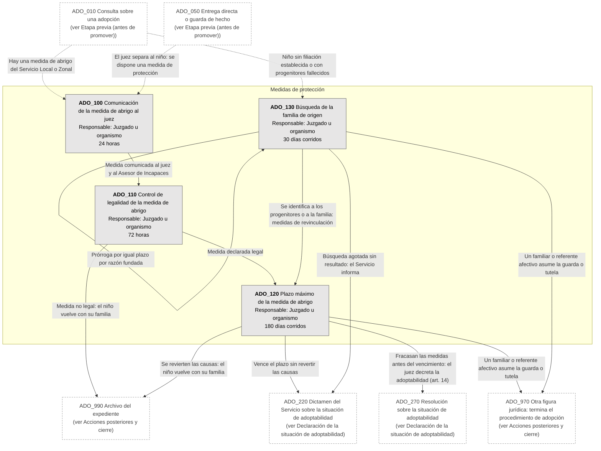
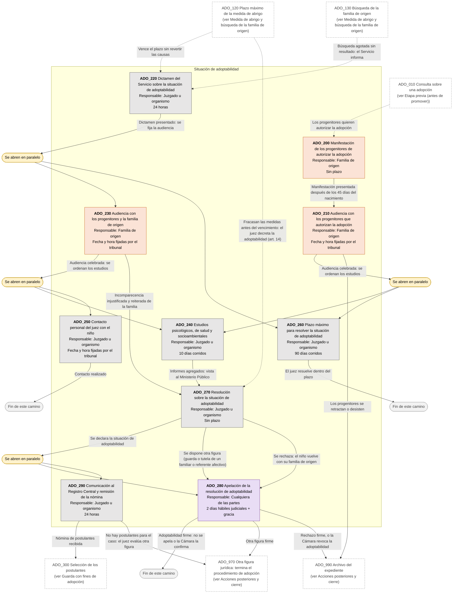
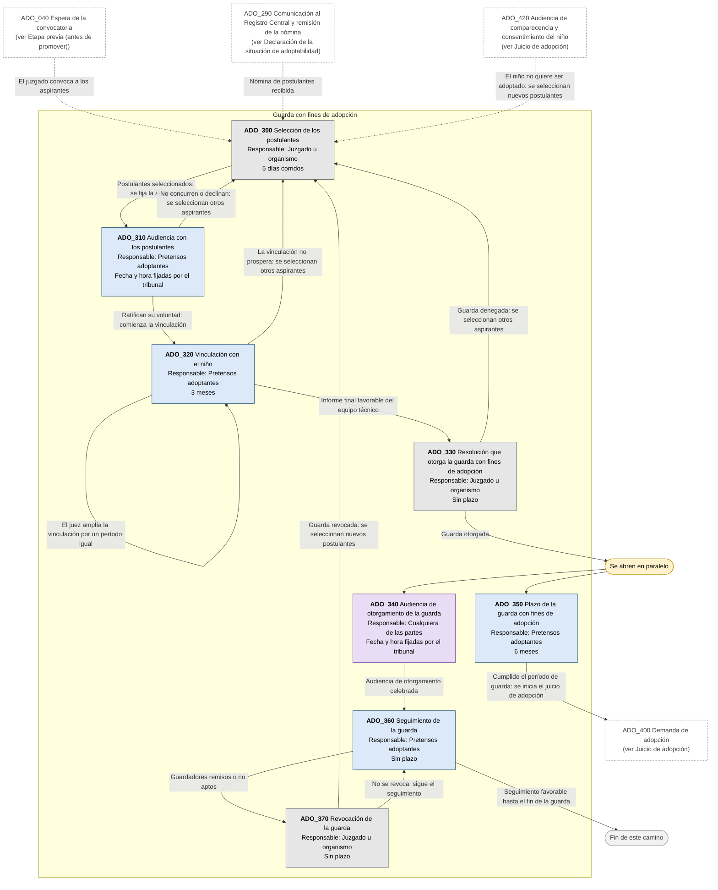
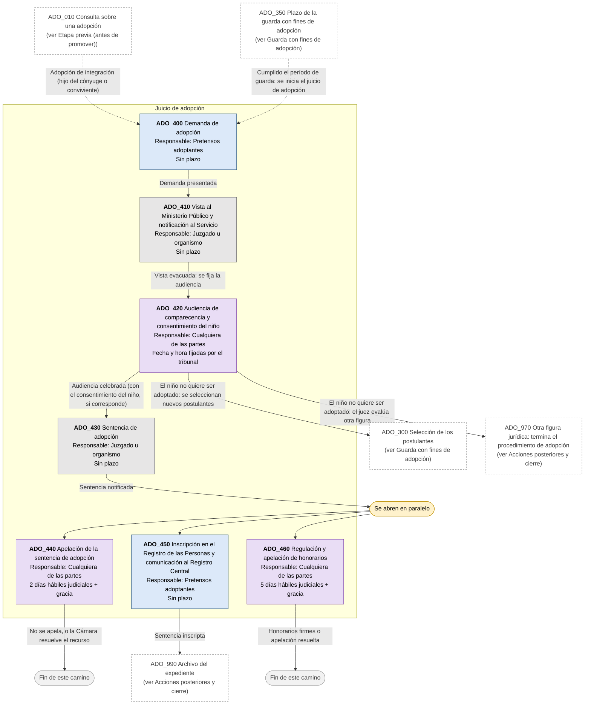

# Diagrama de Flujo: Adopción (PBA)

**Régimen:** Ley 14.528 de procedimiento de adopción (texto Ley 15.610); Ley 13.298, art. 35 bis (texto Ley 14.537); CCyC, arts. 594 a 637; CPCCBA en forma supletoria (art. 30 Ley 14.528) · **Versión:** 1 (borrador)

> Este documento se genera a partir de `matriz_familia_adopcion_pba.xlsx`. No se edita a mano: las correcciones se hacen en la planilla y luego se vuelve a generar el diagrama.

## Cómo leer los diagramas

* **Cada caja es un hito** de la hoja `Nodos`: muestra el ID, el nombre, quién debe actuar y el plazo.
* **Cada flecha es un camino** de la hoja `Transiciones`, rotulado con su condición de salida.
* **Color de la caja según el responsable:** celeste = aspirantes, guardadores o pretensos adoptantes (ACTORA); naranja = progenitores y familia de origen (DEMANDADA); gris = juzgado, Servicio Local o Zonal, Registro Central de Aspirantes, equipo técnico o Ministerio Público, aclarado en el nombre (TRIBUNAL); violeta = cualquiera de las partes, incluido el niño con su abogado (AMBAS).
* **Borde grueso:** hito inicial o hito final.
* **"Se abren en paralelo"** (amarillo): esa condición abre varios hitos a la vez; por ejemplo, al dictarse el dictamen del Servicio corren a la vez la audiencia con la familia de origen y los 90 días que tiene el juez para resolver la situación de adoptabilidad.
* **"Fin de este camino"** (gris claro): el camino paralelo termina sin abrir otro hito.
* **Cajas blancas con borde discontinuo:** hitos de otra etapa; el texto indica en qué diagrama están. Las flechas punteadas muestran desde dónde se llega a esta etapa.
* **Derivación a otra matriz:** caja con borde grueso (es un hito final) cuyo nombre empieza con "Sigue en la matriz de ...": el expediente continúa en ese otro flujo de familia, en un expediente vinculado.
* **Fase "Previa":** hitos anteriores a la promoción (partidas, intimaciones, denuncia, inscripción en un registro). La app los separa en el flujo prejudicial.

## Vista general por fases

## 1. Etapa previa (antes de promover)

```mermaid
flowchart TD
  subgraph F_0["Previa"]
    ADO_010["INICIO - <b>ADO_010</b> Consulta sobre una adopción<br/>Responsable: Cualquiera de las partes<br/>Sin plazo"]:::ambas
    ADO_020["<b>ADO_020</b> Inscripción en el Registro Central de Aspirantes a Guardas con Fines de Adopción<br/>Responsable: Pretensos adoptantes<br/>Sin plazo"]:::actora
    ADO_030["<b>ADO_030</b> Impugnación de la no admisión en el Registro<br/>Responsable: Pretensos adoptantes<br/>Sin plazo"]:::actora
    ADO_040["<b>ADO_040</b> Espera de la convocatoria<br/>Responsable: Pretensos adoptantes<br/>Sin plazo"]:::actora
    ADO_050["<b>ADO_050</b> Entrega directa o guarda de hecho<br/>Responsable: Juzgado u organismo<br/>Sin plazo"]:::tribunal
  end
  ADO_010 -->|"Se quieren inscribir como aspirantes a guarda con fines de adopción"| ADO_020
  EXT_ADO_100_destino["ADO_100 Comunicación de la medida de abrigo al juez<br/>(ver Medida de abrigo y búsqueda de la familia de origen)"]:::externo
  ADO_010 -->|"Hay una medida de abrigo del Servicio Local o Zonal"| EXT_ADO_100_destino
  EXT_ADO_130_destino["ADO_130 Búsqueda de la familia de origen<br/>(ver Medida de abrigo y búsqueda de la familia de origen)"]:::externo
  ADO_010 -->|"Niño sin filiación establecida o con progenitores fallecidos"| EXT_ADO_130_destino
  EXT_ADO_200_destino["ADO_200 Manifestación de los progenitores de autorizar la adopción<br/>(ver Declaración de la situación de adoptabilidad)"]:::externo
  ADO_010 -->|"Los progenitores quieren autorizar la adopción"| EXT_ADO_200_destino
  EXT_ADO_400_destino["ADO_400 Demanda de adopción<br/>(ver Juicio de adopción)"]:::externo
  ADO_010 -->|"Adopción de integración (hijo del cónyuge o conviviente)"| EXT_ADO_400_destino
  ADO_010 -->|"Hay una entrega directa o una guarda de hecho"| ADO_050
  EXT_ADO_500_destino["ADO_500 Conversión, revocación o nulidad de la adopción<br/>(ver Acciones posteriores y cierre)"]:::externo
  ADO_010 -->|"Conversión, revocación o nulidad de una adopción"| EXT_ADO_500_destino
  EXT_ADO_510_destino["ADO_510 Acceso a los orígenes<br/>(ver Acciones posteriores y cierre)"]:::externo
  ADO_010 -->|"La persona adoptada quiere conocer sus orígenes"| EXT_ADO_510_destino
  ADO_020 -->|"Inscripción admitida"| ADO_040
  ADO_020 -->|"Inscripción no admitida"| ADO_030
  ADO_030 -->|"Se admite la inscripción"| ADO_040
  EXT_ADO_990_destino["ADO_990 Archivo del expediente<br/>(ver Acciones posteriores y cierre)"]:::externo
  ADO_030 -->|"Se confirma la no admisión"| EXT_ADO_990_destino
  EXT_ADO_300_destino["ADO_300 Selección de los postulantes<br/>(ver Guarda con fines de adopción)"]:::externo
  ADO_040 -->|"El juzgado convoca a los aspirantes"| EXT_ADO_300_destino
  ADO_040 -->|"Baja o renuncia a la inscripción"| EXT_ADO_990_destino
  EXT_ADO_970_destino["ADO_970 Otra figura jurídica: termina el procedimiento de adopción<br/>(ver Acciones posteriores y cierre)"]:::externo
  ADO_050 -->|"Se prueba el vínculo con el guardador: el juez evalúa otra figura"| EXT_ADO_970_destino
  ADO_050 -->|"El juez separa al niño: se dispone una medida de protección"| EXT_ADO_100_destino
  style ADO_010 stroke-width:3px
  classDef actora fill:#DCE9F9,stroke:#1F4E79,color:#000
  classDef demandada fill:#FBE3D6,stroke:#C55A11,color:#000
  classDef tribunal fill:#E7E6E6,stroke:#595959,color:#000
  classDef ambas fill:#E9DDF5,stroke:#7030A0,color:#000
  classDef externo fill:#FFFFFF,stroke:#8C8C8C,color:#404040,stroke-dasharray:4 3
  classDef paralelo fill:#FFF2CC,stroke:#BF9000,color:#000
  classDef fin fill:#F2F2F2,stroke:#A6A6A6,color:#404040
```

## 2. Medida de abrigo y búsqueda de la familia de origen

## 3. Declaración de la situación de adoptabilidad

## 4. Guarda con fines de adopción

## 5. Juicio de adopción

## 6. Acciones posteriores y cierre

```mermaid
flowchart TD
  subgraph F_0["Acciones posteriores"]
    ADO_500["<b>ADO_500</b> Conversión, revocación o nulidad de la adopción<br/>Responsable: Cualquiera de las partes<br/>Sin plazo"]:::ambas
    ADO_510["<b>ADO_510</b> Acceso a los orígenes<br/>Responsable: Pretensos adoptantes<br/>Sin plazo"]:::actora
  end
  subgraph F_1["Cierre"]
    ADO_970["<b>ADO_970</b> Otra figura jurídica: termina el procedimiento de adopción<br/>Responsable: Juzgado u organismo<br/>Sin plazo"]:::tribunal
    ADO_990["<b>ADO_990</b> Archivo del expediente<br/>Responsable: Cualquiera de las partes<br/>Sin plazo"]:::ambas
  end
  EXT_ADO_010_origen["ADO_010 Consulta sobre una adopción<br/>(ver Etapa previa (antes de promover))"]:::externo
  EXT_ADO_010_origen -.->|"Conversión, revocación o nulidad de una adopción"| ADO_500
  EXT_ADO_010_origen -.->|"La persona adoptada quiere conocer sus orígenes"| ADO_510
  EXT_ADO_030_origen["ADO_030 Impugnación de la no admisión en el Registro<br/>(ver Etapa previa (antes de promover))"]:::externo
  EXT_ADO_030_origen -.->|"Se confirma la no admisión"| ADO_990
  EXT_ADO_040_origen["ADO_040 Espera de la convocatoria<br/>(ver Etapa previa (antes de promover))"]:::externo
  EXT_ADO_040_origen -.->|"Baja o renuncia a la inscripción"| ADO_990
  EXT_ADO_050_origen["ADO_050 Entrega directa o guarda de hecho<br/>(ver Etapa previa (antes de promover))"]:::externo
  EXT_ADO_050_origen -.->|"Se prueba el vínculo con el guardador: el juez evalúa otra figura"| ADO_970
  EXT_ADO_110_origen["ADO_110 Control de legalidad de la medida de abrigo<br/>(ver Medida de abrigo y búsqueda de la familia de origen)"]:::externo
  EXT_ADO_110_origen -.->|"Medida no legal: el niño vuelve con su familia"| ADO_990
  EXT_ADO_120_origen["ADO_120 Plazo máximo de la medida de abrigo<br/>(ver Medida de abrigo y búsqueda de la familia de origen)"]:::externo
  EXT_ADO_120_origen -.->|"Se revierten las causas: el niño vuelve con su familia"| ADO_990
  EXT_ADO_120_origen -.->|"Un familiar o referente afectivo asume la guarda o tutela"| ADO_970
  EXT_ADO_130_origen["ADO_130 Búsqueda de la familia de origen<br/>(ver Medida de abrigo y búsqueda de la familia de origen)"]:::externo
  EXT_ADO_130_origen -.->|"Un familiar o referente afectivo asume la guarda o tutela"| ADO_970
  EXT_ADO_210_origen["ADO_210 Audiencia con los progenitores que autorizan la adopción<br/>(ver Declaración de la situación de adoptabilidad)"]:::externo
  EXT_ADO_210_origen -.->|"Los progenitores se retractan o desisten"| ADO_990
  EXT_ADO_280_origen["ADO_280 Apelación de la resolución de adoptabilidad<br/>(ver Declaración de la situación de adoptabilidad)"]:::externo
  EXT_ADO_280_origen -.->|"Otra figura firme"| ADO_970
  EXT_ADO_280_origen -.->|"Rechazo firme, o la Cámara revoca la adoptabilidad"| ADO_990
  EXT_ADO_290_origen["ADO_290 Comunicación al Registro Central y remisión de la nómina<br/>(ver Declaración de la situación de adoptabilidad)"]:::externo
  EXT_ADO_290_origen -.->|"No hay postulantes para el caso: el juez evalúa otra figura"| ADO_970
  EXT_ADO_420_origen["ADO_420 Audiencia de comparecencia y consentimiento del niño<br/>(ver Juicio de adopción)"]:::externo
  EXT_ADO_420_origen -.->|"El niño no quiere ser adoptado: el juez evalúa otra figura"| ADO_970
  EXT_ADO_450_origen["ADO_450 Inscripción en el Registro de las Personas y comunicación al Registro Central<br/>(ver Juicio de adopción)"]:::externo
  EXT_ADO_450_origen -.->|"Sentencia inscripta"| ADO_990
  ADO_500 -->|"Sentencia firme sobre la conversión, la revocación o la nulidad"| ADO_990
  ADO_510 -->|"Acceso otorgado o acción resuelta"| ADO_990
  style ADO_970 stroke-width:3px
  style ADO_990 stroke-width:3px
  classDef actora fill:#DCE9F9,stroke:#1F4E79,color:#000
  classDef demandada fill:#FBE3D6,stroke:#C55A11,color:#000
  classDef tribunal fill:#E7E6E6,stroke:#595959,color:#000
  classDef ambas fill:#E9DDF5,stroke:#7030A0,color:#000
  classDef externo fill:#FFFFFF,stroke:#8C8C8C,color:#404040,stroke-dasharray:4 3
  classDef paralelo fill:#FFF2CC,stroke:#BF9000,color:#000
  classDef fin fill:#F2F2F2,stroke:#A6A6A6,color:#404040
```

