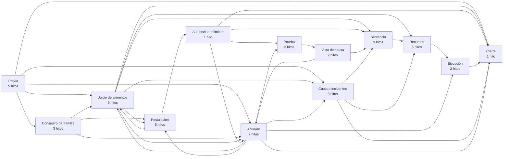
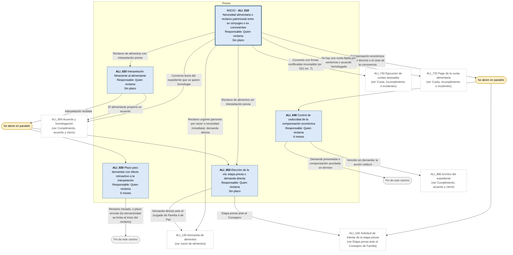
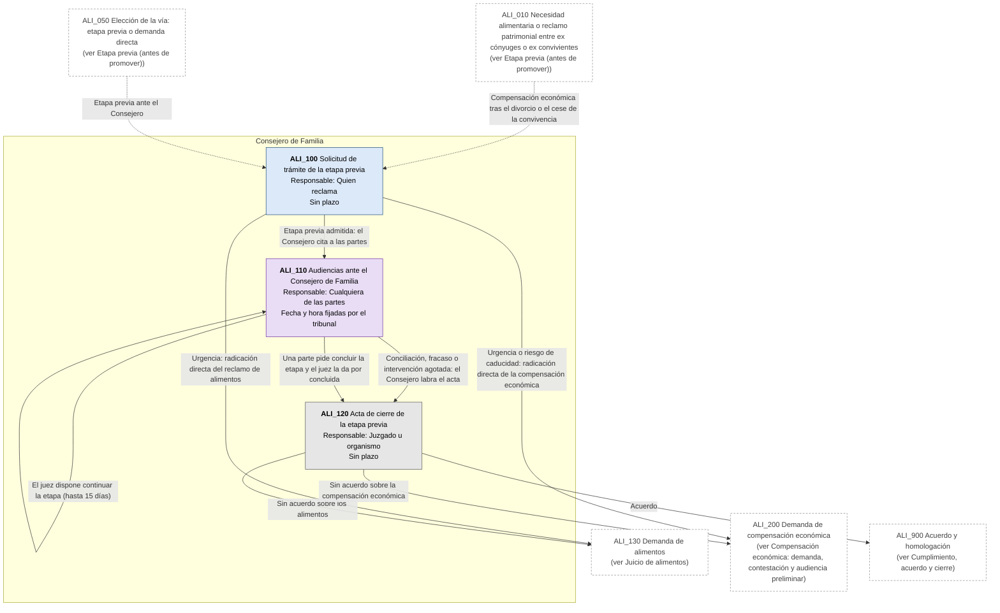
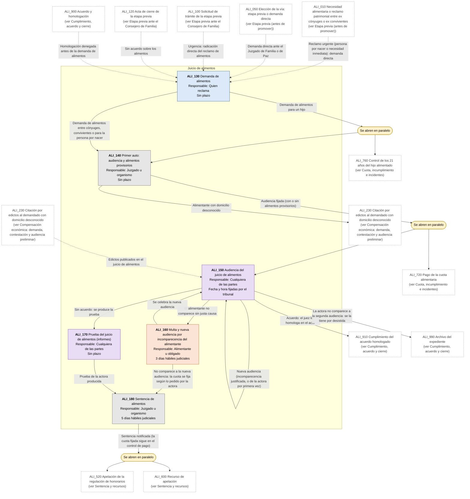
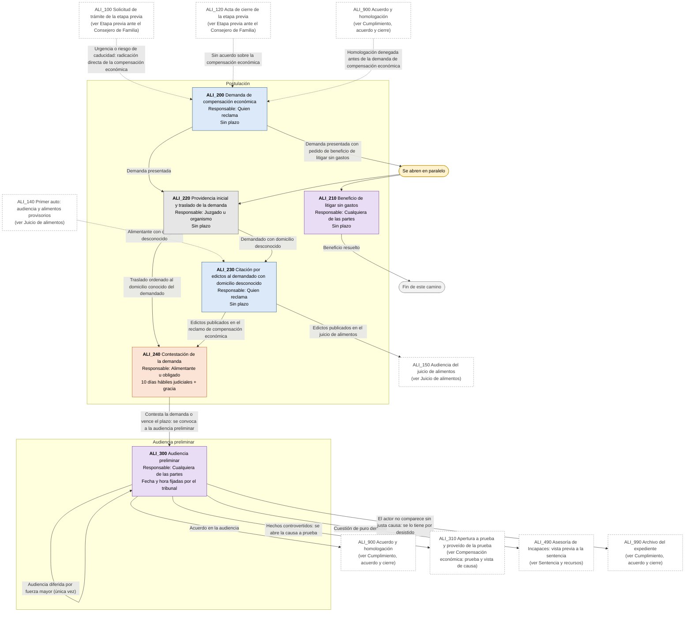
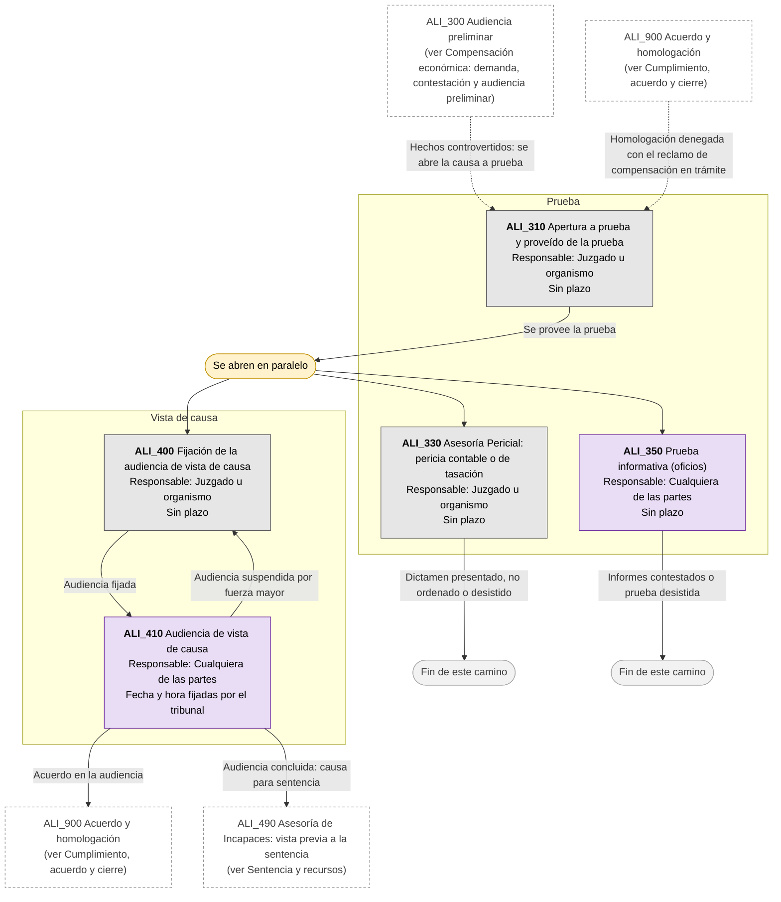
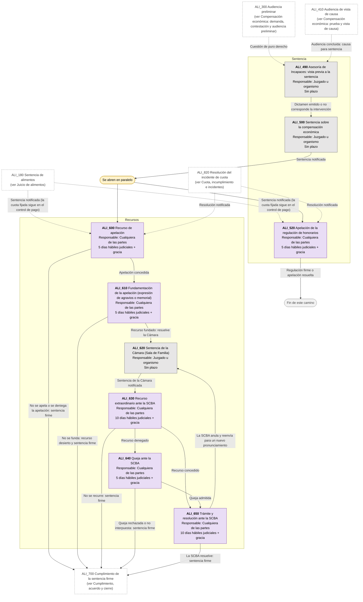
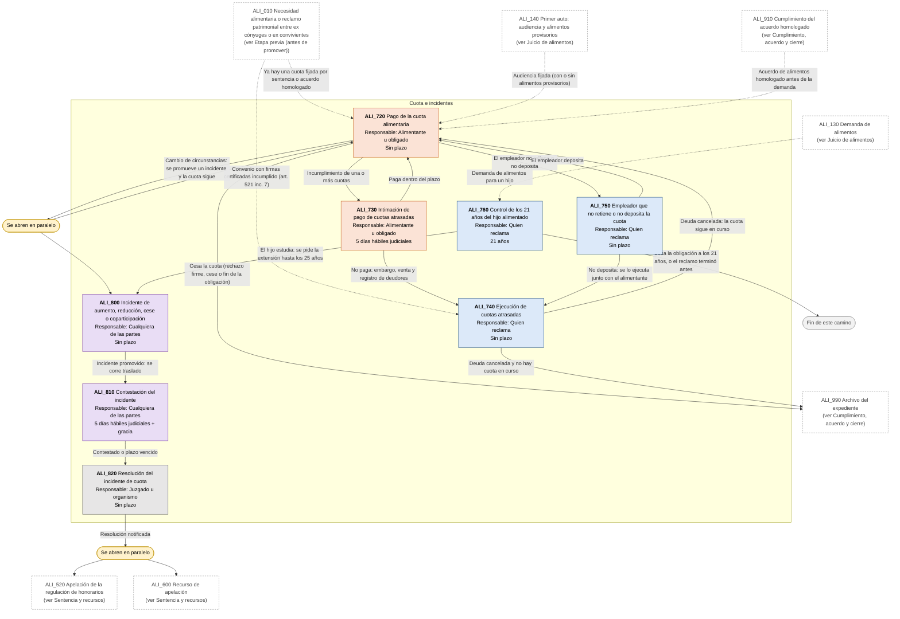

# Diagrama de Flujo: Alimentos y compensación económica (PBA)

**Régimen:** CPCCBA (Decreto-Ley 7425/68), Libro VIII: proceso ante los Juzgados de Familia (arts. 827 a 853, texto de las Leyes 13.634 y 15.513); juicio de alimentos, arts. 635 a 648 CPCCBA (texto Ley 15.513); CCyC, arts. 432 a 434, 441, 442, 519, 524, 525, 537 a 554 y 658 a 670 · **Versión:** 1 (borrador)

> Este documento se genera a partir de `matriz_familia_alimentos_pba.xlsx`. No se edita a mano: las correcciones se hacen en la planilla y luego se vuelve a generar el diagrama.

## Cómo leer los diagramas

* **Cada caja es un hito** de la hoja `Nodos`: muestra el ID, el nombre, quién debe actuar y el plazo.
* **Cada flecha es un camino** de la hoja `Transiciones`, rotulado con su condición de salida.
* **Color de la caja según el responsable:** celeste = quien reclama alimentos o compensación (ACTORA); naranja = el alimentante u obligado (DEMANDADA); gris = juzgado, Consejero, Asesoría de Incapaces u organismo que informa, aclarado en el nombre (TRIBUNAL); violeta = cualquiera de las partes (AMBAS).
* **Borde grueso:** hito inicial o hito final.
* **"Se abren en paralelo"** (amarillo): esa condición abre varios hitos a la vez; por ejemplo, cuando el primer auto fija la audiencia y los alimentos provisorios, corren a la vez la audiencia y el control del pago de la cuota.
* **"Fin de este camino"** (gris claro): el camino paralelo termina sin abrir otro hito.
* **Cajas blancas con borde discontinuo:** hitos de otra etapa; el texto indica en qué diagrama están. Las flechas punteadas muestran desde dónde se llega a esta etapa.
* **Derivación a otra matriz:** caja con borde grueso (es un hito final) cuyo nombre empieza con "Sigue en la matriz de ...": el expediente continúa en ese otro flujo de familia, en un expediente vinculado.
* **Fase "Previa":** hitos anteriores a la promoción (partidas, intimaciones, denuncia, inscripción en un registro). La app los separa en el flujo prejudicial.

## Vista general por fases

## 1. Etapa previa (antes de promover)

## 2. Etapa previa ante el Consejero de Familia

## 3. Juicio de alimentos

## 4. Compensación económica: demanda, contestación y audiencia preliminar

## 5. Compensación económica: prueba y vista de causa

## 6. Sentencia y recursos

## 7. Cuota, incumplimiento e incidentes

## 8. Cumplimiento, acuerdo y cierre

```mermaid
flowchart TD
  subgraph F_0["Ejecución"]
    ALI_700["<b>ALI_700</b> Cumplimiento de la sentencia firme<br/>Responsable: Alimentante u obligado<br/>Sin plazo"]:::demandada
    ALI_710["<b>ALI_710</b> Ejecución de la sentencia<br/>Responsable: Quien reclama<br/>Sin plazo"]:::actora
  end
  subgraph F_1["Acuerdo"]
    ALI_900["<b>ALI_900</b> Acuerdo y homologación<br/>Responsable: Cualquiera de las partes<br/>Sin plazo"]:::ambas
    ALI_910["<b>ALI_910</b> Cumplimiento del acuerdo homologado<br/>Responsable: Alimentante u obligado<br/>Sin plazo"]:::demandada
  end
  subgraph F_2["Cierre"]
    ALI_990["<b>ALI_990</b> Archivo del expediente<br/>Responsable: Cualquiera de las partes<br/>Sin plazo"]:::ambas
  end
  EXT_ALI_010_origen["ALI_010 Necesidad alimentaria o reclamo patrimonial entre ex cónyuges o ex convivientes<br/>(ver Etapa previa (antes de promover))"]:::externo
  EXT_ALI_010_origen -.->|"Convenio fuera del expediente que se quiere homologar"| ALI_900
  EXT_ALI_020_origen["ALI_020 Interpelación fehaciente al alimentante<br/>(ver Etapa previa (antes de promover))"]:::externo
  EXT_ALI_020_origen -.->|"El alimentante propone un acuerdo"| ALI_900
  EXT_ALI_040_origen["ALI_040 Control de caducidad de la compensación económica<br/>(ver Etapa previa (antes de promover))"]:::externo
  EXT_ALI_040_origen -.->|"Vencido sin demanda: la acción caducó"| ALI_990
  EXT_ALI_120_origen["ALI_120 Acta de cierre de la etapa previa<br/>(ver Etapa previa ante el Consejero de Familia)"]:::externo
  EXT_ALI_120_origen -.->|"Acuerdo"| ALI_900
  EXT_ALI_150_origen["ALI_150 Audiencia del juicio de alimentos<br/>(ver Juicio de alimentos)"]:::externo
  EXT_ALI_150_origen -.->|"Acuerdo: el juez lo homologa en el acto"| ALI_910
  EXT_ALI_150_origen -.->|"La actora no comparece a la segunda audiencia: se la tiene por desistida"| ALI_990
  EXT_ALI_300_origen["ALI_300 Audiencia preliminar<br/>(ver Compensación económica: demanda, contestación y audiencia preliminar)"]:::externo
  EXT_ALI_300_origen -.->|"Acuerdo en la audiencia"| ALI_900
  EXT_ALI_300_origen -.->|"El actor no comparece sin justa causa: se lo tiene por desistido"| ALI_990
  EXT_ALI_410_origen["ALI_410 Audiencia de vista de causa<br/>(ver Compensación económica: prueba y vista de causa)"]:::externo
  EXT_ALI_410_origen -.->|"Acuerdo en la audiencia"| ALI_900
  EXT_ALI_600_origen["ALI_600 Recurso de apelación<br/>(ver Sentencia y recursos)"]:::externo
  EXT_ALI_600_origen -.->|"No se apela o se deniega la apelación: sentencia firme"| ALI_700
  EXT_ALI_610_origen["ALI_610 Fundamentación de la apelación (expresión de agravios o memorial)<br/>(ver Sentencia y recursos)"]:::externo
  EXT_ALI_610_origen -.->|"No se funda: recurso desierto y sentencia firme"| ALI_700
  EXT_ALI_630_origen["ALI_630 Recurso extraordinario ante la SCBA<br/>(ver Sentencia y recursos)"]:::externo
  EXT_ALI_630_origen -.->|"No se recurre: sentencia firme"| ALI_700
  EXT_ALI_640_origen["ALI_640 Queja ante la SCBA<br/>(ver Sentencia y recursos)"]:::externo
  EXT_ALI_640_origen -.->|"Queja rechazada o no interpuesta: sentencia firme"| ALI_700
  EXT_ALI_650_origen["ALI_650 Trámite y resolución ante la SCBA<br/>(ver Sentencia y recursos)"]:::externo
  EXT_ALI_650_origen -.->|"La SCBA resuelve: sentencia firme"| ALI_700
  ALI_700 -->|"Compensación económica cumplida"| ALI_990
  ALI_700 -->|"Compensación económica incumplida"| ALI_710
  FIN_ALI_700_3(["Fin de este camino"]):::fin
  ALI_700 -->|"Alimentos: la cuota sigue en curso con lo resuelto en firme"| FIN_ALI_700_3
  ALI_710 -->|"Sentencia cumplida o crédito cobrado"| ALI_990
  EXT_ALI_720_origen["ALI_720 Pago de la cuota alimentaria<br/>(ver Cuota, incumplimiento e incidentes)"]:::externo
  EXT_ALI_720_origen -.->|"Cesa la cuota (rechazo firme, cese o fin de la obligación)"| ALI_990
  EXT_ALI_740_origen["ALI_740 Ejecución de cuotas atrasadas<br/>(ver Cuota, incumplimiento e incidentes)"]:::externo
  EXT_ALI_740_origen -.->|"Deuda cancelada y no hay cuota en curso"| ALI_990
  ALI_900 -->|"Acuerdo homologado"| ALI_910
  EXT_ALI_130_destino["ALI_130 Demanda de alimentos<br/>(ver Juicio de alimentos)"]:::externo
  ALI_900 -->|"Homologación denegada antes de la demanda de alimentos"| EXT_ALI_130_destino
  EXT_ALI_200_destino["ALI_200 Demanda de compensación económica<br/>(ver Compensación económica: demanda, contestación y audiencia preliminar)"]:::externo
  ALI_900 -->|"Homologación denegada antes de la demanda de compensación económica"| EXT_ALI_200_destino
  EXT_ALI_310_destino["ALI_310 Apertura a prueba y proveído de la prueba<br/>(ver Compensación económica: prueba y vista de causa)"]:::externo
  ALI_900 -->|"Homologación denegada con el reclamo de compensación en trámite"| EXT_ALI_310_destino
  FIN_ALI_910_1(["Fin de este camino"]):::fin
  ALI_910 -->|"Acuerdo de alimentos homologado en la audiencia: sigue el control de la cuota"| FIN_ALI_910_1
  EXT_ALI_720_destino["ALI_720 Pago de la cuota alimentaria<br/>(ver Cuota, incumplimiento e incidentes)"]:::externo
  ALI_910 -->|"Acuerdo de alimentos homologado antes de la demanda"| EXT_ALI_720_destino
  ALI_910 -->|"Acuerdo de compensación económica cumplido"| ALI_990
  ALI_910 -->|"Acuerdo de compensación económica incumplido: se ejecuta"| ALI_710
  style ALI_990 stroke-width:3px
  classDef actora fill:#DCE9F9,stroke:#1F4E79,color:#000
  classDef demandada fill:#FBE3D6,stroke:#C55A11,color:#000
  classDef tribunal fill:#E7E6E6,stroke:#595959,color:#000
  classDef ambas fill:#E9DDF5,stroke:#7030A0,color:#000
  classDef externo fill:#FFFFFF,stroke:#8C8C8C,color:#404040,stroke-dasharray:4 3
  classDef paralelo fill:#FFF2CC,stroke:#BF9000,color:#000
  classDef fin fill:#F2F2F2,stroke:#A6A6A6,color:#404040
```

