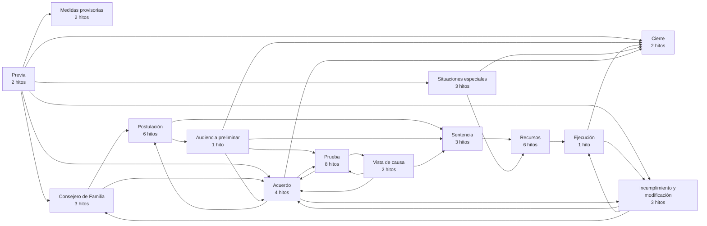
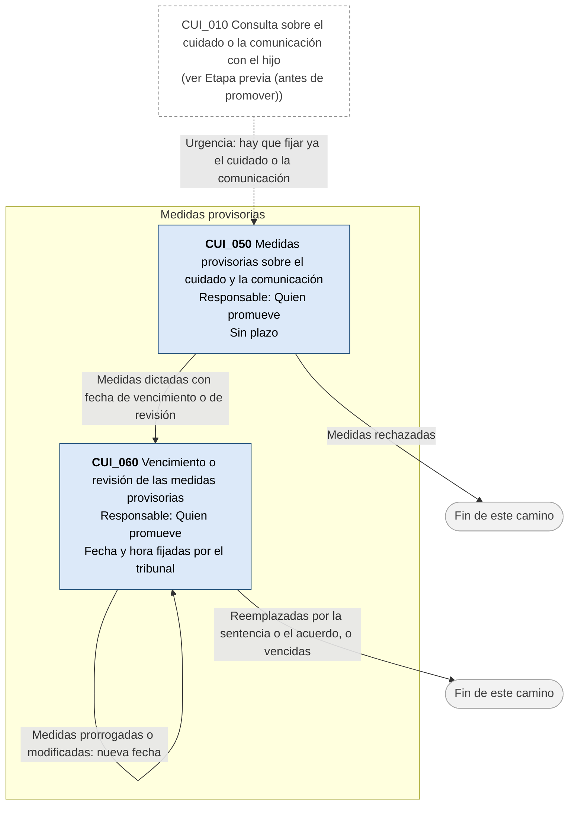
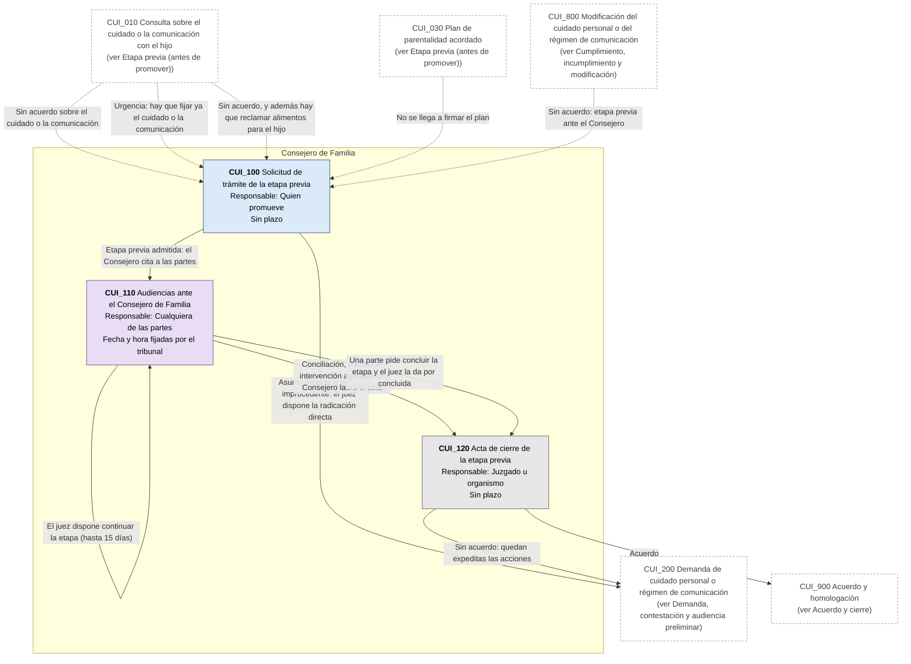
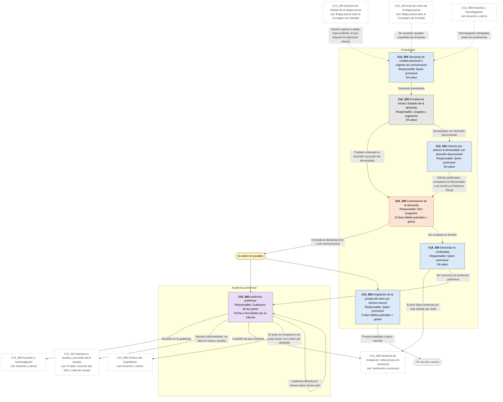
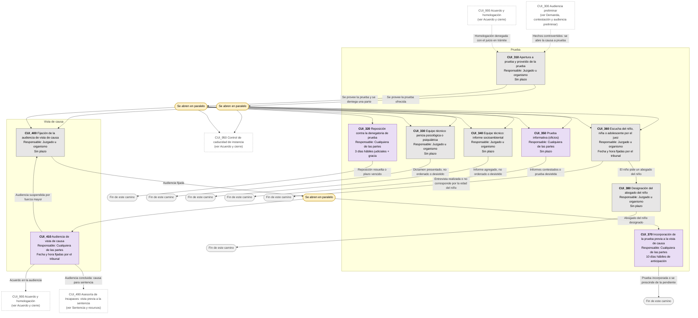
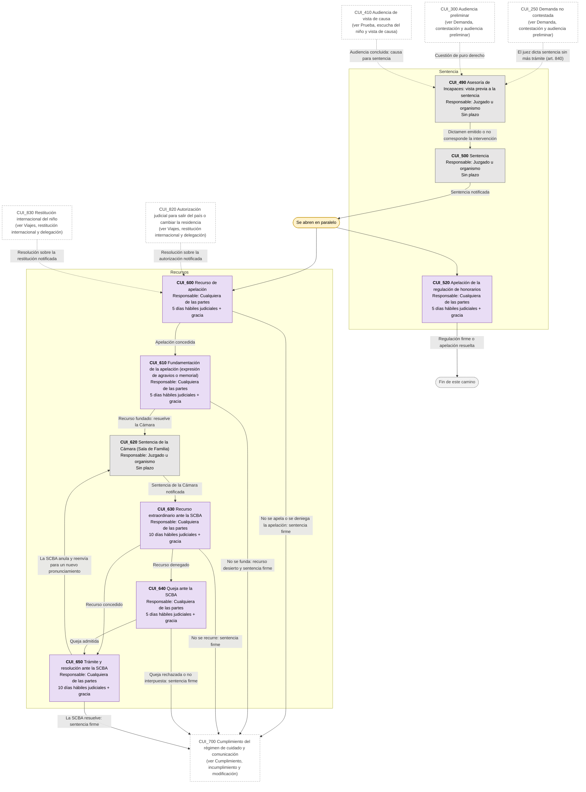
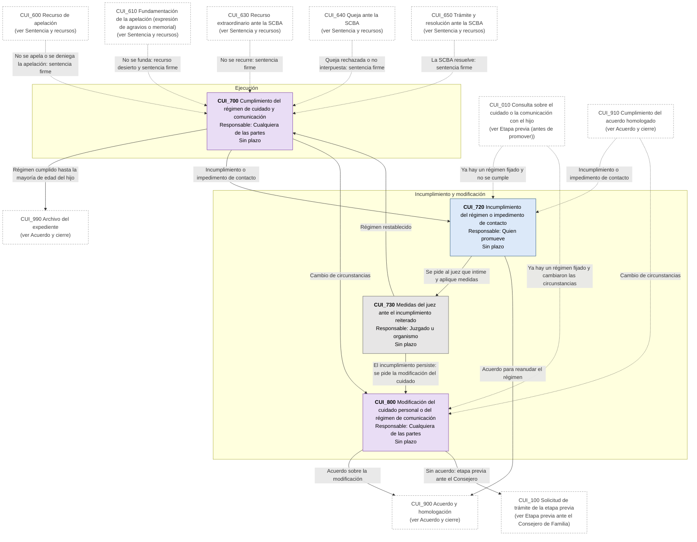
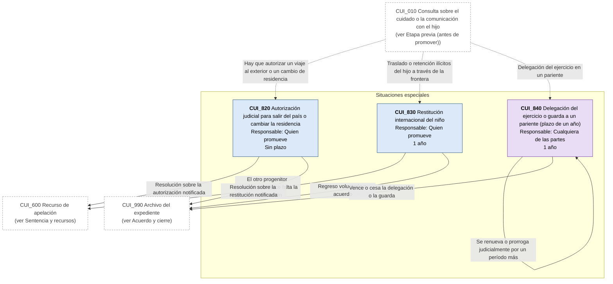

# Diagrama de Flujo: Cuidado personal y régimen de comunicación (PBA)

**Régimen:** CPCCBA (Decreto-Ley 7425/68), Libro VIII: proceso ante los Juzgados de Familia (arts. 827 a 853, texto de las Leyes 13.634 y 15.513); CCyC, arts. 555 a 557, 643, 645, 648 a 657, 706, 707, 716 y 2642; Ley 14.568 (abogado del niño) · **Versión:** 1 (borrador)

> Este documento se genera a partir de `matriz_familia_cuidado_personal_pba.xlsx`. No se edita a mano: las correcciones se hacen en la planilla y luego se vuelve a generar el diagrama.

## Cómo leer los diagramas

* **Cada caja es un hito** de la hoja `Nodos`: muestra el ID, el nombre, quién debe actuar y el plazo.
* **Cada flecha es un camino** de la hoja `Transiciones`, rotulado con su condición de salida.
* **Color de la caja según el responsable:** celeste = el progenitor o pariente que promueve (ACTORA); naranja = el otro progenitor o quien tiene el cuidado (DEMANDADA); gris = juzgado, Consejero, equipo técnico, Asesoría de Incapaces o abogado del niño, aclarado en el nombre (TRIBUNAL); violeta = cualquiera de las partes (AMBAS).
* **Borde grueso:** hito inicial o hito final.
* **"Se abren en paralelo"** (amarillo): esa condición abre varios hitos a la vez; por ejemplo, cuando hay urgencia, corren a la vez las medidas provisorias y la etapa previa ante el Consejero.
* **"Fin de este camino"** (gris claro): el camino paralelo termina sin abrir otro hito.
* **Cajas blancas con borde discontinuo:** hitos de otra etapa; el texto indica en qué diagrama están. Las flechas punteadas muestran desde dónde se llega a esta etapa.
* **Derivación a otra matriz:** caja con borde grueso (es un hito final) cuyo nombre empieza con "Sigue en la matriz de ...": el expediente continúa en ese otro flujo de familia, en un expediente vinculado.
* **Fase "Previa":** hitos anteriores a la promoción (partidas, intimaciones, denuncia, inscripción en un registro). La app los separa en el flujo prejudicial.

## Vista general por fases

## 1. Etapa previa (antes de promover)

```mermaid
flowchart TD
  subgraph F_0["Previa"]
    CUI_010["INICIO - <b>CUI_010</b> Consulta sobre el cuidado o la comunicación con el hijo<br/>Responsable: Quien promueve<br/>Sin plazo"]:::actora
    CUI_030["<b>CUI_030</b> Plan de parentalidad acordado<br/>Responsable: Cualquiera de las partes<br/>Sin plazo"]:::ambas
  end
  CUI_010 -->|"Los progenitores acuerdan un plan de parentalidad"| CUI_030
  EXT_CUI_100_destino["CUI_100 Solicitud de trámite de la etapa previa<br/>(ver Etapa previa ante el Consejero de Familia)"]:::externo
  CUI_010 -->|"Sin acuerdo sobre el cuidado o la comunicación"| EXT_CUI_100_destino
  P_CUI_010_3(["Se abren en paralelo"]):::paralelo
  CUI_010 -->|"Urgencia: hay que fijar ya el cuidado o la comunicación"| P_CUI_010_3
  EXT_CUI_050_destino["CUI_050 Medidas provisorias sobre el cuidado y la comunicación<br/>(ver Medidas provisorias)"]:::externo
  P_CUI_010_3 --> EXT_CUI_050_destino
  P_CUI_010_3 --> EXT_CUI_100_destino
  P_CUI_010_4(["Se abren en paralelo"]):::paralelo
  CUI_010 -->|"Sin acuerdo, y además hay que reclamar alimentos para el hijo"| P_CUI_010_4
  P_CUI_010_4 --> EXT_CUI_100_destino
  EXT_CUI_970_destino["CUI_970 Sigue en la matriz de alimentos y compensación económica<br/>(ver Acuerdo y cierre)"]:::externo
  P_CUI_010_4 --> EXT_CUI_970_destino
  EXT_CUI_820_destino["CUI_820 Autorización judicial para salir del país o cambiar la residencia<br/>(ver Viajes, restitución internacional y delegación)"]:::externo
  CUI_010 -->|"Hay que autorizar un viaje al exterior o un cambio de residencia"| EXT_CUI_820_destino
  EXT_CUI_830_destino["CUI_830 Restitución internacional del niño<br/>(ver Viajes, restitución internacional y delegación)"]:::externo
  CUI_010 -->|"Traslado o retención ilícitos del hijo a través de la frontera"| EXT_CUI_830_destino
  EXT_CUI_840_destino["CUI_840 Delegación del ejercicio o guarda a un pariente (plazo de un año)<br/>(ver Viajes, restitución internacional y delegación)"]:::externo
  CUI_010 -->|"Delegación del ejercicio en un pariente"| EXT_CUI_840_destino
  EXT_CUI_720_destino["CUI_720 Incumplimiento del régimen o impedimento de contacto<br/>(ver Cumplimiento, incumplimiento y modificación)"]:::externo
  CUI_010 -->|"Ya hay un régimen fijado y no se cumple"| EXT_CUI_720_destino
  EXT_CUI_800_destino["CUI_800 Modificación del cuidado personal o del régimen de comunicación<br/>(ver Cumplimiento, incumplimiento y modificación)"]:::externo
  CUI_010 -->|"Ya hay un régimen fijado y cambiaron las circunstancias"| EXT_CUI_800_destino
  EXT_CUI_900_destino["CUI_900 Acuerdo y homologación<br/>(ver Acuerdo y cierre)"]:::externo
  CUI_030 -->|"Plan acordado: se pide la homologación"| EXT_CUI_900_destino
  CUI_030 -->|"No se llega a firmar el plan"| EXT_CUI_100_destino
  style CUI_010 stroke-width:3px
  classDef actora fill:#DCE9F9,stroke:#1F4E79,color:#000
  classDef demandada fill:#FBE3D6,stroke:#C55A11,color:#000
  classDef tribunal fill:#E7E6E6,stroke:#595959,color:#000
  classDef ambas fill:#E9DDF5,stroke:#7030A0,color:#000
  classDef externo fill:#FFFFFF,stroke:#8C8C8C,color:#404040,stroke-dasharray:4 3
  classDef paralelo fill:#FFF2CC,stroke:#BF9000,color:#000
  classDef fin fill:#F2F2F2,stroke:#A6A6A6,color:#404040
```

## 2. Medidas provisorias

## 3. Etapa previa ante el Consejero de Familia

## 4. Demanda, contestación y audiencia preliminar

## 5. Prueba, escucha del niño y vista de causa

## 6. Sentencia y recursos

## 7. Cumplimiento, incumplimiento y modificación

## 8. Viajes, restitución internacional y delegación

## 9. Acuerdo y cierre

```mermaid
flowchart TD
  subgraph F_0["Acuerdo"]
    CUI_900["<b>CUI_900</b> Acuerdo y homologación<br/>Responsable: Cualquiera de las partes<br/>Sin plazo"]:::ambas
    CUI_910["<b>CUI_910</b> Cumplimiento del acuerdo homologado<br/>Responsable: Otro progenitor<br/>Sin plazo"]:::demandada
    CUI_950["<b>CUI_950</b> Control de caducidad de instancia<br/>Responsable: Quien promueve<br/>3 meses"]:::actora
    CUI_960["<b>CUI_960</b> Intimación previa a la caducidad de instancia<br/>Responsable: Quien promueve<br/>5 días hábiles judiciales + gracia"]:::actora
  end
  subgraph F_1["Cierre"]
    CUI_970["<b>CUI_970</b> Sigue en la matriz de alimentos y compensación económica<br/>Responsable: Quien promueve<br/>Sin plazo"]:::actora
    CUI_990["<b>CUI_990</b> Archivo del expediente<br/>Responsable: Cualquiera de las partes<br/>Sin plazo"]:::ambas
  end
  EXT_CUI_010_origen["CUI_010 Consulta sobre el cuidado o la comunicación con el hijo<br/>(ver Etapa previa (antes de promover))"]:::externo
  EXT_CUI_010_origen -.->|"Sin acuerdo, y además hay que reclamar alimentos para el hijo"| CUI_970
  EXT_CUI_030_origen["CUI_030 Plan de parentalidad acordado<br/>(ver Etapa previa (antes de promover))"]:::externo
  EXT_CUI_030_origen -.->|"Plan acordado: se pide la homologación"| CUI_900
  EXT_CUI_120_origen["CUI_120 Acta de cierre de la etapa previa<br/>(ver Etapa previa ante el Consejero de Familia)"]:::externo
  EXT_CUI_120_origen -.->|"Acuerdo"| CUI_900
  EXT_CUI_300_origen["CUI_300 Audiencia preliminar<br/>(ver Demanda, contestación y audiencia preliminar)"]:::externo
  EXT_CUI_300_origen -.->|"Acuerdo en la audiencia"| CUI_900
  EXT_CUI_300_origen -.->|"El actor no comparece sin justa causa: se lo tiene por desistido"| CUI_990
  EXT_CUI_310_origen["CUI_310 Apertura a prueba y proveído de la prueba<br/>(ver Prueba, escucha del niño y vista de causa)"]:::externo
  EXT_CUI_310_origen -.->|"Se provee la prueba ofrecida"| CUI_950
  EXT_CUI_310_origen -.->|"Se provee la prueba y se deniega una parte"| CUI_950
  EXT_CUI_410_origen["CUI_410 Audiencia de vista de causa<br/>(ver Prueba, escucha del niño y vista de causa)"]:::externo
  EXT_CUI_410_origen -.->|"Acuerdo en la audiencia"| CUI_900
  EXT_CUI_700_origen["CUI_700 Cumplimiento del régimen de cuidado y comunicación<br/>(ver Cumplimiento, incumplimiento y modificación)"]:::externo
  EXT_CUI_700_origen -.->|"Régimen cumplido hasta la mayoría de edad del hijo"| CUI_990
  EXT_CUI_720_origen["CUI_720 Incumplimiento del régimen o impedimento de contacto<br/>(ver Cumplimiento, incumplimiento y modificación)"]:::externo
  EXT_CUI_720_origen -.->|"Acuerdo para reanudar el régimen"| CUI_900
  EXT_CUI_800_origen["CUI_800 Modificación del cuidado personal o del régimen de comunicación<br/>(ver Cumplimiento, incumplimiento y modificación)"]:::externo
  EXT_CUI_800_origen -.->|"Acuerdo sobre la modificación"| CUI_900
  EXT_CUI_820_origen["CUI_820 Autorización judicial para salir del país o cambiar la residencia<br/>(ver Viajes, restitución internacional y delegación)"]:::externo
  EXT_CUI_820_origen -.->|"El otro progenitor consiente: no hace falta la autorización"| CUI_990
  EXT_CUI_830_origen["CUI_830 Restitución internacional del niño<br/>(ver Viajes, restitución internacional y delegación)"]:::externo
  EXT_CUI_830_origen -.->|"Regreso voluntario o acuerdo"| CUI_990
  EXT_CUI_840_origen["CUI_840 Delegación del ejercicio o guarda a un pariente (plazo de un año)<br/>(ver Viajes, restitución internacional y delegación)"]:::externo
  EXT_CUI_840_origen -.->|"Vence o cesa la delegación o la guarda"| CUI_990
  CUI_900 -->|"Acuerdo homologado"| CUI_910
  EXT_CUI_200_destino["CUI_200 Demanda de cuidado personal o régimen de comunicación<br/>(ver Demanda, contestación y audiencia preliminar)"]:::externo
  CUI_900 -->|"Homologación denegada antes de la demanda"| EXT_CUI_200_destino
  EXT_CUI_310_destino["CUI_310 Apertura a prueba y proveído de la prueba<br/>(ver Prueba, escucha del niño y vista de causa)"]:::externo
  CUI_900 -->|"Homologación denegada con el juicio en trámite"| EXT_CUI_310_destino
  CUI_910 -->|"Acuerdo cumplido hasta la mayoría de edad del hijo"| CUI_990
  EXT_CUI_720_destino["CUI_720 Incumplimiento del régimen o impedimento de contacto<br/>(ver Cumplimiento, incumplimiento y modificación)"]:::externo
  CUI_910 -->|"Incumplimiento o impedimento de contacto"| EXT_CUI_720_destino
  EXT_CUI_800_destino["CUI_800 Modificación del cuidado personal o del régimen de comunicación<br/>(ver Cumplimiento, incumplimiento y modificación)"]:::externo
  CUI_910 -->|"Cambio de circunstancias"| EXT_CUI_800_destino
  CUI_950 -->|"Se impulsa el proceso: se actualiza el Día Cero al último acto"| CUI_950
  FIN_CUI_950_2(["Fin de este camino"]):::fin
  CUI_950 -->|"Se dicta sentencia o termina el proceso"| FIN_CUI_950_2
  CUI_950 -->|"La contraria pide la caducidad"| CUI_960
  CUI_960 -->|"Actividad útil en término"| CUI_950
  CUI_960 -->|"No hay actividad útil: se decreta la caducidad"| CUI_990
  style CUI_970 stroke-width:3px
  style CUI_990 stroke-width:3px
  classDef actora fill:#DCE9F9,stroke:#1F4E79,color:#000
  classDef demandada fill:#FBE3D6,stroke:#C55A11,color:#000
  classDef tribunal fill:#E7E6E6,stroke:#595959,color:#000
  classDef ambas fill:#E9DDF5,stroke:#7030A0,color:#000
  classDef externo fill:#FFFFFF,stroke:#8C8C8C,color:#404040,stroke-dasharray:4 3
  classDef paralelo fill:#FFF2CC,stroke:#BF9000,color:#000
  classDef fin fill:#F2F2F2,stroke:#A6A6A6,color:#404040
```

