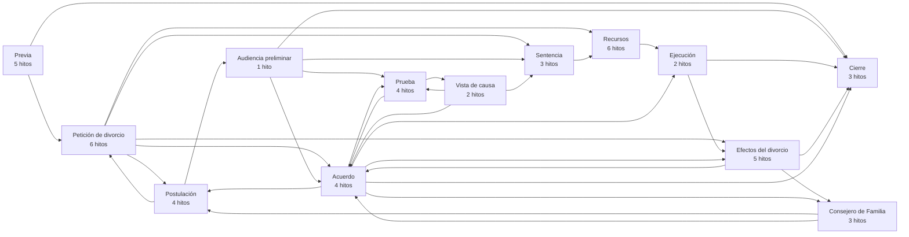
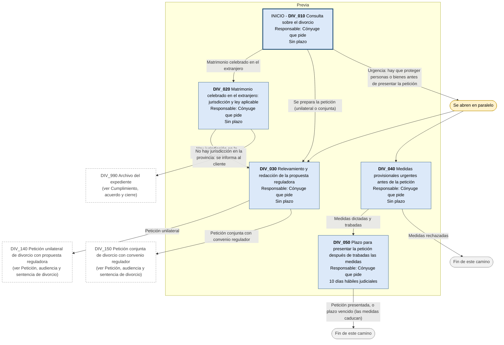
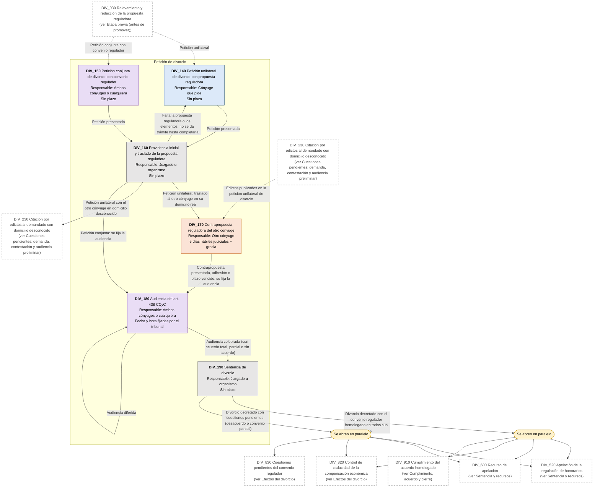
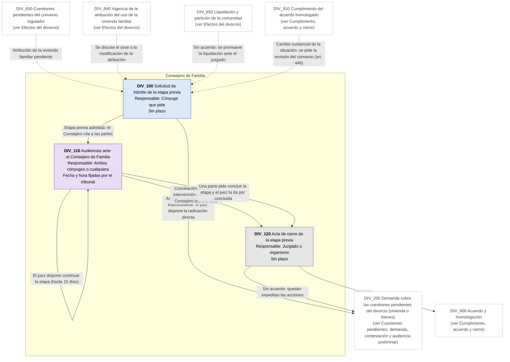
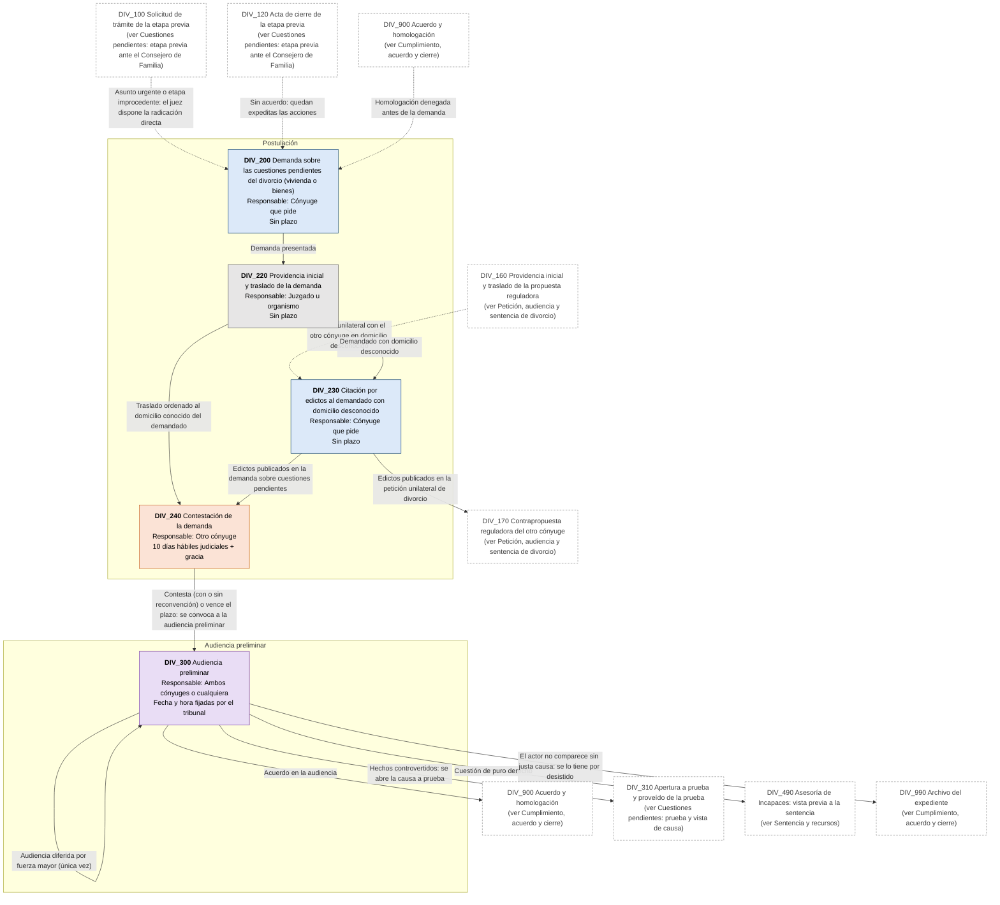
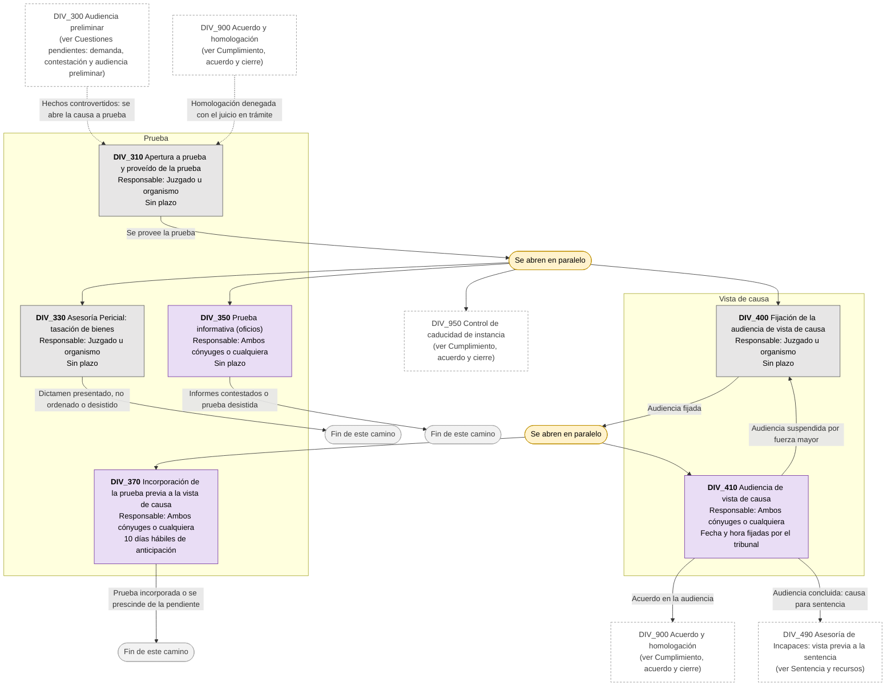
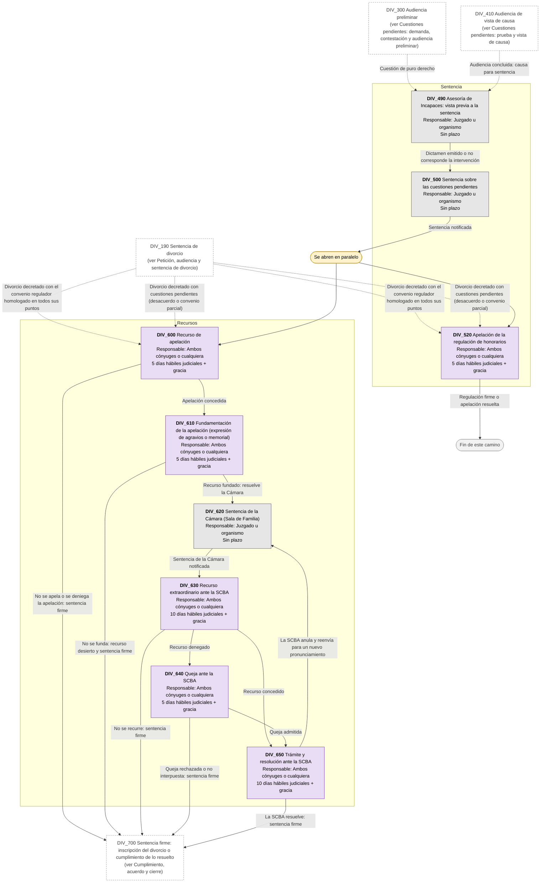

# Diagrama de Flujo: Divorcio (PBA)

**Régimen:** CPCCBA (Decreto-Ley 7425/68), Libro VIII: proceso ante los Juzgados de Familia (arts. 827 a 853, texto de las Leyes 13.634 y 15.513); CCyC, arts. 435 a 445, 480, 496 a 500, 717, 721, 722, 2621 y 2626 · **Versión:** 1 (borrador)

> Este documento se genera a partir de `matriz_familia_divorcio_pba.xlsx`. No se edita a mano: las correcciones se hacen en la planilla y luego se vuelve a generar el diagrama.

## Cómo leer los diagramas

* **Cada caja es un hito** de la hoja `Nodos`: muestra el ID, el nombre, quién debe actuar y el plazo.
* **Cada flecha es un camino** de la hoja `Transiciones`, rotulado con su condición de salida.
* **Color de la caja según el responsable:** celeste = el cónyuge que pide el divorcio o promueve la cuestión (ACTORA); naranja = el otro cónyuge (DEMANDADA); gris = juzgado, Consejero, Asesoría de Incapaces o Registro de las Personas, aclarado en el nombre (TRIBUNAL); violeta = los dos cónyuges o cualquiera de ellos (AMBAS).
* **Borde grueso:** hito inicial o hito final.
* **"Se abren en paralelo"** (amarillo): esa condición abre varios hitos a la vez; por ejemplo, al dictarse la sentencia de divorcio corren a la vez la apelación, la apelación de los honorarios, la caducidad de la compensación económica y las cuestiones que quedaron pendientes.
* **"Fin de este camino"** (gris claro): el camino paralelo termina sin abrir otro hito.
* **Cajas blancas con borde discontinuo:** hitos de otra etapa; el texto indica en qué diagrama están. Las flechas punteadas muestran desde dónde se llega a esta etapa.
* **Derivación a otra matriz:** caja con borde grueso (es un hito final) cuyo nombre empieza con "Sigue en la matriz de ...": el expediente continúa en ese otro flujo de familia, en un expediente vinculado.
* **Fase "Previa":** hitos anteriores a la promoción (partidas, intimaciones, denuncia, inscripción en un registro). La app los separa en el flujo prejudicial.

## Vista general por fases

## 1. Etapa previa (antes de promover)

## 2. Petición, audiencia y sentencia de divorcio

## 3. Efectos del divorcio

```mermaid
flowchart TD
  subgraph F_0["Efectos del divorcio"]
    DIV_810["<b>DIV_810</b> Inscripción de la sentencia de divorcio en el Registro de las Personas<br/>Responsable: Cónyuge que pide<br/>Sin plazo"]:::actora
    DIV_820["<b>DIV_820</b> Control de caducidad de la compensación económica<br/>Responsable: Cónyuge que pide<br/>6 meses"]:::actora
    DIV_830["<b>DIV_830</b> Cuestiones pendientes del convenio regulador<br/>Responsable: Ambos cónyuges o cualquiera<br/>Sin plazo"]:::ambas
    DIV_840["<b>DIV_840</b> Vigencia de la atribución del uso de la vivienda familiar<br/>Responsable: Cónyuge que pide<br/>Sin plazo"]:::actora
    DIV_850["<b>DIV_850</b> Liquidación y partición de la comunidad<br/>Responsable: Ambos cónyuges o cualquiera<br/>Sin plazo"]:::ambas
  end
  EXT_DIV_190_origen["DIV_190 Sentencia de divorcio<br/>(ver Petición, audiencia y sentencia de divorcio)"]:::externo
  EXT_DIV_190_origen -.->|"Divorcio decretado con el convenio regulador homologado en todos sus puntos"| DIV_820
  EXT_DIV_190_origen -.->|"Divorcio decretado con cuestiones pendientes (desacuerdo o convenio parcial)"| DIV_820
  EXT_DIV_190_origen -.->|"Divorcio decretado con cuestiones pendientes (desacuerdo o convenio parcial)"| DIV_830
  EXT_DIV_700_origen["DIV_700 Sentencia firme: inscripción del divorcio o cumplimiento de lo resuelto<br/>(ver Cumplimiento, acuerdo y cierre)"]:::externo
  EXT_DIV_700_origen -.->|"Sentencia de divorcio firme: se ordena su inscripción"| DIV_810
  EXT_DIV_700_origen -.->|"Se atribuyó el uso de la vivienda: se controla su vigencia"| DIV_840
  FIN_DIV_810_1(["Fin de este camino"]):::fin
  DIV_810 -->|"Sentencia inscripta"| FIN_DIV_810_1
  EXT_DIV_970_destino["DIV_970 Sigue en la matriz de alimentos y compensación económica<br/>(ver Cumplimiento, acuerdo y cierre)"]:::externo
  DIV_820 -->|"Se va a reclamar la compensación económica"| EXT_DIV_970_destino
  FIN_DIV_820_2(["Fin de este camino"]):::fin
  DIV_820 -->|"Vence sin reclamo, o la compensación ya se resolvió en el convenio"| FIN_DIV_820_2
  DIV_830 -->|"Alimentos o compensación económica pendientes"| EXT_DIV_970_destino
  EXT_DIV_980_destino["DIV_980 Sigue en la matriz de cuidado personal y régimen de comunicación<br/>(ver Cumplimiento, acuerdo y cierre)"]:::externo
  DIV_830 -->|"Cuidado personal o régimen de comunicación pendientes"| EXT_DIV_980_destino
  P_DIV_830_3(["Se abren en paralelo"]):::paralelo
  DIV_830 -->|"Alimentos y cuidado de los hijos pendientes"| P_DIV_830_3
  P_DIV_830_3 --> EXT_DIV_970_destino
  P_DIV_830_3 --> EXT_DIV_980_destino
  EXT_DIV_100_destino["DIV_100 Solicitud de trámite de la etapa previa<br/>(ver Cuestiones pendientes: etapa previa ante el Consejero de Familia)"]:::externo
  DIV_830 -->|"Atribución de la vivienda familiar pendiente"| EXT_DIV_100_destino
  DIV_830 -->|"Distribución de los bienes pendiente"| DIV_850
  EXT_DIV_900_destino["DIV_900 Acuerdo y homologación<br/>(ver Cumplimiento, acuerdo y cierre)"]:::externo
  DIV_830 -->|"Acuerdo posterior sobre lo pendiente"| EXT_DIV_900_destino
  EXT_DIV_990_destino["DIV_990 Archivo del expediente<br/>(ver Cumplimiento, acuerdo y cierre)"]:::externo
  DIV_840 -->|"Cesa la atribución (plazo cumplido, cambio de circunstancias o indignidad)"| EXT_DIV_990_destino
  DIV_840 -->|"Se discute el cese o la modificación de la atribución"| EXT_DIV_100_destino
  DIV_850 -->|"Partición acordada"| EXT_DIV_900_destino
  DIV_850 -->|"Sin acuerdo: se promueve la liquidación ante el juzgado"| EXT_DIV_100_destino
  EXT_DIV_910_origen["DIV_910 Cumplimiento del acuerdo homologado<br/>(ver Cumplimiento, acuerdo y cierre)"]:::externo
  EXT_DIV_910_origen -.->|"El convenio atribuye el uso de la vivienda: se controla su vigencia"| DIV_840
  classDef actora fill:#DCE9F9,stroke:#1F4E79,color:#000
  classDef demandada fill:#FBE3D6,stroke:#C55A11,color:#000
  classDef tribunal fill:#E7E6E6,stroke:#595959,color:#000
  classDef ambas fill:#E9DDF5,stroke:#7030A0,color:#000
  classDef externo fill:#FFFFFF,stroke:#8C8C8C,color:#404040,stroke-dasharray:4 3
  classDef paralelo fill:#FFF2CC,stroke:#BF9000,color:#000
  classDef fin fill:#F2F2F2,stroke:#A6A6A6,color:#404040
```

## 4. Cuestiones pendientes: etapa previa ante el Consejero de Familia

## 5. Cuestiones pendientes: demanda, contestación y audiencia preliminar

## 6. Cuestiones pendientes: prueba y vista de causa

## 7. Sentencia y recursos

## 8. Cumplimiento, acuerdo y cierre

```mermaid
flowchart TD
  subgraph F_0["Ejecución"]
    DIV_700["<b>DIV_700</b> Sentencia firme: inscripción del divorcio o cumplimiento de lo resuelto<br/>Responsable: Ambos cónyuges o cualquiera<br/>Sin plazo"]:::ambas
    DIV_710["<b>DIV_710</b> Ejecución de la sentencia<br/>Responsable: Cónyuge que pide<br/>Sin plazo"]:::actora
  end
  subgraph F_1["Acuerdo"]
    DIV_900["<b>DIV_900</b> Acuerdo y homologación<br/>Responsable: Ambos cónyuges o cualquiera<br/>Sin plazo"]:::ambas
    DIV_910["<b>DIV_910</b> Cumplimiento del acuerdo homologado<br/>Responsable: Otro cónyuge<br/>Sin plazo"]:::demandada
    DIV_950["<b>DIV_950</b> Control de caducidad de instancia<br/>Responsable: Cónyuge que pide<br/>3 meses"]:::actora
    DIV_960["<b>DIV_960</b> Intimación previa a la caducidad de instancia<br/>Responsable: Cónyuge que pide<br/>5 días hábiles judiciales + gracia"]:::actora
  end
  subgraph F_2["Cierre"]
    DIV_970["<b>DIV_970</b> Sigue en la matriz de alimentos y compensación económica<br/>Responsable: Cónyuge que pide<br/>Sin plazo"]:::actora
    DIV_980["<b>DIV_980</b> Sigue en la matriz de cuidado personal y régimen de comunicación<br/>Responsable: Cónyuge que pide<br/>Sin plazo"]:::actora
    DIV_990["<b>DIV_990</b> Archivo del expediente<br/>Responsable: Ambos cónyuges o cualquiera<br/>Sin plazo"]:::ambas
  end
  EXT_DIV_020_origen["DIV_020 Matrimonio celebrado en el extranjero: jurisdicción y ley aplicable<br/>(ver Etapa previa (antes de promover))"]:::externo
  EXT_DIV_020_origen -.->|"No hay jurisdicción en la provincia: se informa al cliente"| DIV_990
  EXT_DIV_120_origen["DIV_120 Acta de cierre de la etapa previa<br/>(ver Cuestiones pendientes: etapa previa ante el Consejero de Familia)"]:::externo
  EXT_DIV_120_origen -.->|"Acuerdo"| DIV_900
  EXT_DIV_190_origen["DIV_190 Sentencia de divorcio<br/>(ver Petición, audiencia y sentencia de divorcio)"]:::externo
  EXT_DIV_190_origen -.->|"Divorcio decretado con el convenio regulador homologado en todos sus puntos"| DIV_910
  EXT_DIV_300_origen["DIV_300 Audiencia preliminar<br/>(ver Cuestiones pendientes: demanda, contestación y audiencia preliminar)"]:::externo
  EXT_DIV_300_origen -.->|"Acuerdo en la audiencia"| DIV_900
  EXT_DIV_300_origen -.->|"El actor no comparece sin justa causa: se lo tiene por desistido"| DIV_990
  EXT_DIV_310_origen["DIV_310 Apertura a prueba y proveído de la prueba<br/>(ver Cuestiones pendientes: prueba y vista de causa)"]:::externo
  EXT_DIV_310_origen -.->|"Se provee la prueba"| DIV_950
  EXT_DIV_410_origen["DIV_410 Audiencia de vista de causa<br/>(ver Cuestiones pendientes: prueba y vista de causa)"]:::externo
  EXT_DIV_410_origen -.->|"Acuerdo en la audiencia"| DIV_900
  EXT_DIV_600_origen["DIV_600 Recurso de apelación<br/>(ver Sentencia y recursos)"]:::externo
  EXT_DIV_600_origen -.->|"No se apela o se deniega la apelación: sentencia firme"| DIV_700
  EXT_DIV_610_origen["DIV_610 Fundamentación de la apelación (expresión de agravios o memorial)<br/>(ver Sentencia y recursos)"]:::externo
  EXT_DIV_610_origen -.->|"No se funda: recurso desierto y sentencia firme"| DIV_700
  EXT_DIV_630_origen["DIV_630 Recurso extraordinario ante la SCBA<br/>(ver Sentencia y recursos)"]:::externo
  EXT_DIV_630_origen -.->|"No se recurre: sentencia firme"| DIV_700
  EXT_DIV_640_origen["DIV_640 Queja ante la SCBA<br/>(ver Sentencia y recursos)"]:::externo
  EXT_DIV_640_origen -.->|"Queja rechazada o no interpuesta: sentencia firme"| DIV_700
  EXT_DIV_650_origen["DIV_650 Trámite y resolución ante la SCBA<br/>(ver Sentencia y recursos)"]:::externo
  EXT_DIV_650_origen -.->|"La SCBA resuelve: sentencia firme"| DIV_700
  EXT_DIV_810_destino["DIV_810 Inscripción de la sentencia de divorcio en el Registro de las Personas<br/>(ver Efectos del divorcio)"]:::externo
  DIV_700 -->|"Sentencia de divorcio firme: se ordena su inscripción"| EXT_DIV_810_destino
  EXT_DIV_840_destino["DIV_840 Vigencia de la atribución del uso de la vivienda familiar<br/>(ver Efectos del divorcio)"]:::externo
  DIV_700 -->|"Se atribuyó el uso de la vivienda: se controla su vigencia"| EXT_DIV_840_destino
  DIV_700 -->|"Sentencia sobre las cuestiones pendientes cumplida"| DIV_990
  DIV_700 -->|"Sentencia sobre las cuestiones pendientes incumplida"| DIV_710
  DIV_710 -->|"Sentencia cumplida o crédito cobrado"| DIV_990
  EXT_DIV_820_origen["DIV_820 Control de caducidad de la compensación económica<br/>(ver Efectos del divorcio)"]:::externo
  EXT_DIV_820_origen -.->|"Se va a reclamar la compensación económica"| DIV_970
  EXT_DIV_830_origen["DIV_830 Cuestiones pendientes del convenio regulador<br/>(ver Efectos del divorcio)"]:::externo
  EXT_DIV_830_origen -.->|"Alimentos o compensación económica pendientes"| DIV_970
  EXT_DIV_830_origen -.->|"Cuidado personal o régimen de comunicación pendientes"| DIV_980
  EXT_DIV_830_origen -.->|"Alimentos y cuidado de los hijos pendientes"| DIV_970
  EXT_DIV_830_origen -.->|"Alimentos y cuidado de los hijos pendientes"| DIV_980
  EXT_DIV_830_origen -.->|"Acuerdo posterior sobre lo pendiente"| DIV_900
  EXT_DIV_840_origen["DIV_840 Vigencia de la atribución del uso de la vivienda familiar<br/>(ver Efectos del divorcio)"]:::externo
  EXT_DIV_840_origen -.->|"Cesa la atribución (plazo cumplido, cambio de circunstancias o indignidad)"| DIV_990
  EXT_DIV_850_origen["DIV_850 Liquidación y partición de la comunidad<br/>(ver Efectos del divorcio)"]:::externo
  EXT_DIV_850_origen -.->|"Partición acordada"| DIV_900
  DIV_900 -->|"Acuerdo homologado"| DIV_910
  EXT_DIV_200_destino["DIV_200 Demanda sobre las cuestiones pendientes del divorcio (vivienda o bienes)<br/>(ver Cuestiones pendientes: demanda, contestación y audiencia preliminar)"]:::externo
  DIV_900 -->|"Homologación denegada antes de la demanda"| EXT_DIV_200_destino
  EXT_DIV_310_destino["DIV_310 Apertura a prueba y proveído de la prueba<br/>(ver Cuestiones pendientes: prueba y vista de causa)"]:::externo
  DIV_900 -->|"Homologación denegada con el juicio en trámite"| EXT_DIV_310_destino
  DIV_910 -->|"Convenio cumplido"| DIV_990
  DIV_910 -->|"Convenio incumplido: se ejecuta"| DIV_710
  DIV_910 -->|"El convenio atribuye el uso de la vivienda: se controla su vigencia"| EXT_DIV_840_destino
  EXT_DIV_100_destino["DIV_100 Solicitud de trámite de la etapa previa<br/>(ver Cuestiones pendientes: etapa previa ante el Consejero de Familia)"]:::externo
  DIV_910 -->|"Cambio sustancial de la situación: se pide la revisión del convenio (art. 440)"| EXT_DIV_100_destino
  DIV_950 -->|"Se impulsa el proceso: se actualiza el Día Cero al último acto"| DIV_950
  FIN_DIV_950_2(["Fin de este camino"]):::fin
  DIV_950 -->|"Se dicta sentencia o termina el proceso"| FIN_DIV_950_2
  DIV_950 -->|"La contraria pide la caducidad"| DIV_960
  DIV_960 -->|"Actividad útil en término"| DIV_950
  DIV_960 -->|"No hay actividad útil: se decreta la caducidad"| DIV_990
  style DIV_970 stroke-width:3px
  style DIV_980 stroke-width:3px
  style DIV_990 stroke-width:3px
  classDef actora fill:#DCE9F9,stroke:#1F4E79,color:#000
  classDef demandada fill:#FBE3D6,stroke:#C55A11,color:#000
  classDef tribunal fill:#E7E6E6,stroke:#595959,color:#000
  classDef ambas fill:#E9DDF5,stroke:#7030A0,color:#000
  classDef externo fill:#FFFFFF,stroke:#8C8C8C,color:#404040,stroke-dasharray:4 3
  classDef paralelo fill:#FFF2CC,stroke:#BF9000,color:#000
  classDef fin fill:#F2F2F2,stroke:#A6A6A6,color:#404040
```

