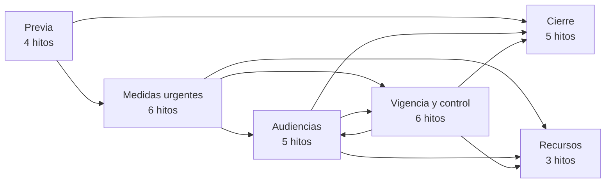
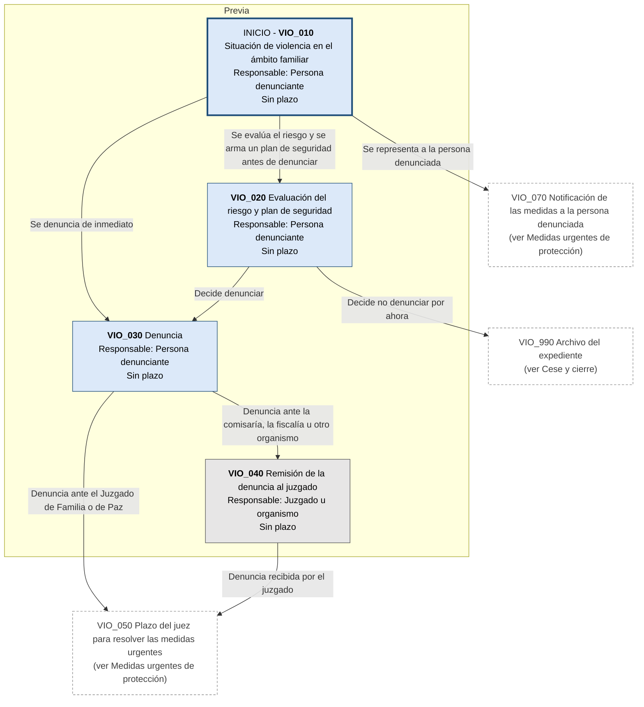
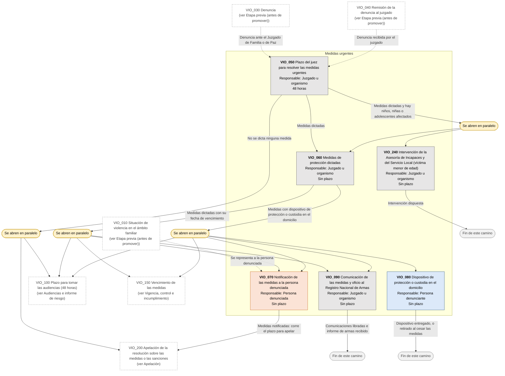
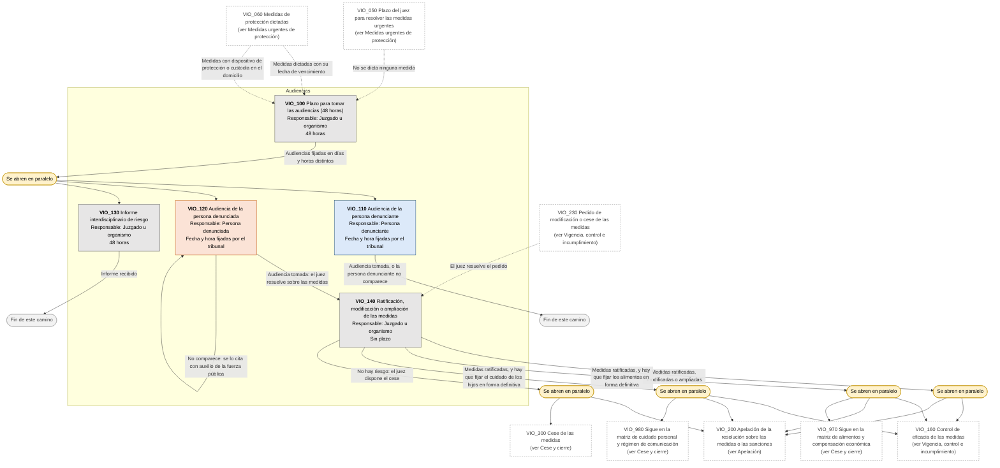
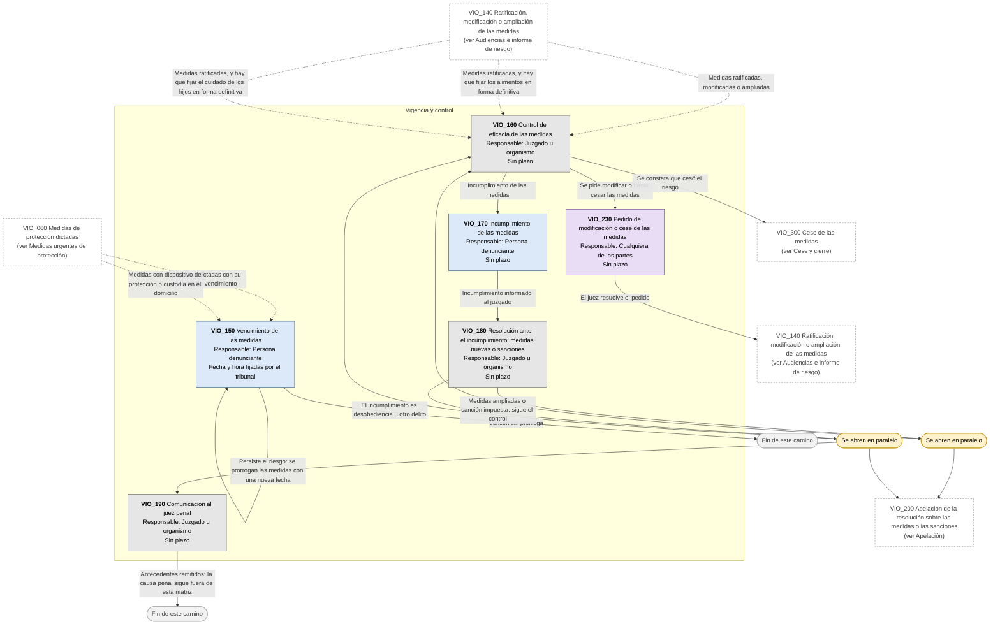
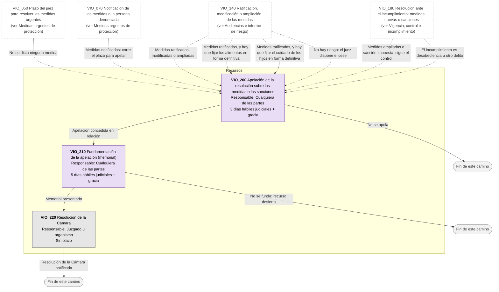
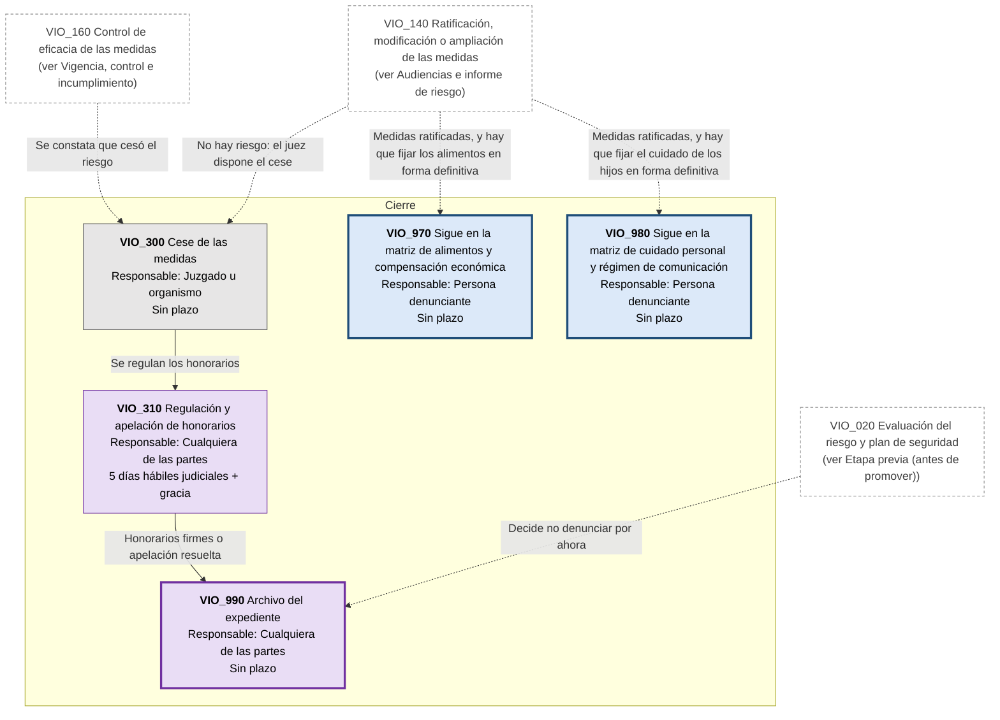

# Diagrama de Flujo: Violencia familiar: medidas de protección (PBA)

**Régimen:** Ley 12.569 de violencia familiar (texto de las Leyes 14.509 y 14.657); art. 827 inc. u CPCCBA; art. 16 de la Ley 26.485 (garantías mínimas de procedimiento, según el art. 6 ter de la Ley 12.569) · **Versión:** 1 (borrador)

> Este documento se genera a partir de `matriz_familia_violencia_pba.xlsx`. No se edita a mano: las correcciones se hacen en la planilla y luego se vuelve a generar el diagrama.

## Cómo leer los diagramas

* **Cada caja es un hito** de la hoja `Nodos`: muestra el ID, el nombre, quién debe actuar y el plazo.
* **Cada flecha es un camino** de la hoja `Transiciones`, rotulado con su condición de salida.
* **Color de la caja según el responsable:** celeste = la persona que padece la violencia o quien denuncia (ACTORA); naranja = la persona denunciada (DEMANDADA); gris = juzgado, comisaría, equipo interdisciplinario, Registro Nacional de Armas, Asesoría de Incapaces o Servicio Local, aclarado en el nombre (TRIBUNAL); violeta = cualquiera de las partes (AMBAS).
* **Borde grueso:** hito inicial o hito final.
* **"Se abren en paralelo"** (amarillo): esa condición abre varios hitos a la vez; por ejemplo, al dictarse las medidas corren a la vez la notificación a la persona denunciada, las comunicaciones, las 48 horas para tomar las audiencias y el vencimiento de las medidas.
* **"Fin de este camino"** (gris claro): el camino paralelo termina sin abrir otro hito.
* **Cajas blancas con borde discontinuo:** hitos de otra etapa; el texto indica en qué diagrama están. Las flechas punteadas muestran desde dónde se llega a esta etapa.
* **Derivación a otra matriz:** caja con borde grueso (es un hito final) cuyo nombre empieza con "Sigue en la matriz de ...": el expediente continúa en ese otro flujo de familia, en un expediente vinculado.
* **Fase "Previa":** hitos anteriores a la promoción (partidas, intimaciones, denuncia, inscripción en un registro). La app los separa en el flujo prejudicial.

## Vista general por fases

## 1. Etapa previa (antes de promover)

## 2. Medidas urgentes de protección

## 3. Audiencias e informe de riesgo

## 4. Vigencia, control e incumplimiento

## 5. Apelación

## 6. Cese y cierre

