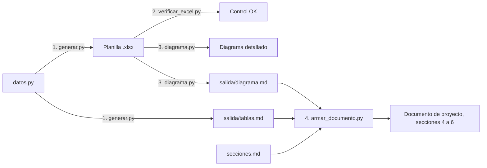

# Herramientas del repositorio

> **Este repositorio es solo documental.** No contiene el código de la aplicación ni se despliega. Los scripts de esta carpeta existen para **generar y verificar la documentación**: la planilla de la matriz, sus diagramas y los casos de prueba del motor de plazos. No son la base del desarrollo: el backend se escribe en Java en su propio repositorio, a partir de estos documentos.

## Qué hay

| Archivo | Para qué sirve |
| ----- | ----- |
| `motor_plazos_referencia.py` | Implementación de referencia del motor de plazos. Ejecuta los casos de prueba del documento de lógica y falla si alguno no da el resultado esperado. |
| `matriz/datos.py` | Contenido del borrador de la matriz laboral (Ley 11.653): hitos, transiciones, tipos de plazo y dudas para el abogado. **Es la fuente del borrador.** |
| `matriz/generar.py` | Arma la planilla `matriz_flujo_laboral_pba_ley_11653.xlsx` desde `datos.py`, con validaciones y fórmulas de control. También escribe las tablas en Markdown (`salida/tablas.md`). |
| `matriz/verificar_excel.py` | Evalúa las fórmulas de control de la planilla sin abrir Excel. Comprueba que no marquen errores y que sí los detecten cuando se inyecta uno. |
| `matriz/diagrama.py` | Lee la planilla y genera los diagramas Mermaid: el detalle en `diagrama_flujo_laboral_pba_ley_11653.md` y la vista general en `salida/diagrama.md`. |
| `matriz/secciones.md` | Plantilla de las secciones 4 a 6 del documento de proyecto (formato de la matriz, tablas y diagrama). |
| `matriz/armar_documento.py` | Reemplaza las secciones 4 a 6 de `documentacion_de_proyecto_asistente_legal_pba.md` con la plantilla, las tablas y la vista general. Las secciones 1 a 3 no se tocan. |
| `matriz/salida/` | Archivos intermedios que generan los scripts. No se editan a mano. |
| `requirements.txt` | Dependencias de Python, con versión fija. |
| `pantallas/capturar.cjs` | Genera las capturas PNG de las maquetas (`diseno/pantallas/*.html`) en `diseno/pantallas/capturas/`, que se usan en `diseno_de_pantallas_v1.md`. |
| `pantallas/package.json` | Dependencia de Node.js para las capturas (puppeteer, versión fija, con `package-lock.json`). |

## Preparar el entorno (una sola vez)

Hace falta Python 3.11 o superior.

```bash
cd herramientas
python3 -m venv .venv
.venv/bin/pip install -r requirements.txt
```

La carpeta `.venv/` está en `.gitignore`.

## Verificar el motor de plazos

```bash
cd herramientas
.venv/bin/python motor_plazos_referencia.py
```

Imprime una línea por caso (`OK` o `ERR`) y termina con código 0 solo si pasan todos.

Si cambia una regla en `logica_matematica_calculadora_de_dias_habiles_judiciales.md`:
1. se actualiza la sección 5 de ese documento (casos de prueba);
2. se actualiza `CASOS` en el script;
3. se vuelve a correr.

Los mismos casos son los que después tiene que pasar el módulo Java.

## Regenerar la matriz, los diagramas y el documento de proyecto

Los cuatro pasos, en orden, desde `herramientas/matriz`:

```bash
cd herramientas/matriz
PY=../.venv/bin/python

# 1. Planilla y tablas, desde datos.py
$PY generar.py ../../matriz_flujo_laboral_pba_ley_11653.xlsx salida/tablas.md

# 2. Control de las fórmulas de la planilla
$PY verificar_excel.py ../../matriz_flujo_laboral_pba_ley_11653.xlsx

# 3. Diagramas, desde la planilla
$PY diagrama.py ../../matriz_flujo_laboral_pba_ley_11653.xlsx ../../diagrama_flujo_laboral_pba_ley_11653.md salida/diagrama.md

# 4. Secciones 4 a 6 del documento de proyecto
$PY armar_documento.py ../../documentacion_de_proyecto_asistente_legal_pba.md salida/tablas.md salida/diagrama.md
```



Los scripts validan la matriz antes de escribir. Si algo no cierra (un ID duplicado, una transición a un hito que no existe, un plazo incoherente con su tipo, gracia en un tipo que no la admite), cortan con un error y no generan nada.

### Cuidado: `generar.py` pisa la planilla

`generar.py` crea la planilla desde cero con lo que hay en `datos.py`. **Si el abogado ya completó la planilla** (respuestas en `Dudas_a_validar`, cambios en `Nodos` o `Transiciones`, estado de validación), correrlo borra ese trabajo. Desde la reunión de validación en adelante:

1. **La planilla pasa a ser la fuente.** Las correcciones del abogado se hacen en la planilla, no en `datos.py`.
2. **Para los diagramas alcanza con el paso 3**, porque `diagrama.py` lee la planilla.
3. **Las tablas del documento de proyecto salen de `datos.py`.** Para actualizarlas, primero hay que pasar los cambios de la planilla a `datos.py` y después correr los cuatro pasos. Antes de hacerlo, conviene guardar una copia de la planilla y comparar las celdas para no perder nada.

En la aplicación, la planilla validada no pasa por estos scripts: la importa el back-office, que repite las mismas validaciones y publica una versión del flujo (sección 4 del documento de proyecto).

## Regenerar las capturas de las pantallas

Hace falta Node.js 18 o superior. La primera vez, `npm ci` instala puppeteer con la versión del lockfile y descarga el navegador que usa (unos 150 MB, fuera del repositorio):

```bash
cd herramientas/pantallas
npm ci
npm run capturar                      # todas las maquetas
npm run capturar -- 07_ficha.html     # solo una
```

Cada maqueta se captura en escritorio (1440 px de ancho) y, las que lo tienen definido en `CAPTURAS`, también en celular (390 px, con sufijo `_celular`). La captura toma el alto completo de la página. Si se agrega una maqueta, hay que sumarla a `CAPTURAS`; el script falla con un nombre que no conoce.

`node_modules/` está en `.gitignore`.

## Revisar que los diagramas rendericen (opcional)

Los diagramas Mermaid se ven en GitHub, en Cursor y en la mayoría de los visores de Markdown. Para comprobar que no tienen errores de sintaxis se puede usar la herramienta oficial de línea de comandos de Mermaid (`@mermaid-js/mermaid-cli`, requiere Node.js), guardando primero el bloque en un archivo `.mmd`:

```bash
npx -p @mermaid-js/mermaid-cli mmdc -i diagrama.mmd -o diagrama.svg
```
