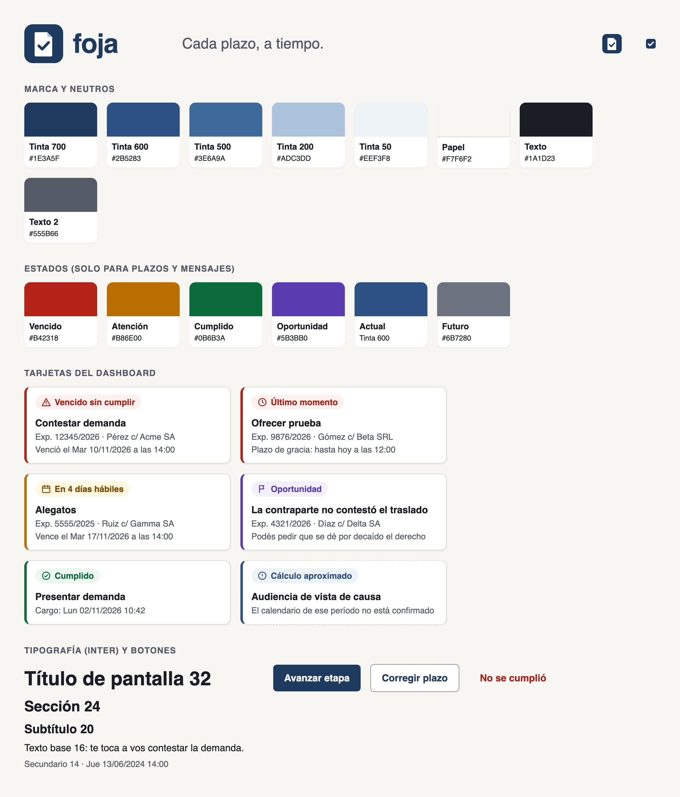

# Identidad y Diseño - Foja (V1)

**Estado:** borrador v0.1 · **Fecha:** 11/11/2026

Este documento define:
- el nombre de la app;
- la marca (logo, paleta, tipografía e íconos);
- las reglas visuales y de redacción de la interfaz.

Los archivos están en `diseno/`. Complementa a `definicion_de_ui_ux_asistente_legal.md`, que define qué hace cada pantalla, y a `diseno_de_pantallas_v1.md`, que muestra cómo se ve cada una aplicando esta identidad.

---

## 1. Nombre

**Foja.** Lema: **"Cada plazo, a tiempo."**

**Por qué:**
- Una foja es una hoja del expediente judicial ("a fojas 23"): todo abogado argentino reconoce la palabra y la asocia a su trabajo.
- Es corta, se pronuncia igual en todo el país, no lleva tilde ni eñe, y funciona en dominios, emails y nombres de archivo.
- No describe literalmente la función (como "Plazos" o "Vencimientos"), así que es más fácil de registrar como marca y no limita el producto si mañana suma otros fueros.

**Cómo se escribe:**
- En texto: "Foja", con mayúscula inicial. Nunca "FOJA", "Foja App" ni "la Foja".
- En el logo: "foja", en minúscula.

**Alternativas**, en orden, si "Foja" no se puede usar:
1. **Hábil:** juega con "día hábil" y con "ser hábil". Contras: es más descriptiva (más difícil de registrar) y la tilde complica el dominio.
2. **Cargo:** el sello que prueba la presentación en término. Contra: fuera del ámbito legal se entiende como "puesto" o "cobro".
3. **Término:** sinónimo procesal de plazo. Contra: es genérica.

**Antes de usarlo en público** (no lo pude verificar desde acá):
1. Búsqueda de antecedentes en el INPI, en las clases 9 (software) y 42 (software como servicio), y de ser posible también en la 45 (servicios jurídicos). Si está libre, presentar la solicitud de registro.
2. Disponibilidad de `foja.com.ar` o `foja.ar` en NIC Argentina, y opcionalmente `foja.app`.
3. Búsqueda de productos legales con el mismo nombre en Argentina y en la región.
4. Recién después, reemplazar `[NOMBRE COMERCIAL]` en los documentos de `legal/`.

## 2. Personalidad y principios

Foja es una herramienta de trabajo en la que el abogado confía su responsabilidad profesional. Tiene que transmitir:

| Rasgo | Qué significa en la práctica |
| :--- | :--- |
| Confiable | Colores sobrios, sin efectos. Cada fecha se puede explicar ("por qué vence ese día"). |
| Clara | Una acción principal por pantalla. Textos cortos, sin jerga técnica. |
| Serena | La urgencia se reserva para lo urgente: si todo es rojo, nada lo es. |
| Precisa | Fechas siempre con día de la semana y hora. "Días hábiles" siempre aclarado. |

**Principios de diseño:**
1. **El estado se entiende sin color.** Cada estado lleva ícono y texto ("Vencido sin cumplir"), además del color. Funciona en blanco y negro y para personas con daltonismo.
2. **Lo más urgente, arriba y una sola vez.** Primero los vencidos sin cumplir, después lo que vence hoy y después el resto, ordenado por fecha.
3. **Primero el celular.** El abogado consulta en el pasillo del tribunal: la información clave entra en la pantalla de un teléfono sin hacer zoom.
4. **Nada se pierde en silencio.** Todo cambio de un vencimiento se muestra con el antes y el después.

## 3. Logo

**Concepto:** una foja con la esquina doblada (el expediente) y un tilde (el plazo cumplido), sobre un cuadrado azul tinta.

| Archivo | Uso | Tamaño mínimo |
| :--- | :--- | :--- |
| `diseno/logo_horizontal.svg` | Encabezado de la web, emails, facturas, presentaciones | 120 px de ancho |
| `diseno/isotipo.svg` | Ícono de la app instalada, avatar en redes, pantalla de carga | 24 px |
| `diseno/favicon.svg` | Pestaña del navegador (solo el tilde, porque la hoja no se distingue a 16 px) | 16 px |

**Reglas:**
- Espacio libre alrededor: como mínimo, la mitad del alto del isotipo.
- Fondos permitidos: Papel, blanco o Tinta 700. Sobre Tinta 700, el isotipo va con un borde de 1 px en Tinta 200 para que no se pierda.
- No se deforma, no se rota, no se le agregan sombras ni degradados, y no se cambian sus colores (salvo la versión en un solo color negro o blanco para sellos e impresiones).

**Pendiente:** en `logo_horizontal.svg` la palabra "foja" es texto en Inter Bold. Antes de usarlo fuera de la web hay que convertir el texto a curvas, para que no dependa de la fuente instalada. Conviene que un diseñador haga una revisión final del logo; la propuesta sirve para la V1.

## 4. Paleta

Contrastes calculados según WCAG 2.1. Para texto, el mínimo es 4,5:1; para íconos y bordes que transmiten información, 3:1.

### 4.1 Marca: Tinta

El azul tinta remite a la tinta de los escritos y a la seriedad del trabajo judicial. No compite con los colores de estado.

| Nombre | Hex | Uso | Contraste |
| :--- | :--- | :--- | :--- |
| Tinta 700 | `#1E3A5F` | Color de marca. Botón principal, encabezado, logo | 11,5:1 sobre blanco |
| Tinta 600 | `#2B5283` | Enlaces, estado "Actual" del mapa | 8,0:1 sobre blanco |
| Tinta 500 | `#3E6A9A` | Íconos secundarios, gráficos | 5,6:1 sobre blanco |
| Tinta 200 | `#ADC3DD` | Anillo de foco, esquina del isotipo | Decorativo |
| Tinta 100 | `#D6E1EE` | Fondos de selección | Decorativo |
| Tinta 50 | `#EEF3F8` | Fondo del paso actual | Decorativo |
| Tinta 900 | `#0F1E33` | Sombras (con transparencia) | — |

### 4.2 Neutros: Papel

| Nombre | Hex | Uso | Contraste |
| :--- | :--- | :--- | :--- |
| Papel | `#F7F6F2` | Fondo general: un blanco cálido, que cansa menos la vista que el blanco puro | — |
| Superficie | `#FFFFFF` | Tarjetas, formularios, menús | — |
| Borde | `#D9D6CC` | Bordes decorativos de tarjetas y divisores | Decorativo |
| Borde de control | `#8C8A82` | Bordes de campos de formulario y botones secundarios | 3,5:1 sobre blanco |
| Texto | `#1A1D23` | Texto principal | 15,6:1 sobre Papel |
| Texto secundario | `#555B66` | Datos del expediente, ayudas | 6,3:1 sobre Papel |
| Texto terciario | `#6B7280` | Metadatos, pasos futuros | 4,8:1 sobre blanco |

### 4.3 Estados

Se usan **solo** para estados de plazos y mensajes del sistema, nunca como decoración. Así el rojo siempre significa "atención ahora".

| Estado | Color fuerte (franja e ícono) | Texto | Fondo | Contraste del texto |
| :--- | :--- | :--- | :--- | :--- |
| Vencido, vence hoy, último momento (gracia) | `#B42318` | `#A8231A` | `#FDF1EF` | 6,5:1 |
| Atención (amarillo del semáforo) | `#B86E00` | `#7A4B00` | `#FFF7E0` | 6,9:1 |
| Cumplido | `#0B6B3A` | `#0B6B3A` | `#ECF8F0` | 6,1:1 |
| Oportunidad (plazo vencido de la contraparte) | `#5B3BB0` | `#5B3BB0` | `#F3F0FC` | 6,9:1 |
| Actual (paso en curso del mapa) | `#2B5283` | `#2B5283` | `#EEF3F8` | 8,0:1 |
| Futuro | `#6B7280` | `#6B7280` | sin fondo | 4,8:1 |

**Reglas de estado:**
- El amarillo del semáforo se muestra en **ámbar oscuro**: el amarillo puro no se lee sobre blanco.
- La oportunidad usa **violeta**, para no confundirse con los vencimientos propios (rojo y ámbar) ni con lo cumplido (verde).
- "No cumplido" y "Anulado" se muestran tachados y en Texto terciario, con su ícono, en el historial.
- El **cálculo aproximado** (calendario provisorio) se marca con un borde punteado y la etiqueta "Cálculo aproximado", nunca solo con un color.

### 4.4 Tema oscuro

Queda fuera de la V1. Los tokens están preparados para sumarlo en la V1.x sin cambiar los componentes.

## 5. Tipografía

**Inter**, en sus pesos 400, 500, 600 y 700. Está diseñada para pantallas, se lee bien en tamaños chicos y tiene números tabulares, así las fechas quedan alineadas en las listas. Licencia: SIL Open Font License (uso comercial libre).

**Se sirve desde nuestro propio dominio**, no desde Google Fonts. La política de seguridad (`font-src 'self'`) no admite fuentes externas, y así ningún tercero se entera de las visitas de los usuarios. Es coherente con la política de privacidad, que excluye el seguimiento y pide consentimiento antes de sumar cualquier herramienta de medición.

| Rol | Tamaño | Peso | Uso |
| :--- | :--- | :--- | :--- |
| Título de pantalla | 32 px (24 en celular) | 700 | Uno por pantalla |
| Sección | 24 px (20 en celular) | 600 | "Vencidos sin cumplir", "Esta semana" |
| Subtítulo | 20 px | 600 | Título de tarjeta destacada |
| Base | 16 px | 400 | Texto general. Es el mínimo para leer en el celular |
| Secundario | 14 px | 400 o 500 | Datos del expediente, ayudas, etiquetas |
| Metadato | 12 px | 500 | Solo datos accesorios (por ejemplo, "Editado por…"). Nunca un vencimiento |

- Interlineado: 1,5 en el texto y 1,25 en los títulos.
- Fechas, horas y números de expediente siempre con números tabulares (`font-variant-numeric: tabular-nums`).

## 6. Íconos

**Lucide** (licencia ISC; paquete `lucide-react`): trazo uniforme de 2 px y estilo sobrio, en 16 px para el texto, 20 px para los botones y 24 px para la navegación.

| Significado | Ícono de Lucide | Etiqueta |
| :--- | :--- | :--- |
| Vencido sin cumplir | `triangle-alert` | "Vencido sin cumplir" |
| Último momento (plazo de gracia) | `clock` | "Último momento: hasta las 12:00" |
| Rojo y amarillo del semáforo | `calendar` | "Vence hoy", "En 4 días hábiles" |
| Oportunidad | `flag` | "Oportunidad" |
| Cumplido | `circle-check` | "Cumplido" |
| Paso actual | `circle-dot` | "Te toca a vos", "Le toca a la contraparte" o "Esperando al tribunal" |
| Futuro | `circle` | — |
| No cumplido o anulado | `circle-x` | "No se cumplió" o "Anulado" |
| Modificado manualmente | `pencil` | "Plazo modificado a mano" |
| Cálculo aproximado | `info` | "Cálculo aproximado" |
| Día inhábil | `calendar-x` | "Inhábil" |
| "Tu vencimiento cambió" | `history` | "Cambió: antes Mar 17/11, ahora Mié 18/11" |

## 7. Componentes base

**Tarjeta de plazo** (dashboard), de arriba hacia abajo:
1. Franja lateral de 4 px con el color fuerte del estado.
2. Etiqueta del estado, con ícono, texto y fondo suave.
3. La acción que hay que hacer ("Contestar demanda"), en negrita.
4. El número de expediente y la carátula. La carátula y el cliente pueden ocultarse si el estudio lo prefiere.
5. El vencimiento: "Vence el Mar 17/11/2026 a las 14:00".

Toda la tarjeta es tocable (mínimo 44 px de alto) y lleva a la ficha del expediente.

**Botones:**
- **Principal:** fondo Tinta 700, texto blanco. Uno solo por pantalla o por panel ("Avanzar etapa", "Guardar").
- **Secundario:** fondo blanco, borde de control, texto Tinta 700 ("Corregir plazo").
- **Destructivo:** solo texto en rojo, y siempre con confirmación ("No se cumplió", "Dar de baja").

**Formularios:**
- La etiqueta siempre está visible arriba del campo, nunca solo como texto de ejemplo adentro.
- El error se muestra debajo del campo, en rojo y con ícono, diciendo cómo corregirlo.

**Mapa del flujo**, con los mismos estados de la sección 4.3:
- el paso actual, resaltado en Tinta con fondo Tinta 50;
- los completados, en verde;
- los futuros, en gris;
- los vencidos, en rojo;
- los no cumplidos y anulados, tachados.

**Franjas de aviso**, a lo ancho de la pantalla y debajo del encabezado:
- Solo lectura: fondo ámbar suave. "Tu suscripción está en solo lectura hasta el 10/12/2026. Podés exportar tus datos o regularizar el pago."
- Calendario provisorio: fondo Tinta 50.

**Estados vacíos:** un texto que explica qué va a aparecer y un botón para empezar ("Todavía no cargaste expedientes. Cargá el primero").

**Espaciado y formas:**
- Espaciado en múltiplos de 4 px.
- Bordes redondeados: 6 px en los controles, 10 px en las tarjetas y 14 px en los diálogos.
- Sombras mínimas.
- Foco visible: anillo de 3 px en Tinta 200.

Los valores exactos están en `diseno/tokens.css`.

## 8. Formatos

| Dato | Formato | Ejemplo |
| :--- | :--- | :--- |
| Fecha | Día de la semana abreviado + dd/mm/aaaa | Mar 17/11/2026 |
| Fecha y hora | Fecha + hora de 24 h | Mar 17/11/2026 14:00 |
| Plazo | Cantidad + unidad completa | 5 días hábiles · 48 horas · 2 meses |
| Tiempo restante | En días hábiles, salvo en horas | En 4 días hábiles · Vence hoy · Vence en 6 horas |
| Importe | Pesos con separador de miles | $ 12.500 |
| Expediente | Como lo escribe el tribunal | 12345/2026 |
| Zona horaria | Siempre Argentina (UTC-3) | — |

Nunca "hace 2 días" ni "la semana que viene" para un vencimiento: siempre la fecha exacta.

## 9. Tono de voz

Hablamos como un colega prolijo: con voseo rioplatense, directo, preciso y sin dramatizar.

- Frases cortas, que empiezan por la acción: "Cargá la fecha de notificación".
- Términos procesales correctos ("traslado", "cargo", "plazo de gracia"), sin jerga técnica ("error 409", "sincronizando", "token").
- Los errores dicen qué pasó y qué hacer.
- Sin signos de exclamación, sin emojis y sin culpar al usuario.

| Situación | Sí | No |
| :--- | :--- | :--- |
| Paso propio | "Te toca a vos: contestar demanda" | "Acción pendiente del usuario" |
| Vencido | "Venció el Mar 10/11 a las 14:00. ¿Se cumplió?" | "¡Atención! Plazo vencido" |
| Gracia | "Último momento: podés presentarlo hasta hoy a las 12:00" | "Estás en el plazo de gracia del art. 124" |
| Límite del plan | "Llegaste a los 10 clientes activos de tu plan. Para sumar otro, pasá al plan de 30" | "Error: límite de clientes excedido" |
| Calendario provisorio | "Cálculo aproximado: todavía no está confirmado el calendario de ese período" | "Calendario no oficial" |
| Recálculo | "Tu vencimiento cambió por el asueto del 20/11: antes Mar 17/11, ahora Mié 18/11" | "Se recalcularon 3 pasos" |
| Error inesperado | "No pudimos guardar el cambio. Probá de nuevo; si sigue pasando, escribinos con este código: 7F3A" | "Internal Server Error" |

**Emails:**
- El asunto dice lo importante: "2 vencidos sin cumplir y 3 vencimientos esta semana".
- Nunca un asunto genérico como "Novedades de Foja".

## 10. Aplicación de la marca

**PWA (manifest):**
- `name: "Foja"`, `short_name: "Foja"`.
- `theme_color: #1E3A5F` y `background_color: #F7F6F2`.
- Íconos de 192 y 512 px exportados desde `isotipo.svg`, con versión *maskable* (con margen de seguridad), y `apple-touch-icon` de 180 px.

**Emails:**
- El logo en el encabezado se sirve desde nuestro dominio, sin píxeles de seguimiento.
- Siempre hay versión en texto plano.
- El pie lleva el nombre del prestador, el enlace a las preferencias y la leyenda de la AAIP cuando corresponde.

**Facturas en PDF:** logo horizontal arriba a la izquierda, y todos los datos que exige ARCA, sin colores de estado.

**Documentos legales:** reemplazar `[NOMBRE COMERCIAL]` por "Foja" cuando se confirme la marca (sección 1).

## 11. Accesibilidad (WCAG 2.1 AA)

- Contrastes de la sección 4: texto con 4,5:1 o más; íconos y bordes de control con 3:1 o más.
- Ningún dato depende solo del color (principio 1).
- Foco visible en todos los elementos interactivos, y uso completo con teclado.
- Objetivos táctiles de 44 × 44 px como mínimo.
- La interfaz funciona con el texto al 200 % sin cortar contenido.
- Los estados tienen texto para lectores de pantalla (por ejemplo, la franja roja dice "Vencido sin cumplir").
- Se respeta "reducir movimiento" del sistema: sin animaciones decorativas.

## 12. Archivos

| Archivo | Contenido |
| :--- | :--- |
| `diseno/isotipo.svg` | Isotipo en color |
| `diseno/logo_horizontal.svg` | Isotipo y nombre |
| `diseno/favicon.svg` | Versión simplificada para 16 px |
| `diseno/tokens.css` | Colores, tipografía, espaciado y formas como variables CSS, para el frontend |
| `diseno/vista_previa.png` | Muestra de la paleta, las tarjetas y la tipografía |
| `diseno/pantallas/` | Maquetas HTML de todas las pantallas y sus capturas (ver `diseno_de_pantallas_v1.md`) |

## 13. Pendientes

| # | Tema | Responsable |
| :--- | :--- | :--- |
| 1 | Búsqueda en el INPI y registro de la marca "Foja" (clases 9 y 42, y de ser posible 45) | [PRODUCTO] |
| 2 | Registro del dominio | [PRODUCTO] |
| 3 | Convertir a curvas el texto del logo y exportar los íconos de la PWA | [DISEÑO] |
| 4 | Probar las tarjetas del dashboard con 2 o 3 abogados (¿se entiende qué es urgente?) | [PRODUCTO] |
| 5 | Tema oscuro | V1.x |
