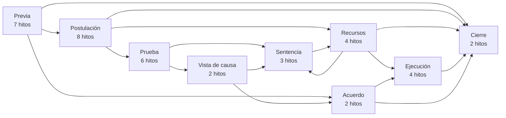
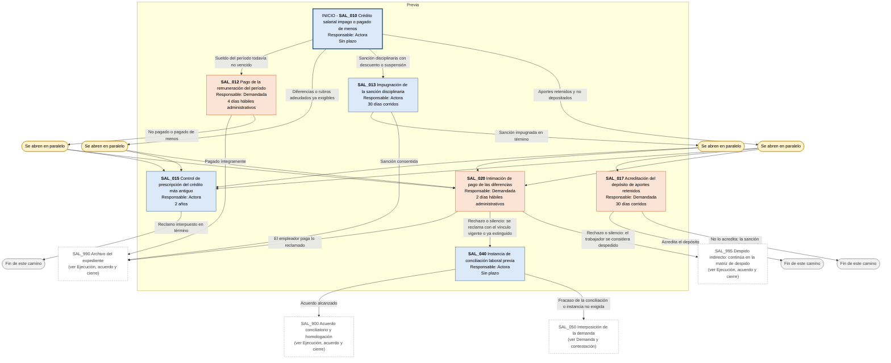
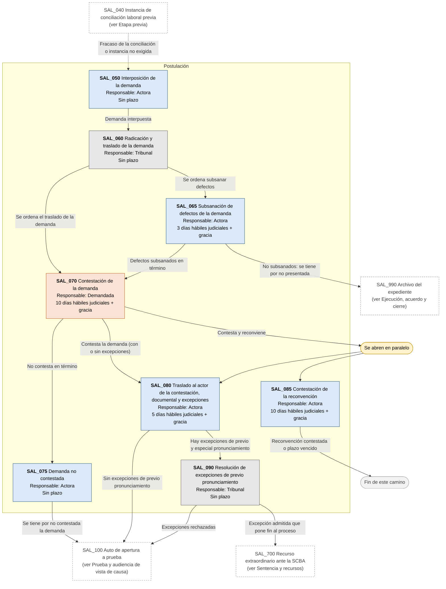
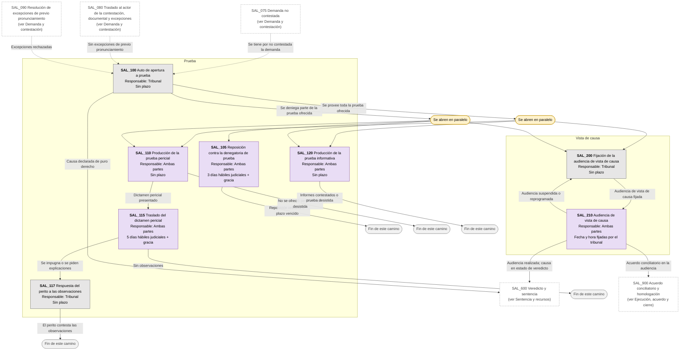
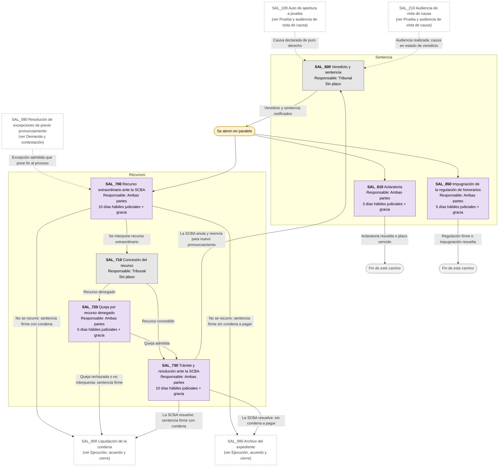
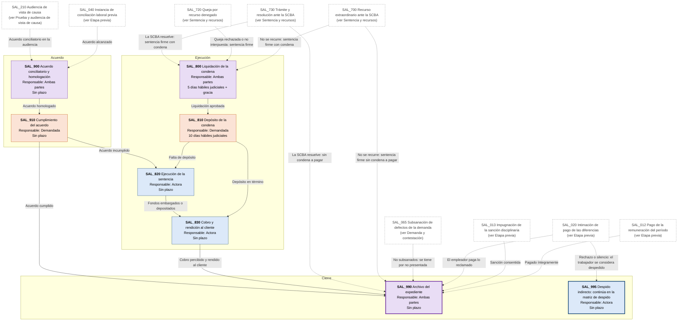

# Diagrama de Flujo: Reclamos salariales - Provincia de Buenos Aires

**Régimen:** Ley 11.653 (Tribunales de Trabajo, instancia única) · **Versión:** 1 (borrador)

> Este documento se genera a partir de `matriz_laboral_reclamos_salariales_pba.xlsx`. No se edita a mano: las correcciones se hacen en la planilla y luego se vuelve a generar el diagrama.

## Cómo leer los diagramas

* **Cada caja es un hito** de la hoja `Nodos`: muestra el ID, el nombre, quién debe actuar y el plazo.
* **Cada flecha es un camino** de la hoja `Transiciones`, rotulado con su condición de salida.
* **Color de la caja según el responsable:** celeste = Actora; naranja = Demandada; gris = Tribunal; violeta = Ambas partes.
* **Borde grueso:** hito inicial o hito final.
* **"Se abren en paralelo"** (amarillo): esa condición abre varios hitos a la vez; por ejemplo, la prescripción corre mientras avanza el reclamo.
* **"Fin de este camino"** (gris claro): el camino paralelo termina sin abrir otro hito.
* **Cajas blancas con borde discontinuo:** hitos de otra etapa; el texto indica en qué diagrama están. Las flechas punteadas muestran desde dónde se llega a esta etapa.

## Vista general por fases

## 1. Etapa previa

## 2. Demanda y contestación

## 3. Prueba y audiencia de vista de causa

## 4. Sentencia y recursos

## 5. Ejecución, acuerdo y cierre

