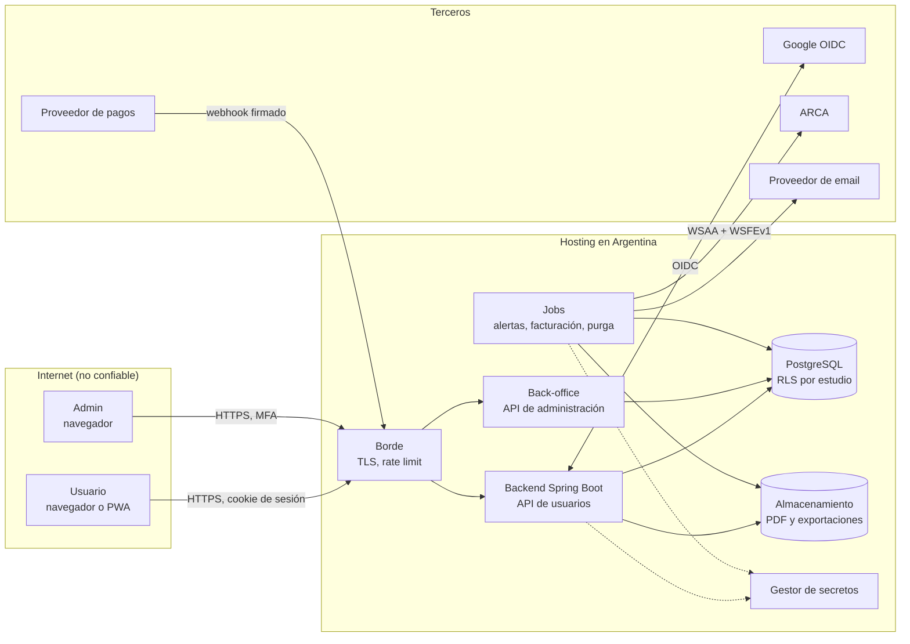

# Modelado de Amenazas Inicial - Asistente Legal (V1)

**Estado:** borrador v0.1 · **Fecha:** 11/11/2026 · **Responsable:** Gerardo Zena (responsable de seguridad y privacidad, designación provisoria)

Este documento aplica STRIDE a cada componente de la arquitectura V1 (sección 7.2 del análisis):
- autenticación;
- aislamiento entre estudios;
- motor de plazos;
- pagos y facturación;
- back-office;
- y los componentes que los rodean: jobs, email y exportación.

Cada amenaza que aplica tiene un control concreto, o figura como brecha en la sección 9. Se revisa ante cada cambio de arquitectura y, como mínimo, una vez por año (ISO/IEC 27034).

**Fuera de alcance en la V1:** no hay modelos de lenguaje ni agentes de IA, así que no aplican los riesgos de OWASP para LLM. Si se agregan, este documento se amplía.

---

## 1. Activos

| ID | Activo | Clasificación | Qué se pierde si falla |
| ----- | ----- | ----- | ----- |
| A1 | Datos del Estudio: clientes, partes, expedientes, pasos y motivos | **Confidencial** (secreto profesional; puede contener datos sensibles) | Confidencialidad frente a los clientes del abogado; sanción por la Ley 25.326 |
| A2 | Vencimientos calculados, calendario judicial y horarios | **Integridad crítica** | Un vencimiento mal calculado hace perder un plazo procesal: daño al cliente final y reclamo al abogado |
| A3 | Versiones de los flujos (matriz) | **Integridad crítica** | Hitos o plazos legales equivocados para todos los expedientes nuevos |
| A4 | Identidades, sesiones y dispositivos | **Confidencial** | Toma de cuentas y acceso a A1 |
| A5 | Datos fiscales y facturas | **Confidencial**, con integridad legal | Facturas erróneas o duplicadas ante ARCA |
| A6 | Registro de auditoría (`audit_events`) | **Integridad alta** | Pérdida de la prueba ante un reclamo profesional |
| A7 | Secretos: client secret de Google, certificado y clave privada de ARCA, credenciales del proveedor de pagos y de email, credenciales de la base y claves de cifrado | **Secreto** | Suplantación de la app ante terceros; acceso a todos los datos |
| A8 | Disponibilidad del servicio, sobre todo en horario judicial | **Alta** | El abogado no ve sus vencimientos del día |

## 2. Arquitectura y límites de confianza

**Límites de confianza:**
- **LC1:** Internet hacia el borde.
- **LC2:** borde hacia la aplicación.
- **LC3:** aplicación hacia la base de datos.
- **LC4:** aplicación hacia terceros (Google, pagos, ARCA, email).
- **LC5:** el back-office frente a los datos de los estudios.

## 3. Autenticación y autorización: definición

| Aspecto | Definición |
| ----- | ----- |
| Proveedor | Google (OIDC), mediante `spring-boot-starter-oauth2-client` |
| Flujo | Authorization Code con PKCE. Se valida el ID token (firma, `iss`, `aud`, `exp`). El usuario se identifica por `sub` y se exige `email_verified`. |
| Sesión | Propia del backend (Spring Session JDBC). Cookie `__Host-` con `HttpOnly`, `Secure` y `SameSite=Lax`. ID de sesión nuevo en cada login. Expira a las 8 horas de inactividad y a los 30 días como máximo. Se revoca desde el servidor. |
| MFA | **Usuarios:** no se puede exigir a cuentas personales de Gmail; se recomienda en el onboarding. **Admin:** obligatoria, con una cuenta de Google Workspace con verificación en dos pasos forzada por política. |
| Modelo de permisos | RBAC por estudio (`memberships.role`) más un rol de sistema (`users.system_role`). Denegación por defecto: cada endpoint declara el permiso que exige. |
| Roles | `TITULAR`, `ABOGADO` y `ASISTENTE` en el estudio; `ADMIN` en el sistema, sin acceso a los datos de los estudios. |

**Matriz de permisos (V1):**

| Acción | TITULAR | ABOGADO | ASISTENTE | ADMIN |
| ----- | ----- | ----- | ----- | ----- |
| Ver clientes, expedientes y plazos del estudio | Sí | Sí | Sí | No |
| Crear y editar clientes, expedientes y pasos; avanzar, saltear, retroceder, plazos sueltos, suspensiones | Sí | Sí | Sí | No |
| Marcar un plazo como no cumplido; eliminar un expediente o un cliente | Sí | Sí | No | No |
| Marcar días inhábiles del estudio | Sí | Sí | No | No |
| Invitar y revocar miembros, cambiar roles | Sí | No | No | No |
| Plan, datos fiscales, facturas, baja y arrepentimiento | Sí | No | No | No |
| Ajustar umbrales del semáforo del estudio | Sí | No | No | No |
| Exportar todos los datos del estudio | Sí | No | No | No |
| Calendario, horarios, regímenes, tribunales e importación de la matriz | No | No | No | Sí |

## 4. STRIDE por componente

Columna **Estado**:
- **Diseñado:** el control ya figura en el modelo de datos, el análisis o este documento.
- **Brecha:** falta definirlo; ver la sección 9.

### 4.1 Autenticación y sesión

| ID | STRIDE | Amenaza | Control | Estado |
| ----- | ----- | ----- | ----- | ----- |
| AUT-01 | S | Un atacante crea una cuenta de Google con el email de otro usuario y entra a su estudio | Identificación por `sub`, nunca por email. `UNIQUE (provider, provider_subject)`. Se exige `email_verified`. | Diseñado |
| AUT-02 | S | Robo de la cookie de sesión por XSS | Cookie `HttpOnly`. CSP restrictiva (`script-src 'self'`, sin `unsafe-inline`). Escape automático de React, sin `dangerouslySetInnerHTML`. | Diseñado |
| AUT-03 | S | Fijación de sesión | Spring Security cambia el ID de sesión al autenticar. | Diseñado |
| AUT-04 | T | CSRF sobre acciones que modifican datos | `SameSite=Lax` más token CSRF de Spring Security en un header de cada petición que modifica datos. | Diseñado |
| AUT-05 | S | Redirección abierta después del login (`?volver=` hacia un sitio externo) | Solo se aceptan rutas internas de una lista permitida. | Diseñado |
| AUT-06 | S | Invitación a un estudio reenviada o adivinada | Token aleatorio de 128 bits o más, de un solo uso, con vencimiento a los 7 días y atado al email invitado. Solo se guarda su hash. | Diseñado (este documento) |
| AUT-07 | R | El usuario niega haber cerrado una sesión o aceptado los términos | `audit_events` (`LOGIN`, `DISPOSITIVO_REVOCADO`, `DOCUMENTO_LEGAL_ACEPTADO`) y `legal_acceptances`. | Diseñado |
| AUT-08 | I | La respuesta de login revela si un email está registrado | Respuesta idéntica en todos los casos de rechazo. | Diseñado |
| AUT-09 | D | Fuerza bruta o creación masiva de sesiones o dispositivos | Rate limiting por IP y por usuario en el login y en el alta de dispositivos (sección 6). Límite de dispositivos del plan. | Diseñado |
| AUT-10 | E | Un miembro revocado mantiene una sesión abierta en el estudio | Al revocar una membresía se revocan, en la misma transacción, las sesiones de ese usuario en ese estudio. Cada petición verifica que la membresía siga activa. | Diseñado (este documento) |
| AUT-11 | D | Google suspende la cuenta del abogado y este pierde el acceso | Proceso de recuperación verificado por soporte; resumen diario por email como respaldo. | **Brecha B1** |

### 4.2 Aislamiento entre estudios

| ID | STRIDE | Amenaza | Control | Estado |
| ----- | ----- | ----- | ----- | ----- |
| ISO-01 | I | IDOR: un usuario pide `/cases/{id}` con el ID de otro estudio | El `organization_id` sale **siempre de la sesión**, nunca de la petición. Toda consulta filtra por él, y un ID de otro estudio responde 404, no 403. Los IDs son UUID v7: no se pueden adivinar, pero eso no reemplaza el control. | Diseñado |
| ISO-02 | T | Asociar un expediente al cliente de otro estudio | Claves foráneas compuestas `(organization_id, id)`. | Diseñado |
| ISO-03 | I | Un error en una consulta nueva olvida el filtro por estudio | Row-Level Security de PostgreSQL con `FORCE ROW LEVEL SECURITY`. La aplicación fija el estudio con una variable de sesión al empezar cada transacción, y su rol de base no es dueño de las tablas. | Diseñado (pasa de "recomendado" a obligatorio) |
| ISO-04 | I | Un job (alertas, purga, exportación) mezcla datos de dos estudios | Cada unidad de trabajo de un job procesa un solo estudio y fija su variable de RLS. El resumen diario se arma por usuario, solo con los estudios donde su membresía está activa. | Diseñado (este documento) |
| ISO-05 | I | Caché o búsqueda que devuelve resultados de otro estudio | Las claves de caché incluyen el `organization_id`. La búsqueda es una consulta SQL bajo RLS; no hay índice de búsqueda externo en la V1. | Diseñado (este documento) |
| ISO-06 | I | Un archivo (PDF de factura, exportación) accesible por URL pública | El almacenamiento de objetos es privado. La descarga pasa por un endpoint autenticado que verifica el estudio, o por una URL firmada que dura 5 minutos. | Diseñado (este documento) |
| ISO-07 | E | Un asistente hace acciones de titular (exportar todo, cambiar el plan) | Matriz de permisos de la sección 3, verificada en cada endpoint. | Diseñado |
| ISO-08 | R | Nadie sabe quién vio o cambió un dato de otro estudio | Los intentos con un ID de otro estudio se registran como evento de seguridad y generan alerta si se repiten. | Diseñado (este documento) |
| ISO-09 | T | Regresión: un cambio de código rompe el aislamiento | Tests de integración automáticos que, para cada endpoint, prueban con un usuario de otro estudio. Bloquean el merge. | Diseñado |

### 4.3 Motor de plazos y calendario

| ID | STRIDE | Amenaza | Control | Estado |
| ----- | ----- | ----- | ----- | ----- |
| MOT-01 | T | Un admin comprometido o un error de carga cambia el calendario y mueve vencimientos | Cambios auditados (`CALENDARIO_MODIFICADO`, con valores anteriores y nuevos). El calendario `OFICIAL` exige un validador. Después de recalcular, cada usuario afectado ve "tu vencimiento cambió", con el antes y el después. | Diseñado |
| MOT-02 | T | Un cambio de calendario **atrasa** vencimientos en forma masiva: el error más peligroso, porque el abogado cree que tiene más tiempo | Antes de publicar, el back-office muestra cuántos pasos pendientes cambian y cuántos se atrasan. Si alguno se atrasa, pide una confirmación explícita con motivo. | Diseñado (este documento) |
| MOT-03 | T | El cliente envía un vencimiento ya calculado y el backend lo acepta | El vencimiento lo calcula **solo el backend**. El frontend envía los datos de entrada; un vencimiento enviado por el cliente solo se acepta en `MANUAL`, con motivo. | Diseñado |
| MOT-04 | R | El abogado niega haber editado un plazo, o reclama que la app calculó mal | `audit_events` guarda los datos de entrada, la versión del calendario y el resultado. La pantalla "por qué vence ese día" muestra los días computados. | Diseñado |
| MOT-05 | D | Valores enormes (por ejemplo, 10.000 años) o rangos que agotan la CPU | Validación de entrada con `MAX_VALOR` por tipo (días 365, horas 720, meses 120, años 10). El cálculo se acota a la cobertura del calendario. | Diseñado |
| MOT-06 | I | El calendario de inhábiles del estudio revela algo de otro estudio | Los inhábiles con alcance `ORGANIZACION` están bajo RLS. | Diseñado |
| MOT-07 | T | Una versión de flujo mal importada (hitos o plazos legales erróneos) | Validaciones del importador. La versión publicada es inmutable. El "validado por" del equipo legal es obligatorio para publicar. | Diseñado |

### 4.4 Pagos y suscripción

| ID | STRIDE | Amenaza | Control | Estado |
| ----- | ----- | ----- | ----- | ----- |
| PAG-01 | S | Un webhook falso marca como pagada una suscripción | Firma del proveedor verificada antes de procesar. Además, el backend confirma el estado del pago consultando la API del proveedor con su propia credencial. | Diseñado |
| PAG-02 | T | Repetición de un webhook válido | `UNIQUE (provider, provider_event_id)`, y se rechazan los eventos fuera de la ventana de tiempo de la firma. | Diseñado |
| PAG-03 | T | El usuario manipula el precio o el plan del checkout | El checkout lo crea el backend con el plan y el precio de `plans`. Al recibir el pago, el importe se compara con el precio del plan; si no coincide, el pago no activa nada y genera una alerta. | Diseñado (este documento) |
| PAG-04 | E | Saltear el límite de clientes con dos altas simultáneas | `SELECT … FOR UPDATE` sobre la suscripción antes de contar. | Diseñado |
| PAG-05 | E | Usar funciones pagas en modo de solo lectura, desde la API directamente | El estado de la suscripción se verifica en el backend en cada escritura, no solo en la UI. | Diseñado |
| PAG-06 | I | Datos de tarjeta en la app | Checkout alojado por el proveedor: la app nunca recibe datos de tarjeta, y en los webhooks se guarda solo la lista de campos permitidos. | Diseñado |
| PAG-07 | R | El usuario niega haber pedido la baja o el arrepentimiento | Número de trámite, email de confirmación y `audit_events`. | Diseñado |

### 4.5 Facturación (ARCA)

| ID | STRIDE | Amenaza | Control | Estado |
| ----- | ----- | ----- | ----- | ----- |
| FAC-01 | S | Robo del certificado y la clave de ARCA para emitir facturas en nombre de la empresa | Certificado y clave en el gestor de secretos, accesibles solo por el job de facturación. Nunca en el repositorio, en la imagen ni en los logs. Rotación antes del vencimiento y ante cualquier sospecha. | Diseñado; depende de la **brecha B3** |
| FAC-02 | T | Facturas duplicadas o huecos de numeración por reintentos | Consulta del último comprobante autorizado antes de cada intento; `UNIQUE` sobre el número; un cobro genera una sola factura. | Diseñado |
| FAC-03 | T | Modificar una factura autorizada | Inmutable: se corrige con una nota de crédito. | Diseñado |
| FAC-04 | I | El ticket de acceso de WSAA queda en los logs | El ticket se guarda solo en memoria o en el gestor de secretos. Los logs registran el resultado, nunca el ticket. | Diseñado |
| FAC-05 | D | ARCA no responde | La factura queda pendiente y se reintenta; nunca afecta el acceso del estudio. | Diseñado |

### 4.6 Back-office

| ID | STRIDE | Amenaza | Control | Estado |
| ----- | ----- | ----- | ----- | ----- |
| BO-01 | S | Toma de la cuenta de un admin | MFA obligatoria (Google Workspace con verificación en dos pasos forzada). Sesión de admin de 1 hora de inactividad. Alerta en cada login de admin. | Diseñado |
| BO-02 | E | El admin lee datos de los estudios | El back-office usa **otro rol de base de datos**, con permisos solo sobre las tablas de catálogo, calendario y flujos. Las tablas de los estudios quedan fuera de su alcance por permisos, no solo por código. | Diseñado (este documento) |
| BO-03 | T | Una planilla maliciosa en la importación de la matriz (bomba de descompresión, XML con entidades externas, fórmulas) | Tamaño máximo de 5 MB. Se valida que el archivo sea un ZIP de Office por sus bytes iniciales. Se usan los límites de descompresión de la librería de lectura, con entidades externas deshabilitadas. Se leen solo valores, nunca se evalúan fórmulas. | Diseñado (este documento) |
| BO-04 | R | Un admin publica un cambio y nadie sabe quién fue | Todas las acciones del back-office quedan en `audit_events` con `actor_type = ADMIN`. | Diseñado |
| BO-05 | E | Separación de funciones: con un equipo chico, la misma persona carga y publica | Para el calendario `OFICIAL` y las versiones de flujo, el validador debe ser otra persona (el abogado valida la matriz). Si no hay una segunda persona disponible, el riesgo se acepta por escrito, con revisión posterior. | **Brecha B4** |

### 4.7 Jobs, email y exportación

| ID | STRIDE | Amenaza | Control | Estado |
| ----- | ----- | ----- | ----- | ----- |
| JOB-01 | S | Emails falsos que imitan a la app (phishing a abogados) | SPF, DKIM y DMARC con política `reject` en el dominio. Los emails no piden datos ni credenciales. | Diseñado (este documento) |
| JOB-02 | I | El resumen diario expone datos de los expedientes | Por defecto solo trae cantidades y números de expediente; la carátula y el cliente se incluyen si el usuario lo activa. | Diseñado |
| JOB-03 | I | La exportación completa del estudio cae en manos equivocadas | Solo la pide el titular. Es asíncrona, y el enlace de descarga es firmado, de un solo uso y válido por 24 horas. Queda registrada (`DATOS_EXPORTADOS`). | Diseñado (este documento) |
| JOB-04 | T | Inyección de fórmulas en la exportación (un valor que empieza con `=` y se ejecuta al abrirlo en Excel) | Los valores que empiezan con `=`, `+`, `-` o `@` se escapan en los formatos de planilla. | Diseñado (este documento) |
| JOB-05 | T | La purga borra datos de un estudio que volvió a contratar | La purga vuelve a verificar el estado de la suscripción en la misma transacción. Avisa al titular 7 días antes. | Diseñado |
| JOB-06 | D | El job de alertas no corre y nadie se entera | Monitoreo de ejecución: si el resumen de las 07:00 no salió a las 07:30, se envía una alerta al responsable. | Diseñado (este documento) |

## 5. Controles por capa

| Capa | Controles |
| ----- | ----- |
| Borde | TLS 1.2 o superior (preferido 1.3), HSTS de 1 año con `includeSubDomains`, redirección de HTTP a HTTPS, rate limiting, límite de tamaño de las peticiones (1 MB en la API; 5 MB en la importación del back-office) y protección contra DDoS según el proveedor (**brecha B2**). |
| Aplicación | Validación de entrada por esquema (Bean Validation, sin campos desconocidos). Autorización en cada endpoint. Respuestas con DTO explícitos. Errores con el formato `application/problem+json`, sin trazas ni detalles internos. Headers de seguridad: CSP, `X-Content-Type-Options`, `frame-ancestors 'none'`, `Referrer-Policy` y `Permissions-Policy`. |
| Datos | RLS forzado, claves foráneas compuestas, rol de la aplicación sin DDL, rol del back-office separado, `audit_events` solo con inserción, cifrado en reposo y backups cifrados. |
| Infraestructura | Mínimo privilegio en la consola del proveedor, MFA en todas las cuentas de administración, entornos dev, stg y prod separados (sin datos reales fuera de prod) e infraestructura como código. |

## 6. Valores de rate limiting (V1)

| Superficie | Límite |
| ----- | ----- |
| Inicio de login (por IP) | 20 por minuto |
| Alta de dispositivo (por usuario) | 5 por hora |
| API autenticada (por usuario) | 300 por minuto |
| Cálculo de vista previa de plazos (por usuario) | 60 por minuto |
| Invitaciones (por estudio) | 20 por día |
| Pedido de exportación (por estudio) | 3 por día |
| Webhooks de pagos (por IP) | 120 por minuto |

Al superar el límite, la respuesta es 429 con `Retry-After`.

## 7. Secretos

| Secreto | Dónde vive | Quién lo usa | Rotación |
| ----- | ----- | ----- | ----- |
| Client secret de Google | Gestor de secretos | API | Anual y ante un incidente |
| Certificado y clave de ARCA (homologación y producción, distintos) | Gestor de secretos | Job de facturación | Antes de su vencimiento (alerta 30 días antes) y ante un incidente |
| Credencial y secreto de webhook del proveedor de pagos | Gestor de secretos | API | Anual y ante un incidente |
| Credencial del proveedor de email | Gestor de secretos | Jobs | Anual |
| Credenciales de la base (un rol por componente) | Gestor de secretos | API, back-office, jobs, migraciones | Trimestral, o credenciales dinámicas si el proveedor las ofrece |
| Claves de cifrado de la base y los backups | KMS del proveedor | Infraestructura | Según el proveedor |

**Detección de filtraciones:** escaneo de secretos (por ejemplo, gitleaks) en cada pull request y en el historial del repositorio. Los logs pasan por un filtro que enmascara tokens y credenciales.

## 8. Registro de seguridad y alertas

**Eventos:**
- logins exitosos y rechazados, y logins de admin;
- accesos denegados y pedidos con IDs de otro estudio;
- cambios de rol y revocaciones;
- exportaciones;
- cambios de calendario y publicación de flujos;
- webhooks con firma inválida o importe que no coincide;
- errores de ARCA;
- fallas de backup y de los jobs.

**Retención:** `audit_events` mientras exista el estudio; eventos de seguridad de la cuenta, 1 año; logs técnicos, 90 días (sección 7 de la política de privacidad).

**Alertas al responsable** (email y canal de mensajería):
- más de 10 logins rechazados por minuto;
- cualquier login de admin;
- más de 3 pedidos con IDs de otro estudio por un mismo usuario en una hora;
- una firma de webhook inválida o un importe que no coincide;
- un backup fallido;
- el resumen diario sin enviar a las 07:30;
- errores 5xx por encima del 2 % durante 5 minutos.

## 9. Brechas abiertas

| ID | Brecha | Propuesta | Responsable |
| ----- | ----- | ----- | ----- |
| B1 | Recuperación de una cuenta cuyo acceso a Google se perdió | El titular de un estudio puede reasignar la titularidad a otro miembro. Para un estudio individual, soporte verifica la identidad (DNI y matrícula) y vincula una nueva cuenta de Google, con un registro en la auditoría. Definir el procedimiento por escrito. | [PRODUCTO] |
| B2 | Protección contra DDoS y WAF en un hosting argentino | Elegir un proveedor que la ofrezca o poner adelante un servicio de CDN con WAF. Entra como criterio de selección del hosting (sección 7.3 del análisis). | [TÉCNICO] |
| B3 | Gestor de secretos y KMS en el hosting elegido | Si el proveedor no los ofrece, usar una solución con secretos cifrados en el despliegue y descifrados en el servidor. Entra como criterio de selección. | [TÉCNICO] |
| B4 | Separación de funciones con un equipo chico | Ver BO-05: el abogado como validador de la matriz; aceptación del riesgo por escrito para el calendario si no hay una segunda persona. | [PRODUCTO] |
| B5 | Prueba de penetración antes del lanzamiento | Definir quién la hace (proveedor externo) y el presupuesto. | [PRODUCTO] |

## 10. Mapeo OWASP Top 10 (2021)

| Categoría | Aplica | Control principal |
| ----- | ----- | ----- |
| A01 Control de acceso roto | Sí | Sesión → estudio, RLS forzado, matriz de permisos y tests entre estudios (ISO-01 a ISO-09) |
| A02 Fallas criptográficas | Sí | TLS, cifrado en reposo, KMS; sin criptografía propia |
| A03 Inyección | Sí | Consultas parametrizadas (JPA o JDBC con parámetros), validación de entrada, escape de React; sin SQL armado con texto |
| A04 Diseño inseguro | Sí | Este documento, y el vencimiento calculado solo en el backend (MOT-03) |
| A05 Configuración de seguridad incorrecta | Sí | Headers, `DEBUG` apagado en prod, actuators de Spring no expuestos, infraestructura como código |
| A06 Componentes vulnerables | Sí | Análisis de dependencias en cada pull request (por ejemplo, OWASP Dependency-Check), versiones fijas en Maven y Dependabot o equivalente |
| A07 Fallas de identificación y autenticación | Sí | Google OIDC con PKCE, sesión propia, MFA de admin (sección 3) |
| A08 Fallas de integridad de software y datos | Sí | Webhooks firmados, versiones de flujo inmutables, auditoría y firma de artefactos en la integración continua |
| A09 Fallas de registro y monitoreo | Sí | Sección 8 |
| A10 SSRF | Parcial | El backend solo llama a destinos fijos (Google, pagos, ARCA, email) configurados en una lista permitida; ninguna URL viene del usuario |

**PCI DSS:** el alcance es mínimo, porque el checkout está alojado por el proveedor y la app nunca recibe datos de tarjeta. Hay que confirmar con el proveedor elegido qué cuestionario de autoevaluación corresponde.
