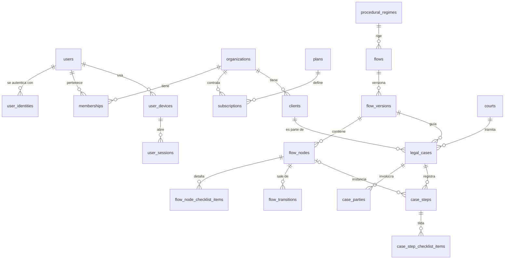

# Modelo de Base de Datos Relacional - Asistente Legal (V1)

Este documento define la estructura de tablas para el motor de base de datos relacional (**PostgreSQL**). El modelo se divide en seis dominios:

1. **Identidad y Acceso:** usuarios, identidades de Google, estudios, miembros, dispositivos y sesiones.
2. **Suscripciones:** planes, suscripciones y eventos de pago.
3. **Catálogos del Sistema:** jurisdicciones, departamentos, fueros, regímenes procesales, tribunales y calendario judicial.
4. **Motor de Flujos:** la "receta" procesal, versionada.
5. **Datos del Estudio:** clientes, expedientes, partes y pasos (transaccional).
6. **Auditoría:** registro inmutable de eventos.

---

## 0. Convenciones Generales

* **Claves primarias:** `UUID` generado por la aplicación (se recomienda UUID v7, que es ordenable en el tiempo y mejora los índices).
* **Fechas:** los días sin hora (notificación, vencimiento, feriados) son `date`. Los instantes (creación, gracia, presentación) son `timestamptz`. Ver la sección 6 del documento de lógica de plazos.
* **Enums:** se guardan como `text` con una restricción `CHECK` de valores permitidos. Es más fácil de migrar que el tipo `enum` nativo de PostgreSQL. Los valores van en mayúsculas y en español (ej. `ACTORA`, `HABILES_JUDICIALES`), igual que en el motor de plazos.
* **Trazabilidad:** toda tabla mutable tiene `created_at` y `updated_at`. Las tablas de datos del estudio tienen además `created_by` (FK -> `users.id`).
* **Borrado lógico:** `organizations`, `clients` y `legal_cases` tienen `deleted_at`. Nada se borra físicamente desde la app; un job de purga elimina los datos según la política de retención (ISO 27701).
* **Multitenancy:** toda tabla con datos de un estudio tiene `organization_id`. Ver la sección 7.
* **Migraciones:** versionadas con Flyway o Liquibase. La app usa un rol de base de datos sin permisos de DDL; las migraciones corren con otro rol.

---

## 1. Dominio: Identidad y Acceso

### Tabla: `users` (usuarios)

*La autenticación la hace Google (OIDC). La app no guarda contraseñas.*

| Campo | Tipo | Descripción |
| ----- | ----- | ----- |
| `id` | PK, UUID | |
| `full_name` | text | Nombre completo. |
| `primary_email` | text | Email de contacto; se toma de la identidad de Google en el alta. |
| `status` | enum | `ACTIVO`, `SUSPENDIDO`, `BAJA`. |
| `system_role` | enum | `USUARIO` o `ADMIN`. `ADMIN` gestiona catálogos, calendario y flujos desde el back-office; no da acceso a datos de los estudios. |
| `last_login_at` | timestamptz, nullable | |
| `created_at`, `updated_at` | timestamptz | |

### Tabla: `user_identities` (identidades externas)

*Separa al usuario de su proveedor de login. Permite sumar Microsoft u otro proveedor sin migrar usuarios.*

| Campo | Tipo | Descripción |
| ----- | ----- | ----- |
| `id` | PK, UUID | |
| `user_id` | FK -> `users.id` | |
| `provider` | enum | `GOOGLE` (V1). |
| `provider_subject` | text | El `sub` del ID token. **Es el identificador del usuario**, no el email. |
| `email` | text | Email informado por el proveedor. |
| `email_verified` | boolean | El login se rechaza si es `false`. |
| `last_used_at` | timestamptz, nullable | |
| `created_at`, `updated_at` | timestamptz | |

Restricción: `UNIQUE (provider, provider_subject)`.

### Tabla: `organizations` (estudios)

*Es el **tenant**. Los expedientes y clientes pertenecen al estudio, no a un usuario. Un abogado independiente tiene un estudio de tipo `INDIVIDUAL` con un solo miembro.*

| Campo | Tipo | Descripción |
| ----- | ----- | ----- |
| `id` | PK, UUID | |
| `name` | text | Nombre del estudio. |
| `type` | enum | `INDIVIDUAL`, `ESTUDIO`. |
| `created_at`, `updated_at`, `deleted_at` | timestamptz | |

### Tabla: `memberships` (miembros del estudio)

| Campo | Tipo | Descripción |
| ----- | ----- | ----- |
| `id` | PK, UUID | |
| `organization_id` | FK -> `organizations.id` | |
| `user_id` | FK -> `users.id` | |
| `role` | enum | `TITULAR` (gestiona la suscripción y los miembros), `ABOGADO`, `ASISTENTE`. |
| `status` | enum | `INVITADO`, `ACTIVO`, `REVOCADO`. |
| `created_at`, `updated_at` | timestamptz | |

Restricción: `UNIQUE (organization_id, user_id)`.

### Tabla: `user_devices` (dispositivos)

*Sostiene el límite de dispositivos de la suscripción y la pantalla "Mis dispositivos".*

| Campo | Tipo | Descripción |
| ----- | ----- | ----- |
| `id` | PK, UUID | |
| `user_id` | FK -> `users.id` | |
| `device_key_hash` | text | Hash de un identificador aleatorio que la app genera y guarda en el dispositivo. No se usa *fingerprinting* del navegador. |
| `display_name` | text | Ej: "Chrome en Windows". Se deriva del *user agent*. |
| `first_seen_at`, `last_seen_at` | timestamptz | |
| `revoked_at` | timestamptz, nullable | Si tiene valor, el dispositivo no puede abrir sesiones. |
| `revoked_reason` | enum, nullable | `USUARIO`, `LIMITE_DISPOSITIVOS`, `SEGURIDAD`, `ADMIN`. |

Restricción: `UNIQUE (user_id, device_key_hash)`.

### Tabla: `user_sessions` (sesiones)

*La sesión técnica la maneja Spring Session (JDBC), con sus propias tablas. Esta tabla la vincula con el usuario y el dispositivo, y permite revocarla desde el servidor.*

| Campo | Tipo | Descripción |
| ----- | ----- | ----- |
| `id` | PK, UUID | |
| `user_id` | FK -> `users.id` | |
| `device_id` | FK -> `user_devices.id` | |
| `organization_id` | FK -> `organizations.id` | Estudio activo en la sesión. |
| `spring_session_id` | text | ID interno de Spring Session. **Nunca** se expone al cliente ni se escribe en logs. |
| `created_at`, `last_activity_at`, `expires_at` | timestamptz | |
| `revoked_at` | timestamptz, nullable | |

---

## 2. Dominio: Suscripciones

*No se guardan datos de tarjeta: el pago se procesa en el checkout del proveedor (a definir; ej. Mercado Pago).*

### Tabla: `plans` (planes)

| Campo | Tipo | Descripción |
| ----- | ----- | ----- |
| `id` | PK, UUID | |
| `code` | text, unique | Ej: `INDIVIDUAL_MENSUAL`, `ESTUDIO_ANUAL`. |
| `name` | text | |
| `billing_period` | enum | `MENSUAL`, `ANUAL`. |
| `max_seats` | integer | Usuarios incluidos (1 para el plan individual). |
| `max_devices_per_user` | integer | Dispositivos simultáneos por usuario (propuesta: 2 o 3). |
| `trial_days` | integer | |
| `price_amount` | numeric(12,2) | Precio de referencia para mostrar; el cobro lo define el proveedor. |
| `currency` | text | Ej: `ARS`. |
| `is_active` | boolean | |
| `created_at`, `updated_at` | timestamptz | |

### Tabla: `subscriptions` (suscripciones)

| Campo | Tipo | Descripción |
| ----- | ----- | ----- |
| `id` | PK, UUID | |
| `organization_id` | FK -> `organizations.id` | |
| `plan_id` | FK -> `plans.id` | |
| `status` | enum | `PRUEBA`, `ACTIVA`, `EN_MORA`, `SOLO_LECTURA`, `CANCELADA`. |
| `seats` | integer | Usuarios contratados. |
| `trial_ends_at` | timestamptz, nullable | |
| `current_period_start`, `current_period_end` | timestamptz | |
| `read_only_until` | timestamptz, nullable | Fin del período de solo lectura y exportación tras el vencimiento. |
| `provider` | enum | Proveedor de pagos. |
| `provider_subscription_id` | text | ID de la suscripción en el proveedor. |
| `created_at`, `updated_at` | timestamptz | |

Restricción: un índice único parcial asegura **una sola suscripción no cancelada por estudio**.

### Tabla: `payment_events` (eventos de pago)

*Registra los webhooks del proveedor. Solo se procesan si la firma es válida.*

| Campo | Tipo | Descripción |
| ----- | ----- | ----- |
| `id` | PK, UUID | |
| `subscription_id` | FK -> `subscriptions.id`, nullable | |
| `provider` | enum | |
| `provider_event_id` | text | Restricción `UNIQUE (provider, provider_event_id)`: el mismo evento no se procesa dos veces. |
| `event_type` | text | |
| `signature_verified` | boolean | |
| `payload_redacted` | jsonb | Solo los campos permitidos; sin datos de tarjeta ni del titular. |
| `received_at`, `processed_at` | timestamptz | |

---

## 3. Dominio: Catálogos del Sistema (Datos estáticos)

Estas tablas son administradas por los dueños de la app (rol `ADMIN`). Los usuarios solo las leen.

### Tabla: `jurisdictions` (jurisdicciones)

*Para la V1 solo tendrá un registro activo (PBA), pero prepara el sistema para escalar.*

| Campo | Tipo | Descripción |
| ----- | ----- | ----- |
| `id` | PK, UUID | |
| `code` | text, unique | Ej: `PBA`, `CABA`. |
| `name` | text | Ej: "Provincia de Buenos Aires". |
| `time_zone` | text | `America/Argentina/Buenos_Aires`. |
| `is_active` | boolean | |

### Tabla: `judicial_departments` (departamentos judiciales)

| Campo | Tipo | Descripción |
| ----- | ----- | ----- |
| `id` | PK, UUID | |
| `jurisdiction_id` | FK -> `jurisdictions.id` | |
| `name` | text | Ej: "San Isidro", "Lomas de Zamora". |
| `is_active` | boolean | |

### Tabla: `legal_branches` (fueros)

| Campo | Tipo | Descripción |
| ----- | ----- | ----- |
| `id` | PK, UUID | |
| `code` | text, unique | Ej: `LABORAL`. |
| `name` | text | |

### Tabla: `procedural_regimes` (regímenes procesales)

| Campo | Tipo | Descripción |
| ----- | ----- | ----- |
| `id` | PK, UUID | |
| `jurisdiction_id` | FK -> `jurisdictions.id` | |
| `legal_branch_id` | FK -> `legal_branches.id` | |
| `code` | text, unique | Ej: `PBA_LAB_LEY_11653`, `PBA_LAB_LEY_15057`. |
| `name` | text | |
| `legal_basis` | text | Ley de referencia. |

### Tabla: `department_regimes` (régimen vigente por departamento)

*Responde qué régimen procesal rige en cada departamento judicial y desde cuándo. El contenido lo define el equipo legal (punto 1 de la sección 4 del análisis).*

| Campo | Tipo | Descripción |
| ----- | ----- | ----- |
| `id` | PK, UUID | |
| `department_id` | FK -> `judicial_departments.id` | |
| `procedural_regime_id` | FK -> `procedural_regimes.id` | |
| `valid_from` | date | |
| `valid_to` | date, nullable | `null` = vigente. |

Restricción: los períodos de un mismo departamento y fuero no se superponen (restricción de exclusión sobre el rango de fechas).

### Tabla: `courts` (tribunales y juzgados)

| Campo | Tipo | Descripción |
| ----- | ----- | ----- |
| `id` | PK, UUID | |
| `department_id` | FK -> `judicial_departments.id` | |
| `legal_branch_id` | FK -> `legal_branches.id` | |
| `procedural_regime_id` | FK -> `procedural_regimes.id` | |
| `court_type` | enum | `TRIBUNAL_TRABAJO`, `JUZGADO_LABORAL`, `CAMARA_APELACION`. |
| `name` | text | Ej: "Tribunal de Trabajo N° 1". |
| `is_active` | boolean | |

### Tabla: `holidays_calendar` (calendario de días inhábiles)

*Fuente de los días inhábiles que usa el motor de plazos. Las ferias se cargan como un registro por día (el back-office acepta un rango y lo expande).*

| Campo | Tipo | Descripción |
| ----- | ----- | ----- |
| `id` | PK, UUID | |
| `date` | date | Ej: "2026-07-20". |
| `description` | text | Ej: "Feria de Invierno", "Asueto por paro judicial". |
| `type` | enum | `FERIADO`, `FERIA`, `ASUETO`, `INHABIL_MANUAL`. |
| `scope` | enum | `NACIONAL`, `PROVINCIAL`, `DEPARTAMENTO`, `ORGANIZACION`. |
| `jurisdiction_id` | FK -> `jurisdictions.id`, nullable | Obligatorio si `scope` es `PROVINCIAL` o `DEPARTAMENTO`. |
| `department_id` | FK -> `judicial_departments.id`, nullable | Obligatorio si `scope = DEPARTAMENTO`. |
| `organization_id` | FK -> `organizations.id`, nullable | Obligatorio si `scope = ORGANIZACION`: es el "inhábil manual" de la Pantalla 4. |
| `legal_reference` | text, nullable | Acordada o resolución de la SCBA. Obligatoria para `ASUETO` y `FERIA`. |
| `created_by` | FK -> `users.id` | |
| `created_at`, `updated_at` | timestamptz | |

Restricciones:
* Un `CHECK` exige que las columnas de alcance sean coherentes con `scope`.
* `UNIQUE NULLS NOT DISTINCT (date, scope, jurisdiction_id, department_id, organization_id)` (PostgreSQL 15+).

> **Por qué el inhábil manual es del estudio y no del usuario:** el vencimiento de un expediente tiene que ser el mismo para todos los miembros que lo miran. Si fuera por usuario, el abogado y su asistente podrían ver fechas distintas para el mismo plazo.

### Tabla: `calendar_coverage` (cobertura del calendario)

*El motor de plazos devuelve `CALENDARIO_NO_CARGADO` si el cómputo pasa de `covered_until`.*

| Campo | Tipo | Descripción |
| ----- | ----- | ----- |
| `id` | PK, UUID | |
| `jurisdiction_id` | FK -> `jurisdictions.id`, unique | |
| `covered_until` | date | Último día con el calendario oficial completo y validado. |
| `calendar_version` | integer | Se incrementa con cada cambio del calendario de la jurisdicción. |
| `validated_by` | FK -> `users.id` | |
| `validated_at` | timestamptz | |

---

## 4. Dominio: Motor de Flujos (La "Receta" Procesal)

Estas tablas digitalizan la matriz que arma el equipo legal. **Una versión publicada es inmutable**: un cambio de ley o una corrección genera una versión nueva, y cada expediente queda atado a la versión con la que se creó.

### Tabla: `flows` (flujos)

| Campo | Tipo | Descripción |
| ----- | ----- | ----- |
| `id` | PK, UUID | |
| `procedural_regime_id` | FK -> `procedural_regimes.id` | Define fuero y jurisdicción. |
| `name` | text | Ej: "Proceso laboral ordinario - Ley 11.653". |
| `description` | text, nullable | |
| `created_at`, `updated_at` | timestamptz | |

### Tabla: `flow_versions` (versiones de flujo)

| Campo | Tipo | Descripción |
| ----- | ----- | ----- |
| `id` | PK, UUID | |
| `flow_id` | FK -> `flows.id` | |
| `version_number` | integer | Restricción `UNIQUE (flow_id, version_number)`. |
| `status` | enum | `BORRADOR`, `PUBLICADA`, `RETIRADA`. Una `RETIRADA` no se usa en expedientes nuevos, pero los existentes la conservan. |
| `source_file_name` | text | Nombre de la planilla importada. |
| `source_checksum` | text | SHA-256 de la planilla, para saber exactamente qué se importó. |
| `approved_by_legal` | text | Quién del equipo legal validó el contenido. |
| `published_by` | FK -> `users.id`, nullable | |
| `published_at` | timestamptz, nullable | |
| `notes` | text, nullable | Qué cambió respecto de la versión anterior. |

Una versión `PUBLICADA` no admite cambios en sus nodos, transiciones ni ítems. La app lo controla y un trigger lo refuerza.

### Tabla: `flow_nodes` (nodos de flujo)

*Representa cada etapa individual del proceso legal.*

| Campo | Tipo | Descripción |
| ----- | ----- | ----- |
| `id` | PK, UUID | |
| `flow_version_id` | FK -> `flow_versions.id` | |
| `step_code` | text | Ej: "LAB_050". Restricción `UNIQUE (flow_version_id, step_code)`. |
| `phase` | text | Ej: "Postulación". |
| `name` | text | Ej: "Contestación de Demanda". |
| `responsible_role` | enum | `ACTORA`, `DEMANDADA`, `TRIBUNAL`, `AMBAS` (cualquiera de las partes: recursos, impugnaciones, audiencias). |
| `trigger_event` | text | Ej: "Recepción de cédula". |
| `default_term_value` | integer | Ej: 10. `0` para `SIN_PLAZO` y `FECHA_FIJADA`. |
| `term_type` | enum | Soportados en V1: `HABILES_JUDICIALES`, `CORRIDOS`, `SIN_PLAZO`. Pendientes de soporte en el motor: `HABILES_ADMINISTRATIVOS`, `ANIOS`, `FECHA_FIJADA`. |
| `applies_grace_period` | boolean | Siempre `false` para `SIN_PLAZO` y `FECHA_FIJADA`. |
| `legal_basis` | text | Ej: "Arts. 28 y 29 L.11653". |
| `is_initial` | boolean | Nodo de inicio del flujo. Cada versión tiene exactamente uno. |
| `is_final` | boolean | Nodo de cierre (ej. archivo del expediente). No tiene transiciones de salida. |
| `sort_order` | integer | Orden de presentación en el roadmap visual. |

Restricciones:
* `CHECK ((term_type IN ('SIN_PLAZO','FECHA_FIJADA') AND default_term_value = 0 AND NOT applies_grace_period) OR (term_type NOT IN ('SIN_PLAZO','FECHA_FIJADA') AND default_term_value > 0))`.
* Las reglas de estructura (un nodo inicial, todos los nodos alcanzables, nodos no finales con al menos una salida) las valida el importador antes de publicar; ver la sección 4 del documento de proyecto.

### Tabla: `flow_node_checklist_items` (ítems de checklist y documentación)

*Reemplaza al antiguo `checklist_json`. Separa las tareas de la documentación requerida y les da un ID estable para tildarlas por expediente.*

| Campo | Tipo | Descripción |
| ----- | ----- | ----- |
| `id` | PK, UUID | |
| `node_id` | FK -> `flow_nodes.id` | |
| `kind` | enum | `TAREA` (columna `Checklist_Abogado` de la matriz) o `DOCUMENTO` (columna `Documentacion_Requerida`). |
| `description` | text | Ej: "Bono Ley 8480". |
| `sort_order` | integer | |

### Tabla: `flow_transitions` (transiciones de flujo / bifurcaciones)

*Conecta un nodo con los posibles siguientes pasos según qué haya pasado.*

| Campo | Tipo | Descripción |
| ----- | ----- | ----- |
| `id` | PK, UUID | |
| `flow_version_id` | FK -> `flow_versions.id` | |
| `source_node_id` | FK -> `flow_nodes.id` | |
| `exit_condition` | text | Ej: "Demandado contesta", "Demandado no contesta". |
| `target_node_id` | FK -> `flow_nodes.id`, nullable | `null` = la transición cierra ese camino paralelo sin abrir otro hito (`CIERRA_CAMINO` en la planilla). |
| `sort_order` | integer | Orden de las opciones en el selector "Avanzar de etapa". |

Restricción: origen y destino pertenecen a la misma versión (claves foráneas compuestas sobre `(flow_version_id, id)`).

**Caminos en paralelo:** varias filas con el mismo `source_node_id` y el mismo `exit_condition` forman **una sola opción** en el selector "Avanzar de etapa". Al elegirla se crea un `case_step` pendiente por cada destino. Así se modelan los plazos simultáneos (ej. la prescripción corre mientras avanza el reclamo).

---

## 5. Dominio: Datos del Estudio (Transaccional)

Aquí se guarda la información privada de cada estudio, sus clientes y expedientes. Respecto de estos datos, el estudio es el **responsable del tratamiento** y la app es **encargada** (ver sección 10 del análisis).

### Tabla: `clients` (clientes)

| Campo | Tipo | Descripción |
| ----- | ----- | ----- |
| `id` | PK, UUID | |
| `organization_id` | FK -> `organizations.id` | |
| `person_type` | enum | `HUMANA`, `JURIDICA`. |
| `full_name_or_company` | text | Nombre o razón social. |
| `tax_id` | text, nullable | CUIT / DNI. |
| `phone` | text, nullable | |
| `email` | text, nullable | |
| `created_by` | FK -> `users.id` | |
| `created_at`, `updated_at`, `deleted_at` | timestamptz | |

Restricción: `UNIQUE (organization_id, id)`, para que los expedientes puedan referenciar al cliente con clave compuesta.

### Tabla: `legal_cases` (expedientes)

| Campo | Tipo | Descripción |
| ----- | ----- | ----- |
| `id` | PK, UUID | |
| `organization_id` | FK -> `organizations.id` | |
| `client_id` | UUID | FK compuesta `(organization_id, client_id)` -> `clients (organization_id, id)`: el cliente es siempre del mismo estudio. |
| `responsible_user_id` | FK -> `users.id` | Abogado a cargo; debe ser miembro activo del estudio. |
| `flow_version_id` | FK -> `flow_versions.id` | Versión del flujo con la que se creó el expediente. |
| `case_title` | text | Carátula. Ej: "PEREZ C/ EMPRESA S/ DESPIDO". |
| `case_number` | text, nullable | Número de expediente / causa. |
| `receptoria_number` | text, nullable | Número de receptoría. |
| `jurisdiction_id` | FK -> `jurisdictions.id` | |
| `department_id` | FK -> `judicial_departments.id` | Define qué asuetos departamentales aplican al cálculo. |
| `court_id` | FK -> `courts.id` | |
| `represented_role` | enum | `ACTORA`, `DEMANDADA`. |
| `current_status` | enum | `ACTIVO`, `PAUSADO`, `TERMINADO`. |
| `started_at` | date, nullable | Fecha de inicio del juicio. |
| `closed_at` | date, nullable | |
| `closed_reason` | enum, nullable | `SENTENCIA`, `ACUERDO`, `DESISTIMIENTO`, `OTRO`. Obligatorio si `current_status = TERMINADO`. |
| `created_by` | FK -> `users.id` | |
| `created_at`, `updated_at`, `deleted_at` | timestamptz | |

Restricción: `UNIQUE (organization_id, id)`, para las claves compuestas de las tablas hijas.

### Tabla: `case_parties` (partes del expediente)

*Contrapartes, litisconsortes y terceros. El cliente propio está en `clients`.*

| Campo | Tipo | Descripción |
| ----- | ----- | ----- |
| `id` | PK, UUID | |
| `organization_id` | UUID | FK compuesta `(organization_id, case_id)` -> `legal_cases (organization_id, id)`. |
| `case_id` | UUID | |
| `party_role` | enum | `ACTORA`, `DEMANDADA`, `TERCERO`. |
| `name` | text | Nombre o razón social. |
| `tax_id` | text, nullable | |
| `counsel_name` | text, nullable | Abogado de la parte. |
| `created_at`, `updated_at` | timestamptz | |

### Tabla: `case_steps` (pasos del expediente / línea de tiempo)

*Es la tabla más importante. Registra el progreso de un expediente sobre el flujo y cada plazo que corre. Puede haber **varios pasos pendientes a la vez** (plazos simultáneos) y pasos que no salen del flujo (plazos sueltos, ej. una intimación del juzgado).*

| Campo | Tipo | Descripción |
| ----- | ----- | ----- |
| `id` | PK, UUID | |
| `organization_id` | UUID | FK compuesta `(organization_id, case_id)` -> `legal_cases (organization_id, id)`. |
| `case_id` | UUID | |
| `node_id` | FK -> `flow_nodes.id`, nullable | Hito del flujo. `null` = plazo suelto. Debe pertenecer a la versión del expediente. |
| `custom_title` | text, nullable | Título del plazo suelto. Ej: "Acompañar documental intimada". |
| `status` | enum | `PENDIENTE`, `COMPLETADO`, `SALTEADO`. "Vencido" no se guarda: se deriva de un paso `PENDIENTE` con el vencimiento ya pasado. |
| `term_type` | enum | Copia de `flow_nodes.term_type`, o lo que se cargue en un plazo suelto. |
| `applies_grace_period` | boolean | Copia de `flow_nodes.applies_grace_period`, o lo que se cargue en un plazo suelto. |
| `notification_type` | enum, nullable | `CEDULA_PAPEL`, `ELECTRONICA`, `MINISTERIO_LEY`, `OTRA`. |
| `start_notification_date` | date, nullable | El Día Cero que carga el abogado. |
| `term_value` | integer | Copia `default_term_value` del nodo; el usuario puede editarlo (ej. de 10 a 12). |
| `term_override_reason` | text, nullable | Obligatorio si `term_value` difiere del valor del nodo. |
| `extension_days` | integer, default 0 | Días sumados con el botón de asueto imprevisto (+1). |
| `calculation_status` | enum, nullable | `CALCULADO`, `SIN_VENCIMIENTO`, `CALENDARIO_NO_CARGADO`. Resultado del motor. |
| `calculated_due_date` | date, nullable | Vencimiento ordinario. |
| `calculated_grace_at` | timestamptz, nullable | Fin del plazo de gracia (12:00 hs, hora de Argentina). |
| `calendar_version` | integer, nullable | Versión del calendario usada en el cálculo; permite detectar qué recalcular. |
| `calculated_at` | timestamptz, nullable | |
| `filed_at` | timestamptz, nullable | Fecha y hora de presentación (cargo); prueba que se cumplió en término. |
| `completed_at` | timestamptz, nullable | Cuándo se marcó el paso como terminado. |
| `completed_by` | FK -> `users.id`, nullable | |
| `chosen_transition_id` | FK -> `flow_transitions.id`, nullable | Por qué camino avanzó. |
| `created_by` | FK -> `users.id` | |
| `created_at`, `updated_at` | timestamptz | |

Restricciones:
* `CHECK (node_id IS NOT NULL OR custom_title IS NOT NULL)`.
* `CHECK (term_value >= 0 AND extension_days >= 0)`.
* Índice por `(organization_id, status, calculated_due_date)` para el dashboard de alertas.

### Tabla: `case_step_checklist_items` (checklist del paso)

| Campo | Tipo | Descripción |
| ----- | ----- | ----- |
| `id` | PK, UUID | |
| `organization_id` | UUID | Tenant; coherente con el paso. |
| `case_step_id` | FK -> `case_steps.id` | |
| `checklist_item_id` | FK -> `flow_node_checklist_items.id`, nullable | `null` para ítems agregados a mano. |
| `kind` | enum | `TAREA`, `DOCUMENTO`. |
| `description` | text | Copia del ítem del flujo, o texto libre. |
| `is_done` | boolean | |
| `done_at` | timestamptz, nullable | |
| `done_by` | FK -> `users.id`, nullable | |

---

## 6. Dominio: Auditoría

### Tabla: `audit_events` (eventos de auditoría)

*Registro de solo inserción. Responde quién hizo qué, cuándo y por qué. Es evidencia ante un reclamo por responsabilidad profesional y un requisito de ISO 27001.*

| Campo | Tipo | Descripción |
| ----- | ----- | ----- |
| `id` | PK, UUID | |
| `occurred_at` | timestamptz | |
| `actor_type` | enum | `USUARIO`, `ADMIN`, `SISTEMA` (jobs). |
| `actor_user_id` | FK -> `users.id`, nullable | `null` para `SISTEMA`. |
| `organization_id` | FK -> `organizations.id`, nullable | `null` para eventos de catálogo. |
| `entity_type` | text | Ej: `case_step`, `holidays_calendar`, `membership`. |
| `entity_id` | UUID, nullable | |
| `action` | text | Ej: `LOGIN`, `LOGIN_RECHAZADO`, `CASO_CREADO`, `PLAZO_EDITADO`, `PRORROGA_AGREGADA`, `ETAPA_SALTEADA`, `PASO_COMPLETADO`, `CALENDARIO_MODIFICADO`, `MIEMBRO_INVITADO`, `ROL_CAMBIADO`, `DISPOSITIVO_REVOCADO`, `DATOS_EXPORTADOS`. |
| `old_values` | jsonb, nullable | Solo campos de una lista permitida por tipo de entidad. |
| `new_values` | jsonb, nullable | Ídem. |
| `reason` | text, nullable | Ej: el motivo de un cambio de plazo. |
| `correlation_id` | text | ID de la petición, para cruzar con los logs. |

Reglas:
* El rol de base de datos de la app tiene solo `INSERT` y `SELECT` sobre esta tabla; no puede modificar ni borrar.
* Nunca se registran tokens, secretos, IDs de sesión ni datos que no estén en la lista permitida.
* La retención la fija la política de privacidad y seguridad (ISO 27001 / 27701).

---

## 7. Resumen de Relaciones Clave

1. **Multitenancy por estudio:** toda tabla con datos de un estudio tiene `organization_id`, y la app filtra siempre por el estudio de la sesión. Como defensa en profundidad:
   * las claves foráneas compuestas impiden mezclar datos de dos estudios (ej. un expediente con el cliente de otro estudio);
   * se recomienda activar Row-Level Security de PostgreSQL sobre esas tablas;
   * los tests de integración deben probar que un usuario no puede leer ni modificar datos de otro estudio.
2. **Separación Plantilla vs. Instancia:** la definición del proceso (`flow_versions` / `flow_nodes`) está separada de la realidad del caso (`case_steps`). Si el año que viene cambia la ley y un plazo pasa de 10 a 15 días, se publica una **nueva versión** del flujo. Los expedientes nuevos usan la nueva; los ya iniciados conservan la suya, sin cambios en nombres, checklist ni transiciones. Además, `case_steps` copia los datos del cálculo (`term_type`, `applies_grace_period`, `term_value`), así que el historial de cada plazo no depende del flujo.
3. **Calendario y recálculo:** el vencimiento de un paso depende de la jurisdicción, el departamento judicial y el estudio del expediente. Cuando cambia `holidays_calendar` (se incrementa `calendar_version` o el estudio carga un inhábil manual), un job recalcula los pasos `PENDIENTE` afectados, registra el cambio en `audit_events` y avisa al usuario.
4. **Suscripción y acceso:** el límite de dispositivos se controla con `plans.max_devices_per_user` sobre `user_devices` activos. Con la suscripción en `SOLO_LECTURA`, la app permite consultar y exportar, pero no modificar.
