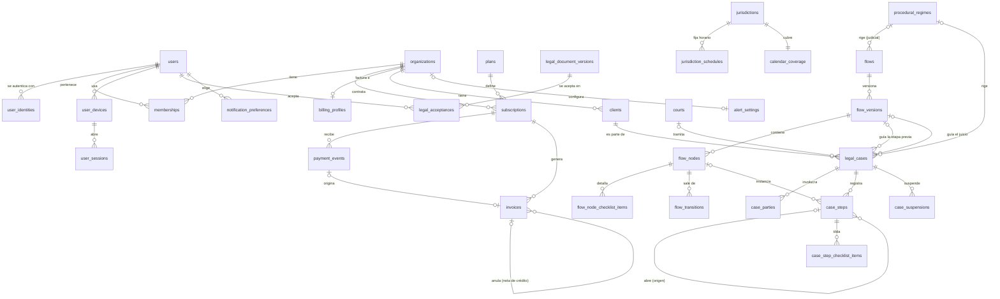

# Modelo de Base de Datos Relacional - Asistente Legal (V1)

Este documento define la estructura de tablas para el motor de base de datos relacional (**PostgreSQL**). El modelo se divide en seis dominios:

1. **Identidad y Acceso:** usuarios, identidades de Google, estudios, miembros, dispositivos y sesiones.
2. **Suscripciones y facturación:** planes por tramo de clientes, suscripciones, eventos de pago, datos fiscales, facturas electrónicas y aceptación de los documentos legales.
3. **Catálogos del Sistema:** jurisdicciones, departamentos, fueros, regímenes procesales, tribunales y calendario judicial.
4. **Motor de Flujos:** la "receta" procesal, versionada.
5. **Datos del Estudio:** clientes, expedientes, partes y pasos (transaccional).
6. **Auditoría:** registro inmutable de eventos.

---

## 0. Convenciones Generales

* **Claves primarias:** `UUID` generado por la aplicación (se recomienda UUID v7, que es ordenable en el tiempo y mejora los índices).
* **Fechas:** los días sin hora (notificación, vencimiento, feriados) son `date`. Los instantes (creación, gracia, presentación) son `timestamptz`. Ver la sección 6 del documento de lógica de plazos.
* **Enums:** se guardan como `text` con una restricción `CHECK` de valores permitidos. Es más fácil de migrar que el tipo `enum` nativo de PostgreSQL. Los valores van en mayúsculas y en español (ej. `ACTORA`, `HABILES_JUDICIALES`), igual que en el motor de plazos.
* **Trazabilidad:** toda tabla mutable tiene `created_at` y `updated_at`. Las tablas de datos del estudio tienen además `created_by` (FK -> `users.id`).
* **Borrado lógico:** `organizations`, `clients` y `legal_cases` tienen `deleted_at`. Nada se borra físicamente desde la app; un job de purga elimina los datos según la política de retención (ISO 27701).
* **Multitenancy:** toda tabla con datos de un estudio tiene `organization_id`. Ver la sección 7.
* **Migraciones:** versionadas con **Flyway** (scripts SQL `V<n>__<descripcion>.sql` en el repositorio del backend). Cada componente usa su propio rol de base de datos, sin permisos de DDL: la API, el back-office (solo tablas de catálogo, calendario y flujos) y los jobs. Las migraciones corren con otro rol, solo en el despliegue.

---

## 1. Dominio: Identidad y Acceso

### Tabla: `users` (usuarios)

*La autenticación la hace Google (OIDC). La app no guarda contraseñas.*

| Campo | Tipo | Descripción |
| ----- | ----- | ----- |
| `id` | PK, UUID | |
| `full_name` | text | Nombre completo. |
| `primary_email` | text | Email de contacto; se toma de la identidad de Google en el alta. |
| `status` | enum | `ACTIVO`, `SUSPENDIDO`, `BAJA`. |
| `system_role` | enum | `USUARIO` o `ADMIN`. `ADMIN` gestiona catálogos, calendario y flujos desde el back-office; no da acceso a datos de los estudios. |
| `last_login_at` | timestamptz, nullable | |
| `created_at`, `updated_at` | timestamptz | |

### Tabla: `user_identities` (identidades externas)

*Separa al usuario de su proveedor de login. Permite sumar Microsoft u otro proveedor sin migrar usuarios.*

| Campo | Tipo | Descripción |
| ----- | ----- | ----- |
| `id` | PK, UUID | |
| `user_id` | FK -> `users.id` | |
| `provider` | enum | `GOOGLE` (V1). |
| `provider_subject` | text | El `sub` del ID token. **Es el identificador del usuario**, no el email. |
| `email` | text | Email informado por el proveedor. |
| `email_verified` | boolean | El login se rechaza si es `false`. |
| `last_used_at` | timestamptz, nullable | |
| `created_at`, `updated_at` | timestamptz | |

Restricción: `UNIQUE (provider, provider_subject)`.

### Tabla: `organizations` (estudios)

*Es el **tenant**. Los expedientes y clientes pertenecen al estudio, no a un usuario. Un abogado independiente tiene un estudio de tipo `INDIVIDUAL` con un solo miembro.*

| Campo | Tipo | Descripción |
| ----- | ----- | ----- |
| `id` | PK, UUID | |
| `name` | text | Nombre del estudio. |
| `type` | enum | `INDIVIDUAL`, `ESTUDIO`. |
| `created_at`, `updated_at`, `deleted_at` | timestamptz | |

### Tabla: `memberships` (miembros del estudio)

| Campo | Tipo | Descripción |
| ----- | ----- | ----- |
| `id` | PK, UUID | |
| `organization_id` | FK -> `organizations.id` | |
| `user_id` | FK -> `users.id` | |
| `role` | enum | `TITULAR` (gestiona la suscripción y los miembros), `ABOGADO`, `ASISTENTE`. |
| `status` | enum | `INVITADO`, `ACTIVO`, `REVOCADO`. |
| `created_at`, `updated_at` | timestamptz | |

Restricción: `UNIQUE (organization_id, user_id)`.

### Tabla: `user_devices` (dispositivos)

*Sostiene el límite de dispositivos de la suscripción y la pantalla "Mis dispositivos".*

| Campo | Tipo | Descripción |
| ----- | ----- | ----- |
| `id` | PK, UUID | |
| `user_id` | FK -> `users.id` | |
| `device_key_hash` | text | Hash de un identificador aleatorio que la app genera y guarda en el dispositivo. No se usa *fingerprinting* del navegador. |
| `display_name` | text | Ej: "Chrome en Windows". Se deriva del *user agent*. |
| `first_seen_at`, `last_seen_at` | timestamptz | |
| `revoked_at` | timestamptz, nullable | Si tiene valor, el dispositivo no puede abrir sesiones. |
| `revoked_reason` | enum, nullable | `USUARIO`, `LIMITE_DISPOSITIVOS`, `SEGURIDAD`, `ADMIN`. |

Restricción: `UNIQUE (user_id, device_key_hash)`.

### Tabla: `user_sessions` (sesiones)

*La sesión técnica la maneja Spring Session (JDBC), con sus propias tablas. Esta tabla la vincula con el usuario y el dispositivo, y permite revocarla desde el servidor.*

| Campo | Tipo | Descripción |
| ----- | ----- | ----- |
| `id` | PK, UUID | |
| `user_id` | FK -> `users.id` | |
| `device_id` | FK -> `user_devices.id` | |
| `organization_id` | FK -> `organizations.id` | Estudio activo en la sesión. |
| `spring_session_id` | text | ID interno de Spring Session. **Nunca** se expone al cliente ni se escribe en logs. |
| `created_at`, `last_activity_at`, `expires_at` | timestamptz | |
| `revoked_at` | timestamptz, nullable | |

---

## 2. Dominio: Suscripciones y Facturación

*No se guardan datos de tarjeta: el pago se procesa en el checkout del proveedor (a definir; ej. Mercado Pago). La factura electrónica la emite la app ante ARCA.*

### Tabla: `plans` (planes)

*Cada fila es un tramo de un plan con un período de cobro. Ej: Individual hasta 10 clientes, mensual. Los planes no se editan: un cambio de precio o de límites crea una fila nueva, y las suscripciones pasan a ella con el aviso previo de 30 días de los Términos.*

| Campo | Tipo | Descripción |
| ----- | ----- | ----- |
| `id` | PK, UUID | |
| `code` | text, unique | Ej: `INDIVIDUAL_10_MENSUAL`, `ESTUDIO_50_ANUAL`. |
| `name` | text | Nombre visible. Ej: "Individual · hasta 10 clientes". |
| `family` | enum | `INDIVIDUAL`, `ESTUDIO`. |
| `tier_rank` | integer | Orden del tramo dentro de la familia; define qué cambio es una subida y cuál una bajada. |
| `max_active_clients` | integer, nullable | Clientes activos permitidos. `null` = sin límite (tramo a medida). |
| `max_active_cases` | integer, nullable | Tope de uso razonable de expedientes activos. `null` = sin tope (valor por defecto; ver sección 9.2 del análisis). |
| `included_seats` | integer | Usuarios incluidos (1 en `INDIVIDUAL`). |
| `max_seats` | integer, nullable | Máximo de usuarios contratables. `null` = sin máximo. |
| `extra_seat_price_amount` | numeric(12,2), nullable | Precio de cada usuario adicional. Solo en `ESTUDIO`. |
| `max_devices_per_user` | integer | Dispositivos simultáneos por usuario (propuesta: 3). |
| `billing_period` | enum | `MENSUAL`, `ANUAL`. |
| `trial_days` | integer | |
| `price_amount` | numeric(12,2) | Precio final con impuestos incluidos, como se le muestra al usuario. La factura discrimina el IVA cuando corresponde. |
| `currency` | text | `ARS`. |
| `is_active` | boolean | Si se puede contratar. Un plan inactivo sigue vigente para las suscripciones que ya lo tienen. |
| `created_at`, `updated_at` | timestamptz | |

Restricciones:
* `CHECK (family <> 'INDIVIDUAL' OR (included_seats = 1 AND max_seats = 1 AND extra_seat_price_amount IS NULL))`.
* `UNIQUE (family, tier_rank, billing_period)` entre los planes activos (índice único parcial).

**Cliente activo:** un cliente del estudio, sin borrar, con al menos un expediente `ACTIVO` o `PAUSADO`. Un cliente con varios expedientes cuenta una vez. Ver la sección 7, punto 4.

### Tabla: `subscriptions` (suscripciones)

| Campo | Tipo | Descripción |
| ----- | ----- | ----- |
| `id` | PK, UUID | |
| `organization_id` | FK -> `organizations.id` | |
| `plan_id` | FK -> `plans.id` | |
| `status` | enum | `PRUEBA`, `ACTIVA`, `EN_MORA`, `SOLO_LECTURA`, `CANCELADA`. |
| `seats` | integer | Usuarios contratados (incluidos más adicionales). |
| `trial_ends_at` | timestamptz, nullable | |
| `current_period_start`, `current_period_end` | timestamptz | |
| `scheduled_plan_id` | FK -> `plans.id`, nullable | Plan inferior programado para el próximo período. Se aplica solo si en ese momento los clientes activos entran en su límite. |
| `cancel_at_period_end` | boolean, default false | Baja pedida con el botón "Dar de baja"; tiene efecto al final del período pagado. |
| `cancellation_type` | enum, nullable | `BAJA`, `ARREPENTIMIENTO`, `FALTA_DE_PAGO`, `FIN_DE_PRUEBA`, `ADMIN`. |
| `cancellation_requested_at` | timestamptz, nullable | |
| `cancellation_ticket` | text, nullable | Número de trámite que se le informa al usuario al confirmar la baja o el arrepentimiento. |
| `first_charged_at` | timestamptz, nullable | Primer cobro. Junto con `created_at`, define el plazo de arrepentimiento de 10 días corridos. |
| `read_only_until` | timestamptz, nullable | Fin del período de solo lectura y exportación (30 días). Después corre el borrado de los datos del estudio (30 días más). |
| `provider` | enum | Proveedor de pagos. |
| `provider_subscription_id` | text | ID de la suscripción en el proveedor. |
| `created_at`, `updated_at` | timestamptz | |

Restricciones:
* Un índice único parcial asegura **una sola suscripción no cancelada por estudio**.
* `CHECK (cancellation_type IS NULL OR cancellation_requested_at IS NOT NULL)`.

### Tabla: `payment_events` (eventos de pago)

*Registra los webhooks del proveedor. Solo se procesan si la firma es válida.*

| Campo | Tipo | Descripción |
| ----- | ----- | ----- |
| `id` | PK, UUID | |
| `subscription_id` | FK -> `subscriptions.id`, nullable | |
| `provider` | enum | |
| `provider_event_id` | text | Restricción `UNIQUE (provider, provider_event_id)`: el mismo evento no se procesa dos veces. |
| `event_type` | text | |
| `signature_verified` | boolean | |
| `payload_redacted` | jsonb | Solo los campos permitidos; sin datos de tarjeta ni del titular. |
| `amount`, `currency` | numeric(12,2), text, nullable | Importe cobrado, si el evento es un cobro. Es la base de la factura. |
| `received_at`, `processed_at` | timestamptz | |

### Tabla: `billing_profiles` (datos fiscales del estudio)

*Los carga el titular antes del primer cobro. Son datos del titular frente a la app (la app es responsable), no datos del estudio sobre sus clientes.*

| Campo | Tipo | Descripción |
| ----- | ----- | ----- |
| `id` | PK, UUID | |
| `organization_id` | FK -> `organizations.id`, unique | Un perfil fiscal por estudio. |
| `tax_id_type` | enum | `CUIT`, `DNI` (solo consumidor final). |
| `tax_id` | text | Se valida el dígito verificador del CUIT. |
| `legal_name` | text | Nombre o razón social. |
| `vat_condition` | enum | `RESPONSABLE_INSCRIPTO`, `MONOTRIBUTO`, `EXENTO`, `CONSUMIDOR_FINAL`. Define el tipo de factura. |
| `fiscal_address` | text | Domicilio fiscal. |
| `billing_email` | text | Destino de las facturas. |
| `verified_with_arca_at` | timestamptz, nullable | Si se contrastó con el padrón de ARCA. |
| `created_at`, `updated_at` | timestamptz | |

### Tabla: `invoices` (facturas electrónicas)

*Cada cobro confirmado genera una factura. Un reembolso (por ejemplo, por arrepentimiento) genera una nota de crédito asociada. Los datos del emisor (CUIT, punto de venta, ambiente de ARCA) son configuración; el certificado y su clave privada viven en el gestor de secretos, nunca en la base ni en el repositorio.*

| Campo | Tipo | Descripción |
| ----- | ----- | ----- |
| `id` | PK, UUID | |
| `organization_id` | FK -> `organizations.id` | |
| `subscription_id` | FK -> `subscriptions.id` | |
| `payment_event_id` | FK -> `payment_events.id`, nullable, unique | Cobro que origina la factura. `UNIQUE`: un cobro no se factura dos veces. |
| `related_invoice_id` | FK -> `invoices.id`, nullable | Factura que anula una nota de crédito. |
| `voucher_kind` | enum | `FACTURA`, `NOTA_DE_CREDITO`. |
| `voucher_letter` | enum | `A`, `B`, `C`. Sale de la condición frente al IVA del emisor y del receptor. |
| `point_of_sale` | integer | Punto de venta habilitado para web services. |
| `voucher_number` | bigint, nullable | Lo asigna la app al pedir la autorización, a partir del último autorizado en ARCA. |
| `issue_date` | date | |
| `service_period_from`, `service_period_to` | date | Período facturado. |
| `net_amount`, `vat_amount`, `total_amount` | numeric(12,2) | `vat_amount` en 0 si el emisor o la operación no discriminan IVA. |
| `currency` | text | `ARS`. |
| `receiver_snapshot` | jsonb | Copia de los datos fiscales del receptor al momento de facturar (`billing_profiles` puede cambiar después). |
| `status` | enum | `PENDIENTE`, `AUTORIZADA`, `RECHAZADA`, `ERROR`. |
| `cae`, `cae_due_date` | text, date, nullable | Código de autorización electrónico y su vencimiento. Obligatorios si `AUTORIZADA`. |
| `arca_observations` | jsonb, nullable | Observaciones o errores devueltos por ARCA, sin datos sensibles. |
| `attempts` | integer | Intentos de autorización. |
| `pdf_object_key` | text, nullable | Ubicación del PDF (con código QR) en el almacenamiento de objetos. |
| `created_at`, `updated_at` | timestamptz | |

Restricciones:
* `UNIQUE (point_of_sale, voucher_kind, voucher_letter, voucher_number)`.
* `CHECK (status <> 'AUTORIZADA' OR (cae IS NOT NULL AND cae_due_date IS NOT NULL AND voucher_number IS NOT NULL))`.
* `CHECK ((voucher_kind = 'NOTA_DE_CREDITO') = (related_invoice_id IS NOT NULL))`.
* Una factura `AUTORIZADA` no se modifica ni se borra: se corrige con una nota de crédito. Se conserva durante el plazo de la normativa fiscal, aunque el estudio se dé de baja. Por eso, la purga de un estudio elimina sus clientes, expedientes y pasos, pero conserva la fila de `organizations` (con `deleted_at`), su `billing_profiles` y sus `invoices`.

### Tabla: `legal_document_versions` (versiones de los documentos legales)

| Campo | Tipo | Descripción |
| ----- | ----- | ----- |
| `id` | PK, UUID | |
| `document_type` | enum | `TERMINOS`, `PRIVACIDAD`, `ENCARGO_DEL_TRATAMIENTO`. |
| `version` | text | Ej: `1.0`. |
| `content_sha256` | text | Hash del texto publicado; prueba qué versión exacta se aceptó. |
| `published_at` | timestamptz | |
| `effective_at` | timestamptz | Entrada en vigencia (al menos 30 días después del aviso si cambia derechos u obligaciones). |
| `requires_reacceptance` | boolean | Si la versión pide una nueva aceptación. |

Restricción: `UNIQUE (document_type, version)`.

### Tabla: `legal_acceptances` (aceptaciones)

*Registro de solo inserción.*

| Campo | Tipo | Descripción |
| ----- | ----- | ----- |
| `id` | PK, UUID | |
| `document_version_id` | FK -> `legal_document_versions.id` | |
| `user_id` | FK -> `users.id` | Quién aceptó. |
| `organization_id` | FK -> `organizations.id`, nullable | Obligatorio para `ENCARGO_DEL_TRATAMIENTO`: el titular lo acepta en nombre del estudio. |
| `accepted_at` | timestamptz | |

Restricciones:
* `UNIQUE (document_version_id, user_id, organization_id)`.
* No se guarda la IP ni el *user agent*: la identidad la da la sesión autenticada, y el evento queda también en `audit_events`.

---

## 3. Dominio: Catálogos del Sistema (Datos estáticos)

Estas tablas son administradas por los dueños de la app (rol `ADMIN`). Los usuarios solo las leen.

### Tabla: `jurisdictions` (jurisdicciones)

*Para la V1 solo tendrá un registro activo (PBA), pero prepara el sistema para escalar.*

| Campo | Tipo | Descripción |
| ----- | ----- | ----- |
| `id` | PK, UUID | |
| `code` | text, unique | Ej: `PBA`, `CABA`. |
| `name` | text | Ej: "Provincia de Buenos Aires". |
| `time_zone` | text | `America/Argentina/Buenos_Aires`. |
| `is_active` | boolean | |

### Tabla: `jurisdiction_schedules` (horario judicial por jurisdicción)

*Parámetros horarios que usa el motor de plazos para los límites del vencimiento (regla R3). Son datos, no constantes del código: si la SCBA cambia el horario, se carga un registro nuevo con su fecha de vigencia.*

| Campo | Tipo | Descripción |
| ----- | ----- | ----- |
| `id` | PK, UUID | |
| `jurisdiction_id` | FK -> `jurisdictions.id` | |
| `opening_time` | time | Ej: 08:00. |
| `closing_time` | time | Ej: 14:00. Hora del límite `CIERRE_HORARIO_JUDICIAL`. |
| `grace_end_time` | time | Ej: 12:00 (las primeras cuatro horas del día hábil siguiente, art. 124 CPCCBA). |
| `valid_from` | date | |
| `valid_to` | date, nullable | `null` = vigente. |
| `legal_reference` | text | Acordada o norma que fija el horario. |

Restricciones: `CHECK (opening_time < grace_end_time AND grace_end_time <= closing_time)` y períodos sin superposición por jurisdicción. El motor usa el registro vigente en el día del límite.

### Tabla: `judicial_departments` (departamentos judiciales)

| Campo | Tipo | Descripción |
| ----- | ----- | ----- |
| `id` | PK, UUID | |
| `jurisdiction_id` | FK -> `jurisdictions.id` | |
| `name` | text | Ej: "San Isidro", "Lomas de Zamora". |
| `is_active` | boolean | |

### Tabla: `legal_branches` (fueros)

| Campo | Tipo | Descripción |
| ----- | ----- | ----- |
| `id` | PK, UUID | |
| `code` | text, unique | Ej: `LABORAL`. |
| `name` | text | |

### Tabla: `procedural_regimes` (regímenes procesales)

| Campo | Tipo | Descripción |
| ----- | ----- | ----- |
| `id` | PK, UUID | |
| `jurisdiction_id` | FK -> `jurisdictions.id` | |
| `legal_branch_id` | FK -> `legal_branches.id` | |
| `code` | text, unique | Ej: `PBA_LAB_LEY_11653`, `PBA_LAB_LEY_15057`. |
| `name` | text | |
| `legal_basis` | text | Ley de referencia. |

### Tabla: `department_regimes` (régimen vigente por departamento)

*Responde qué régimen procesal rige en cada departamento judicial y desde cuándo. El contenido lo define el equipo legal (punto 1 de la sección 4 del análisis).*

| Campo | Tipo | Descripción |
| ----- | ----- | ----- |
| `id` | PK, UUID | |
| `department_id` | FK -> `judicial_departments.id` | |
| `procedural_regime_id` | FK -> `procedural_regimes.id` | |
| `valid_from` | date | |
| `valid_to` | date, nullable | `null` = vigente. |

Restricción: los períodos de un mismo departamento y fuero no se superponen (restricción de exclusión sobre el rango de fechas).

### Tabla: `courts` (tribunales y juzgados)

| Campo | Tipo | Descripción |
| ----- | ----- | ----- |
| `id` | PK, UUID | |
| `department_id` | FK -> `judicial_departments.id` | |
| `legal_branch_id` | FK -> `legal_branches.id` | |
| `procedural_regime_id` | FK -> `procedural_regimes.id` | |
| `court_type` | enum | `TRIBUNAL_TRABAJO`, `JUZGADO_LABORAL`, `CAMARA_APELACION`. |
| `name` | text | Ej: "Tribunal de Trabajo N° 1". |
| `is_active` | boolean | |

### Tabla: `holidays_calendar` (calendario de días inhábiles)

*Fuente de los días inhábiles que usa el motor de plazos. Las ferias se cargan como un registro por día (el back-office acepta un rango y lo expande).*

| Campo | Tipo | Descripción |
| ----- | ----- | ----- |
| `id` | PK, UUID | |
| `date` | date | Ej: "2026-07-20". |
| `description` | text | Ej: "Feria de Invierno", "Asueto por paro judicial". |
| `type` | enum | `FERIADO`, `FERIA`, `ASUETO`, `INHABIL_MANUAL`. Los plazos en días hábiles administrativos solo excluyen los `FERIADO` nacionales y provinciales (regla R6). |
| `scope` | enum | `NACIONAL`, `PROVINCIAL`, `DEPARTAMENTO`, `ORGANIZACION`. |
| `jurisdiction_id` | FK -> `jurisdictions.id`, nullable | Obligatorio si `scope` es `PROVINCIAL` o `DEPARTAMENTO`. |
| `department_id` | FK -> `judicial_departments.id`, nullable | Obligatorio si `scope = DEPARTAMENTO`. |
| `organization_id` | FK -> `organizations.id`, nullable | Obligatorio si `scope = ORGANIZACION`: es el "inhábil manual" de la Pantalla 4. |
| `legal_reference` | text, nullable | Acordada o resolución de la SCBA. Obligatoria para `ASUETO` y `FERIA`. |
| `created_by` | FK -> `users.id` | |
| `created_at`, `updated_at` | timestamptz | |

Restricciones:
* Un `CHECK` exige que las columnas de alcance sean coherentes con `scope`.
* `UNIQUE NULLS NOT DISTINCT (date, scope, jurisdiction_id, department_id, organization_id)` (PostgreSQL 15+).

> **Por qué el inhábil manual es del estudio y no del usuario:** el vencimiento de un expediente tiene que ser el mismo para todos los miembros que lo miran. Si fuera por usuario, el abogado y su asistente podrían ver fechas distintas para el mismo plazo.

### Tabla: `calendar_coverage` (cobertura del calendario)

*El motor de plazos devuelve `CALENDARIO_NO_CARGADO` si el cómputo pasa de `covered_until`.*

| Campo | Tipo | Descripción |
| ----- | ----- | ----- |
| `id` | PK, UUID | |
| `jurisdiction_id` | FK -> `jurisdictions.id`, unique | |
| `status` | enum | `PROVISORIO` (fases iniciales: solo se excluyen sábados y domingos, más lo que ya esté cargado) u `OFICIAL` (completo y validado). Con `PROVISORIO` el motor marca cada resultado como aproximado. |
| `covered_until` | date | Último día con el calendario cargado. Con `OFICIAL`, es el último día completo y validado. |
| `calendar_version` | integer | Se incrementa con cada cambio del calendario de la jurisdicción. |
| `validated_by` | FK -> `users.id`, nullable | Obligatorio si `status = OFICIAL`. |
| `validated_at` | timestamptz, nullable | Obligatorio si `status = OFICIAL`. |

Restricción: `CHECK (status = 'PROVISORIO' OR (validated_by IS NOT NULL AND validated_at IS NOT NULL))`. Pasar de `PROVISORIO` a `OFICIAL` incrementa `calendar_version` y dispara el recálculo de los pasos pendientes.

---

## 4. Dominio: Motor de Flujos (La "Receta" Procesal)

Estas tablas digitalizan la matriz que arma el equipo legal. **Una versión publicada es inmutable**: un cambio de ley o una corrección genera una versión nueva, y cada expediente queda atado a la versión con la que se creó.

### Tabla: `flows` (flujos)

| Campo | Tipo | Descripción |
| ----- | ----- | ----- |
| `id` | PK, UUID | |
| `flow_kind` | enum | `PREJUDICIAL` (intimaciones, prescripción, conciliación previa) o `JUDICIAL` (desde la demanda). |
| `jurisdiction_id` | FK -> `jurisdictions.id` | |
| `legal_branch_id` | FK -> `legal_branches.id` | |
| `procedural_regime_id` | FK -> `procedural_regimes.id`, nullable | Obligatorio para `JUDICIAL`. `null` para `PREJUDICIAL`: la etapa previa es común a los regímenes del fuero (a confirmar, duda D25). |
| `name` | text | Ej: "Proceso laboral ordinario - Ley 11.653". |
| `description` | text, nullable | |
| `created_at`, `updated_at` | timestamptz | |

Restricción: `CHECK ((flow_kind = 'JUDICIAL') = (procedural_regime_id IS NOT NULL))`; si hay régimen, su jurisdicción y su fuero coinciden con los del flujo.

> **Por qué la etapa previa es un flujo propio:** las intimaciones y la conciliación ocurren antes de que haya tribunal, y por lo tanto antes de que se sepa el régimen. Si estuvieran en el flujo judicial, un expediente creado en la etapa previa quedaría atado a un régimen que podría no ser el que corresponda al interponer la demanda. Con dos flujos, el judicial se elige recién al interponer la demanda. Hoy la matriz de la Ley 11.653 tiene la etapa previa adentro (fase `Previa`); se separa al importarla, una vez respondida la D25.

### Tabla: `flow_versions` (versiones de flujo)

| Campo | Tipo | Descripción |
| ----- | ----- | ----- |
| `id` | PK, UUID | |
| `flow_id` | FK -> `flows.id` | |
| `version_number` | integer | Restricción `UNIQUE (flow_id, version_number)`. |
| `status` | enum | `BORRADOR`, `PUBLICADA`, `RETIRADA`. Una `RETIRADA` no se usa en expedientes nuevos, pero los existentes la conservan. |
| `source_file_name` | text | Nombre de la planilla importada. |
| `source_checksum` | text | SHA-256 de la planilla, para saber exactamente qué se importó. |
| `approved_by_legal` | text | Quién del equipo legal validó el contenido. |
| `published_by` | FK -> `users.id`, nullable | |
| `published_at` | timestamptz, nullable | |
| `notes` | text, nullable | Qué cambió respecto de la versión anterior. |

Una versión `PUBLICADA` no admite cambios en sus nodos, transiciones ni ítems. La app lo controla y un trigger lo refuerza.

### Tabla: `flow_nodes` (nodos de flujo)

*Representa cada etapa individual del proceso legal.*

| Campo | Tipo | Descripción |
| ----- | ----- | ----- |
| `id` | PK, UUID | |
| `flow_version_id` | FK -> `flow_versions.id` | |
| `step_code` | text | Ej: "LAB_050". Restricción `UNIQUE (flow_version_id, step_code)`. |
| `phase` | text | Ej: "Postulación". |
| `name` | text | Ej: "Contestación de Demanda". |
| `responsible_role` | enum | `ACTORA`, `DEMANDADA`, `TRIBUNAL`, `AMBAS` (cualquiera de las partes: recursos, impugnaciones, audiencias). |
| `trigger_event` | text | Ej: "Recepción de cédula". |
| `default_term_value` | integer | Ej: 10. `0` para `SIN_PLAZO` y `FECHA_FIJADA`. |
| `term_type` | enum | `HABILES_JUDICIALES`, `CORRIDOS`, `HABILES_ADMINISTRATIVOS`, `MESES`, `ANIOS`, `HORAS`, `FECHA_FIJADA`, `ANTICIPACION_HABILES_JUDICIALES`, `SIN_PLAZO`. El cómputo de cada uno está en la sección 2 del documento de lógica de plazos. |
| `applies_grace_period` | boolean | Siempre `false` para `SIN_PLAZO` y `FECHA_FIJADA`. |
| `deadline_limit_type` | enum | `CIERRE_HORARIO_JUDICIAL` (default) o `FIN_DEL_DIA` (plazos de fondo, como la prescripción). No aplica a `HORAS` ni a `FECHA_FIJADA`, cuyo límite es un instante. Ver la regla R3. La planilla todavía no tiene esta columna: se agrega como `Limite_Horario` cuando se responda la D28; mientras tanto, el importador usa `CIERRE_HORARIO_JUDICIAL`, que es la opción más temprana. |
| `legal_basis` | text | Ej: "Arts. 28 y 29 L.11653". |
| `is_initial` | boolean | Nodo de inicio del flujo. Cada versión tiene exactamente uno. |
| `is_final` | boolean | Nodo de cierre (ej. archivo del expediente). No tiene transiciones de salida. |
| `sort_order` | integer | Orden de presentación en el roadmap visual. |

Restricciones:
* `CHECK ((term_type IN ('SIN_PLAZO','FECHA_FIJADA')) = (default_term_value = 0))`: esos dos tipos llevan valor `0` y el resto, mayor que `0`.
* `CHECK (NOT applies_grace_period OR term_type IN ('HABILES_JUDICIALES','CORRIDOS','MESES','ANIOS'))`.
* Las reglas de estructura (un nodo inicial, todos los nodos alcanzables, nodos no finales con al menos una salida) las valida el importador antes de publicar; ver la sección 4 del documento de proyecto.

### Tabla: `flow_node_checklist_items` (ítems de checklist y documentación)

*Reemplaza al antiguo `checklist_json`. Separa las tareas de la documentación requerida y les da un ID estable para tildarlas por expediente.*

| Campo | Tipo | Descripción |
| ----- | ----- | ----- |
| `id` | PK, UUID | |
| `node_id` | FK -> `flow_nodes.id` | |
| `kind` | enum | `TAREA` (columna `Checklist_Abogado` de la matriz) o `DOCUMENTO` (columna `Documentacion_Requerida`). |
| `description` | text | Ej: "Bono Ley 8480". |
| `sort_order` | integer | |

### Tabla: `flow_transitions` (transiciones de flujo / bifurcaciones)

*Conecta un nodo con los posibles siguientes pasos según qué haya pasado.*

| Campo | Tipo | Descripción |
| ----- | ----- | ----- |
| `id` | PK, UUID | |
| `flow_version_id` | FK -> `flow_versions.id` | |
| `source_node_id` | FK -> `flow_nodes.id` | |
| `exit_condition` | text | Ej: "Demandado contesta", "Demandado no contesta". |
| `target_node_id` | FK -> `flow_nodes.id`, nullable | `null` = la transición cierra ese camino paralelo sin abrir otro hito (`CIERRA_CAMINO` en la planilla). |
| `sort_order` | integer | Orden de las opciones en el selector "Avanzar de etapa". |

Restricción: origen y destino pertenecen a la misma versión (claves foráneas compuestas sobre `(flow_version_id, id)`).

**Caminos en paralelo:** varias filas con el mismo `source_node_id` y el mismo `exit_condition` forman **una sola opción** en el selector "Avanzar de etapa". Al elegirla se crea un `case_step` pendiente por cada destino. Así se modelan los plazos simultáneos (ej. la prescripción corre mientras avanza el reclamo).

---

## 5. Dominio: Datos del Estudio (Transaccional)

Aquí se guarda la información privada de cada estudio, sus clientes y expedientes. Respecto de estos datos, el estudio es el **responsable del tratamiento** y la app es **encargada** (ver sección 10 del análisis).

### Tabla: `clients` (clientes)

| Campo | Tipo | Descripción |
| ----- | ----- | ----- |
| `id` | PK, UUID | |
| `organization_id` | FK -> `organizations.id` | |
| `person_type` | enum | `HUMANA`, `JURIDICA`. |
| `full_name_or_company` | text | Nombre o razón social. |
| `tax_id` | text, nullable | CUIT / DNI. |
| `phone` | text, nullable | |
| `email` | text, nullable | |
| `created_by` | FK -> `users.id` | |
| `created_at`, `updated_at`, `deleted_at` | timestamptz | |

Restricción: `UNIQUE (organization_id, id)`, para que los expedientes puedan referenciar al cliente con clave compuesta.

### Tabla: `legal_cases` (expedientes)

| Campo | Tipo | Descripción |
| ----- | ----- | ----- |
| `id` | PK, UUID | |
| `organization_id` | FK -> `organizations.id` | |
| `client_id` | UUID | FK compuesta `(organization_id, client_id)` -> `clients (organization_id, id)`: el cliente es siempre del mismo estudio. |
| `responsible_user_id` | FK -> `users.id` | Abogado a cargo; debe ser miembro activo del estudio. |
| `prejudicial_flow_version_id` | FK -> `flow_versions.id`, nullable | Versión del flujo `PREJUDICIAL`, si el expediente empezó en la etapa previa. |
| `judicial_flow_version_id` | FK -> `flow_versions.id`, nullable | Versión del flujo `JUDICIAL`. Se asigna al interponer la demanda (o al dar de alta un juicio en curso) y no cambia después. |
| `procedural_regime_id` | FK -> `procedural_regimes.id`, nullable | Régimen del juicio, resuelto al asignar el flujo judicial. Coincide con el de `judicial_flow_version_id`. |
| `regime_source` | enum, nullable | Cómo se determinó el régimen: `TRIBUNAL` (el del órgano elegido) o `DEPARTAMENTO_Y_FECHA` (por `department_regimes`, si todavía no hay tribunal). |
| `case_title` | text | Carátula. Ej: "PEREZ C/ EMPRESA S/ DESPIDO". |
| `case_number` | text, nullable | Número de expediente / causa. |
| `receptoria_number` | text, nullable | Número de receptoría. |
| `jurisdiction_id` | FK -> `jurisdictions.id` | |
| `department_id` | FK -> `judicial_departments.id` | Define qué asuetos departamentales aplican al cálculo. |
| `court_id` | FK -> `courts.id`, nullable | `null` solo en la etapa previa. |
| `represented_role` | enum | `ACTORA`, `DEMANDADA`. |
| `current_status` | enum | `ACTIVO`, `PAUSADO`, `TERMINADO`. |
| `claim_filed_on` | date, nullable | Fecha de interposición de la demanda. Junto con el departamento, sirve para controlar el régimen. |
| `loaded_in_progress` | boolean, default false | `true` si se dio de alta un expediente que ya estaba en curso. Los hitos anteriores a la etapa elegida se muestran como "anteriores a la carga". |
| `closed_at` | date, nullable | |
| `closed_reason` | enum, nullable | `SENTENCIA`, `ACUERDO`, `DESISTIMIENTO`, `OTRO`. Obligatorio si `current_status = TERMINADO`. |
| `created_by` | FK -> `users.id` | |
| `created_at`, `updated_at`, `deleted_at` | timestamptz | |

Restricciones:
* `UNIQUE (organization_id, id)`, para las claves compuestas de las tablas hijas.
* `CHECK (prejudicial_flow_version_id IS NOT NULL OR judicial_flow_version_id IS NOT NULL OR procedural_regime_id IS NOT NULL)`. Un expediente de un régimen sin flujo publicado (en la V1, la Ley 15.057) no tiene versión de flujo: tiene régimen y tribunal, y sus plazos son plazos sueltos.
* `CHECK (judicial_flow_version_id IS NULL OR (court_id IS NOT NULL AND procedural_regime_id IS NOT NULL AND regime_source IS NOT NULL))`.

**Resolución del régimen.** Al asignar el flujo judicial, el backend resuelve el régimen así:

1. **Si hay tribunal**, el régimen es el del tribunal (`courts.procedural_regime_id`). Es la fuente principal: el abogado ya sabe dónde tramita su causa.
2. **Control cruzado:** con `department_regimes`, el departamento y `claim_filed_on`, el backend calcula el régimen esperado. Si no coincide con el del tribunal, se lo muestra al usuario y lo registra en `audit_events`, pero no lo corrige solo.
3. **Si no se puede determinar** (no hay tribunal ni un período de `department_regimes` que cubra la fecha), no se asigna el flujo y se pide elegir el tribunal. La app no adivina.
4. **Si el régimen no tiene un flujo publicado** (en la V1, la Ley 15.057), la app lo informa y permite cargar los plazos como plazos sueltos.

La regla de transición (si las causas iniciadas antes de la implementación siguen con la ley anterior) está pendiente de confirmación: duda D24.

### Tabla: `case_parties` (partes del expediente)

*Contrapartes, litisconsortes y terceros. El cliente propio está en `clients`.*

| Campo | Tipo | Descripción |
| ----- | ----- | ----- |
| `id` | PK, UUID | |
| `organization_id` | UUID | FK compuesta `(organization_id, case_id)` -> `legal_cases (organization_id, id)`. |
| `case_id` | UUID | |
| `party_role` | enum | `ACTORA`, `DEMANDADA`, `TERCERO`. |
| `name` | text | Nombre o razón social. |
| `tax_id` | text, nullable | |
| `counsel_name` | text, nullable | Abogado de la parte. |
| `created_at`, `updated_at` | timestamptz | |

### Tabla: `case_steps` (pasos del expediente / línea de tiempo)

*Es la tabla más importante. Registra el progreso de un expediente sobre el flujo y cada plazo que corre. Puede haber **varios pasos pendientes a la vez** (plazos simultáneos) y pasos que no salen del flujo (plazos sueltos, ej. una intimación del juzgado).*

| Campo | Tipo | Descripción |
| ----- | ----- | ----- |
| `id` | PK, UUID | |
| `organization_id` | UUID | FK compuesta `(organization_id, case_id)` -> `legal_cases (organization_id, id)`. |
| `case_id` | UUID | |
| `node_id` | FK -> `flow_nodes.id`, nullable | Hito del flujo. `null` = plazo suelto. Debe pertenecer a una de las dos versiones del expediente (prejudicial o judicial). |
| `custom_title` | text, nullable | Título del plazo suelto. Ej: "Acompañar documental intimada". |
| `responsible_role` | enum | Copia de `flow_nodes.responsible_role`; en un plazo suelto, el rol representado por defecto. Cruzado con `legal_cases.represented_role` define si el paso es propio, de la contraparte o del tribunal. |
| `origin_step_id` | FK -> `case_steps.id`, nullable | Paso cuyo avance abrió este paso. `null` para el paso inicial, los plazos sueltos y los pasos cargados al dar de alta un expediente en curso. Es lo que permite retroceder. |
| `related_step_id` | FK -> `case_steps.id`, nullable | En un plazo suelto, el hito en curso cuando se cargó (contexto). En una `ANTICIPACION_HABILES_JUDICIALES`, el paso con la fecha fijada de referencia: si se reprograma la audiencia, se recalcula. |
| `status` | enum | `PENDIENTE`, `COMPLETADO`, `SALTEADO`, `NO_CUMPLIDO` (venció sin cumplirse y el abogado lo registró así) o `ANULADO` (se deshizo al retroceder una etapa). "Vencido" no se guarda: se deriva de un paso `PENDIENTE` con el límite ya pasado. |
| `status_reason` | text, nullable | Motivo. Obligatorio para `SALTEADO`, `NO_CUMPLIDO` y `ANULADO`. |
| `term_type` | enum | Copia de `flow_nodes.term_type`, o lo que se cargue en un plazo suelto. |
| `applies_grace_period` | boolean | Copia de `flow_nodes.applies_grace_period`, o lo que se cargue en un plazo suelto. |
| `deadline_limit_type` | enum | Copia de `flow_nodes.deadline_limit_type`, o lo que se cargue en un plazo suelto (default `CIERRE_HORARIO_JUDICIAL`). |
| `notification_type` | enum, nullable | `CEDULA_PAPEL`, `ELECTRONICA`, `MINISTERIO_LEY`, `PERSONAL`, `OTRA`. |
| `start_date` | date, nullable | Inicio del cómputo según el tipo: el Día Cero (la fecha en que la notificación quedó perfeccionada, regla R5), la fecha del hecho en meses y años, o la fecha del acto de referencia en una anticipación. |
| `start_at` | timestamptz, nullable | Fecha y hora del disparador en `HORAS`, o del acto en `FECHA_FIJADA`. |
| `term_value` | integer | Copia `default_term_value` del nodo; el usuario puede editarlo (ej. de 10 a 12). |
| `term_override_reason` | text, nullable | Obligatorio si `term_value` difiere del valor del nodo. Ej: "Ampliación por distancia". |
| `extension_days` | integer, default 0 | Días sumados con el botón de asueto imprevisto (+1). Solo en plazos en días. |
| `calculation_status` | enum, nullable | `CALCULADO`, `SIN_VENCIMIENTO`, `CALENDARIO_NO_CARGADO` (resultados del motor) o `MANUAL` (vencimiento informado por el abogado, solo al dar de alta un expediente en curso sin Día Cero conocido). |
| `nominal_due_date` | date, nullable | Vencimiento nominal: último día del cómputo. Es la fecha de alerta. |
| `effective_due_date` | date, nullable | Vencimiento efectivo. Igual al nominal, salvo plazos corridos, en meses o en años que terminan en inhábil (reglas R2 y R7). |
| `ordinary_limit_at` | timestamptz, nullable | Límite ordinario: el vencimiento efectivo a la hora que corresponde al tipo de límite, o el instante en `HORAS` y `FECHA_FIJADA`. |
| `grace_limit_at` | timestamptz, nullable | Límite con gracia (12:00 hs del hábil siguiente, hora de Argentina). `null` si no aplica gracia. |
| `calculated_with_provisional_calendar` | boolean, default false | `true` si el cálculo usó un calendario `PROVISORIO`. La UI muestra "Cálculo aproximado". |
| `calendar_incomplete` | boolean, default false | `true` si un plazo en meses o años vence después del calendario cargado. Se recalcula al cargarlo. |
| `calculation_warnings` | text[], default `{}` | Advertencias del motor. Ej: `FECHA_EN_DIA_INHABIL`. |
| `calendar_version` | integer, nullable | Versión del calendario usada en el cálculo; permite detectar qué recalcular. |
| `schedule_id` | FK -> `jurisdiction_schedules.id`, nullable | Horario usado en el cálculo. |
| `calculated_at` | timestamptz, nullable | |
| `loaded_in_progress` | boolean, default false | `true` si el paso se cargó al dar de alta un expediente que ya estaba en curso. |
| `filed_at` | timestamptz, nullable | Fecha y hora de presentación (cargo); prueba que se cumplió en término. |
| `completed_at` | timestamptz, nullable | Cuándo se marcó el paso como terminado. |
| `completed_by` | FK -> `users.id`, nullable | |
| `chosen_transition_id` | FK -> `flow_transitions.id`, nullable | Por qué camino avanzó. |
| `annulled_at` | timestamptz, nullable | Cuándo se anuló al retroceder. |
| `annulled_by` | FK -> `users.id`, nullable | |
| `created_by` | FK -> `users.id` | |
| `created_at`, `updated_at` | timestamptz | |

Restricciones:
* `CHECK (node_id IS NOT NULL OR custom_title IS NOT NULL)`.
* `CHECK (term_value >= 0 AND extension_days >= 0)`.
* `CHECK (calculation_status NOT IN ('CALCULADO','MANUAL') OR (nominal_due_date IS NOT NULL AND effective_due_date >= nominal_due_date AND ordinary_limit_at IS NOT NULL))`.
* `CHECK (status NOT IN ('SALTEADO','NO_CUMPLIDO','ANULADO') OR status_reason IS NOT NULL)`.
* `CHECK ((status = 'ANULADO') = (annulled_at IS NOT NULL))`.
* Índice por `(organization_id, status, nominal_due_date)` para el dashboard de alertas.

**Retroceder una etapa.** "Retroceder" deshace el último avance de un camino; es una corrección de carga, no un evento procesal. Los retrocesos procesales reales, como el reenvío de la SCBA para un nuevo pronunciamiento, ya son transiciones de la matriz.

1. Se elige un paso `COMPLETADO`. Los pasos con `origin_step_id` igual a ese paso pasan a `ANULADO`, con motivo, y el paso vuelve a `PENDIENTE`.
2. Solo se puede retroceder si los pasos que se anulan no abrieron, a su vez, otros pasos. Si los abrieron, primero hay que retroceder esos, en orden inverso.
3. Si alguno de los pasos que se anulan tiene actividad (ítems del checklist tildados, `filed_at` o una edición del plazo), la app lo muestra y pide confirmación.
4. Nada se borra: los pasos anulados quedan en el historial, y el retroceso se registra en `audit_events` como `ETAPA_RETROCEDIDA`.
5. El paso reabierto conserva su vencimiento original. Si ya pasó, aparece como vencido.

### Tabla: `case_suspensions` (suspensiones de plazos del expediente)

*Períodos en que los plazos de un expediente no corren: acuerdo de partes, resolución del tribunal en esa causa, etc. El motor los suma a los días inhábiles de ese expediente (duda D36).*

| Campo | Tipo | Descripción |
| ----- | ----- | ----- |
| `id` | PK, UUID | |
| `organization_id` | UUID | FK compuesta `(organization_id, case_id)` -> `legal_cases (organization_id, id)`. |
| `case_id` | UUID | |
| `starts_on` | date | |
| `ends_on` | date | `CHECK (ends_on >= starts_on)`. |
| `reason` | enum | `ACUERDO_DE_PARTES`, `RESOLUCION_DEL_TRIBUNAL`, `OTRO`. |
| `legal_reference` | text, nullable | Ej: fecha del escrito y del proveído. |
| `created_by` | FK -> `users.id` | |
| `created_at`, `updated_at`, `deleted_at` | timestamptz | |

Cargar, editar o borrar una suspensión recalcula los pasos `PENDIENTE` del expediente y queda en `audit_events`.

### Tabla: `case_step_checklist_items` (checklist del paso)

| Campo | Tipo | Descripción |
| ----- | ----- | ----- |
| `id` | PK, UUID | |
| `organization_id` | UUID | Tenant; coherente con el paso. |
| `case_step_id` | FK -> `case_steps.id` | |
| `checklist_item_id` | FK -> `flow_node_checklist_items.id`, nullable | `null` para ítems agregados a mano. |
| `kind` | enum | `TAREA`, `DOCUMENTO`. |
| `description` | text | Copia del ítem del flujo, o texto libre. |
| `is_done` | boolean | |
| `done_at` | timestamptz, nullable | |
| `done_by` | FK -> `users.id`, nullable | |

### Tabla: `alert_settings` (parámetros del semáforo y del resumen diario)

*El semáforo y el resumen por email se configuran en la base, no en el código. Hay un registro `GLOBAL` con los valores por defecto, y un estudio puede tener el suyo.*

| Campo | Tipo | Descripción |
| ----- | ----- | ----- |
| `id` | PK, UUID | |
| `scope` | enum | `GLOBAL` u `ORGANIZACION`. |
| `organization_id` | FK -> `organizations.id`, nullable | Obligatorio si `scope = ORGANIZACION`. |
| `red_business_days` | integer | Rojo: vence hoy o dentro de esta cantidad de días hábiles judiciales. Default `2`. |
| `yellow_business_days` | integer | Amarillo: vence dentro de esta cantidad de días hábiles. Default `5`. Verde: después. |
| `digest_time` | time | Hora del resumen diario por email, en la zona de la jurisdicción. Default 07:00. |
| `digest_lookahead_business_days` | integer | Qué vencimientos entran en el resumen. Default igual a `yellow_business_days`. |
| `updated_by` | FK -> `users.id` | |
| `created_at`, `updated_at` | timestamptz | |

Restricciones: `CHECK (0 <= red_business_days AND red_business_days < yellow_business_days)`; un solo registro `GLOBAL` y uno por estudio. Los cambios quedan en `audit_events`.

### Tabla: `notification_preferences` (preferencias de aviso por usuario)

| Campo | Tipo | Descripción |
| ----- | ----- | ----- |
| `user_id` | PK compuesta, FK -> `users.id` | |
| `organization_id` | PK compuesta, FK -> `organizations.id` | |
| `daily_digest_enabled` | boolean, default true | Recibir el resumen diario por email. |
| `digest_includes_case_details` | boolean, default false | Si el email incluye carátula y cliente. Por defecto no: el email solo trae cantidades, el número de expediente y el enlace a la app (minimización de datos, ISO 27701). |
| `counterparty_alerts_enabled` | boolean, default true | Avisar cuando vence un plazo de la contraparte (oportunidad procesal). |
| `updated_at` | timestamptz | |

---

## 6. Dominio: Auditoría

### Tabla: `audit_events` (eventos de auditoría)

*Registro de solo inserción. Responde quién hizo qué, cuándo y por qué. Es evidencia ante un reclamo por responsabilidad profesional y un requisito de ISO 27001.*

| Campo | Tipo | Descripción |
| ----- | ----- | ----- |
| `id` | PK, UUID | |
| `occurred_at` | timestamptz | |
| `actor_type` | enum | `USUARIO`, `ADMIN`, `SISTEMA` (jobs). |
| `actor_user_id` | FK -> `users.id`, nullable | `null` para `SISTEMA`. |
| `organization_id` | FK -> `organizations.id`, nullable | `null` para eventos de catálogo. |
| `entity_type` | text | Ej: `case_step`, `holidays_calendar`, `membership`. |
| `entity_id` | UUID, nullable | |
| `action` | text | Ej: `LOGIN`, `LOGIN_RECHAZADO`, `CASO_CREADO`, `PLAZO_EDITADO`, `PRORROGA_AGREGADA`, `ETAPA_SALTEADA`, `ETAPA_RETROCEDIDA`, `PASO_COMPLETADO`, `PLAZO_NO_CUMPLIDO`, `PLAZO_SUELTO_CREADO`, `SUSPENSION_CARGADA`, `EXPEDIENTE_EN_CURSO_CARGADO`, `ALERTAS_CONFIGURADAS`, `PLAN_CAMBIADO`, `LIMITE_CLIENTES_ALCANZADO`, `BAJA_SOLICITADA`, `ARREPENTIMIENTO_SOLICITADO`, `FACTURA_EMITIDA`, `DOCUMENTO_LEGAL_ACEPTADO`, `DATOS_DEL_ESTUDIO_ELIMINADOS`, `CALENDARIO_MODIFICADO`, `MIEMBRO_INVITADO`, `ROL_CAMBIADO`, `DISPOSITIVO_REVOCADO`, `DATOS_EXPORTADOS`. |
| `old_values` | jsonb, nullable | Solo campos de una lista permitida por tipo de entidad. |
| `new_values` | jsonb, nullable | Ídem. |
| `reason` | text, nullable | Ej: el motivo de un cambio de plazo. |
| `correlation_id` | text | ID de la petición, para cruzar con los logs. |

Reglas:
* El rol de base de datos de la app tiene solo `INSERT` y `SELECT` sobre esta tabla; no puede modificar ni borrar.
* Nunca se registran tokens, secretos, IDs de sesión ni datos que no estén en la lista permitida.
* La retención la fija la política de privacidad y seguridad (ISO 27001 / 27701).

---

## 7. Resumen de Relaciones Clave

1. **Multitenancy por estudio:** toda tabla con datos de un estudio tiene `organization_id`, y la app filtra siempre por el estudio de la sesión. Como defensa en profundidad:
   * las claves foráneas compuestas impiden mezclar datos de dos estudios (ej. un expediente con el cliente de otro estudio);
   * Row-Level Security de PostgreSQL **obligatorio** sobre esas tablas, con `FORCE ROW LEVEL SECURITY`. La app fija el estudio en una variable de sesión al comenzar cada transacción, y su rol de base no es dueño de las tablas (modelado de amenazas, ISO-03);
   * los tests de integración deben probar que un usuario no puede leer ni modificar datos de otro estudio.
2. **Separación Plantilla vs. Instancia:** la definición del proceso (`flow_versions` / `flow_nodes`) está separada de la realidad del caso (`case_steps`). Si el año que viene cambia la ley y un plazo pasa de 10 a 15 días, se publica una **nueva versión** del flujo. Los expedientes nuevos usan la nueva; los ya iniciados conservan la suya, sin cambios en nombres, checklist ni transiciones. Además, `case_steps` copia los datos del cálculo (`term_type`, `applies_grace_period`, `term_value`), así que el historial de cada plazo no depende del flujo.
3. **Calendario y recálculo:** el vencimiento de un paso depende de la jurisdicción, el departamento judicial y el estudio del expediente, y del horario vigente de la jurisdicción. Cuando cambia `holidays_calendar` (se incrementa `calendar_version`, el calendario pasa de `PROVISORIO` a `OFICIAL` o el estudio carga un inhábil manual) o cambia `jurisdiction_schedules`, un job recalcula los pasos `PENDIENTE` afectados, registra el cambio en `audit_events` y avisa al usuario.
4. **Suscripción y acceso:**
   * **Dispositivos:** el límite se controla con `plans.max_devices_per_user` sobre los `user_devices` activos.
   * **Solo lectura:** con la suscripción en `SOLO_LECTURA`, la app permite consultar y exportar, pero no modificar. El resumen diario por email se sigue enviando.
   * **Límite de clientes:**
     * Se controla al crear o reactivar un expediente, y solo si el cliente todavía no cuenta como activo. La transacción bloquea la fila de `subscriptions` (`SELECT … FOR UPDATE`) antes de contar, para que dos altas simultáneas no superen el límite.
     * Llegar al límite **nunca** bloquea los expedientes ya cargados: sus plazos, sus alertas y la lectura siguen funcionando.
   * **Bajada de plan:** se programa en `scheduled_plan_id` y se rechaza si al cambiar de período los clientes activos superan el nuevo límite.
5. **Facturación:**
   * Un cobro confirmado (`payment_events` con firma válida) crea una factura `PENDIENTE` en la misma transacción.
   * Un job pide la autorización a ARCA. Antes de cada intento consulta el último comprobante autorizado de ese punto de venta y tipo: si ya quedó autorizado en un intento anterior, lo recupera en lugar de pedir otro número. Así un reintento no duplica facturas ni deja huecos en la numeración.
   * Si ARCA no responde, la factura queda `PENDIENTE` y se reintenta. Que la factura esté pendiente nunca afecta el acceso del estudio.
