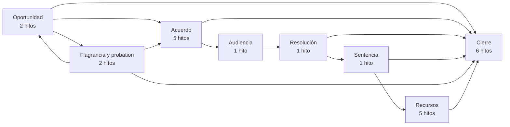
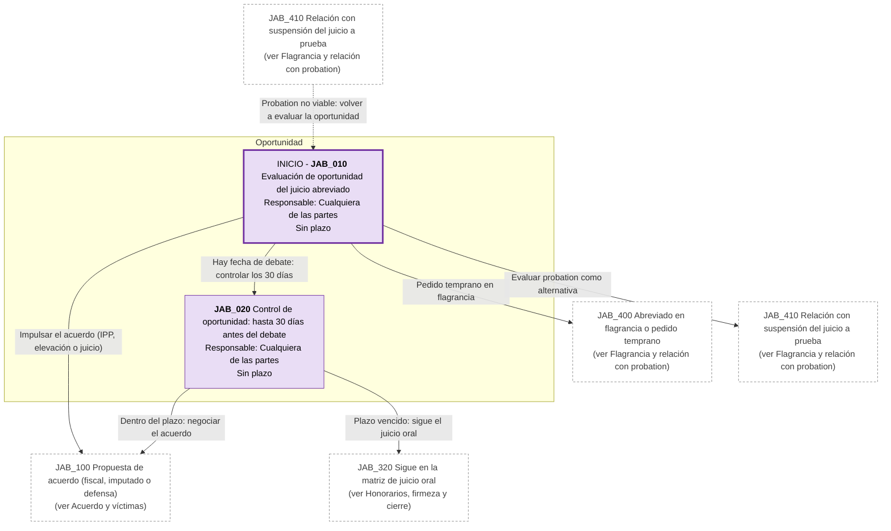
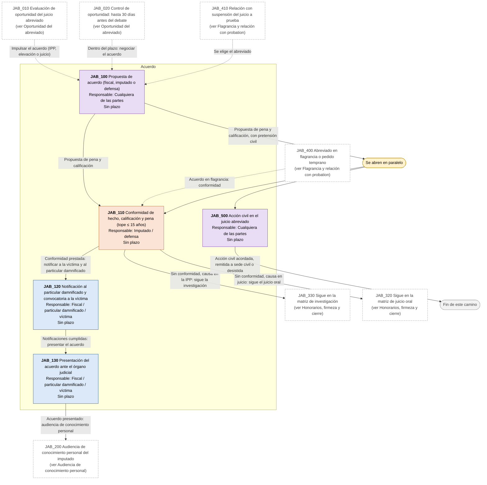
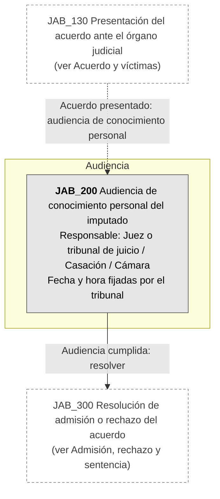
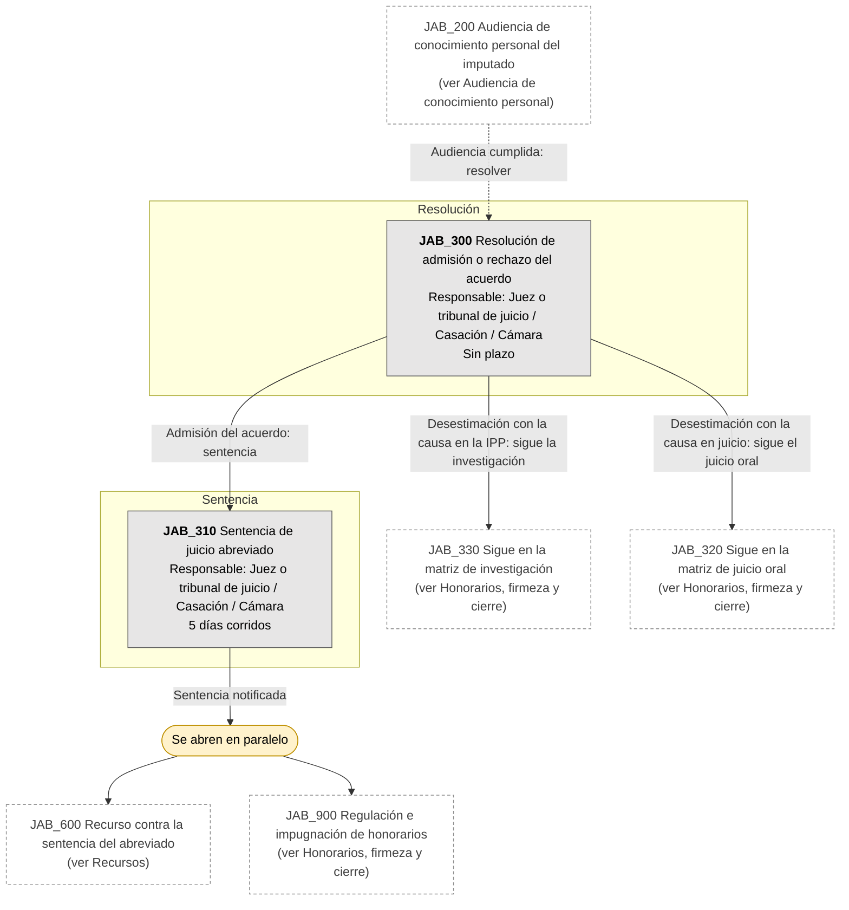
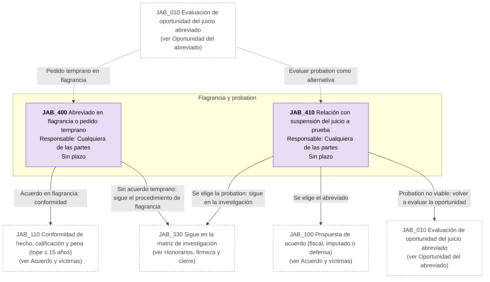
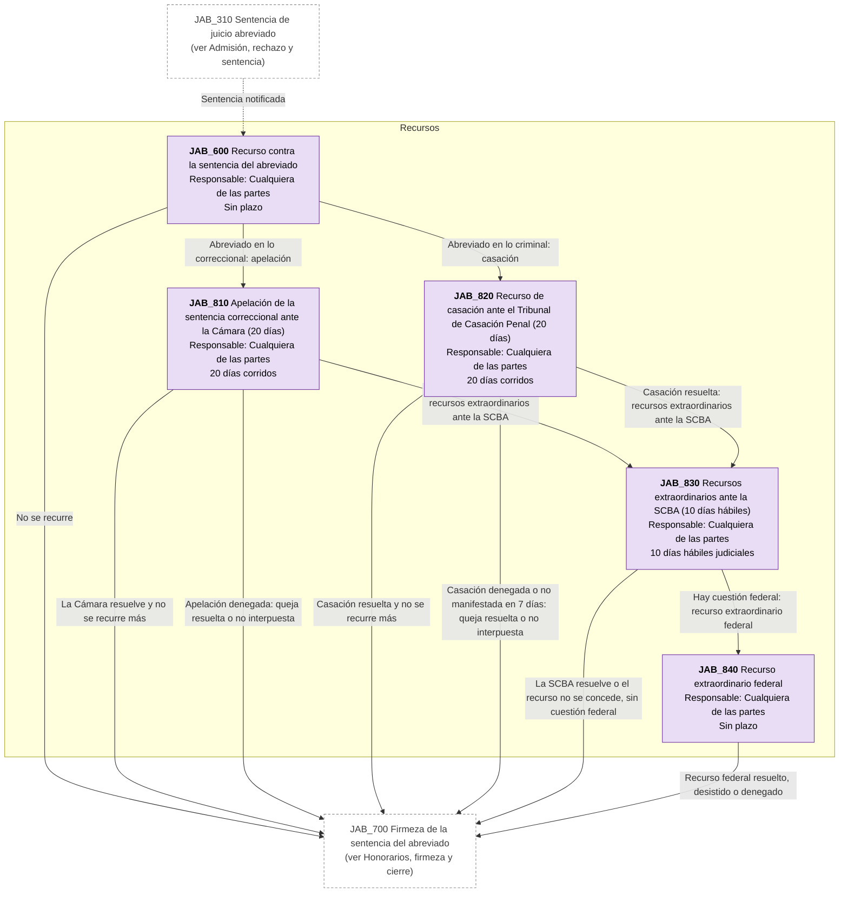

# Diagrama de Flujo: Juicio abreviado (PBA)

**Régimen:** CPP PBA (Ley 11.922 y modificatorias); arts. 395 a 403 CPP PBA; Ley 13.811 (flagrancia, a verificar); Código Penal (suspensión del juicio a prueba, arts. 76 bis y 76 ter) · **Versión:** 1 (borrador)

> Este documento se genera a partir de `matriz_penal_abreviado_pba.xlsx`. No se edita a mano: las correcciones se hacen en la planilla y luego se vuelve a generar el diagrama.

## Cómo leer los diagramas

* **Cada caja es un hito** de la hoja `Nodos`: muestra el ID, el nombre, quién debe actuar y el plazo.
* **Cada flecha es un camino** de la hoja `Transiciones`, rotulado con su condición de salida.
* **Color de la caja según el responsable:** celeste = acusación: Ministerio Público Fiscal o particular damnificado / víctima (ACTORA); naranja = imputado y defensa (DEMANDADA); gris = juez o tribunal de juicio, Cámara o Casación (TRIBUNAL); violeta = cualquiera de las partes (AMBAS).
* **Borde grueso:** hito inicial o hito final.
* **"Se abren en paralelo"** (amarillo): esa condición abre varios hitos a la vez; por ejemplo, tras la sentencia del abreviado corren a la vez el recurso (casación o apelación), la impugnación de honorarios y el control de firmeza hacia ejecución.
* **"Fin de este camino"** (gris claro): el camino paralelo termina sin abrir otro hito.
* **Cajas blancas con borde discontinuo:** hitos de otra etapa; el texto indica en qué diagrama están. Las flechas punteadas muestran desde dónde se llega a esta etapa.
* **Derivación a otra matriz:** caja con borde grueso (hito final) cuyo nombre empieza con "Sigue en la matriz de ...": el expediente continúa en ese otro flujo penal, en un expediente vinculado.
* **Fase "Previa":** hitos anteriores a la intervención judicial formal (consulta, denuncia, designación de defensor, constitución como particular damnificado). La app los separa en el flujo prejudicial; en penal hay duda sobre si eso tiene sentido desde la denuncia.
* **Plazos corridos (art. 139 CPP PBA):** la mayoría de los plazos procesales penales son días continuos (CORRIDOS), no hábiles judiciales. Aplica_Gracia = NO en todos los hitos.
* **Tope de pena (art. 395):** la pena pedida por el fiscal no puede superar 15 años de prisión (o una pena no privativa de libertad, aún conjunta). Es pena concreta pedida, no máximo abstracto.
* **Rechazo del acuerdo (art. 398):** si se desestima, el proceso sigue en juicio oral; las conformidades no valen como reconocimiento de culpabilidad. Resolución inimpugnable.

## Vista general por fases

## 1. Oportunidad del abreviado

## 2. Acuerdo y víctimas

## 3. Audiencia de conocimiento personal

## 4. Admisión, rechazo y sentencia

## 5. Flagrancia y relación con probation

## 6. Recursos

## 7. Honorarios, firmeza y cierre

```mermaid
flowchart TD
  subgraph F_0["Cierre"]
    JAB_320["<b>JAB_320</b> Sigue en la matriz de juicio oral<br/>Responsable: Cualquiera de las partes<br/>Sin plazo"]:::ambas
    JAB_330["<b>JAB_330</b> Sigue en la matriz de investigación<br/>Responsable: Cualquiera de las partes<br/>Sin plazo"]:::ambas
    JAB_700["<b>JAB_700</b> Firmeza de la sentencia del abreviado<br/>Responsable: Cualquiera de las partes<br/>Sin plazo"]:::ambas
    JAB_900["<b>JAB_900</b> Regulación e impugnación de honorarios<br/>Responsable: Cualquiera de las partes<br/>5 días corridos"]:::ambas
    JAB_970["<b>JAB_970</b> Sigue en ejecución penal<br/>Responsable: Cualquiera de las partes<br/>Sin plazo"]:::ambas
    JAB_990["<b>JAB_990</b> Archivo o absolución firme<br/>Responsable: Cualquiera de las partes<br/>Sin plazo"]:::ambas
  end
  EXT_JAB_020_origen["JAB_020 Control de oportunidad: hasta 30 días antes del debate<br/>(ver Oportunidad del abreviado)"]:::externo
  EXT_JAB_020_origen -.->|"Plazo vencido: sigue el juicio oral"| JAB_320
  EXT_JAB_110_origen["JAB_110 Conformidad de hecho, calificación y pena (tope ≤ 15 años)<br/>(ver Acuerdo y víctimas)"]:::externo
  EXT_JAB_110_origen -.->|"Sin conformidad, causa en la IPP: sigue la investigación"| JAB_330
  EXT_JAB_110_origen -.->|"Sin conformidad, causa en juicio: sigue el juicio oral"| JAB_320
  EXT_JAB_300_origen["JAB_300 Resolución de admisión o rechazo del acuerdo<br/>(ver Admisión, rechazo y sentencia)"]:::externo
  EXT_JAB_300_origen -.->|"Desestimación con la causa en la IPP: sigue la investigación"| JAB_330
  EXT_JAB_300_origen -.->|"Desestimación con la causa en juicio: sigue el juicio oral"| JAB_320
  EXT_JAB_310_origen["JAB_310 Sentencia de juicio abreviado<br/>(ver Admisión, rechazo y sentencia)"]:::externo
  EXT_JAB_310_origen -.->|"Sentencia notificada"| JAB_900
  EXT_JAB_400_origen["JAB_400 Abreviado en flagrancia o pedido temprano<br/>(ver Flagrancia y relación con probation)"]:::externo
  EXT_JAB_400_origen -.->|"Sin acuerdo temprano: sigue el procedimiento de flagrancia"| JAB_330
  EXT_JAB_410_origen["JAB_410 Relación con suspensión del juicio a prueba<br/>(ver Flagrancia y relación con probation)"]:::externo
  EXT_JAB_410_origen -.->|"Se elige la probation: sigue en la investigación"| JAB_330
  EXT_JAB_600_origen["JAB_600 Recurso contra la sentencia del abreviado<br/>(ver Recursos)"]:::externo
  EXT_JAB_600_origen -.->|"No se recurre"| JAB_700
  JAB_700 -->|"Condena firme con pena o reglas a ejecutar"| JAB_970
  JAB_700 -->|"Absolución firme o cierre sin ejecución"| JAB_990
  EXT_JAB_810_origen["JAB_810 Apelación de la sentencia correccional ante la Cámara (20 días)<br/>(ver Recursos)"]:::externo
  EXT_JAB_810_origen -.->|"La Cámara resuelve y no se recurre más"| JAB_700
  EXT_JAB_810_origen -.->|"Apelación denegada: queja resuelta o no interpuesta"| JAB_700
  EXT_JAB_820_origen["JAB_820 Recurso de casación ante el Tribunal de Casación Penal (20 días)<br/>(ver Recursos)"]:::externo
  EXT_JAB_820_origen -.->|"Casación resuelta y no se recurre más"| JAB_700
  EXT_JAB_820_origen -.->|"Casación denegada o no manifestada en 7 días: queja resuelta o no interpuesta"| JAB_700
  EXT_JAB_830_origen["JAB_830 Recursos extraordinarios ante la SCBA (10 días hábiles)<br/>(ver Recursos)"]:::externo
  EXT_JAB_830_origen -.->|"La SCBA resuelve o el recurso no se concede, sin cuestión federal"| JAB_700
  EXT_JAB_840_origen["JAB_840 Recurso extraordinario federal<br/>(ver Recursos)"]:::externo
  EXT_JAB_840_origen -.->|"Recurso federal resuelto, desistido o denegado"| JAB_700
  FIN_JAB_900_1(["Fin de este camino"]):::fin
  JAB_900 -->|"Honorarios firmes, impugnación resuelta o sin regulación"| FIN_JAB_900_1
  style JAB_320 stroke-width:3px
  style JAB_330 stroke-width:3px
  style JAB_970 stroke-width:3px
  style JAB_990 stroke-width:3px
  classDef actora fill:#DCE9F9,stroke:#1F4E79,color:#000
  classDef demandada fill:#FBE3D6,stroke:#C55A11,color:#000
  classDef tribunal fill:#E7E6E6,stroke:#595959,color:#000
  classDef ambas fill:#E9DDF5,stroke:#7030A0,color:#000
  classDef externo fill:#FFFFFF,stroke:#8C8C8C,color:#404040,stroke-dasharray:4 3
  classDef paralelo fill:#FFF2CC,stroke:#BF9000,color:#000
  classDef fin fill:#F2F2F2,stroke:#A6A6A6,color:#404040
```

