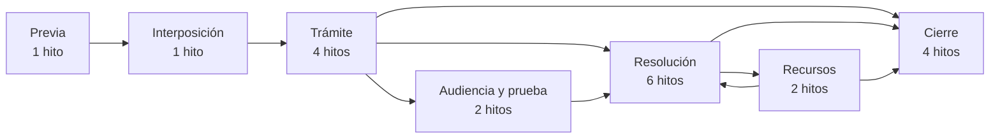
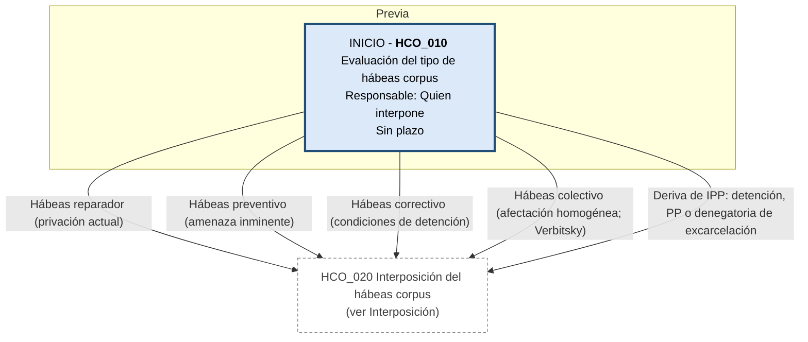
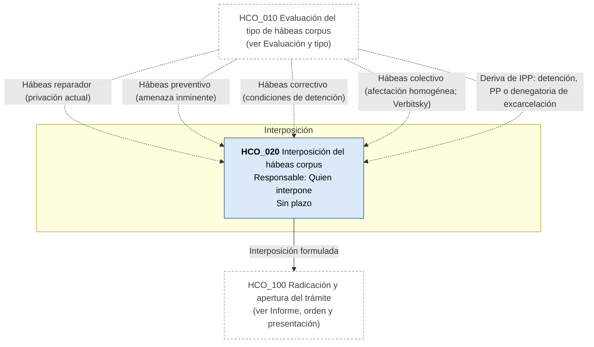
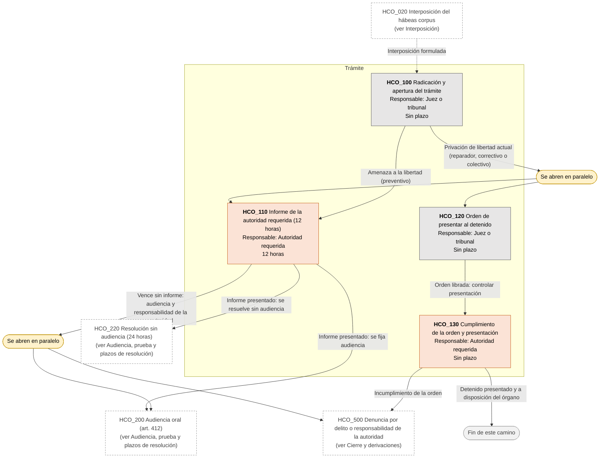
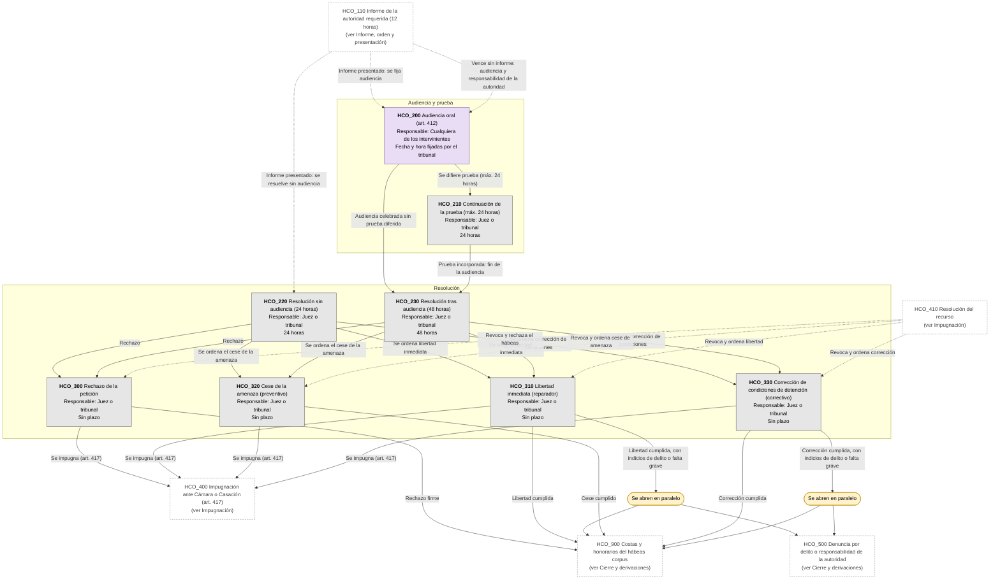
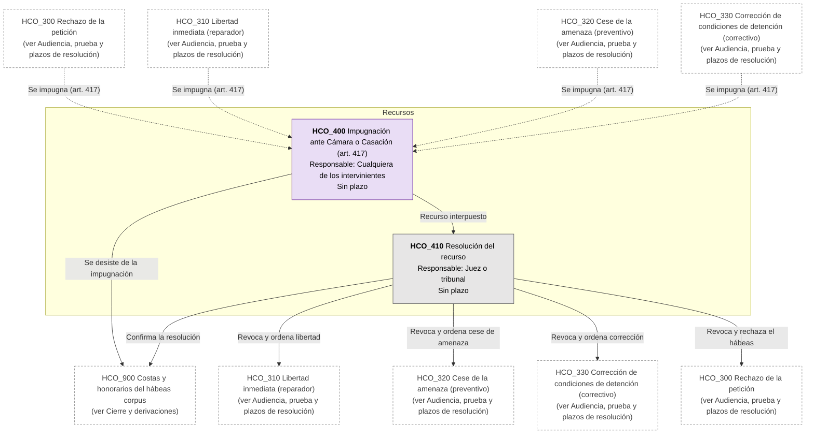

# Diagrama de Flujo: Hábeas corpus (PBA)

**Régimen:** CPP PBA (Ley 11.922 y modificatorias); arts. 405 a 420 CPP PBA; art. 20 inc. 1 Constitución de la Provincia de Buenos Aires; art. 43 Constitución Nacional; Ley 23.098 (hábeas corpus federal, solo como referencia); Ley 14.967; jurisprudencia Verbitsky (CSJN, 2005) y SCBA sobre hábeas colectivo (a verificar alcance) · **Versión:** 1 (borrador)

> Este documento se genera a partir de `matriz_penal_habeas_corpus_pba.xlsx`. No se edita a mano: las correcciones se hacen en la planilla y luego se vuelve a generar el diagrama.

## Cómo leer los diagramas

* **Cada caja es un hito** de la hoja `Nodos`: muestra el ID, el nombre, quién debe actuar y el plazo.
* **Cada flecha es un camino** de la hoja `Transiciones`, rotulado con su condición de salida.
* **Color de la caja según el responsable:** celeste = quien interpone el hábeas corpus: persona afectada o cualquiera a su favor (ACTORA); naranja = autoridad requerida: policía, servicio penitenciario u otro que restringe la libertad (DEMANDADA); gris = juez o tribunal penal que conoce, Cámara o Casación (TRIBUNAL); violeta = cualquiera de los intervinientes en la audiencia o el recurso (AMBAS).
* **Borde grueso:** hito inicial o hito final.
* **"Se abren en paralelo"** (amarillo): esa condición abre varios hitos a la vez; por ejemplo, tras la radicación corren a la vez el informe de la autoridad (12 horas) y, si hay privación de libertad, la orden de presentar al detenido.
* **"Fin de este camino"** (gris claro): el camino paralelo termina sin abrir otro hito.
* **Cajas blancas con borde discontinuo:** hitos de otra etapa; el texto indica en qué diagrama están. Las flechas punteadas muestran desde dónde se llega a esta etapa.
* **Derivación a otra matriz:** caja con borde grueso (hito final) cuyo nombre empieza con "Sigue en la matriz de ...": el expediente continúa en ese otro flujo penal, en un expediente vinculado.
* **Fase "Previa":** hitos anteriores a la intervención judicial formal (consulta, denuncia, designación de defensor, constitución como particular damnificado). La app los separa en el flujo prejudicial; en penal hay duda sobre si eso tiene sentido desde la denuncia.
* **Plazos corridos (art. 139 CPP PBA):** la mayoría de los plazos procesales penales son días continuos (CORRIDOS), no hábiles judiciales. Aplica_Gracia = NO en todos los hitos.
* **Tipos de hábeas corpus:** reparador (privación actual), preventivo (amenaza inminente), correctivo (agravamiento de condiciones de detención legal) y colectivo (afectación homogénea; Verbitsky, CSJN 2005, y SCBA). El tipo se elige en la evaluación y marca el checklist.
* **Informalidad (arts. 406-407):** puede interponerse por cualquiera, sin formalidades, oralmente, por escrito o por teléfono, a cualquier hora, ante cualquier órgano jurisdiccional. Si se impugna una decisión judicial, hay que exponer agravios bajo sanción de inadmisibilidad.

## Vista general por fases

## 1. Evaluación y tipo

## 2. Interposición

## 3. Informe, orden y presentación

## 4. Audiencia, prueba y plazos de resolución

## 5. Impugnación

## 6. Cierre y derivaciones

```mermaid
flowchart TD
  subgraph F_0["Cierre"]
    HCO_500["<b>HCO_500</b> Denuncia por delito o responsabilidad de la autoridad<br/>Responsable: Juez o tribunal<br/>Sin plazo"]:::tribunal
    HCO_900["<b>HCO_900</b> Costas y honorarios del hábeas corpus<br/>Responsable: Cualquiera de los intervinientes<br/>5 días corridos"]:::ambas
    HCO_950["<b>HCO_950</b> Sigue en la matriz de investigación<br/>Responsable: Cualquiera de los intervinientes<br/>Sin plazo"]:::ambas
    HCO_990["<b>HCO_990</b> Cierre del hábeas corpus<br/>Responsable: Cualquiera de los intervinientes<br/>Sin plazo"]:::ambas
  end
  EXT_HCO_110_origen["HCO_110 Informe de la autoridad requerida (12 horas)<br/>(ver Informe, orden y presentación)"]:::externo
  EXT_HCO_110_origen -.->|"Vence sin informe: audiencia y responsabilidad de la autoridad"| HCO_500
  EXT_HCO_130_origen["HCO_130 Cumplimiento de la orden y presentación<br/>(ver Informe, orden y presentación)"]:::externo
  EXT_HCO_130_origen -.->|"Incumplimiento de la orden"| HCO_500
  EXT_HCO_300_origen["HCO_300 Rechazo de la petición<br/>(ver Audiencia, prueba y plazos de resolución)"]:::externo
  EXT_HCO_300_origen -.->|"Rechazo firme"| HCO_900
  EXT_HCO_310_origen["HCO_310 Libertad inmediata (reparador)<br/>(ver Audiencia, prueba y plazos de resolución)"]:::externo
  EXT_HCO_310_origen -.->|"Libertad cumplida"| HCO_900
  EXT_HCO_310_origen -.->|"Libertad cumplida, con indicios de delito o falta grave"| HCO_500
  EXT_HCO_310_origen -.->|"Libertad cumplida, con indicios de delito o falta grave"| HCO_900
  EXT_HCO_320_origen["HCO_320 Cese de la amenaza (preventivo)<br/>(ver Audiencia, prueba y plazos de resolución)"]:::externo
  EXT_HCO_320_origen -.->|"Cese cumplido"| HCO_900
  EXT_HCO_330_origen["HCO_330 Corrección de condiciones de detención (correctivo)<br/>(ver Audiencia, prueba y plazos de resolución)"]:::externo
  EXT_HCO_330_origen -.->|"Corrección cumplida"| HCO_900
  EXT_HCO_330_origen -.->|"Corrección cumplida, con indicios de delito o falta grave"| HCO_500
  EXT_HCO_330_origen -.->|"Corrección cumplida, con indicios de delito o falta grave"| HCO_900
  EXT_HCO_400_origen["HCO_400 Impugnación ante Cámara o Casación (art. 417)<br/>(ver Impugnación)"]:::externo
  EXT_HCO_400_origen -.->|"Se desiste de la impugnación"| HCO_900
  EXT_HCO_410_origen["HCO_410 Resolución del recurso<br/>(ver Impugnación)"]:::externo
  EXT_HCO_410_origen -.->|"Confirma la resolución"| HCO_900
  FIN_HCO_500_1(["Fin de este camino"]):::fin
  HCO_500 -->|"Copias remitidas a la fiscalía (art. 416)"| FIN_HCO_500_1
  FIN_HCO_500_2(["Fin de este camino"]):::fin
  HCO_500 -->|"Trámite iniciado ante la autoridad competente (art. 420)"| FIN_HCO_500_2
  HCO_900 -->|"Costas y honorarios resueltos o sin regulación"| HCO_990
  HCO_900 -->|"Costas y honorarios resueltos; la causa principal sigue en la IPP"| HCO_950
  style HCO_950 stroke-width:3px
  style HCO_990 stroke-width:3px
  classDef actora fill:#DCE9F9,stroke:#1F4E79,color:#000
  classDef demandada fill:#FBE3D6,stroke:#C55A11,color:#000
  classDef tribunal fill:#E7E6E6,stroke:#595959,color:#000
  classDef ambas fill:#E9DDF5,stroke:#7030A0,color:#000
  classDef externo fill:#FFFFFF,stroke:#8C8C8C,color:#404040,stroke-dasharray:4 3
  classDef paralelo fill:#FFF2CC,stroke:#BF9000,color:#000
  classDef fin fill:#F2F2F2,stroke:#A6A6A6,color:#404040
```

