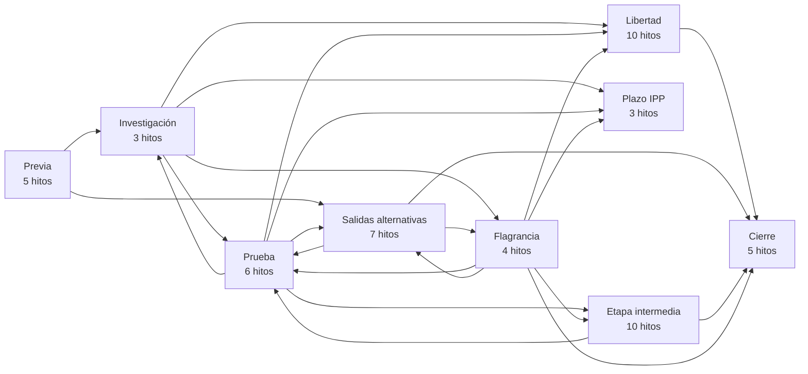
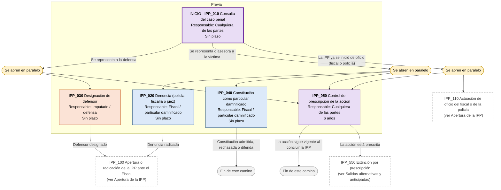
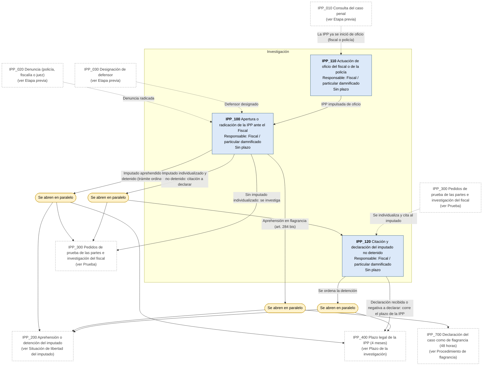
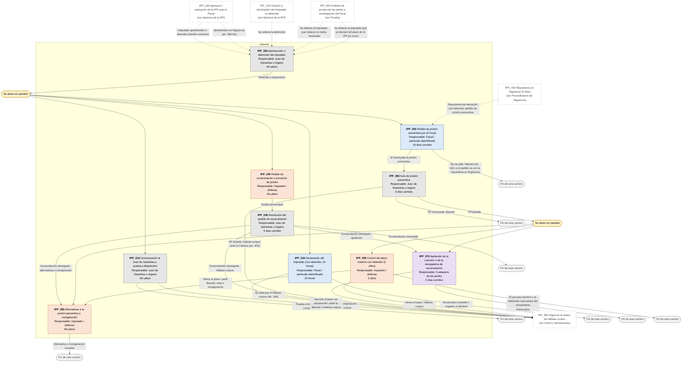
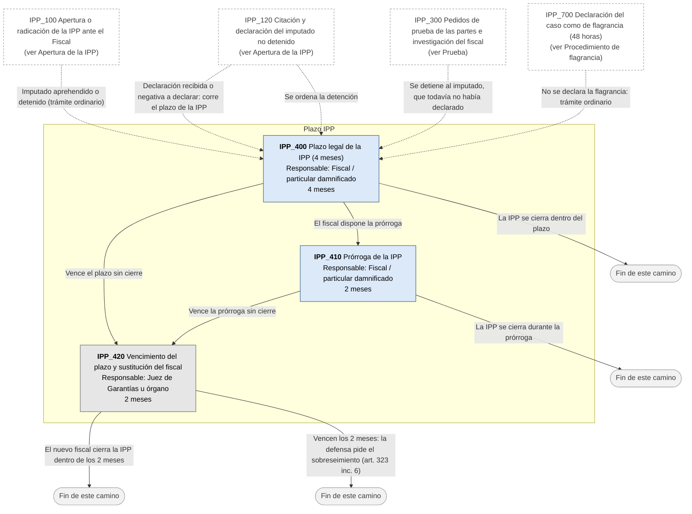
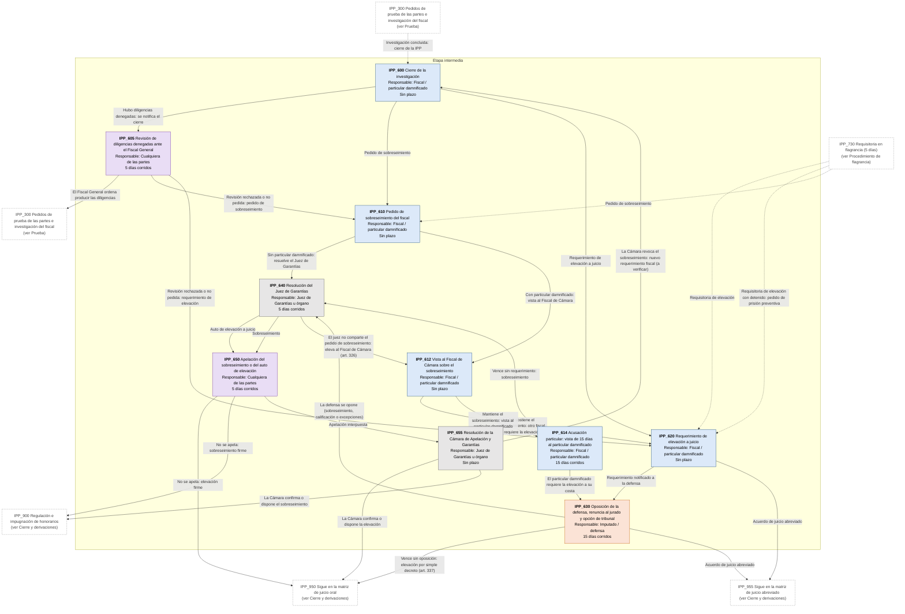
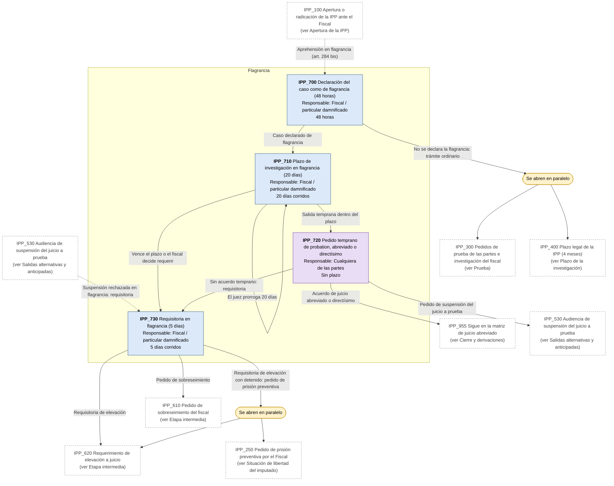

# Diagrama de Flujo: Investigación Penal Preparatoria (PBA)

**Régimen:** CPP PBA (Ley 11.922 y modificatorias); Ley 14.442 del Ministerio Público (a verificar); procedimiento de flagrancia (arts. 284 bis a 284 sexies; Ley 13.811); mediación penal (Ley 13.433, a verificar); Código Penal · **Versión:** 1 (borrador)

> Este documento se genera a partir de `matriz_penal_investigacion_pba.xlsx`. No se edita a mano: las correcciones se hacen en la planilla y luego se vuelve a generar el diagrama.

## Cómo leer los diagramas

* **Cada caja es un hito** de la hoja `Nodos`: muestra el ID, el nombre, quién debe actuar y el plazo.
* **Cada flecha es un camino** de la hoja `Transiciones`, rotulado con su condición de salida.
* **Color de la caja según el responsable:** celeste = acusación: Ministerio Público Fiscal o particular damnificado / víctima constituida en parte (ACTORA); naranja = imputado y defensa (DEMANDADA); gris = Juzgado de Garantías, Cámara, policía, peritos u otros órganos, aclarado en el nombre del hito (TRIBUNAL); violeta = cualquiera de las partes (AMBAS).
* **Borde grueso:** hito inicial o hito final.
* **"Se abren en paralelo"** (amarillo): esa condición abre varios hitos a la vez; por ejemplo, con imputado detenido, la excarcelación y el pedido de prisión preventiva corren en paralelo con la producción de prueba y el control del plazo de la IPP.
* **"Fin de este camino"** (gris claro): el camino paralelo termina sin abrir otro hito.
* **Cajas blancas con borde discontinuo:** hitos de otra etapa; el texto indica en qué diagrama están. Las flechas punteadas muestran desde dónde se llega a esta etapa.
* **Derivación a otra matriz:** caja con borde grueso (hito final) cuyo nombre empieza con "Sigue en la matriz de ...": el expediente continúa en ese otro flujo penal, en un expediente vinculado.
* **Fase "Previa":** hitos anteriores a la intervención judicial formal (consulta, denuncia, designación de defensor, constitución como particular damnificado). La app los separa en el flujo prejudicial; en penal hay duda sobre si eso tiene sentido desde la denuncia.
* **Plazos corridos (art. 139 CPP PBA):** la mayoría de los plazos procesales penales son días continuos (CORRIDOS), no hábiles judiciales. Aplica_Gracia = NO en todos los hitos.
* **Flagrancia (arts. 284 bis a 284 sexies):** el fiscal declara el caso como de flagrancia en 48 horas; investigación en 20 días prorrogables otros 20; requisitoria en 5 días. La feria no suspende los plazos del art. 139 en flagrancia.
* **Pedidos de prueba:** cada medida se abre en paralelo y el hito de pedidos de prueba vuelve a abrirse, porque la investigación sigue mientras se produce la medida.

## Vista general por fases

## 1. Etapa previa

## 2. Apertura de la IPP

## 3. Situación de libertad del imputado

## 4. Prueba

```mermaid
flowchart TD
  subgraph F_0["Prueba"]
    IPP_300["<b>IPP_300</b> Pedidos de prueba de las partes e investigación del fiscal<br/>Responsable: Cualquiera de las partes<br/>Sin plazo"]:::ambas
    IPP_310["<b>IPP_310</b> Registro, allanamiento, requisa o secuestro<br/>Responsable: Juez de Garantías u órgano<br/>Sin plazo"]:::tribunal
    IPP_320["<b>IPP_320</b> Pericias y actos definitivos e irreproductibles<br/>Responsable: Juez de Garantías u órgano<br/>Sin plazo"]:::tribunal
    IPP_330["<b>IPP_330</b> Testimoniales, reconocimientos e informes<br/>Responsable: Cualquiera de las partes<br/>Sin plazo"]:::ambas
    IPP_340["<b>IPP_340</b> Intervención de comunicaciones y otras medidas restrictivas<br/>Responsable: Juez de Garantías u órgano<br/>Sin plazo"]:::tribunal
    IPP_800["<b>IPP_800</b> Recurso de reposición<br/>Responsable: Cualquiera de las partes<br/>3 días corridos"]:::ambas
  end
  EXT_IPP_100_origen["IPP_100 Apertura o radicación de la IPP ante el Fiscal<br/>(ver Apertura de la IPP)"]:::externo
  EXT_IPP_100_origen -.->|"Imputado aprehendido o detenido (trámite ordinario)"| IPP_300
  EXT_IPP_100_origen -.->|"Imputado individualizado y no detenido: citación a declarar"| IPP_300
  EXT_IPP_100_origen -.->|"Sin imputado individualizado: se investiga"| IPP_300
  P_IPP_300_1(["Se abren en paralelo"]):::paralelo
  IPP_300 -->|"Se pide un registro, allanamiento, requisa o secuestro"| P_IPP_300_1
  P_IPP_300_1 --> IPP_310
  P_IPP_300_1 --> IPP_300
  P_IPP_300_2(["Se abren en paralelo"]):::paralelo
  IPP_300 -->|"Se ordena una pericia o un acto irreproductible"| P_IPP_300_2
  P_IPP_300_2 --> IPP_320
  P_IPP_300_2 --> IPP_300
  P_IPP_300_3(["Se abren en paralelo"]):::paralelo
  IPP_300 -->|"Se citan testigos o se piden informes"| P_IPP_300_3
  P_IPP_300_3 --> IPP_330
  P_IPP_300_3 --> IPP_300
  P_IPP_300_4(["Se abren en paralelo"]):::paralelo
  IPP_300 -->|"Se pide una intervención de comunicaciones u otra medida restrictiva"| P_IPP_300_4
  P_IPP_300_4 --> IPP_340
  P_IPP_300_4 --> IPP_300
  P_IPP_300_5(["Se abren en paralelo"]):::paralelo
  IPP_300 -->|"Se individualiza y cita al imputado"| P_IPP_300_5
  EXT_IPP_120_destino["IPP_120 Citación y declaración del imputado no detenido<br/>(ver Apertura de la IPP)"]:::externo
  P_IPP_300_5 --> EXT_IPP_120_destino
  P_IPP_300_5 --> IPP_300
  P_IPP_300_6(["Se abren en paralelo"]):::paralelo
  IPP_300 -->|"Se detiene al imputado, que todavía no había declarado"| P_IPP_300_6
  EXT_IPP_200_destino["IPP_200 Aprehensión o detención del imputado<br/>(ver Situación de libertad del imputado)"]:::externo
  P_IPP_300_6 --> EXT_IPP_200_destino
  P_IPP_300_6 --> IPP_300
  EXT_IPP_400_destino["IPP_400 Plazo legal de la IPP (4 meses)<br/>(ver Plazo de la investigación)"]:::externo
  P_IPP_300_6 --> EXT_IPP_400_destino
  P_IPP_300_7(["Se abren en paralelo"]):::paralelo
  IPP_300 -->|"Se detiene al imputado que ya declaró (el plazo de la IPP ya corre)"| P_IPP_300_7
  P_IPP_300_7 --> EXT_IPP_200_destino
  P_IPP_300_7 --> IPP_300
  EXT_IPP_500_destino["IPP_500 Archivo o desestimación y su revisión ante el Fiscal General<br/>(ver Salidas alternativas y anticipadas)"]:::externo
  IPP_300 -->|"El fiscal archiva o desestima"| EXT_IPP_500_destino
  EXT_IPP_510_destino["IPP_510 Criterios especiales de archivo (principio de oportunidad)<br/>(ver Salidas alternativas y anticipadas)"]:::externo
  IPP_300 -->|"Criterio especial de archivo (art. 56 bis)"| EXT_IPP_510_destino
  EXT_IPP_520_destino["IPP_520 Mediación penal<br/>(ver Salidas alternativas y anticipadas)"]:::externo
  IPP_300 -->|"Derivación a mediación"| EXT_IPP_520_destino
  EXT_IPP_530_destino["IPP_530 Audiencia de suspensión del juicio a prueba<br/>(ver Salidas alternativas y anticipadas)"]:::externo
  IPP_300 -->|"Pedido de suspensión del juicio a prueba"| EXT_IPP_530_destino
  EXT_IPP_540_destino["IPP_540 Conciliación o reparación integral<br/>(ver Salidas alternativas y anticipadas)"]:::externo
  IPP_300 -->|"Propuesta de conciliación o reparación integral"| EXT_IPP_540_destino
  EXT_IPP_600_destino["IPP_600 Cierre de la investigación<br/>(ver Etapa intermedia)"]:::externo
  IPP_300 -->|"Investigación concluida: cierre de la IPP"| EXT_IPP_600_destino
  FIN_IPP_310_1(["Fin de este camino"]):::fin
  IPP_310 -->|"Medida cumplida, rechazada o impugnada"| FIN_IPP_310_1
  FIN_IPP_320_1(["Fin de este camino"]):::fin
  IPP_320 -->|"Pericia cumplida o impugnada"| FIN_IPP_320_1
  FIN_IPP_330_1(["Fin de este camino"]):::fin
  IPP_330 -->|"Declaración o informe incorporado"| FIN_IPP_330_1
  FIN_IPP_340_1(["Fin de este camino"]):::fin
  IPP_340 -->|"Medida cumplida, vencida o rechazada"| FIN_IPP_340_1
  IPP_340 -->|"Medida dictada sin sustanciación: reposición"| IPP_800
  EXT_IPP_500_origen["IPP_500 Archivo o desestimación y su revisión ante el Fiscal General<br/>(ver Salidas alternativas y anticipadas)"]:::externo
  EXT_IPP_500_origen -.->|"La revisión revoca el archivo: sigue la IPP"| IPP_300
  EXT_IPP_510_origen["IPP_510 Criterios especiales de archivo (principio de oportunidad)<br/>(ver Salidas alternativas y anticipadas)"]:::externo
  EXT_IPP_510_origen -.->|"La revisión lo revoca o se incumplen las condiciones"| IPP_300
  EXT_IPP_520_origen["IPP_520 Mediación penal<br/>(ver Salidas alternativas y anticipadas)"]:::externo
  EXT_IPP_520_origen -.->|"Sin acuerdo o acuerdo incumplido: sigue la IPP"| IPP_300
  EXT_IPP_530_origen["IPP_530 Audiencia de suspensión del juicio a prueba<br/>(ver Salidas alternativas y anticipadas)"]:::externo
  EXT_IPP_530_origen -.->|"Suspensión rechazada: sigue la IPP"| IPP_300
  EXT_IPP_535_origen["IPP_535 Plazo de suspensión y control de las reglas de conducta<br/>(ver Salidas alternativas y anticipadas)"]:::externo
  EXT_IPP_535_origen -.->|"Suspensión revocada: el proceso continúa"| IPP_300
  EXT_IPP_540_origen["IPP_540 Conciliación o reparación integral<br/>(ver Salidas alternativas y anticipadas)"]:::externo
  EXT_IPP_540_origen -.->|"Sin acuerdo: sigue la IPP"| IPP_300
  EXT_IPP_605_origen["IPP_605 Revisión de diligencias denegadas ante el Fiscal General<br/>(ver Etapa intermedia)"]:::externo
  EXT_IPP_605_origen -.->|"El Fiscal General ordena producir las diligencias"| IPP_300
  EXT_IPP_700_origen["IPP_700 Declaración del caso como de flagrancia (48 horas)<br/>(ver Procedimiento de flagrancia)"]:::externo
  EXT_IPP_700_origen -.->|"No se declara la flagrancia: trámite ordinario"| IPP_300
  FIN_IPP_800_1(["Fin de este camino"]):::fin
  IPP_800 -->|"Reposición resuelta o plazo vencido"| FIN_IPP_800_1
  classDef actora fill:#DCE9F9,stroke:#1F4E79,color:#000
  classDef demandada fill:#FBE3D6,stroke:#C55A11,color:#000
  classDef tribunal fill:#E7E6E6,stroke:#595959,color:#000
  classDef ambas fill:#E9DDF5,stroke:#7030A0,color:#000
  classDef externo fill:#FFFFFF,stroke:#8C8C8C,color:#404040,stroke-dasharray:4 3
  classDef paralelo fill:#FFF2CC,stroke:#BF9000,color:#000
  classDef fin fill:#F2F2F2,stroke:#A6A6A6,color:#404040
```

## 5. Plazo de la investigación

## 6. Salidas alternativas y anticipadas

```mermaid
flowchart TD
  subgraph F_0["Salidas alternativas"]
    IPP_500["<b>IPP_500</b> Archivo o desestimación y su revisión ante el Fiscal General<br/>Responsable: Fiscal / particular damnificado<br/>Sin plazo"]:::actora
    IPP_510["<b>IPP_510</b> Criterios especiales de archivo (principio de oportunidad)<br/>Responsable: Fiscal / particular damnificado<br/>Sin plazo"]:::actora
    IPP_520["<b>IPP_520</b> Mediación penal<br/>Responsable: Cualquiera de las partes<br/>Sin plazo"]:::ambas
    IPP_530["<b>IPP_530</b> Audiencia de suspensión del juicio a prueba<br/>Responsable: Cualquiera de las partes<br/>Fecha y hora fijadas por el tribunal"]:::ambas
    IPP_535["<b>IPP_535</b> Plazo de suspensión y control de las reglas de conducta<br/>Responsable: Imputado / defensa<br/>1 año"]:::demandada
    IPP_540["<b>IPP_540</b> Conciliación o reparación integral<br/>Responsable: Cualquiera de las partes<br/>Sin plazo"]:::ambas
    IPP_550["<b>IPP_550</b> Extinción por prescripción<br/>Responsable: Cualquiera de las partes<br/>Sin plazo"]:::ambas
  end
  EXT_IPP_050_origen["IPP_050 Control de prescripción de la acción<br/>(ver Etapa previa)"]:::externo
  EXT_IPP_050_origen -.->|"La acción está prescrita"| IPP_550
  EXT_IPP_300_origen["IPP_300 Pedidos de prueba de las partes e investigación del fiscal<br/>(ver Prueba)"]:::externo
  EXT_IPP_300_origen -.->|"El fiscal archiva o desestima"| IPP_500
  EXT_IPP_300_origen -.->|"Criterio especial de archivo (art. 56 bis)"| IPP_510
  EXT_IPP_300_origen -.->|"Derivación a mediación"| IPP_520
  EXT_IPP_300_origen -.->|"Pedido de suspensión del juicio a prueba"| IPP_530
  EXT_IPP_300_origen -.->|"Propuesta de conciliación o reparación integral"| IPP_540
  EXT_IPP_900_destino["IPP_900 Regulación e impugnación de honorarios<br/>(ver Cierre y derivaciones)"]:::externo
  IPP_500 -->|"Archivo o desestimación firmes"| EXT_IPP_900_destino
  EXT_IPP_300_destino["IPP_300 Pedidos de prueba de las partes e investigación del fiscal<br/>(ver Prueba)"]:::externo
  IPP_500 -->|"La revisión revoca el archivo: sigue la IPP"| EXT_IPP_300_destino
  IPP_510 -->|"Archivo firme, sin condiciones o con las condiciones cumplidas"| EXT_IPP_900_destino
  IPP_510 -->|"La revisión lo revoca o se incumplen las condiciones"| EXT_IPP_300_destino
  IPP_520 -->|"Acuerdo cumplido"| EXT_IPP_900_destino
  IPP_520 -->|"Sin acuerdo o acuerdo incumplido: sigue la IPP"| EXT_IPP_300_destino
  IPP_530 -->|"Suspensión concedida"| IPP_535
  IPP_530 -->|"Suspensión rechazada: sigue la IPP"| EXT_IPP_300_destino
  EXT_IPP_730_destino["IPP_730 Requisitoria en flagrancia (5 días)<br/>(ver Procedimiento de flagrancia)"]:::externo
  IPP_530 -->|"Suspensión rechazada en flagrancia: requisitoria"| EXT_IPP_730_destino
  IPP_535 -->|"Reglas cumplidas: extinción de la acción"| EXT_IPP_900_destino
  IPP_535 -->|"Suspensión revocada: el proceso continúa"| EXT_IPP_300_destino
  IPP_540 -->|"Reparación cumplida: extinción de la acción"| EXT_IPP_900_destino
  IPP_540 -->|"Sin acuerdo: sigue la IPP"| EXT_IPP_300_destino
  IPP_550 -->|"Extinción declarada: sobreseimiento"| EXT_IPP_900_destino
  FIN_IPP_550_2(["Fin de este camino"]):::fin
  IPP_550 -->|"Extinción rechazada"| FIN_IPP_550_2
  EXT_IPP_720_origen["IPP_720 Pedido temprano de probation, abreviado o directísimo<br/>(ver Procedimiento de flagrancia)"]:::externo
  EXT_IPP_720_origen -.->|"Pedido de suspensión del juicio a prueba"| IPP_530
  classDef actora fill:#DCE9F9,stroke:#1F4E79,color:#000
  classDef demandada fill:#FBE3D6,stroke:#C55A11,color:#000
  classDef tribunal fill:#E7E6E6,stroke:#595959,color:#000
  classDef ambas fill:#E9DDF5,stroke:#7030A0,color:#000
  classDef externo fill:#FFFFFF,stroke:#8C8C8C,color:#404040,stroke-dasharray:4 3
  classDef paralelo fill:#FFF2CC,stroke:#BF9000,color:#000
  classDef fin fill:#F2F2F2,stroke:#A6A6A6,color:#404040
```

## 7. Etapa intermedia

## 8. Procedimiento de flagrancia

## 9. Cierre y derivaciones

```mermaid
flowchart TD
  subgraph F_0["Cierre"]
    IPP_900["<b>IPP_900</b> Regulación e impugnación de honorarios<br/>Responsable: Cualquiera de las partes<br/>5 días corridos"]:::ambas
    IPP_950["<b>IPP_950</b> Sigue en la matriz de juicio oral<br/>Responsable: Cualquiera de las partes<br/>Sin plazo"]:::ambas
    IPP_955["<b>IPP_955</b> Sigue en la matriz de juicio abreviado<br/>Responsable: Cualquiera de las partes<br/>Sin plazo"]:::ambas
    IPP_960["<b>IPP_960</b> Sigue en la matriz de hábeas corpus<br/>Responsable: Imputado / defensa<br/>Sin plazo"]:::demandada
    IPP_990["<b>IPP_990</b> Archivo, extinción o sobreseimiento firme<br/>Responsable: Cualquiera de las partes<br/>Sin plazo"]:::ambas
  end
  EXT_IPP_210_origen["IPP_210 Comunicación al Juez de Garantías y puesta a disposición<br/>(ver Situación de libertad del imputado)"]:::externo
  EXT_IPP_210_origen -.->|"Sin puesta a disposición: hábeas corpus"| IPP_960
  EXT_IPP_220_origen["IPP_220 Declaración del imputado (con detenido: 24 horas)<br/>(ver Situación de libertad del imputado)"]:::externo
  EXT_IPP_220_origen -.->|"Vencido el plazo sin declaración: pedir la libertad o hábeas corpus"| IPP_960
  EXT_IPP_240_origen["IPP_240 Resolución del pedido de excarcelación<br/>(ver Situación de libertad del imputado)"]:::externo
  EXT_IPP_240_origen -.->|"Excarcelación denegada: hábeas corpus"| IPP_960
  EXT_IPP_260_origen["IPP_260 Auto de prisión preventiva<br/>(ver Situación de libertad del imputado)"]:::externo
  EXT_IPP_260_origen -.->|"PP dictada: hábeas corpus ante la Cámara (art. 405)"| IPP_960
  EXT_IPP_270_origen["IPP_270 Apelación de la coerción o de la denegatoria de excarcelación<br/>(ver Situación de libertad del imputado)"]:::externo
  EXT_IPP_270_origen -.->|"Se opta por el hábeas corpus (art. 164)"| IPP_960
  EXT_IPP_290_origen["IPP_290 Control del plazo máximo con detenido (2 años)<br/>(ver Situación de libertad del imputado)"]:::externo
  EXT_IPP_290_origen -.->|"Vence el plazo: hábeas corpus"| IPP_960
  EXT_IPP_500_origen["IPP_500 Archivo o desestimación y su revisión ante el Fiscal General<br/>(ver Salidas alternativas y anticipadas)"]:::externo
  EXT_IPP_500_origen -.->|"Archivo o desestimación firmes"| IPP_900
  EXT_IPP_510_origen["IPP_510 Criterios especiales de archivo (principio de oportunidad)<br/>(ver Salidas alternativas y anticipadas)"]:::externo
  EXT_IPP_510_origen -.->|"Archivo firme, sin condiciones o con las condiciones cumplidas"| IPP_900
  EXT_IPP_520_origen["IPP_520 Mediación penal<br/>(ver Salidas alternativas y anticipadas)"]:::externo
  EXT_IPP_520_origen -.->|"Acuerdo cumplido"| IPP_900
  EXT_IPP_535_origen["IPP_535 Plazo de suspensión y control de las reglas de conducta<br/>(ver Salidas alternativas y anticipadas)"]:::externo
  EXT_IPP_535_origen -.->|"Reglas cumplidas: extinción de la acción"| IPP_900
  EXT_IPP_540_origen["IPP_540 Conciliación o reparación integral<br/>(ver Salidas alternativas y anticipadas)"]:::externo
  EXT_IPP_540_origen -.->|"Reparación cumplida: extinción de la acción"| IPP_900
  EXT_IPP_550_origen["IPP_550 Extinción por prescripción<br/>(ver Salidas alternativas y anticipadas)"]:::externo
  EXT_IPP_550_origen -.->|"Extinción declarada: sobreseimiento"| IPP_900
  EXT_IPP_620_origen["IPP_620 Requerimiento de elevación a juicio<br/>(ver Etapa intermedia)"]:::externo
  EXT_IPP_620_origen -.->|"Acuerdo de juicio abreviado"| IPP_955
  EXT_IPP_630_origen["IPP_630 Oposición de la defensa, renuncia al jurado y opción de tribunal<br/>(ver Etapa intermedia)"]:::externo
  EXT_IPP_630_origen -.->|"Vence sin oposición: elevación por simple decreto (art. 337)"| IPP_950
  EXT_IPP_630_origen -.->|"Acuerdo de juicio abreviado"| IPP_955
  EXT_IPP_650_origen["IPP_650 Apelación del sobreseimiento o del auto de elevación<br/>(ver Etapa intermedia)"]:::externo
  EXT_IPP_650_origen -.->|"No se apela: elevación firme"| IPP_950
  EXT_IPP_650_origen -.->|"No se apela: sobreseimiento firme"| IPP_900
  EXT_IPP_655_origen["IPP_655 Resolución de la Cámara de Apelación y Garantías<br/>(ver Etapa intermedia)"]:::externo
  EXT_IPP_655_origen -.->|"La Cámara confirma o dispone la elevación"| IPP_950
  EXT_IPP_655_origen -.->|"La Cámara confirma o dispone el sobreseimiento"| IPP_900
  EXT_IPP_720_origen["IPP_720 Pedido temprano de probation, abreviado o directísimo<br/>(ver Procedimiento de flagrancia)"]:::externo
  EXT_IPP_720_origen -.->|"Acuerdo de juicio abreviado o directísimo"| IPP_955
  IPP_900 -->|"Honorarios firmes, impugnación resuelta o sin regulación"| IPP_990
  style IPP_950 stroke-width:3px
  style IPP_955 stroke-width:3px
  style IPP_960 stroke-width:3px
  style IPP_990 stroke-width:3px
  classDef actora fill:#DCE9F9,stroke:#1F4E79,color:#000
  classDef demandada fill:#FBE3D6,stroke:#C55A11,color:#000
  classDef tribunal fill:#E7E6E6,stroke:#595959,color:#000
  classDef ambas fill:#E9DDF5,stroke:#7030A0,color:#000
  classDef externo fill:#FFFFFF,stroke:#8C8C8C,color:#404040,stroke-dasharray:4 3
  classDef paralelo fill:#FFF2CC,stroke:#BF9000,color:#000
  classDef fin fill:#F2F2F2,stroke:#A6A6A6,color:#404040
```

