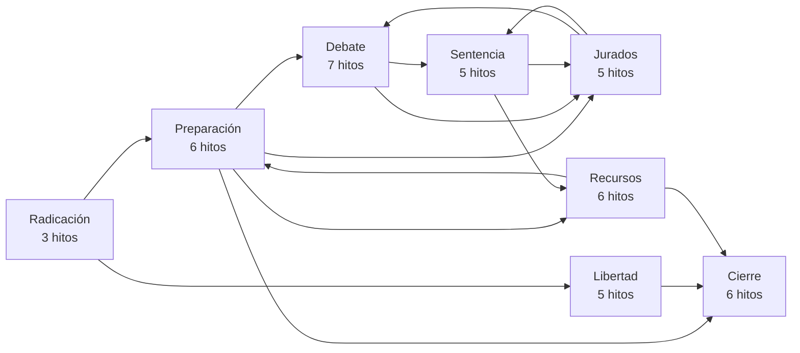
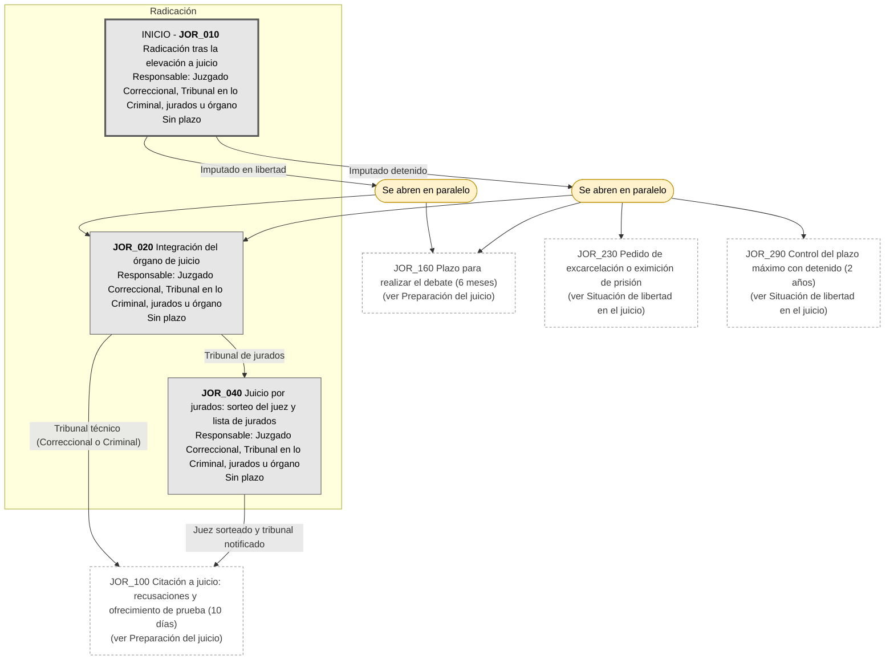
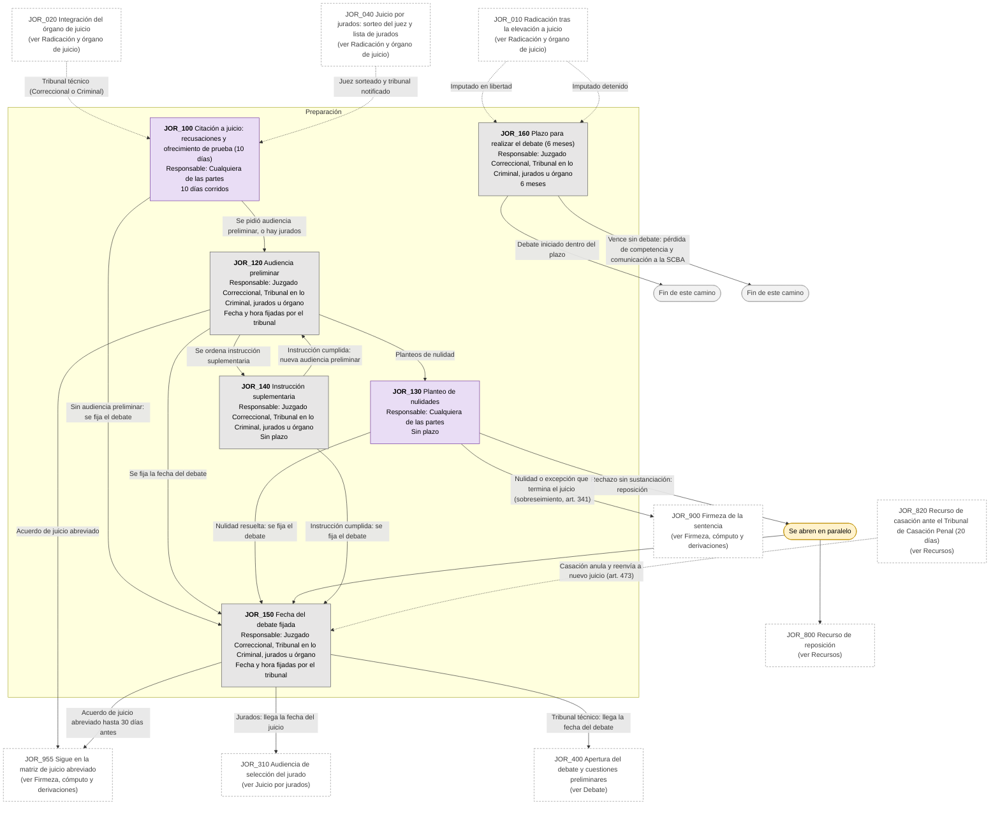
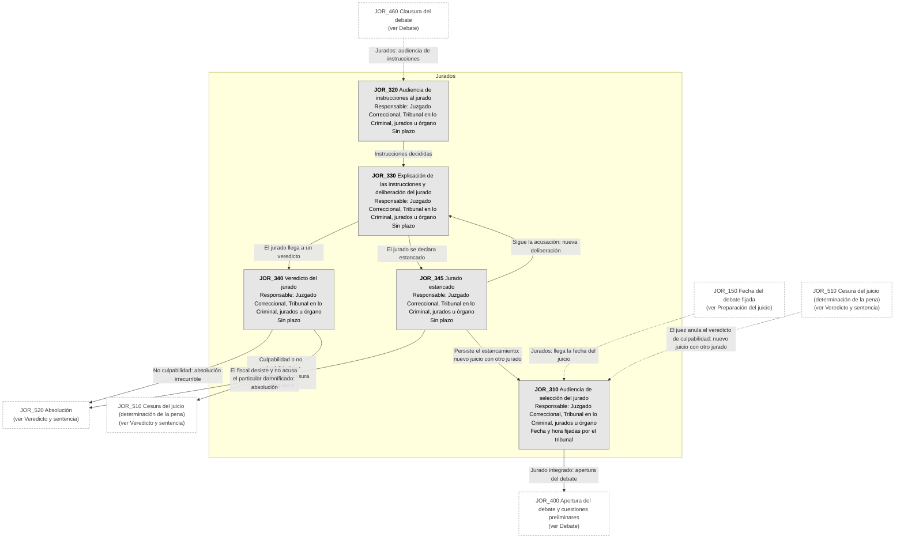
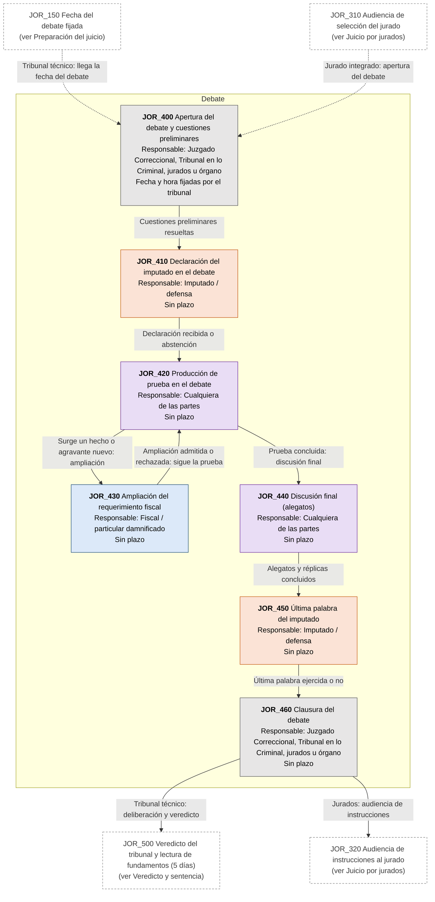
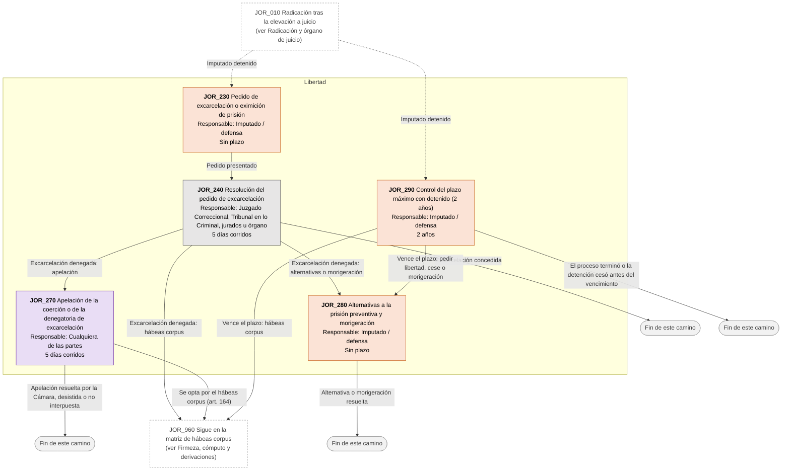
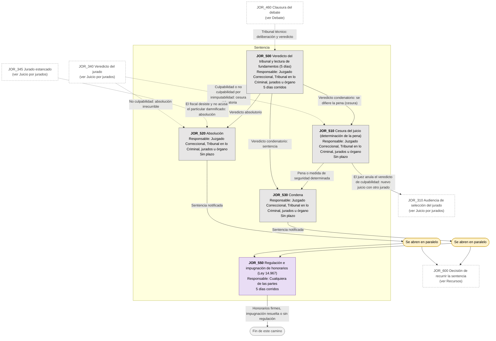
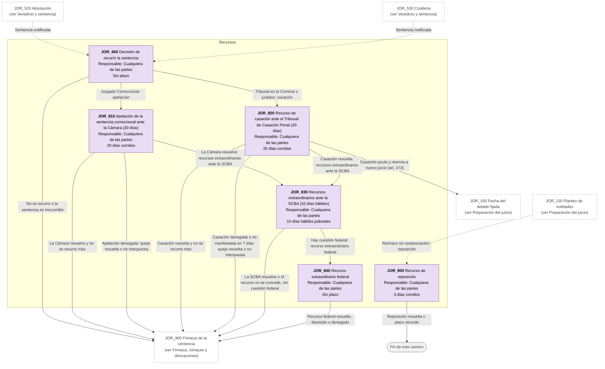

# Diagrama de Flujo: Juicio oral y público (PBA)

**Régimen:** CPP PBA (Ley 11.922 y modificatorias); juicio por jurados (arts. 22 bis, 338 bis a 338 quáter, 371 bis a 371 quáter y 375 bis, Ley 14.543); Ley 14.967 (honorarios); Código Penal · **Versión:** 1 (borrador)

> Este documento se genera a partir de `matriz_penal_juicio_oral_pba.xlsx`. No se edita a mano: las correcciones se hacen en la planilla y luego se vuelve a generar el diagrama.

## Cómo leer los diagramas

* **Cada caja es un hito** de la hoja `Nodos`: muestra el ID, el nombre, quién debe actuar y el plazo.
* **Cada flecha es un camino** de la hoja `Transiciones`, rotulado con su condición de salida.
* **Color de la caja según el responsable:** celeste = acusación: Ministerio Público Fiscal o particular damnificado / víctima constituida en parte (ACTORA); naranja = imputado y defensa (DEMANDADA); gris = Juzgado Correccional, Tribunal en lo Criminal, jurados, Cámara, Casación u otros órganos, aclarado en el nombre del hito (TRIBUNAL); violeta = cualquiera de las partes (AMBAS).
* **Borde grueso:** hito inicial o hito final.
* **"Se abren en paralelo"** (amarillo): esa condición abre varios hitos a la vez; por ejemplo, desde la radicación corren a la vez la preparación del juicio y el plazo de 6 meses para hacer el debate; con imputado detenido, también la excarcelación y el control del plazo máximo con detenido.
* **"Fin de este camino"** (gris claro): el camino paralelo termina sin abrir otro hito.
* **Cajas blancas con borde discontinuo:** hitos de otra etapa; el texto indica en qué diagrama están. Las flechas punteadas muestran desde dónde se llega a esta etapa.
* **Derivación a otra matriz:** caja con borde grueso (hito final) cuyo nombre empieza con "Sigue en la matriz de ...": el expediente continúa en ese otro flujo penal, en un expediente vinculado.
* **Fase "Previa":** hitos anteriores a la intervención judicial formal (consulta, denuncia, designación de defensor, constitución como particular damnificado). La app los separa en el flujo prejudicial; en penal hay duda sobre si eso tiene sentido desde la denuncia.
* **Plazos corridos (art. 139 CPP PBA):** la mayoría de los plazos procesales penales son días continuos (CORRIDOS), no hábiles judiciales. Aplica_Gracia = NO en todos los hitos.
* **Órgano de juicio (arts. 22 y 22 bis):** Juzgado Correccional o Tribunal en lo Criminal (unipersonal si la pena máxima en abstracto no supera 15 años; colegiado para funcionarios o por opción de la defensa en el plazo del art. 336). Jurados si la máxima supera 15 años, salvo renuncia ratificada en ese mismo plazo.
* **Derivación desde la IPP:** el expediente vinculado nace en la radicación tras el auto o decreto firme de elevación; no se copian relatos ni datos sensibles.

## Vista general por fases

## 1. Radicación y órgano de juicio

## 2. Preparación del juicio

## 3. Juicio por jurados

## 4. Debate

## 5. Situación de libertad en el juicio

## 6. Veredicto y sentencia

## 7. Recursos

## 8. Firmeza, cómputo y derivaciones

```mermaid
flowchart TD
  subgraph F_0["Cierre"]
    JOR_900["<b>JOR_900</b> Firmeza de la sentencia<br/>Responsable: Cualquiera de las partes<br/>Sin plazo"]:::ambas
    JOR_910["<b>JOR_910</b> Cómputo de la pena<br/>Responsable: Juzgado Correccional, Tribunal en lo Criminal, jurados u órgano<br/>Sin plazo"]:::tribunal
    JOR_955["<b>JOR_955</b> Sigue en la matriz de juicio abreviado<br/>Responsable: Cualquiera de las partes<br/>Sin plazo"]:::ambas
    JOR_960["<b>JOR_960</b> Sigue en la matriz de hábeas corpus<br/>Responsable: Imputado / defensa<br/>Sin plazo"]:::demandada
    JOR_970["<b>JOR_970</b> Sigue en ejecución penal<br/>Responsable: Cualquiera de las partes<br/>Sin plazo"]:::ambas
    JOR_980["<b>JOR_980</b> Absolución o sobreseimiento firme<br/>Responsable: Cualquiera de las partes<br/>Sin plazo"]:::ambas
  end
  EXT_JOR_120_origen["JOR_120 Audiencia preliminar<br/>(ver Preparación del juicio)"]:::externo
  EXT_JOR_120_origen -.->|"Acuerdo de juicio abreviado"| JOR_955
  EXT_JOR_130_origen["JOR_130 Planteo de nulidades<br/>(ver Preparación del juicio)"]:::externo
  EXT_JOR_130_origen -.->|"Nulidad o excepción que termina el juicio (sobreseimiento, art. 341)"| JOR_900
  EXT_JOR_150_origen["JOR_150 Fecha del debate fijada<br/>(ver Preparación del juicio)"]:::externo
  EXT_JOR_150_origen -.->|"Acuerdo de juicio abreviado hasta 30 días antes"| JOR_955
  EXT_JOR_240_origen["JOR_240 Resolución del pedido de excarcelación<br/>(ver Situación de libertad en el juicio)"]:::externo
  EXT_JOR_240_origen -.->|"Excarcelación denegada: hábeas corpus"| JOR_960
  EXT_JOR_270_origen["JOR_270 Apelación de la coerción o de la denegatoria de excarcelación<br/>(ver Situación de libertad en el juicio)"]:::externo
  EXT_JOR_270_origen -.->|"Se opta por el hábeas corpus (art. 164)"| JOR_960
  EXT_JOR_290_origen["JOR_290 Control del plazo máximo con detenido (2 años)<br/>(ver Situación de libertad en el juicio)"]:::externo
  EXT_JOR_290_origen -.->|"Vence el plazo: hábeas corpus"| JOR_960
  EXT_JOR_600_origen["JOR_600 Decisión de recurrir la sentencia<br/>(ver Recursos)"]:::externo
  EXT_JOR_600_origen -.->|"No se recurre o la sentencia es irrecurrible"| JOR_900
  EXT_JOR_810_origen["JOR_810 Apelación de la sentencia correccional ante la Cámara (20 días)<br/>(ver Recursos)"]:::externo
  EXT_JOR_810_origen -.->|"La Cámara resuelve y no se recurre más"| JOR_900
  EXT_JOR_810_origen -.->|"Apelación denegada: queja resuelta o no interpuesta"| JOR_900
  EXT_JOR_820_origen["JOR_820 Recurso de casación ante el Tribunal de Casación Penal (20 días)<br/>(ver Recursos)"]:::externo
  EXT_JOR_820_origen -.->|"Casación resuelta y no se recurre más"| JOR_900
  EXT_JOR_820_origen -.->|"Casación denegada o no manifestada en 7 días: queja resuelta o no interpuesta"| JOR_900
  EXT_JOR_830_origen["JOR_830 Recursos extraordinarios ante la SCBA (10 días hábiles)<br/>(ver Recursos)"]:::externo
  EXT_JOR_830_origen -.->|"La SCBA resuelve o el recurso no se concede, sin cuestión federal"| JOR_900
  EXT_JOR_840_origen["JOR_840 Recurso extraordinario federal<br/>(ver Recursos)"]:::externo
  EXT_JOR_840_origen -.->|"Recurso federal resuelto, desistido o denegado"| JOR_900
  JOR_900 -->|"Absolución o sobreseimiento firme"| JOR_980
  JOR_900 -->|"Condena firme: cómputo"| JOR_910
  JOR_910 -->|"Cómputo practicado"| JOR_970
  style JOR_955 stroke-width:3px
  style JOR_960 stroke-width:3px
  style JOR_970 stroke-width:3px
  style JOR_980 stroke-width:3px
  classDef actora fill:#DCE9F9,stroke:#1F4E79,color:#000
  classDef demandada fill:#FBE3D6,stroke:#C55A11,color:#000
  classDef tribunal fill:#E7E6E6,stroke:#595959,color:#000
  classDef ambas fill:#E9DDF5,stroke:#7030A0,color:#000
  classDef externo fill:#FFFFFF,stroke:#8C8C8C,color:#404040,stroke-dasharray:4 3
  classDef paralelo fill:#FFF2CC,stroke:#BF9000,color:#000
  classDef fin fill:#F2F2F2,stroke:#A6A6A6,color:#404040
```

