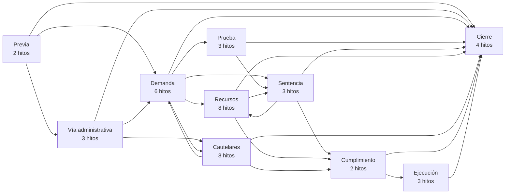
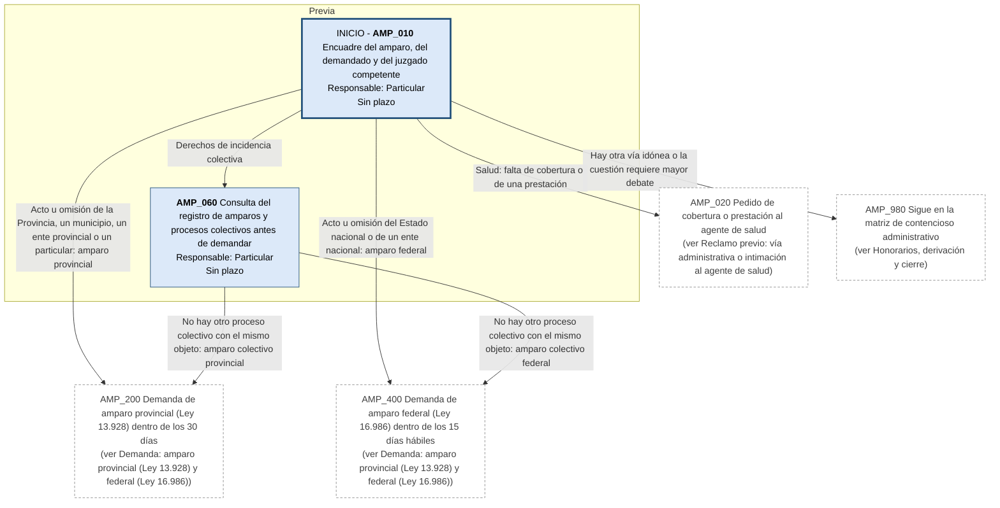
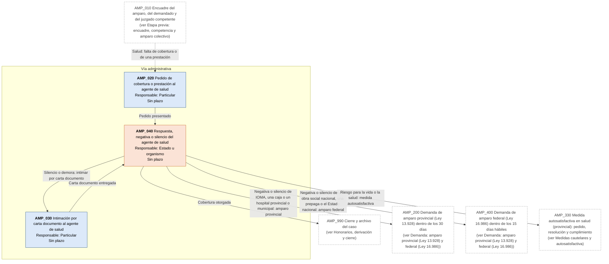
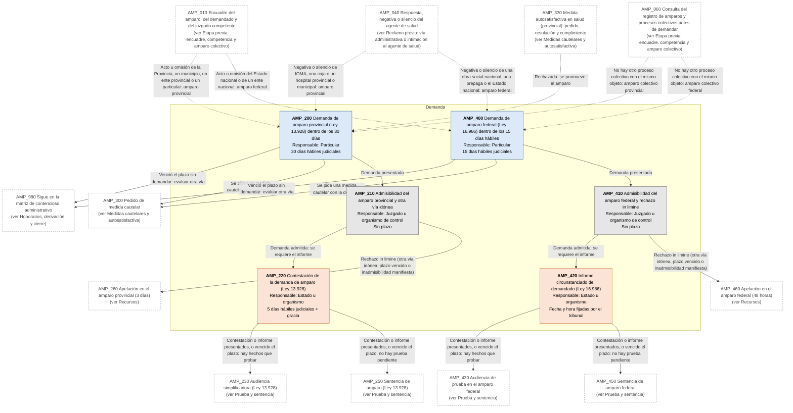
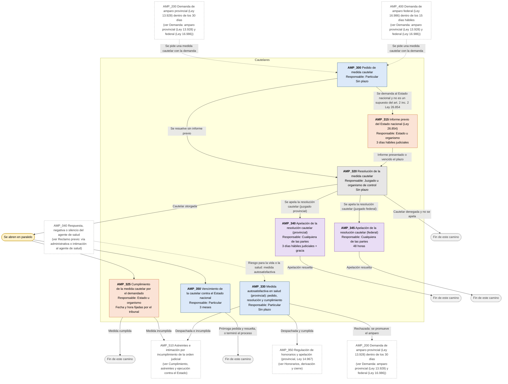
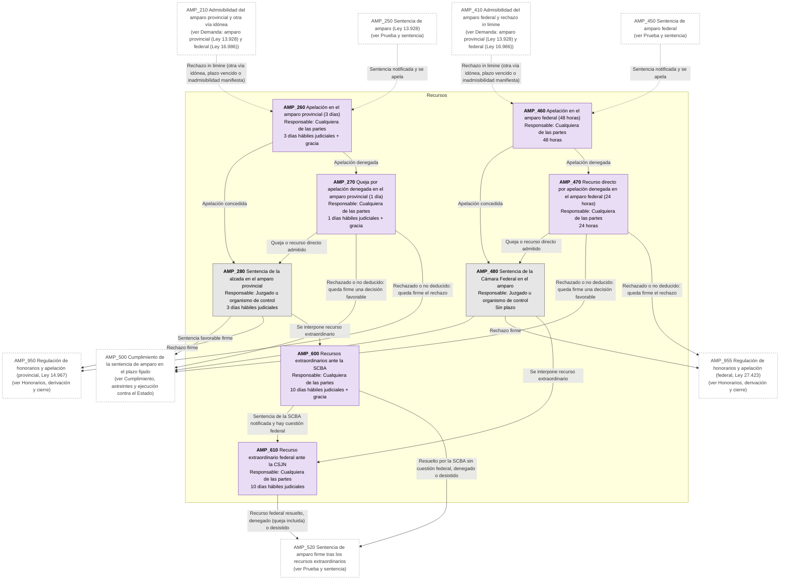
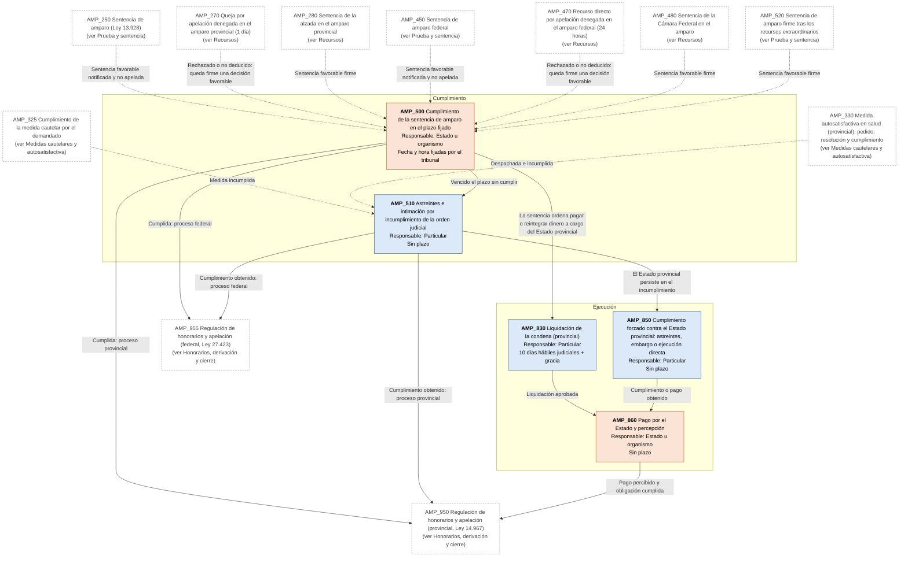

# Diagrama de Flujo: Amparo (PBA, con variante federal)

**Régimen:** Ley 13.928 (texto Leyes 14.192 y 15.016) con el CPCCBA supletorio (art. 25); variante federal: art. 43 Constitución Nacional, Ley 16.986 y CPCCN; cautelares contra el Estado nacional: Ley 26.854 · **Versión:** 1 (borrador)

> Este documento se genera a partir de `matriz_publico_amparo_pba.xlsx`. No se edita a mano: las correcciones se hacen en la planilla y luego se vuelve a generar el diagrama.

## Cómo leer los diagramas

* **Cada caja es un hito** de la hoja `Nodos`: muestra el ID, el nombre, quién debe actuar y el plazo.
* **Cada flecha es un camino** de la hoja `Transiciones`, rotulado con su condición de salida.
* **Color de la caja según el responsable:** celeste = el particular que reclama (ACTORA); naranja = el Estado o el organismo demandado, también cuando resuelve en la vía administrativa (DEMANDADA); gris = juzgado, tribunal u organismo de control que no es parte, como la AAIP o el Tribunal Fiscal de Apelación (TRIBUNAL); violeta = cualquiera de las partes (AMBAS).
* **Borde grueso:** hito inicial o hito final.
* **"Se abren en paralelo"** (amarillo): esa condición abre varios hitos a la vez; por ejemplo, la cautelar otorgada abre a la vez el control de su cumplimiento y, contra el Estado nacional, el de su vigencia.
* **"Fin de este camino"** (gris claro): el camino paralelo termina sin abrir otro hito.
* **Cajas blancas con borde discontinuo:** hitos de otra etapa; el texto indica en qué diagrama están. Las flechas punteadas muestran desde dónde se llega a esta etapa.
* **Derivación a otra matriz:** caja con borde grueso (hito final) cuyo nombre empieza con "Sigue en la matriz de ...": el caso continúa en otra matriz de Derecho Público, en un expediente vinculado.
* **Provincial o federal:** cuando un flujo tiene las dos variantes, el nombre del hito lo dice ("provincial" o "federal") o nombra la ley que lo rige (por ejemplo, "Ley 13.928" o "Ley 16.986").
* **Vía administrativa:** sus hitos están en un diagrama aparte de los judiciales. La Administración que resuelve aparece en naranja, como parte demandada, y sus plazos son días hábiles administrativos.
* **Competencia según el demandado:** los caminos provincial (hitos AMP_200 a AMP_280) y federal (hitos AMP_400 a AMP_480) comparten fases; el nombre del hito dice cuál es.

## Vista general por fases

## 1. Etapa previa: encuadre, competencia y amparo colectivo

## 2. Reclamo previo: vía administrativa o intimación al agente de salud

## 3. Demanda: amparo provincial (Ley 13.928) y federal (Ley 16.986)

## 4. Medidas cautelares y autosatisfactiva

## 5. Prueba y sentencia

```mermaid
flowchart TD
  subgraph F_0["Prueba"]
    AMP_230["<b>AMP_230</b> Audiencia simplificadora (Ley 13.928)<br/>Responsable: Cualquiera de las partes<br/>Fecha y hora fijadas por el tribunal"]:::ambas
    AMP_240["<b>AMP_240</b> Producción de la prueba (Ley 13.928)<br/>Responsable: Cualquiera de las partes<br/>5 días hábiles judiciales"]:::ambas
    AMP_430["<b>AMP_430</b> Audiencia de prueba en el amparo federal<br/>Responsable: Cualquiera de las partes<br/>Fecha y hora fijadas por el tribunal"]:::ambas
  end
  subgraph F_1["Sentencia"]
    AMP_250["<b>AMP_250</b> Sentencia de amparo (Ley 13.928)<br/>Responsable: Juzgado u organismo de control<br/>5 días hábiles judiciales"]:::tribunal
    AMP_450["<b>AMP_450</b> Sentencia de amparo federal<br/>Responsable: Juzgado u organismo de control<br/>48 horas"]:::tribunal
    AMP_520["<b>AMP_520</b> Sentencia de amparo firme tras los recursos extraordinarios<br/>Responsable: Juzgado u organismo de control<br/>Sin plazo"]:::tribunal
  end
  EXT_AMP_220_origen["AMP_220 Contestación de la demanda de amparo (Ley 13.928)<br/>(ver Demanda: amparo provincial (Ley 13.928) y federal (Ley 16.986))"]:::externo
  EXT_AMP_220_origen -.->|"Contestación o informe presentados, o vencido el plazo: hay hechos que probar"| AMP_230
  EXT_AMP_220_origen -.->|"Contestación o informe presentados, o vencido el plazo: no hay prueba pendiente"| AMP_250
  AMP_230 -->|"Audiencia celebrada: se abre a prueba"| AMP_240
  AMP_230 -->|"Audiencia celebrada sin prueba que producir"| AMP_250
  EXT_AMP_950_destino["AMP_950 Regulación de honorarios y apelación (provincial, Ley 14.967)<br/>(ver Honorarios, derivación y cierre)"]:::externo
  AMP_230 -->|"La actora no comparece: se la tiene por desistida"| EXT_AMP_950_destino
  AMP_240 -->|"Prueba producida o vencido el plazo"| AMP_250
  EXT_AMP_260_destino["AMP_260 Apelación en el amparo provincial (3 días)<br/>(ver Recursos)"]:::externo
  AMP_250 -->|"Sentencia notificada y se apela"| EXT_AMP_260_destino
  EXT_AMP_500_destino["AMP_500 Cumplimiento de la sentencia de amparo en el plazo fijado<br/>(ver Cumplimiento, astreintes y ejecución contra el Estado)"]:::externo
  AMP_250 -->|"Sentencia favorable notificada y no apelada"| EXT_AMP_500_destino
  AMP_250 -->|"Sentencia de rechazo notificada y no apelada"| EXT_AMP_950_destino
  EXT_AMP_420_origen["AMP_420 Informe circunstanciado del demandado (Ley 16.986)<br/>(ver Demanda: amparo provincial (Ley 13.928) y federal (Ley 16.986))"]:::externo
  EXT_AMP_420_origen -.->|"Contestación o informe presentados, o vencido el plazo: hay hechos que probar"| AMP_430
  EXT_AMP_420_origen -.->|"Contestación o informe presentados, o vencido el plazo: no hay prueba pendiente"| AMP_450
  AMP_430 -->|"Audiencia de prueba realizada"| AMP_450
  EXT_AMP_955_destino["AMP_955 Regulación de honorarios y apelación (federal, Ley 27.423)<br/>(ver Honorarios, derivación y cierre)"]:::externo
  AMP_430 -->|"La actora no comparece: se la tiene por desistida"| EXT_AMP_955_destino
  EXT_AMP_460_destino["AMP_460 Apelación en el amparo federal (48 horas)<br/>(ver Recursos)"]:::externo
  AMP_450 -->|"Sentencia notificada y se apela"| EXT_AMP_460_destino
  AMP_450 -->|"Sentencia favorable notificada y no apelada"| EXT_AMP_500_destino
  AMP_450 -->|"Sentencia de rechazo notificada y no apelada"| EXT_AMP_955_destino
  AMP_520 -->|"Sentencia favorable firme"| EXT_AMP_500_destino
  AMP_520 -->|"Rechazo firme: proceso provincial"| EXT_AMP_950_destino
  AMP_520 -->|"Rechazo firme: proceso federal"| EXT_AMP_955_destino
  EXT_AMP_600_origen["AMP_600 Recursos extraordinarios ante la SCBA<br/>(ver Recursos)"]:::externo
  EXT_AMP_600_origen -.->|"Resuelto por la SCBA sin cuestión federal, denegado o desistido"| AMP_520
  EXT_AMP_610_origen["AMP_610 Recurso extraordinario federal ante la CSJN<br/>(ver Recursos)"]:::externo
  EXT_AMP_610_origen -.->|"Recurso federal resuelto, denegado (queja incluida) o desistido"| AMP_520
  classDef actora fill:#DCE9F9,stroke:#1F4E79,color:#000
  classDef demandada fill:#FBE3D6,stroke:#C55A11,color:#000
  classDef tribunal fill:#E7E6E6,stroke:#595959,color:#000
  classDef ambas fill:#E9DDF5,stroke:#7030A0,color:#000
  classDef externo fill:#FFFFFF,stroke:#8C8C8C,color:#404040,stroke-dasharray:4 3
  classDef paralelo fill:#FFF2CC,stroke:#BF9000,color:#000
  classDef fin fill:#F2F2F2,stroke:#A6A6A6,color:#404040
```

## 6. Recursos

## 7. Cumplimiento, astreintes y ejecución contra el Estado

## 8. Honorarios, derivación y cierre

```mermaid
flowchart TD
  subgraph F_0["Cierre"]
    AMP_950["<b>AMP_950</b> Regulación de honorarios y apelación (provincial, Ley 14.967)<br/>Responsable: Cualquiera de las partes<br/>5 días hábiles judiciales + gracia"]:::ambas
    AMP_955["<b>AMP_955</b> Regulación de honorarios y apelación (federal, Ley 27.423)<br/>Responsable: Cualquiera de las partes<br/>5 días hábiles judiciales"]:::ambas
    AMP_980["<b>AMP_980</b> Sigue en la matriz de contencioso administrativo<br/>Responsable: Particular<br/>Sin plazo"]:::actora
    AMP_990["<b>AMP_990</b> Cierre y archivo del caso<br/>Responsable: Cualquiera de las partes<br/>Sin plazo"]:::ambas
  end
  EXT_AMP_010_origen["AMP_010 Encuadre del amparo, del demandado y del juzgado competente<br/>(ver Etapa previa: encuadre, competencia y amparo colectivo)"]:::externo
  EXT_AMP_010_origen -.->|"Hay otra vía idónea o la cuestión requiere mayor debate"| AMP_980
  EXT_AMP_040_origen["AMP_040 Respuesta, negativa o silencio del agente de salud<br/>(ver Reclamo previo: vía administrativa o intimación al agente de salud)"]:::externo
  EXT_AMP_040_origen -.->|"Cobertura otorgada"| AMP_990
  EXT_AMP_200_origen["AMP_200 Demanda de amparo provincial (Ley 13.928) dentro de los 30 días<br/>(ver Demanda: amparo provincial (Ley 13.928) y federal (Ley 16.986))"]:::externo
  EXT_AMP_200_origen -.->|"Venció el plazo sin demandar: evaluar otra vía"| AMP_980
  EXT_AMP_230_origen["AMP_230 Audiencia simplificadora (Ley 13.928)<br/>(ver Prueba y sentencia)"]:::externo
  EXT_AMP_230_origen -.->|"La actora no comparece: se la tiene por desistida"| AMP_950
  EXT_AMP_250_origen["AMP_250 Sentencia de amparo (Ley 13.928)<br/>(ver Prueba y sentencia)"]:::externo
  EXT_AMP_250_origen -.->|"Sentencia de rechazo notificada y no apelada"| AMP_950
  EXT_AMP_270_origen["AMP_270 Queja por apelación denegada en el amparo provincial (1 día)<br/>(ver Recursos)"]:::externo
  EXT_AMP_270_origen -.->|"Rechazado o no deducido: queda firme el rechazo"| AMP_950
  EXT_AMP_280_origen["AMP_280 Sentencia de la alzada en el amparo provincial<br/>(ver Recursos)"]:::externo
  EXT_AMP_280_origen -.->|"Rechazo firme"| AMP_950
  EXT_AMP_330_origen["AMP_330 Medida autosatisfactiva en salud (provincial): pedido, resolución y cumplimiento<br/>(ver Medidas cautelares y autosatisfactiva)"]:::externo
  EXT_AMP_330_origen -.->|"Despachada y cumplida"| AMP_950
  EXT_AMP_400_origen["AMP_400 Demanda de amparo federal (Ley 16.986) dentro de los 15 días hábiles<br/>(ver Demanda: amparo provincial (Ley 13.928) y federal (Ley 16.986))"]:::externo
  EXT_AMP_400_origen -.->|"Venció el plazo sin demandar: evaluar otra vía"| AMP_980
  EXT_AMP_430_origen["AMP_430 Audiencia de prueba en el amparo federal<br/>(ver Prueba y sentencia)"]:::externo
  EXT_AMP_430_origen -.->|"La actora no comparece: se la tiene por desistida"| AMP_955
  EXT_AMP_450_origen["AMP_450 Sentencia de amparo federal<br/>(ver Prueba y sentencia)"]:::externo
  EXT_AMP_450_origen -.->|"Sentencia de rechazo notificada y no apelada"| AMP_955
  EXT_AMP_470_origen["AMP_470 Recurso directo por apelación denegada en el amparo federal (24 horas)<br/>(ver Recursos)"]:::externo
  EXT_AMP_470_origen -.->|"Rechazado o no deducido: queda firme el rechazo"| AMP_955
  EXT_AMP_480_origen["AMP_480 Sentencia de la Cámara Federal en el amparo<br/>(ver Recursos)"]:::externo
  EXT_AMP_480_origen -.->|"Rechazo firme"| AMP_955
  EXT_AMP_500_origen["AMP_500 Cumplimiento de la sentencia de amparo en el plazo fijado<br/>(ver Cumplimiento, astreintes y ejecución contra el Estado)"]:::externo
  EXT_AMP_500_origen -.->|"Cumplida: proceso provincial"| AMP_950
  EXT_AMP_500_origen -.->|"Cumplida: proceso federal"| AMP_955
  EXT_AMP_510_origen["AMP_510 Astreintes e intimación por incumplimiento de la orden judicial<br/>(ver Cumplimiento, astreintes y ejecución contra el Estado)"]:::externo
  EXT_AMP_510_origen -.->|"Cumplimiento obtenido: proceso provincial"| AMP_950
  EXT_AMP_510_origen -.->|"Cumplimiento obtenido: proceso federal"| AMP_955
  EXT_AMP_520_origen["AMP_520 Sentencia de amparo firme tras los recursos extraordinarios<br/>(ver Prueba y sentencia)"]:::externo
  EXT_AMP_520_origen -.->|"Rechazo firme: proceso provincial"| AMP_950
  EXT_AMP_520_origen -.->|"Rechazo firme: proceso federal"| AMP_955
  EXT_AMP_860_origen["AMP_860 Pago por el Estado y percepción<br/>(ver Cumplimiento, astreintes y ejecución contra el Estado)"]:::externo
  EXT_AMP_860_origen -.->|"Pago percibido y obligación cumplida"| AMP_950
  AMP_950 -->|"Regulación firme y aportes acreditados"| AMP_990
  AMP_955 -->|"Regulación firme y aportes acreditados"| AMP_990
  style AMP_980 stroke-width:3px
  style AMP_990 stroke-width:3px
  classDef actora fill:#DCE9F9,stroke:#1F4E79,color:#000
  classDef demandada fill:#FBE3D6,stroke:#C55A11,color:#000
  classDef tribunal fill:#E7E6E6,stroke:#595959,color:#000
  classDef ambas fill:#E9DDF5,stroke:#7030A0,color:#000
  classDef externo fill:#FFFFFF,stroke:#8C8C8C,color:#404040,stroke-dasharray:4 3
  classDef paralelo fill:#FFF2CC,stroke:#BF9000,color:#000
  classDef fin fill:#F2F2F2,stroke:#A6A6A6,color:#404040
```

