# Diagrama de Flujo: Contencioso administrativo (PBA)

**Régimen:** Ley 12.008 (Código Contencioso Administrativo) con el CPCCBA supletorio (art. 77); vía administrativa: Decreto-Ley 7647/70 (Provincia) y Ordenanza General 267/80 (municipios) · **Versión:** 1 (borrador)

> Este documento se genera a partir de `matriz_publico_contencioso_pba.xlsx`. No se edita a mano: las correcciones se hacen en la planilla y luego se vuelve a generar el diagrama.

## Cómo leer los diagramas

* **Cada caja es un hito** de la hoja `Nodos`: muestra el ID, el nombre, quién debe actuar y el plazo.
* **Cada flecha es un camino** de la hoja `Transiciones`, rotulado con su condición de salida.
* **Color de la caja según el responsable:** celeste = el particular que reclama (ACTORA); naranja = el Estado o el organismo demandado, también cuando resuelve en la vía administrativa (DEMANDADA); gris = juzgado, tribunal u organismo de control que no es parte, como la AAIP o el Tribunal Fiscal de Apelación (TRIBUNAL); violeta = cualquiera de las partes (AMBAS).
* **Borde grueso:** hito inicial o hito final.
* **"Se abren en paralelo"** (amarillo): esa condición abre varios hitos a la vez; por ejemplo, la notificación del acto que agota la vía abre a la vez el control de la caducidad de 90 días y la preparación de la demanda.
* **"Fin de este camino"** (gris claro): el camino paralelo termina sin abrir otro hito.
* **Cajas blancas con borde discontinuo:** hitos de otra etapa; el texto indica en qué diagrama están. Las flechas punteadas muestran desde dónde se llega a esta etapa.
* **Derivación a otra matriz:** caja con borde grueso (hito final) cuyo nombre empieza con "Sigue en la matriz de ...": el caso continúa en otra matriz de Derecho Público, en un expediente vinculado.
* **Provincial o federal:** cuando un flujo tiene las dos variantes, el nombre del hito lo dice ("provincial" o "federal") o nombra la ley que lo rige (por ejemplo, "Ley 13.928" o "Ley 16.986").
* **Vía administrativa:** sus hitos están en un diagrama aparte de los judiciales. La Administración que resuelve aparece en naranja, como parte demandada, y sus plazos son días hábiles administrativos.
* **Calendario administrativo:** en la vía administrativa provincial rige el Decreto-Ley 7647/70 y en la municipal la Ordenanza General 267/80; el checklist de cada hito dice cuál aplica.
* **Estado nacional:** no tiene camino propio en esta matriz. La salida "Estado nacional demandado: fuera de esta matriz" remite al cuadro de equivalencias de publico/README.md.

## Vista general por fases

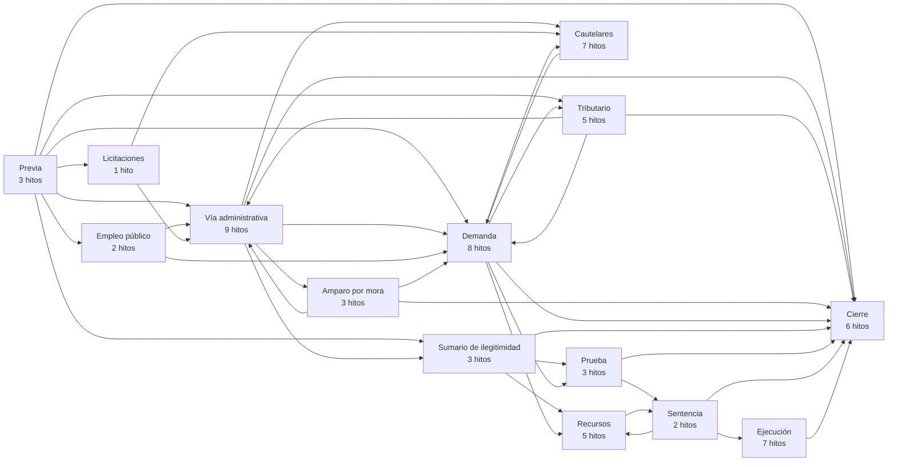

## 1. Etapa previa y encuadre

```mermaid
flowchart TD
  subgraph F_0["Previa"]
    CAD_010["INICIO - <b>CAD_010</b> Encuadre de la pretensión y del demandado<br/>Responsable: Particular<br/>Sin plazo"]:::actora
    CAD_030["<b>CAD_030</b> Vista de las actuaciones administrativas<br/>Responsable: Particular<br/>Sin plazo"]:::actora
    CAD_040["<b>CAD_040</b> Control de la prescripción de la acción de responsabilidad del Estado<br/>Responsable: Particular<br/>3 años"]:::actora
  end
  EXT_CAD_150_destino["CAD_150 Recurso de revocatoria<br/>(ver Vía administrativa (Decreto-Ley 7647/70 u Ordenanza General 267/80))"]:::externo
  CAD_010 -->|"Acto que no agota la vía: recurso de revocatoria"| EXT_CAD_150_destino
  EXT_CAD_170_destino["CAD_170 Recurso jerárquico<br/>(ver Vía administrativa (Decreto-Ley 7647/70 u Ordenanza General 267/80))"]:::externo
  CAD_010 -->|"Acto de un órgano inferior: recurso jerárquico"| EXT_CAD_170_destino
  EXT_CAD_100_destino["CAD_100 Reclamo o petición ante la Administración provincial o municipal<br/>(ver Vía administrativa (Decreto-Ley 7647/70 u Ordenanza General 267/80))"]:::externo
  CAD_010 -->|"No hay acto: reclamo o petición a la Administración"| EXT_CAD_100_destino
  EXT_CAD_210_destino["CAD_210 Reclamo del agente público ante la repartición (Ley 10.430 o Ley 14.656)<br/>(ver Variantes administrativas: empleo público, tributario y licitaciones)"]:::externo
  CAD_010 -->|"Empleo público: reclamo del agente"| EXT_CAD_210_destino
  EXT_CAD_220_destino["CAD_220 Demanda de impugnación de una sanción disciplinaria (arts. 71 a 73 Ley 12.008)<br/>(ver Variantes administrativas: empleo público, tributario y licitaciones)"]:::externo
  CAD_010 -->|"Empleo público: sanción disciplinaria que agota la vía"| EXT_CAD_220_destino
  EXT_CAD_240_destino["CAD_240 Descargo ante la vista de la determinación (ARBA o municipio)<br/>(ver Variantes administrativas: empleo público, tributario y licitaciones)"]:::externo
  CAD_010 -->|"Tributario: vista de una determinación de ARBA o de una tasa municipal"| EXT_CAD_240_destino
  EXT_CAD_285_destino["CAD_285 Reclamo de repetición de un tributo pagado indebidamente<br/>(ver Variantes administrativas: empleo público, tributario y licitaciones)"]:::externo
  CAD_010 -->|"Tributario: repetición de un pago indebido"| EXT_CAD_285_destino
  EXT_CAD_290_destino["CAD_290 Impugnación del dictamen de preadjudicación<br/>(ver Variantes administrativas: empleo público, tributario y licitaciones)"]:::externo
  CAD_010 -->|"Licitación: impugnación de la preadjudicación"| EXT_CAD_290_destino
  P_CAD_010_9(["Se abren en paralelo"]):::paralelo
  CAD_010 -->|"Responsabilidad del Estado: reclamo y control de la prescripción"| P_CAD_010_9
  P_CAD_010_9 --> CAD_040
  P_CAD_010_9 --> EXT_CAD_100_destino
  P_CAD_010_10(["Se abren en paralelo"]):::paralelo
  CAD_010 -->|"El acto ya agota la vía, hay excepción al agotamiento (art. 14) o vía de hecho (art. 21)"| P_CAD_010_10
  EXT_CAD_400_destino["CAD_400 Control del plazo de caducidad para demandar (90 días)<br/>(ver Demanda y contestación)"]:::externo
  P_CAD_010_10 --> EXT_CAD_400_destino
  EXT_CAD_410_destino["CAD_410 Demanda contencioso administrativa<br/>(ver Demanda y contestación)"]:::externo
  P_CAD_010_10 --> EXT_CAD_410_destino
  EXT_CAD_405_destino["CAD_405 Demanda por el proceso sumario de ilegitimidad<br/>(ver Proceso sumario de ilegitimidad)"]:::externo
  CAD_010 -->|"El acto agota la vía y se opta por el proceso sumario de ilegitimidad"| EXT_CAD_405_destino
  CAD_010 -->|"Hace falta conocer las actuaciones: pedir vista"| CAD_030
  EXT_CAD_980_destino["CAD_980 Sigue en la matriz de amparo<br/>(ver Acuerdo, honorarios y cierre)"]:::externo
  CAD_010 -->|"Urgencia que hace del amparo la vía idónea"| EXT_CAD_980_destino
  EXT_CAD_985_destino["CAD_985 Estado nacional demandado: fuera de esta matriz<br/>(ver Acuerdo, honorarios y cierre)"]:::externo
  CAD_010 -->|"El demandado es el Estado nacional"| EXT_CAD_985_destino
  FIN_CAD_030_1(["Fin de este camino"]):::fin
  CAD_030 -->|"Vista tomada: definir la vía"| FIN_CAD_030_1
  FIN_CAD_040_1(["Fin de este camino"]):::fin
  CAD_040 -->|"Reclamo o demanda presentados antes del vencimiento"| FIN_CAD_040_1
  EXT_CAD_990_destino["CAD_990 Cierre y archivo del caso<br/>(ver Acuerdo, honorarios y cierre)"]:::externo
  CAD_040 -->|"Venció la prescripción sin reclamar"| EXT_CAD_990_destino
  style CAD_010 stroke-width:3px
  classDef actora fill:#DCE9F9,stroke:#1F4E79,color:#000
  classDef demandada fill:#FBE3D6,stroke:#C55A11,color:#000
  classDef tribunal fill:#E7E6E6,stroke:#595959,color:#000
  classDef ambas fill:#E9DDF5,stroke:#7030A0,color:#000
  classDef externo fill:#FFFFFF,stroke:#8C8C8C,color:#404040,stroke-dasharray:4 3
  classDef paralelo fill:#FFF2CC,stroke:#BF9000,color:#000
  classDef fin fill:#F2F2F2,stroke:#A6A6A6,color:#404040
```

## 2. Vía administrativa (Decreto-Ley 7647/70 u Ordenanza General 267/80)

```mermaid
flowchart TD
  subgraph F_0["Vía administrativa"]
    CAD_100["<b>CAD_100</b> Reclamo o petición ante la Administración provincial o municipal<br/>Responsable: Particular<br/>Sin plazo"]:::actora
    CAD_110["<b>CAD_110</b> La Administración resuelve el reclamo o la petición<br/>Responsable: Estado u organismo<br/>30 días hábiles administrativos"]:::demandada
    CAD_120["<b>CAD_120</b> Pedido de pronto despacho<br/>Responsable: Particular<br/>Sin plazo"]:::actora
    CAD_130["<b>CAD_130</b> Silencio: la Administración no resuelve tras el pronto despacho<br/>Responsable: Estado u organismo<br/>30 días hábiles administrativos"]:::demandada
    CAD_150["<b>CAD_150</b> Recurso de revocatoria<br/>Responsable: Particular<br/>10 días hábiles administrativos"]:::actora
    CAD_160["<b>CAD_160</b> La Administración resuelve la revocatoria<br/>Responsable: Estado u organismo<br/>5 días hábiles administrativos"]:::demandada
    CAD_170["<b>CAD_170</b> Recurso jerárquico<br/>Responsable: Particular<br/>10 días hábiles administrativos"]:::actora
    CAD_190["<b>CAD_190</b> Resolución del jerárquico (ministro, Poder Ejecutivo o intendente)<br/>Responsable: Estado u organismo<br/>10 días hábiles administrativos"]:::demandada
    CAD_195["<b>CAD_195</b> Notificación del acto que agota la vía administrativa<br/>Responsable: Estado u organismo<br/>Sin plazo"]:::demandada
  end
  EXT_CAD_010_origen["CAD_010 Encuadre de la pretensión y del demandado<br/>(ver Etapa previa y encuadre)"]:::externo
  EXT_CAD_010_origen -.->|"Acto que no agota la vía: recurso de revocatoria"| CAD_150
  EXT_CAD_010_origen -.->|"Acto de un órgano inferior: recurso jerárquico"| CAD_170
  EXT_CAD_010_origen -.->|"No hay acto: reclamo o petición a la Administración"| CAD_100
  EXT_CAD_010_origen -.->|"Responsabilidad del Estado: reclamo y control de la prescripción"| CAD_100
  CAD_100 -->|"Reclamo presentado"| CAD_110
  CAD_110 -->|"Resuelve en contra con un acto que no agota la vía"| CAD_150
  CAD_110 -->|"Resuelve en contra con un acto que agota la vía"| CAD_195
  EXT_CAD_990_destino["CAD_990 Cierre y archivo del caso<br/>(ver Acuerdo, honorarios y cierre)"]:::externo
  CAD_110 -->|"Resuelve a favor"| EXT_CAD_990_destino
  CAD_110 -->|"Vence sin resolver: pronto despacho"| CAD_120
  EXT_CAD_300_destino["CAD_300 Demanda de amparo por mora de la Administración<br/>(ver Amparo por mora (art. 76 Ley 12.008))"]:::externo
  CAD_110 -->|"Vence sin resolver: amparo por mora"| EXT_CAD_300_destino
  CAD_120 -->|"Pronto despacho presentado"| CAD_130
  P_CAD_130_1(["Se abren en paralelo"]):::paralelo
  CAD_130 -->|"Vence sin resolver: denegatoria presunta"| P_CAD_130_1
  EXT_CAD_400_destino["CAD_400 Control del plazo de caducidad para demandar (90 días)<br/>(ver Demanda y contestación)"]:::externo
  P_CAD_130_1 --> EXT_CAD_400_destino
  EXT_CAD_410_destino["CAD_410 Demanda contencioso administrativa<br/>(ver Demanda y contestación)"]:::externo
  P_CAD_130_1 --> EXT_CAD_410_destino
  CAD_130 -->|"Resuelve en contra con un acto que no agota la vía"| CAD_150
  CAD_130 -->|"Resuelve en contra con un acto que agota la vía"| CAD_195
  CAD_130 -->|"Resuelve a favor"| EXT_CAD_990_destino
  CAD_150 -->|"Revocatoria presentada"| CAD_160
  CAD_160 -->|"Rechazada: se eleva el jerárquico en subsidio"| CAD_190
  CAD_160 -->|"Rechazada por la autoridad superior: el acto agota la vía"| CAD_195
  CAD_160 -->|"Revocatoria acogida"| EXT_CAD_990_destino
  CAD_160 -->|"Vence sin resolver: pronto despacho"| CAD_120
  CAD_160 -->|"Vence sin resolver: amparo por mora"| EXT_CAD_300_destino
  CAD_170 -->|"Jerárquico presentado"| CAD_190
  CAD_190 -->|"Rechazado: acto que agota la vía"| CAD_195
  CAD_190 -->|"Jerárquico acogido"| EXT_CAD_990_destino
  CAD_190 -->|"Vence sin resolver: pronto despacho"| CAD_120
  CAD_190 -->|"Vence sin resolver: amparo por mora"| EXT_CAD_300_destino
  P_CAD_195_1(["Se abren en paralelo"]):::paralelo
  CAD_195 -->|"Vía agotada: corre el plazo para demandar"| P_CAD_195_1
  P_CAD_195_1 --> EXT_CAD_400_destino
  P_CAD_195_1 --> EXT_CAD_410_destino
  EXT_CAD_405_destino["CAD_405 Demanda por el proceso sumario de ilegitimidad<br/>(ver Proceso sumario de ilegitimidad)"]:::externo
  CAD_195 -->|"Se opta por el proceso sumario de ilegitimidad"| EXT_CAD_405_destino
  EXT_CAD_600_destino["CAD_600 Pedido de medida cautelar<br/>(ver Medidas cautelares contra el Estado provincial)"]:::externo
  CAD_195 -->|"Hay urgencia: se pide la cautelar antes de demandar"| EXT_CAD_600_destino
  EXT_CAD_210_origen["CAD_210 Reclamo del agente público ante la repartición (Ley 10.430 o Ley 14.656)<br/>(ver Variantes administrativas: empleo público, tributario y licitaciones)"]:::externo
  EXT_CAD_210_origen -.->|"Reclamo presentado ante la repartición"| CAD_110
  EXT_CAD_240_origen["CAD_240 Descargo ante la vista de la determinación (ARBA o municipio)<br/>(ver Variantes administrativas: empleo público, tributario y licitaciones)"]:::externo
  EXT_CAD_240_origen -.->|"El municipio dicta la determinación: recursos de la Ordenanza General 267/80"| CAD_150
  EXT_CAD_285_origen["CAD_285 Reclamo de repetición de un tributo pagado indebidamente<br/>(ver Variantes administrativas: empleo público, tributario y licitaciones)"]:::externo
  EXT_CAD_285_origen -.->|"Reclamo de repetición presentado"| CAD_110
  EXT_CAD_290_origen["CAD_290 Impugnación del dictamen de preadjudicación<br/>(ver Variantes administrativas: empleo público, tributario y licitaciones)"]:::externo
  EXT_CAD_290_origen -.->|"Adjudicación notificada: recurso administrativo"| CAD_150
  EXT_CAD_320_origen["CAD_320 Orden judicial de pronto despacho<br/>(ver Amparo por mora (art. 76 Ley 12.008))"]:::externo
  EXT_CAD_320_origen -.->|"Orden cumplida: acto en contra que no agota la vía"| CAD_150
  EXT_CAD_320_origen -.->|"Orden cumplida: acto en contra que agota la vía"| CAD_195
  classDef actora fill:#DCE9F9,stroke:#1F4E79,color:#000
  classDef demandada fill:#FBE3D6,stroke:#C55A11,color:#000
  classDef tribunal fill:#E7E6E6,stroke:#595959,color:#000
  classDef ambas fill:#E9DDF5,stroke:#7030A0,color:#000
  classDef externo fill:#FFFFFF,stroke:#8C8C8C,color:#404040,stroke-dasharray:4 3
  classDef paralelo fill:#FFF2CC,stroke:#BF9000,color:#000
  classDef fin fill:#F2F2F2,stroke:#A6A6A6,color:#404040
```

## 3. Variantes administrativas: empleo público, tributario y licitaciones

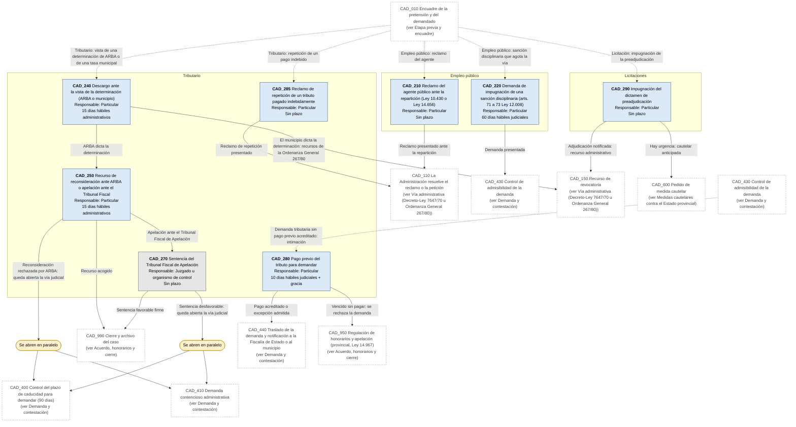

## 4. Amparo por mora (art. 76 Ley 12.008)

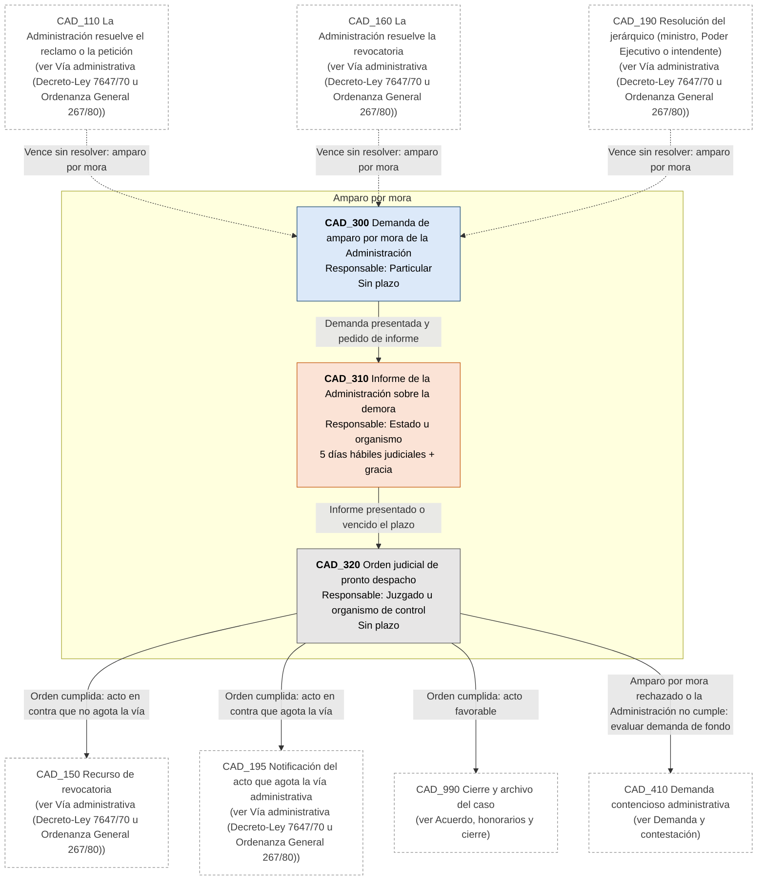

## 5. Demanda y contestación

```mermaid
flowchart TD
  subgraph F_0["Demanda"]
    CAD_400["<b>CAD_400</b> Control del plazo de caducidad para demandar (90 días)<br/>Responsable: Particular<br/>90 días hábiles judiciales"]:::actora
    CAD_410["<b>CAD_410</b> Demanda contencioso administrativa<br/>Responsable: Particular<br/>Sin plazo"]:::actora
    CAD_420["<b>CAD_420</b> Remisión del expediente administrativo por la demandada<br/>Responsable: Estado u organismo<br/>15 días hábiles judiciales"]:::demandada
    CAD_430["<b>CAD_430</b> Control de admisibilidad de la demanda<br/>Responsable: Juzgado u organismo de control<br/>Sin plazo"]:::tribunal
    CAD_440["<b>CAD_440</b> Traslado de la demanda y notificación a la Fiscalía de Estado o al municipio<br/>Responsable: Juzgado u organismo de control<br/>Sin plazo"]:::tribunal
    CAD_450["<b>CAD_450</b> Excepciones previas<br/>Responsable: Estado u organismo<br/>15 días hábiles judiciales + gracia"]:::demandada
    CAD_460["<b>CAD_460</b> Contestación de la demanda por la Provincia, el municipio o el ente<br/>Responsable: Estado u organismo<br/>45 días hábiles judiciales + gracia"]:::demandada
    CAD_470["<b>CAD_470</b> Contestación del traslado de la documental de la demandada<br/>Responsable: Particular<br/>5 días hábiles judiciales + gracia"]:::actora
  end
  EXT_CAD_010_origen["CAD_010 Encuadre de la pretensión y del demandado<br/>(ver Etapa previa y encuadre)"]:::externo
  EXT_CAD_010_origen -.->|"El acto ya agota la vía, hay excepción al agotamiento (art. 14) o vía de hecho (art. 21)"| CAD_400
  EXT_CAD_010_origen -.->|"El acto ya agota la vía, hay excepción al agotamiento (art. 14) o vía de hecho (art. 21)"| CAD_410
  EXT_CAD_130_origen["CAD_130 Silencio: la Administración no resuelve tras el pronto despacho<br/>(ver Vía administrativa (Decreto-Ley 7647/70 u Ordenanza General 267/80))"]:::externo
  EXT_CAD_130_origen -.->|"Vence sin resolver: denegatoria presunta"| CAD_400
  EXT_CAD_130_origen -.->|"Vence sin resolver: denegatoria presunta"| CAD_410
  EXT_CAD_195_origen["CAD_195 Notificación del acto que agota la vía administrativa<br/>(ver Vía administrativa (Decreto-Ley 7647/70 u Ordenanza General 267/80))"]:::externo
  EXT_CAD_195_origen -.->|"Vía agotada: corre el plazo para demandar"| CAD_400
  EXT_CAD_195_origen -.->|"Vía agotada: corre el plazo para demandar"| CAD_410
  EXT_CAD_220_origen["CAD_220 Demanda de impugnación de una sanción disciplinaria (arts. 71 a 73 Ley 12.008)<br/>(ver Variantes administrativas: empleo público, tributario y licitaciones)"]:::externo
  EXT_CAD_220_origen -.->|"Demanda presentada"| CAD_430
  EXT_CAD_250_origen["CAD_250 Recurso de reconsideración ante ARBA o apelación ante el Tribunal Fiscal<br/>(ver Variantes administrativas: empleo público, tributario y licitaciones)"]:::externo
  EXT_CAD_250_origen -.->|"Reconsideración rechazada por ARBA: queda abierta la vía judicial"| CAD_400
  EXT_CAD_250_origen -.->|"Reconsideración rechazada por ARBA: queda abierta la vía judicial"| CAD_410
  EXT_CAD_270_origen["CAD_270 Sentencia del Tribunal Fiscal de Apelación<br/>(ver Variantes administrativas: empleo público, tributario y licitaciones)"]:::externo
  EXT_CAD_270_origen -.->|"Sentencia desfavorable: queda abierta la vía judicial"| CAD_400
  EXT_CAD_270_origen -.->|"Sentencia desfavorable: queda abierta la vía judicial"| CAD_410
  EXT_CAD_280_origen["CAD_280 Pago previo del tributo para demandar<br/>(ver Variantes administrativas: empleo público, tributario y licitaciones)"]:::externo
  EXT_CAD_280_origen -.->|"Pago acreditado o excepción admitida"| CAD_440
  EXT_CAD_320_origen["CAD_320 Orden judicial de pronto despacho<br/>(ver Amparo por mora (art. 76 Ley 12.008))"]:::externo
  EXT_CAD_320_origen -.->|"Amparo por mora rechazado o la Administración no cumple: evaluar demanda de fondo"| CAD_410
  FIN_CAD_400_1(["Fin de este camino"]):::fin
  CAD_400 -->|"Demanda presentada en plazo"| FIN_CAD_400_1
  EXT_CAD_990_destino["CAD_990 Cierre y archivo del caso<br/>(ver Acuerdo, honorarios y cierre)"]:::externo
  CAD_400 -->|"Venció el plazo sin demandar: caducidad"| EXT_CAD_990_destino
  P_CAD_410_1(["Se abren en paralelo"]):::paralelo
  CAD_410 -->|"Demanda presentada"| P_CAD_410_1
  P_CAD_410_1 --> CAD_420
  EXT_CAD_910_destino["CAD_910 Control de caducidad de instancia<br/>(ver Acuerdo, honorarios y cierre)"]:::externo
  P_CAD_410_1 --> EXT_CAD_910_destino
  EXT_CAD_600_destino["CAD_600 Pedido de medida cautelar<br/>(ver Medidas cautelares contra el Estado provincial)"]:::externo
  CAD_410 -->|"Se pide una medida cautelar con la demanda"| EXT_CAD_600_destino
  CAD_420 -->|"Expediente remitido o vencido el plazo"| CAD_430
  CAD_430 -->|"Demanda admitida"| CAD_440
  EXT_CAD_280_destino["CAD_280 Pago previo del tributo para demandar<br/>(ver Variantes administrativas: empleo público, tributario y licitaciones)"]:::externo
  CAD_430 -->|"Demanda tributaria sin pago previo acreditado: intimación"| EXT_CAD_280_destino
  EXT_CAD_700_destino["CAD_700 Apelación de la sentencia ante la Cámara en lo Contencioso Administrativo<br/>(ver Recursos)"]:::externo
  CAD_430 -->|"Demanda declarada inadmisible: se apela"| EXT_CAD_700_destino
  P_CAD_440_1(["Se abren en paralelo"]):::paralelo
  CAD_440 -->|"Traslado notificado"| P_CAD_440_1
  P_CAD_440_1 --> CAD_450
  P_CAD_440_1 --> CAD_460
  FIN_CAD_450_1(["Fin de este camino"]):::fin
  CAD_450 -->|"Excepciones resueltas o no opuestas"| FIN_CAD_450_1
  CAD_450 -->|"Excepción admitida que termina el proceso: se apela"| EXT_CAD_700_destino
  CAD_460 -->|"Contestada con documental: traslado a la actora"| CAD_470
  EXT_CAD_480_destino["CAD_480 Audiencia del art. 41 (hechos, prueba o puro derecho)<br/>(ver Prueba y sentencia)"]:::externo
  CAD_460 -->|"Contestada o vencido el plazo, sin documental nueva"| EXT_CAD_480_destino
  EXT_CAD_900_destino["CAD_900 Acuerdo, conciliación o transacción con el Estado<br/>(ver Acuerdo, honorarios y cierre)"]:::externo
  CAD_460 -->|"Allanamiento o propuesta de acuerdo"| EXT_CAD_900_destino
  CAD_470 -->|"Traslado contestado o vencido el plazo"| EXT_CAD_480_destino
  EXT_CAD_630_origen["CAD_630 Demanda dentro de los 30 días de la cautelar anticipada<br/>(ver Medidas cautelares contra el Estado provincial)"]:::externo
  EXT_CAD_630_origen -.->|"Demanda presentada en plazo"| CAD_410
  classDef actora fill:#DCE9F9,stroke:#1F4E79,color:#000
  classDef demandada fill:#FBE3D6,stroke:#C55A11,color:#000
  classDef tribunal fill:#E7E6E6,stroke:#595959,color:#000
  classDef ambas fill:#E9DDF5,stroke:#7030A0,color:#000
  classDef externo fill:#FFFFFF,stroke:#8C8C8C,color:#404040,stroke-dasharray:4 3
  classDef paralelo fill:#FFF2CC,stroke:#BF9000,color:#000
  classDef fin fill:#F2F2F2,stroke:#A6A6A6,color:#404040
```

## 6. Proceso sumario de ilegitimidad

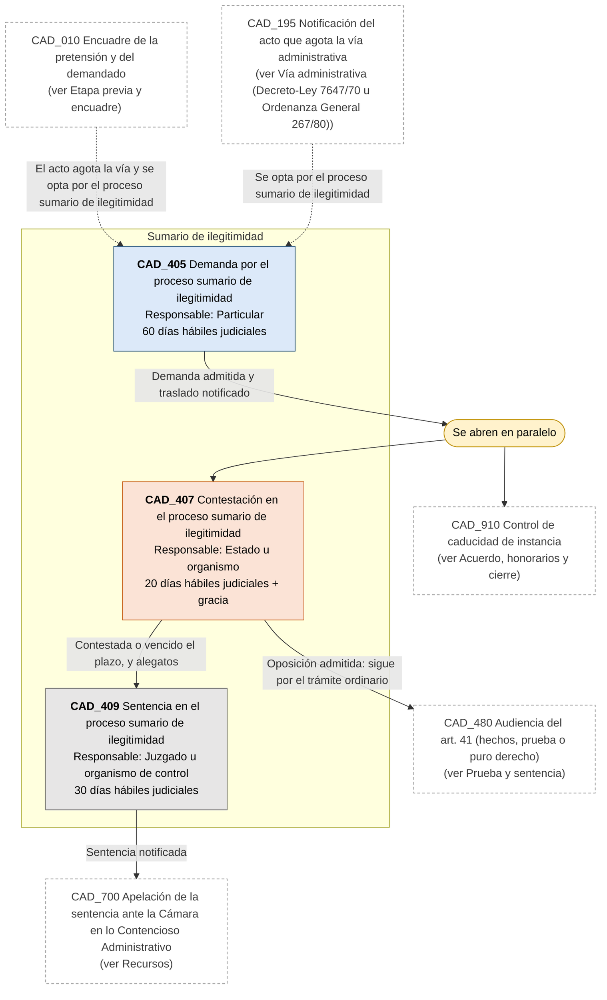

## 7. Medidas cautelares contra el Estado provincial

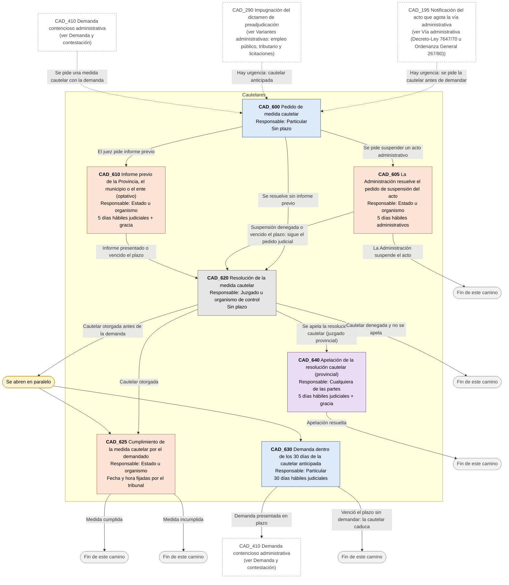

## 8. Prueba y sentencia

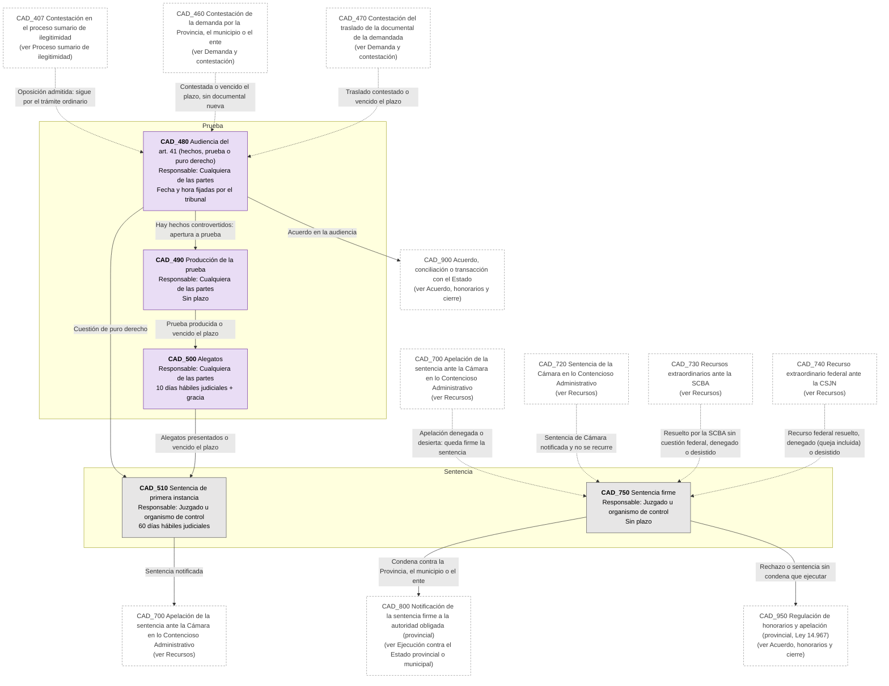

## 9. Recursos

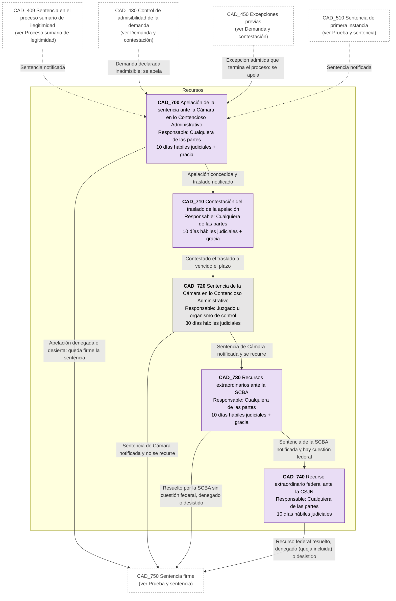

## 10. Ejecución contra el Estado provincial o municipal

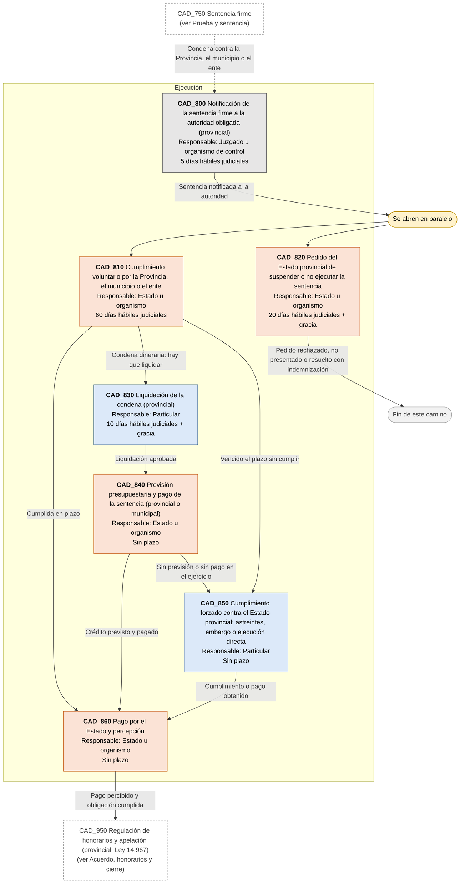

## 11. Acuerdo, honorarios y cierre

```mermaid
flowchart TD
  subgraph F_0["Cierre"]
    CAD_900["<b>CAD_900</b> Acuerdo, conciliación o transacción con el Estado<br/>Responsable: Cualquiera de las partes<br/>Sin plazo"]:::ambas
    CAD_910["<b>CAD_910</b> Control de caducidad de instancia<br/>Responsable: Particular<br/>6 meses"]:::actora
    CAD_950["<b>CAD_950</b> Regulación de honorarios y apelación (provincial, Ley 14.967)<br/>Responsable: Cualquiera de las partes<br/>5 días hábiles judiciales + gracia"]:::ambas
    CAD_980["<b>CAD_980</b> Sigue en la matriz de amparo<br/>Responsable: Particular<br/>Sin plazo"]:::actora
    CAD_985["<b>CAD_985</b> Estado nacional demandado: fuera de esta matriz<br/>Responsable: Particular<br/>Sin plazo"]:::actora
    CAD_990["<b>CAD_990</b> Cierre y archivo del caso<br/>Responsable: Cualquiera de las partes<br/>Sin plazo"]:::ambas
  end
  EXT_CAD_010_origen["CAD_010 Encuadre de la pretensión y del demandado<br/>(ver Etapa previa y encuadre)"]:::externo
  EXT_CAD_010_origen -.->|"Urgencia que hace del amparo la vía idónea"| CAD_980
  EXT_CAD_010_origen -.->|"El demandado es el Estado nacional"| CAD_985
  EXT_CAD_040_origen["CAD_040 Control de la prescripción de la acción de responsabilidad del Estado<br/>(ver Etapa previa y encuadre)"]:::externo
  EXT_CAD_040_origen -.->|"Venció la prescripción sin reclamar"| CAD_990
  EXT_CAD_110_origen["CAD_110 La Administración resuelve el reclamo o la petición<br/>(ver Vía administrativa (Decreto-Ley 7647/70 u Ordenanza General 267/80))"]:::externo
  EXT_CAD_110_origen -.->|"Resuelve a favor"| CAD_990
  EXT_CAD_130_origen["CAD_130 Silencio: la Administración no resuelve tras el pronto despacho<br/>(ver Vía administrativa (Decreto-Ley 7647/70 u Ordenanza General 267/80))"]:::externo
  EXT_CAD_130_origen -.->|"Resuelve a favor"| CAD_990
  EXT_CAD_160_origen["CAD_160 La Administración resuelve la revocatoria<br/>(ver Vía administrativa (Decreto-Ley 7647/70 u Ordenanza General 267/80))"]:::externo
  EXT_CAD_160_origen -.->|"Revocatoria acogida"| CAD_990
  EXT_CAD_190_origen["CAD_190 Resolución del jerárquico (ministro, Poder Ejecutivo o intendente)<br/>(ver Vía administrativa (Decreto-Ley 7647/70 u Ordenanza General 267/80))"]:::externo
  EXT_CAD_190_origen -.->|"Jerárquico acogido"| CAD_990
  EXT_CAD_250_origen["CAD_250 Recurso de reconsideración ante ARBA o apelación ante el Tribunal Fiscal<br/>(ver Variantes administrativas: empleo público, tributario y licitaciones)"]:::externo
  EXT_CAD_250_origen -.->|"Recurso acogido"| CAD_990
  EXT_CAD_270_origen["CAD_270 Sentencia del Tribunal Fiscal de Apelación<br/>(ver Variantes administrativas: empleo público, tributario y licitaciones)"]:::externo
  EXT_CAD_270_origen -.->|"Sentencia favorable firme"| CAD_990
  EXT_CAD_280_origen["CAD_280 Pago previo del tributo para demandar<br/>(ver Variantes administrativas: empleo público, tributario y licitaciones)"]:::externo
  EXT_CAD_280_origen -.->|"Vencido sin pagar: se rechaza la demanda"| CAD_950
  EXT_CAD_320_origen["CAD_320 Orden judicial de pronto despacho<br/>(ver Amparo por mora (art. 76 Ley 12.008))"]:::externo
  EXT_CAD_320_origen -.->|"Orden cumplida: acto favorable"| CAD_990
  EXT_CAD_400_origen["CAD_400 Control del plazo de caducidad para demandar (90 días)<br/>(ver Demanda y contestación)"]:::externo
  EXT_CAD_400_origen -.->|"Venció el plazo sin demandar: caducidad"| CAD_990
  EXT_CAD_405_origen["CAD_405 Demanda por el proceso sumario de ilegitimidad<br/>(ver Proceso sumario de ilegitimidad)"]:::externo
  EXT_CAD_405_origen -.->|"Demanda admitida y traslado notificado"| CAD_910
  EXT_CAD_410_origen["CAD_410 Demanda contencioso administrativa<br/>(ver Demanda y contestación)"]:::externo
  EXT_CAD_410_origen -.->|"Demanda presentada"| CAD_910
  EXT_CAD_460_origen["CAD_460 Contestación de la demanda por la Provincia, el municipio o el ente<br/>(ver Demanda y contestación)"]:::externo
  EXT_CAD_460_origen -.->|"Allanamiento o propuesta de acuerdo"| CAD_900
  EXT_CAD_480_origen["CAD_480 Audiencia del art. 41 (hechos, prueba o puro derecho)<br/>(ver Prueba y sentencia)"]:::externo
  EXT_CAD_480_origen -.->|"Acuerdo en la audiencia"| CAD_900
  EXT_CAD_750_origen["CAD_750 Sentencia firme<br/>(ver Prueba y sentencia)"]:::externo
  EXT_CAD_750_origen -.->|"Rechazo o sentencia sin condena que ejecutar"| CAD_950
  EXT_CAD_860_origen["CAD_860 Pago por el Estado y percepción<br/>(ver Ejecución contra el Estado provincial o municipal)"]:::externo
  EXT_CAD_860_origen -.->|"Pago percibido y obligación cumplida"| CAD_950
  CAD_900 -->|"Acuerdo homologado y cumplido"| CAD_950
  FIN_CAD_910_1(["Fin de este camino"]):::fin
  CAD_910 -->|"Se dicta sentencia o termina el proceso"| FIN_CAD_910_1
  CAD_910 -->|"Caducidad de instancia declarada"| CAD_950
  CAD_950 -->|"Regulación firme y aportes acreditados"| CAD_990
  style CAD_980 stroke-width:3px
  style CAD_985 stroke-width:3px
  style CAD_990 stroke-width:3px
  classDef actora fill:#DCE9F9,stroke:#1F4E79,color:#000
  classDef demandada fill:#FBE3D6,stroke:#C55A11,color:#000
  classDef tribunal fill:#E7E6E6,stroke:#595959,color:#000
  classDef ambas fill:#E9DDF5,stroke:#7030A0,color:#000
  classDef externo fill:#FFFFFF,stroke:#8C8C8C,color:#404040,stroke-dasharray:4 3
  classDef paralelo fill:#FFF2CC,stroke:#BF9000,color:#000
  classDef fin fill:#F2F2F2,stroke:#A6A6A6,color:#404040
```
