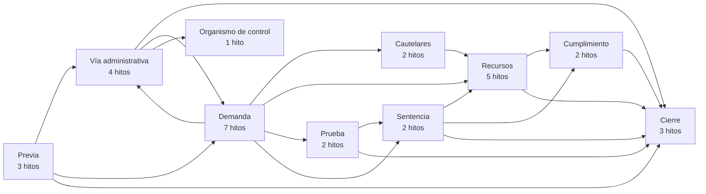
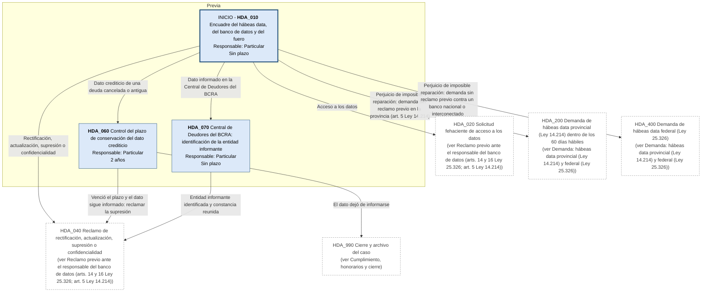
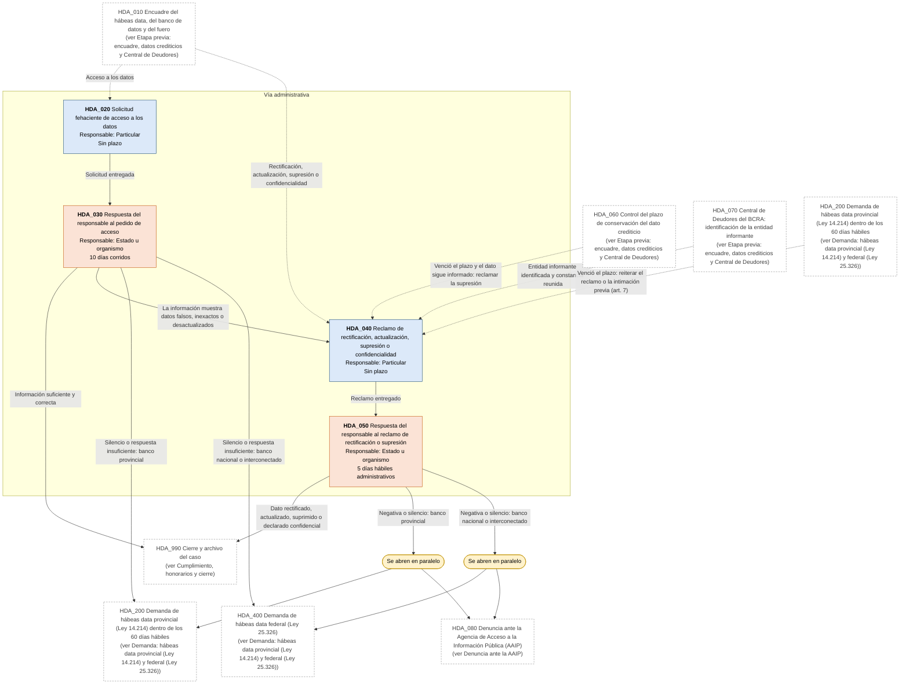
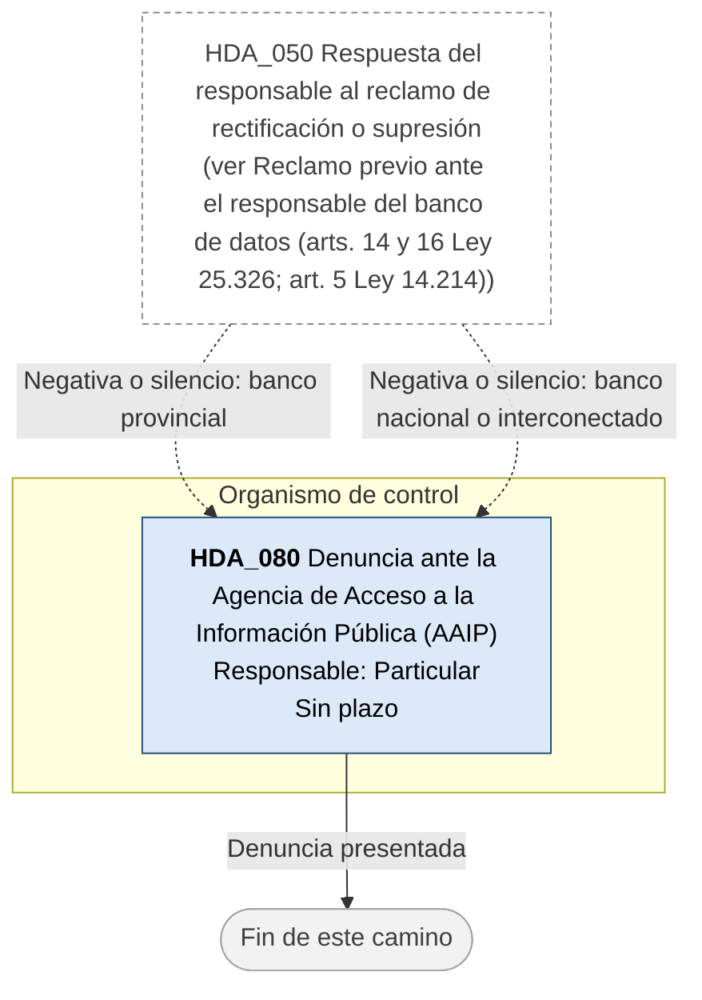
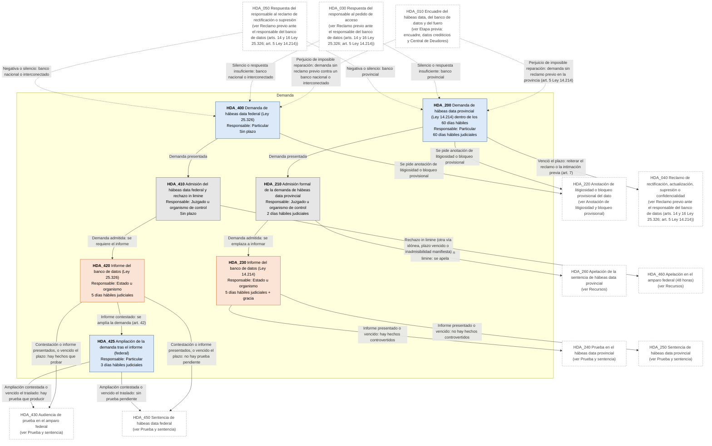
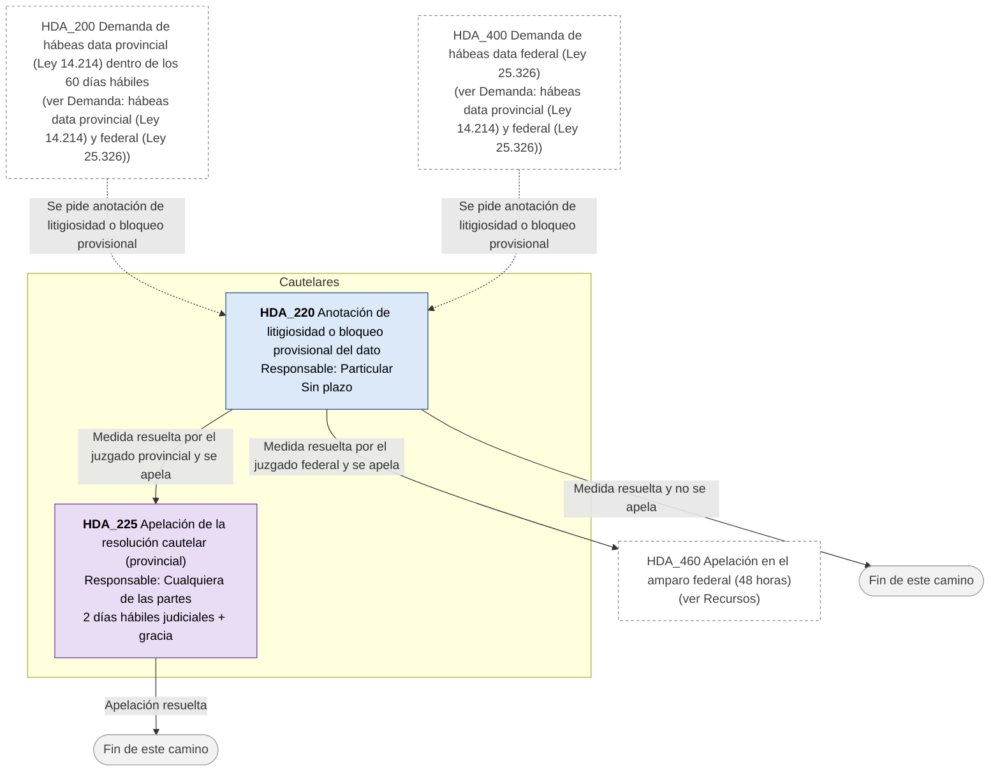
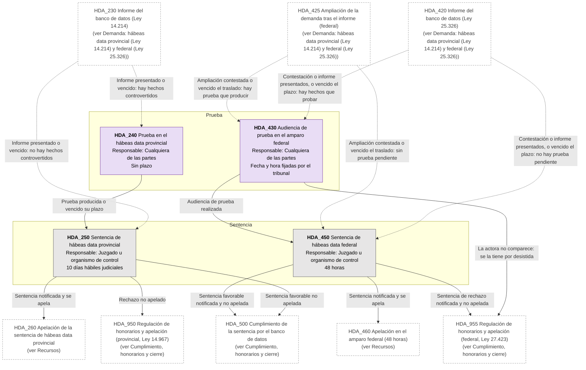
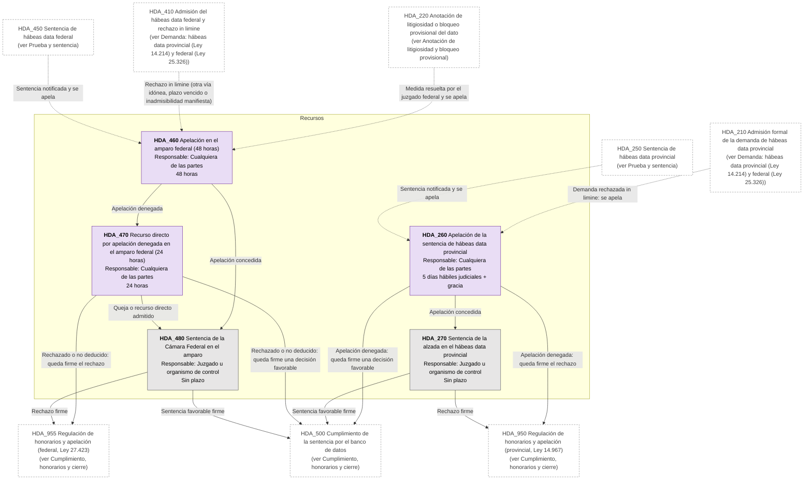

# Diagrama de Flujo: Hábeas data (PBA, con variante federal)

**Régimen:** Ley 14.214 con el CPCCBA supletorio (sumarísimo, art. 8); variante federal: Ley 25.326 (arts. 33 a 44), con el procedimiento del amparo común y el sumarísimo del CPCCN supletorios (art. 37) · **Versión:** 1 (borrador)

> Este documento se genera a partir de `matriz_publico_habeas_data_pba.xlsx`. No se edita a mano: las correcciones se hacen en la planilla y luego se vuelve a generar el diagrama.

## Cómo leer los diagramas

* **Cada caja es un hito** de la hoja `Nodos`: muestra el ID, el nombre, quién debe actuar y el plazo.
* **Cada flecha es un camino** de la hoja `Transiciones`, rotulado con su condición de salida.
* **Color de la caja según el responsable:** celeste = el particular que reclama (ACTORA); naranja = el Estado o el organismo demandado, también cuando resuelve en la vía administrativa (DEMANDADA); gris = juzgado, tribunal u organismo de control que no es parte, como la AAIP o el Tribunal Fiscal de Apelación (TRIBUNAL); violeta = cualquiera de las partes (AMBAS).
* **Borde grueso:** hito inicial o hito final.
* **"Se abren en paralelo"** (amarillo): esa condición abre varios hitos a la vez; por ejemplo, la negativa o el silencio del responsable abren a la vez la demanda y la denuncia ante la AAIP.
* **"Fin de este camino"** (gris claro): el camino paralelo termina sin abrir otro hito.
* **Cajas blancas con borde discontinuo:** hitos de otra etapa; el texto indica en qué diagrama están. Las flechas punteadas muestran desde dónde se llega a esta etapa.
* **Derivación a otra matriz:** caja con borde grueso (hito final) cuyo nombre empieza con "Sigue en la matriz de ...": el caso continúa en otra matriz de Derecho Público, en un expediente vinculado.
* **Provincial o federal:** cuando un flujo tiene las dos variantes, el nombre del hito lo dice ("provincial" o "federal") o nombra la ley que lo rige (por ejemplo, "Ley 13.928" o "Ley 16.986").
* **Vía administrativa:** sus hitos están en un diagrama aparte de los judiciales. La Administración que resuelve aparece en naranja, como parte demandada, y sus plazos son días hábiles administrativos.
* **Fuero según el banco de datos:** bancos privados provinciales, juzgado Civil y Comercial o de Paz; públicos provinciales, Contencioso Administrativo (art. 4 Ley 14.214); públicos nacionales o interconectados, justicia federal (art. 36 Ley 25.326).

## Vista general por fases

## 1. Etapa previa: encuadre, datos crediticios y Central de Deudores

## 2. Reclamo previo ante el responsable del banco de datos (arts. 14 y 16 Ley 25.326; art. 5 Ley 14.214)

## 3. Denuncia ante la AAIP

## 4. Demanda: hábeas data provincial (Ley 14.214) y federal (Ley 25.326)

## 5. Anotación de litigiosidad y bloqueo provisional

## 6. Prueba y sentencia

## 7. Recursos

## 8. Cumplimiento, honorarios y cierre

```mermaid
flowchart TD
  subgraph F_0["Cumplimiento"]
    HDA_500["<b>HDA_500</b> Cumplimiento de la sentencia por el banco de datos<br/>Responsable: Estado u organismo<br/>Fecha y hora fijadas por el tribunal"]:::demandada
    HDA_510["<b>HDA_510</b> Incumplimiento: astreintes y comunicación a la AAIP<br/>Responsable: Particular<br/>Sin plazo"]:::actora
  end
  subgraph F_1["Cierre"]
    HDA_950["<b>HDA_950</b> Regulación de honorarios y apelación (provincial, Ley 14.967)<br/>Responsable: Cualquiera de las partes<br/>5 días hábiles judiciales + gracia"]:::ambas
    HDA_955["<b>HDA_955</b> Regulación de honorarios y apelación (federal, Ley 27.423)<br/>Responsable: Cualquiera de las partes<br/>5 días hábiles judiciales"]:::ambas
    HDA_990["<b>HDA_990</b> Cierre y archivo del caso<br/>Responsable: Cualquiera de las partes<br/>Sin plazo"]:::ambas
  end
  EXT_HDA_030_origen["HDA_030 Respuesta del responsable al pedido de acceso<br/>(ver Reclamo previo ante el responsable del banco de datos (arts. 14 y 16 Ley 25.326; art. 5 Ley 14.214))"]:::externo
  EXT_HDA_030_origen -.->|"Información suficiente y correcta"| HDA_990
  EXT_HDA_050_origen["HDA_050 Respuesta del responsable al reclamo de rectificación o supresión<br/>(ver Reclamo previo ante el responsable del banco de datos (arts. 14 y 16 Ley 25.326; art. 5 Ley 14.214))"]:::externo
  EXT_HDA_050_origen -.->|"Dato rectificado, actualizado, suprimido o declarado confidencial"| HDA_990
  EXT_HDA_060_origen["HDA_060 Control del plazo de conservación del dato crediticio<br/>(ver Etapa previa: encuadre, datos crediticios y Central de Deudores)"]:::externo
  EXT_HDA_060_origen -.->|"El dato dejó de informarse"| HDA_990
  EXT_HDA_250_origen["HDA_250 Sentencia de hábeas data provincial<br/>(ver Prueba y sentencia)"]:::externo
  EXT_HDA_250_origen -.->|"Sentencia favorable no apelada"| HDA_500
  EXT_HDA_250_origen -.->|"Rechazo no apelado"| HDA_950
  EXT_HDA_260_origen["HDA_260 Apelación de la sentencia de hábeas data provincial<br/>(ver Recursos)"]:::externo
  EXT_HDA_260_origen -.->|"Apelación denegada: queda firme una decisión favorable"| HDA_500
  EXT_HDA_260_origen -.->|"Apelación denegada: queda firme el rechazo"| HDA_950
  EXT_HDA_270_origen["HDA_270 Sentencia de la alzada en el hábeas data provincial<br/>(ver Recursos)"]:::externo
  EXT_HDA_270_origen -.->|"Sentencia favorable firme"| HDA_500
  EXT_HDA_270_origen -.->|"Rechazo firme"| HDA_950
  EXT_HDA_430_origen["HDA_430 Audiencia de prueba en el amparo federal<br/>(ver Prueba y sentencia)"]:::externo
  EXT_HDA_430_origen -.->|"La actora no comparece: se la tiene por desistida"| HDA_955
  EXT_HDA_450_origen["HDA_450 Sentencia de hábeas data federal<br/>(ver Prueba y sentencia)"]:::externo
  EXT_HDA_450_origen -.->|"Sentencia favorable notificada y no apelada"| HDA_500
  EXT_HDA_450_origen -.->|"Sentencia de rechazo notificada y no apelada"| HDA_955
  EXT_HDA_470_origen["HDA_470 Recurso directo por apelación denegada en el amparo federal (24 horas)<br/>(ver Recursos)"]:::externo
  EXT_HDA_470_origen -.->|"Rechazado o no deducido: queda firme una decisión favorable"| HDA_500
  EXT_HDA_470_origen -.->|"Rechazado o no deducido: queda firme el rechazo"| HDA_955
  EXT_HDA_480_origen["HDA_480 Sentencia de la Cámara Federal en el amparo<br/>(ver Recursos)"]:::externo
  EXT_HDA_480_origen -.->|"Sentencia favorable firme"| HDA_500
  EXT_HDA_480_origen -.->|"Rechazo firme"| HDA_955
  HDA_500 -->|"Cumplida: proceso provincial"| HDA_950
  HDA_500 -->|"Cumplida: proceso federal"| HDA_955
  HDA_500 -->|"Vencido el plazo sin cumplir"| HDA_510
  HDA_510 -->|"Cumplimiento obtenido: proceso provincial"| HDA_950
  HDA_510 -->|"Cumplimiento obtenido: proceso federal"| HDA_955
  HDA_950 -->|"Regulación firme y aportes acreditados"| HDA_990
  HDA_955 -->|"Regulación firme y aportes acreditados"| HDA_990
  style HDA_990 stroke-width:3px
  classDef actora fill:#DCE9F9,stroke:#1F4E79,color:#000
  classDef demandada fill:#FBE3D6,stroke:#C55A11,color:#000
  classDef tribunal fill:#E7E6E6,stroke:#595959,color:#000
  classDef ambas fill:#E9DDF5,stroke:#7030A0,color:#000
  classDef externo fill:#FFFFFF,stroke:#8C8C8C,color:#404040,stroke-dasharray:4 3
  classDef paralelo fill:#FFF2CC,stroke:#BF9000,color:#000
  classDef fin fill:#F2F2F2,stroke:#A6A6A6,color:#404040
```

