# Diagrama de Flujo: Seguridad social (ANSES y justicia federal, con variante provincial)

**Régimen:** Ley 24.463 (art. 15 según Ley 24.655) y CPCCN; vía administrativa: Ley 19.549 reformada por la Ley 27.742; variante provincial: Decreto-Ley 9650/80 (IPS) y leyes de las cajas profesionales, que siguen en contencioso administrativo · **Versión:** 1 (borrador)

> Este documento se genera a partir de `matriz_publico_seguridad_social_pba.xlsx`. No se edita a mano: las correcciones se hacen en la planilla y luego se vuelve a generar el diagrama.

## Cómo leer los diagramas

* **Cada caja es un hito** de la hoja `Nodos`: muestra el ID, el nombre, quién debe actuar y el plazo.
* **Cada flecha es un camino** de la hoja `Transiciones`, rotulado con su condición de salida.
* **Color de la caja según el responsable:** celeste = el particular que reclama (ACTORA); naranja = el Estado o el organismo demandado, también cuando resuelve en la vía administrativa (DEMANDADA); gris = juzgado, tribunal u organismo de control que no es parte, como la AAIP o el Tribunal Fiscal de Apelación (TRIBUNAL); violeta = cualquiera de las partes (AMBAS).
* **Borde grueso:** hito inicial o hito final.
* **"Se abren en paralelo"** (amarillo): esa condición abre varios hitos a la vez; por ejemplo, la resolución denegatoria de ANSES abre a la vez el control de la caducidad para demandar y la preparación de la demanda.
* **"Fin de este camino"** (gris claro): el camino paralelo termina sin abrir otro hito.
* **Cajas blancas con borde discontinuo:** hitos de otra etapa; el texto indica en qué diagrama están. Las flechas punteadas muestran desde dónde se llega a esta etapa.
* **Derivación a otra matriz:** caja con borde grueso (hito final) cuyo nombre empieza con "Sigue en la matriz de ...": el caso continúa en otra matriz de Derecho Público, en un expediente vinculado.
* **Provincial o federal:** cuando un flujo tiene las dos variantes, el nombre del hito lo dice ("provincial" o "federal") o nombra la ley que lo rige (por ejemplo, "Ley 13.928" o "Ley 16.986").
* **Vía administrativa:** sus hitos están en un diagrama aparte de los judiciales. La Administración que resuelve aparece en naranja, como parte demandada, y sus plazos son días hábiles administrativos.
* **Calendario administrativo:** la vía ante ANSES usa el calendario administrativo nacional (Ley 19.549) y la del IPS o las cajas, el provincial (Decreto-Ley 7647/70); el checklist de cada hito lo dice.
* **Alzada:** desde el fallo 'Pedraza' (CSJN, 2014) las sentencias de los juzgados federales con asiento en PBA se apelan ante la Cámara Federal de Apelaciones del distrito; las de los juzgados de la Seguridad Social de CABA, ante la Cámara Federal de la Seguridad Social.

## Vista general por fases

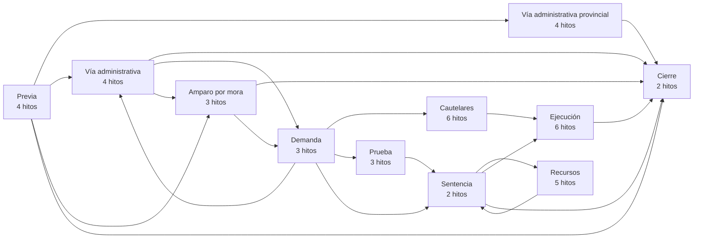

## 1. Etapa previa: encuadre, documentación y prescripción

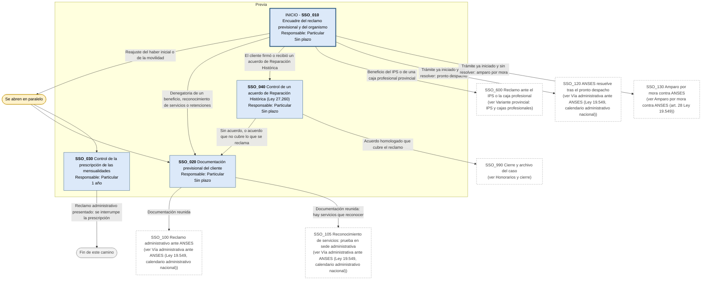

## 2. Vía administrativa ante ANSES (Ley 19.549, calendario administrativo nacional)

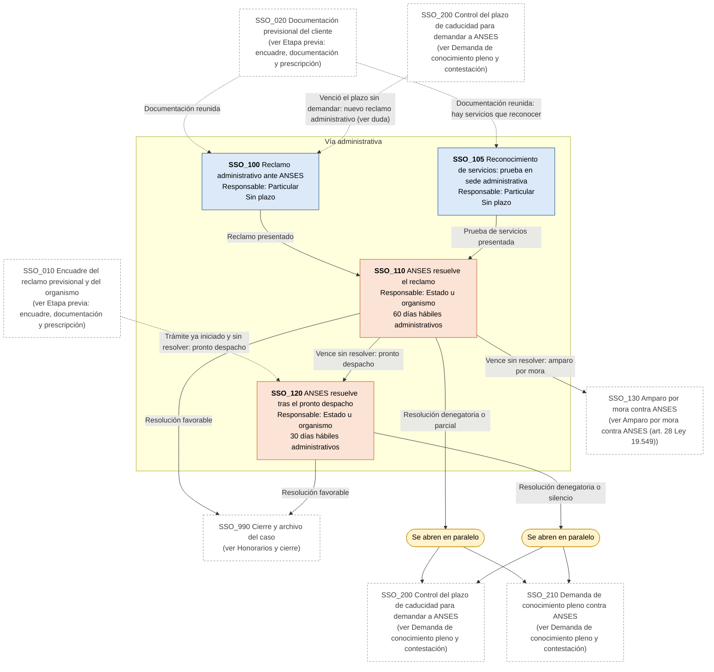

## 3. Amparo por mora contra ANSES (art. 28 Ley 19.549)

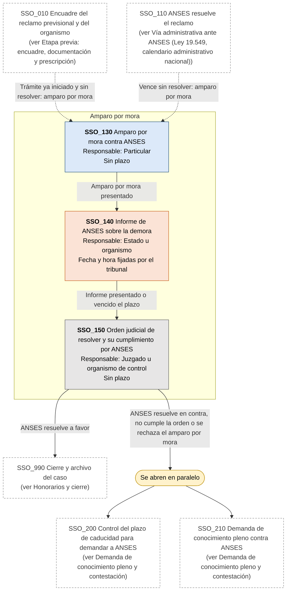

## 4. Demanda de conocimiento pleno y contestación

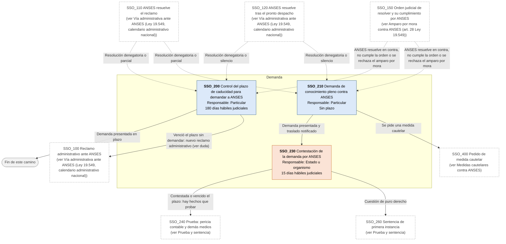

## 5. Medidas cautelares contra ANSES

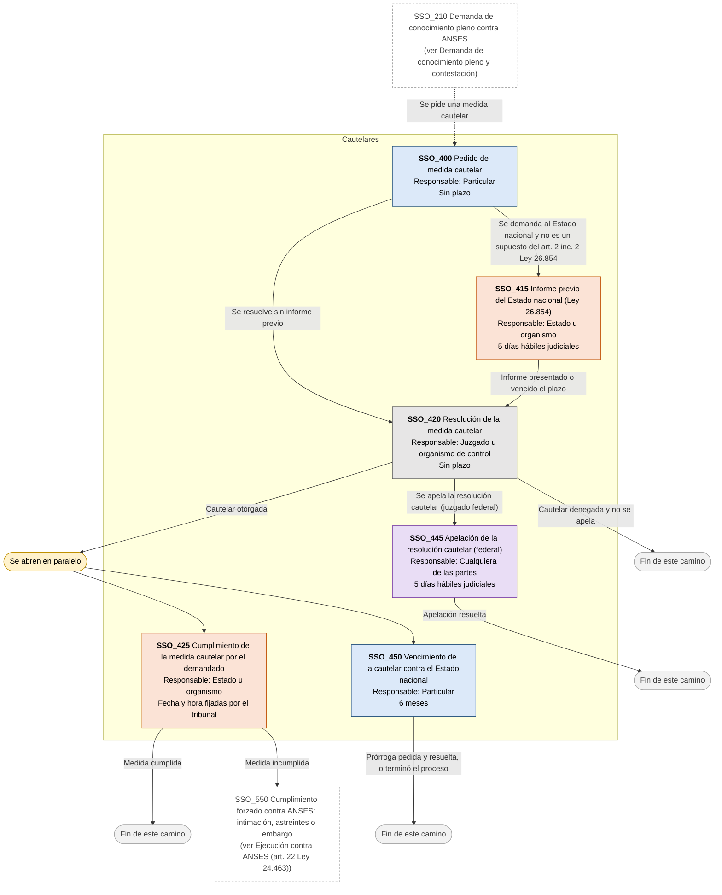

## 6. Prueba y sentencia

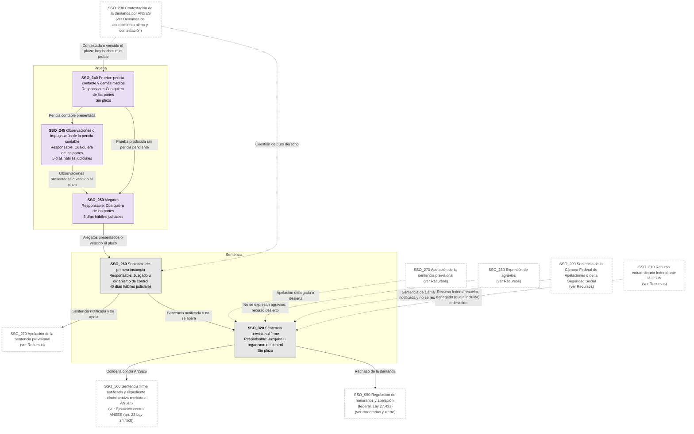

## 7. Recursos

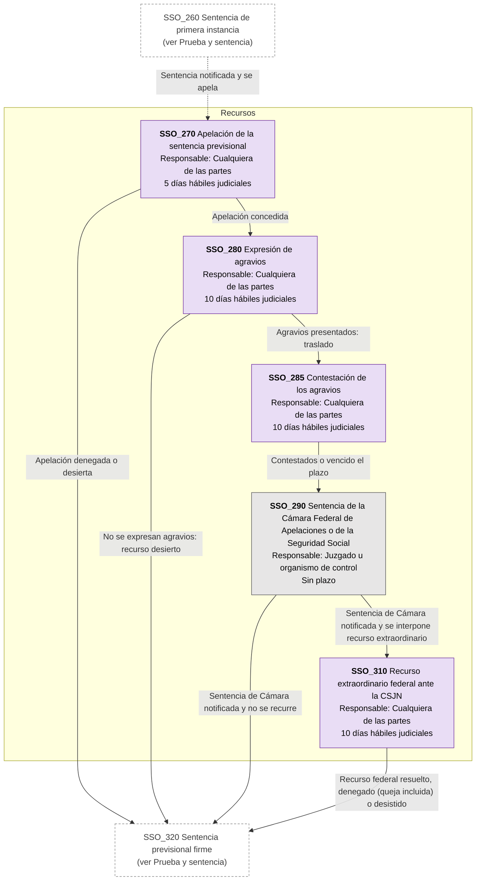

## 8. Ejecución contra ANSES (art. 22 Ley 24.463)

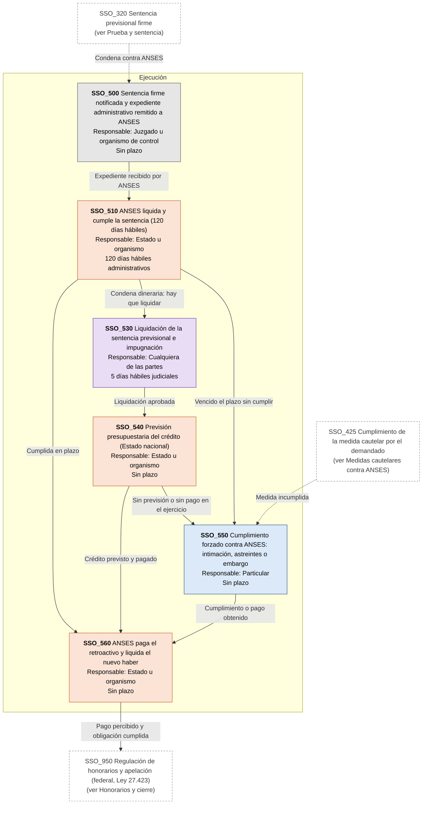

## 9. Variante provincial: IPS y cajas profesionales

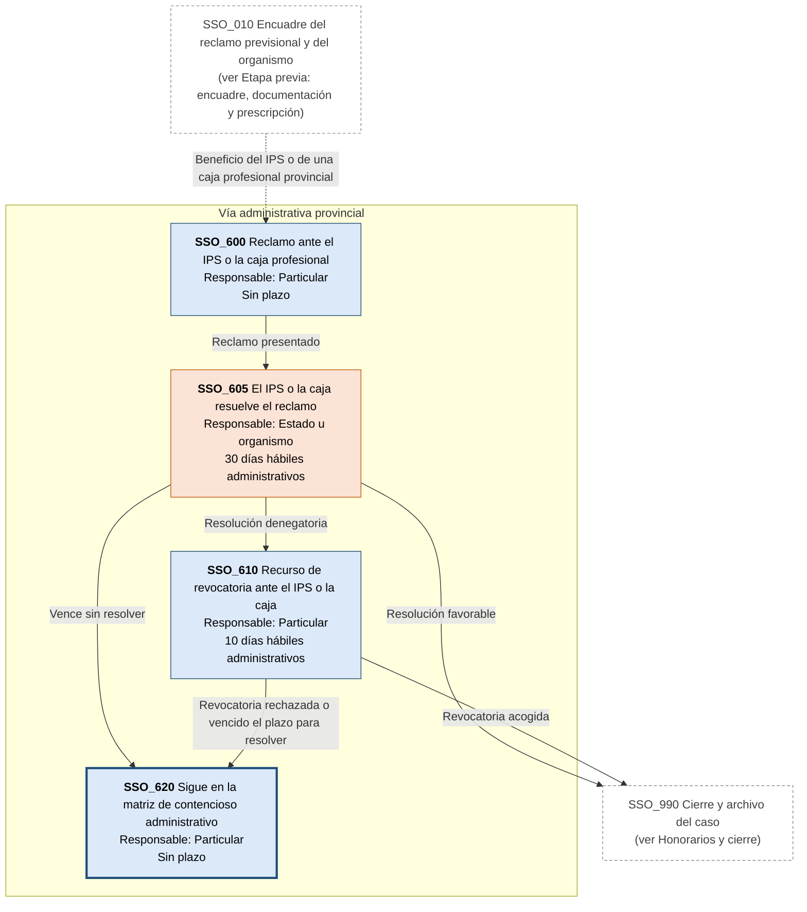

## 10. Honorarios y cierre

```mermaid
flowchart TD
  subgraph F_0["Cierre"]
    SSO_950["<b>SSO_950</b> Regulación de honorarios y apelación (federal, Ley 27.423)<br/>Responsable: Cualquiera de las partes<br/>5 días hábiles judiciales"]:::ambas
    SSO_990["<b>SSO_990</b> Cierre y archivo del caso<br/>Responsable: Cualquiera de las partes<br/>Sin plazo"]:::ambas
  end
  EXT_SSO_040_origen["SSO_040 Control de un acuerdo de Reparación Histórica (Ley 27.260)<br/>(ver Etapa previa: encuadre, documentación y prescripción)"]:::externo
  EXT_SSO_040_origen -.->|"Acuerdo homologado que cubre el reclamo"| SSO_990
  EXT_SSO_110_origen["SSO_110 ANSES resuelve el reclamo<br/>(ver Vía administrativa ante ANSES (Ley 19.549, calendario administrativo nacional))"]:::externo
  EXT_SSO_110_origen -.->|"Resolución favorable"| SSO_990
  EXT_SSO_120_origen["SSO_120 ANSES resuelve tras el pronto despacho<br/>(ver Vía administrativa ante ANSES (Ley 19.549, calendario administrativo nacional))"]:::externo
  EXT_SSO_120_origen -.->|"Resolución favorable"| SSO_990
  EXT_SSO_150_origen["SSO_150 Orden judicial de resolver y su cumplimiento por ANSES<br/>(ver Amparo por mora contra ANSES (art. 28 Ley 19.549))"]:::externo
  EXT_SSO_150_origen -.->|"ANSES resuelve a favor"| SSO_990
  EXT_SSO_320_origen["SSO_320 Sentencia previsional firme<br/>(ver Prueba y sentencia)"]:::externo
  EXT_SSO_320_origen -.->|"Rechazo de la demanda"| SSO_950
  EXT_SSO_560_origen["SSO_560 ANSES paga el retroactivo y liquida el nuevo haber<br/>(ver Ejecución contra ANSES (art. 22 Ley 24.463))"]:::externo
  EXT_SSO_560_origen -.->|"Pago percibido y obligación cumplida"| SSO_950
  EXT_SSO_605_origen["SSO_605 El IPS o la caja resuelve el reclamo<br/>(ver Variante provincial: IPS y cajas profesionales)"]:::externo
  EXT_SSO_605_origen -.->|"Resolución favorable"| SSO_990
  EXT_SSO_610_origen["SSO_610 Recurso de revocatoria ante el IPS o la caja<br/>(ver Variante provincial: IPS y cajas profesionales)"]:::externo
  EXT_SSO_610_origen -.->|"Revocatoria acogida"| SSO_990
  SSO_950 -->|"Regulación firme y aportes acreditados"| SSO_990
  style SSO_990 stroke-width:3px
  classDef actora fill:#DCE9F9,stroke:#1F4E79,color:#000
  classDef demandada fill:#FBE3D6,stroke:#C55A11,color:#000
  classDef tribunal fill:#E7E6E6,stroke:#595959,color:#000
  classDef ambas fill:#E9DDF5,stroke:#7030A0,color:#000
  classDef externo fill:#FFFFFF,stroke:#8C8C8C,color:#404040,stroke-dasharray:4 3
  classDef paralelo fill:#FFF2CC,stroke:#BF9000,color:#000
  classDef fin fill:#F2F2F2,stroke:#A6A6A6,color:#404040
```
