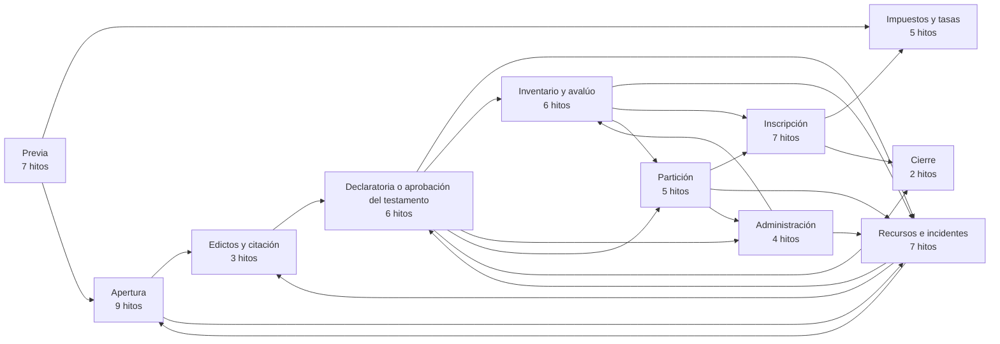
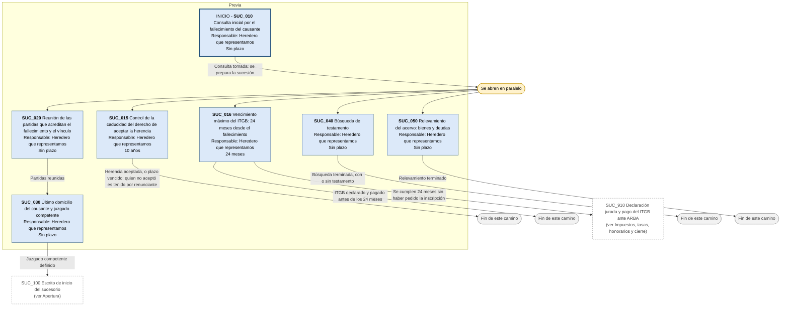
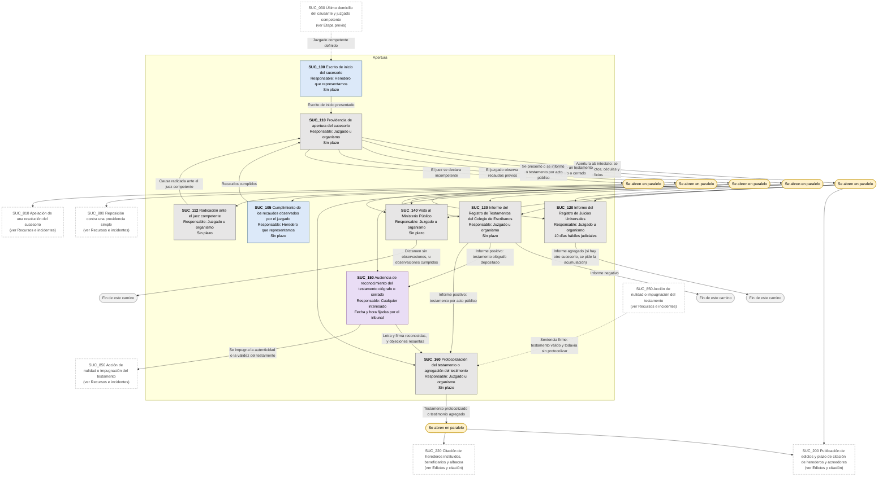
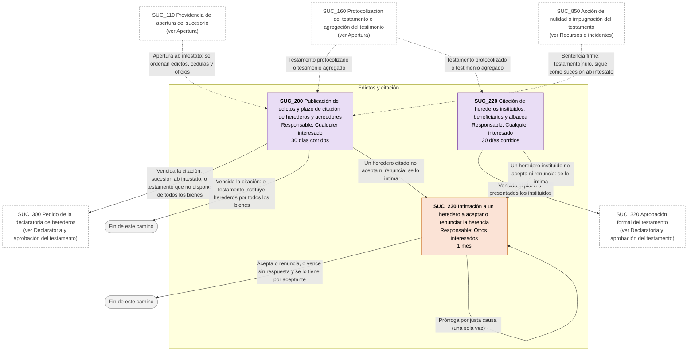
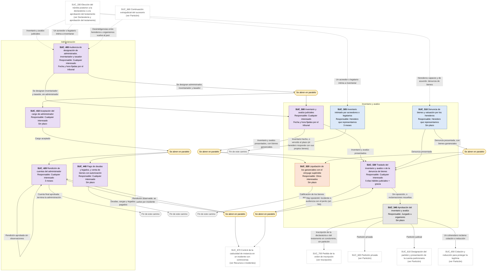
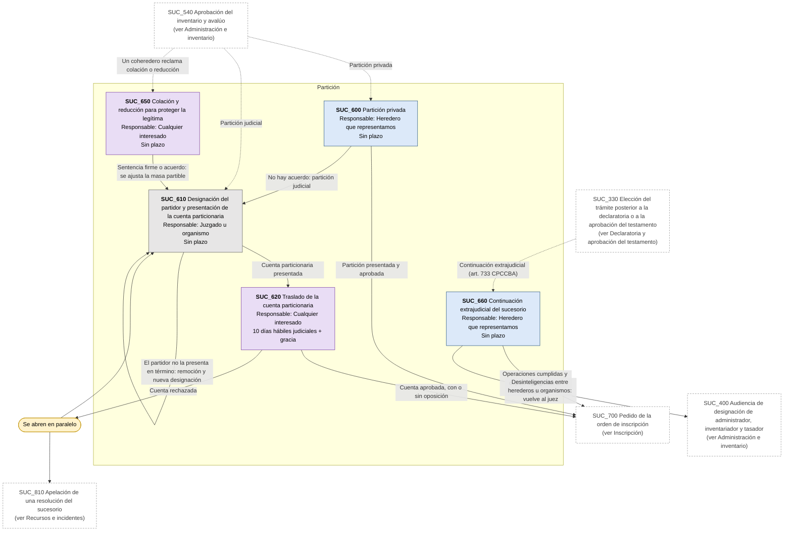
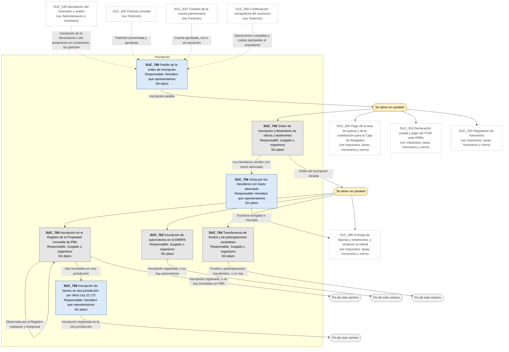
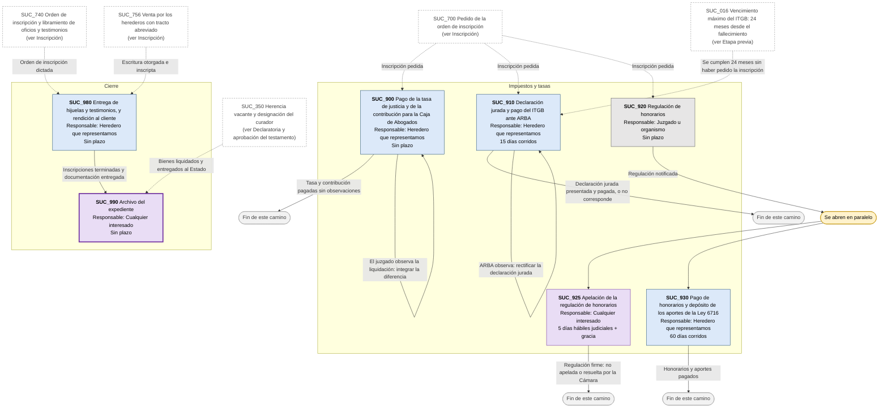

# Diagrama de Flujo: Proceso sucesorio (ab intestato y testamentario) - Provincia de Buenos Aires

**Régimen:** CPCCBA (Decreto-Ley 7425/68, arts. 724 a 773) y CCyC Libro Quinto · **Versión:** 1 (borrador)

> Este documento se genera a partir de `matriz_flujo_sucesorio_pba.xlsx`. No se edita a mano: las correcciones se hacen en la planilla y luego se vuelve a generar el diagrama.

## Cómo leer los diagramas

* **Cada caja es un hito** de la hoja `Nodos`: muestra el ID, el nombre, quién debe actuar y el plazo.
* **Cada flecha es un camino** de la hoja `Transiciones`, rotulado con su condición de salida.
* **Color de la caja según el responsable:** celeste = el heredero o interesado que promueve y al que representamos (ACTORA); naranja = otros interesados con intereses opuestos en una incidencia: coherederos que impugnan, acreedores, el cónyuge en la liquidación de los gananciales (DEMANDADA); gris = el juzgado o la espera de un organismo, como un registro o ARBA (TRIBUNAL); violeta = cualquiera de los interesados (AMBAS).
* **Borde grueso:** hito inicial o hito final.
* **"Se abren en paralelo"** (amarillo): esa condición abre varios hitos a la vez; por ejemplo, la publicación de edictos corre mientras se esperan los informes del Registro de Juicios Universales y del Registro de Testamentos.
* **"Fin de este camino"** (gris claro): el camino paralelo termina sin abrir otro hito.
* **Cajas blancas con borde discontinuo:** hitos de otra etapa; el texto indica en qué diagrama están. Las flechas punteadas muestran desde dónde se llega a esta etapa.

## Vista general por fases

## 1. Etapa previa

## 2. Apertura

## 3. Edictos y citación

## 4. Declaratoria y aprobación del testamento

```mermaid
flowchart TD
  subgraph F_0["Declaratoria o aprobación del testamento"]
    SUC_300["<b>SUC_300</b> Pedido de la declaratoria de herederos<br/>Responsable: Heredero que representamos<br/>Sin plazo"]:::actora
    SUC_310["<b>SUC_310</b> Dictado de la declaratoria de herederos<br/>Responsable: Juzgado u organismo<br/>Sin plazo"]:::tribunal
    SUC_320["<b>SUC_320</b> Aprobación formal del testamento<br/>Responsable: Juzgado u organismo<br/>Sin plazo"]:::tribunal
    SUC_330["<b>SUC_330</b> Elección del trámite posterior a la declaratoria o a la aprobación del testamento<br/>Responsable: Heredero que representamos<br/>Sin plazo"]:::actora
    SUC_340["<b>SUC_340</b> Ampliación de la declaratoria de herederos<br/>Responsable: Cualquier interesado<br/>Sin plazo"]:::ambas
    SUC_350["<b>SUC_350</b> Herencia vacante y designación del curador<br/>Responsable: Juzgado u organismo<br/>Sin plazo"]:::tribunal
  end
  EXT_SUC_200_origen["SUC_200 Publicación de edictos y plazo de citación de herederos y acreedores<br/>(ver Edictos y citación)"]:::externo
  EXT_SUC_200_origen -.->|"Vencida la citación: sucesión ab intestato, o testamento que no dispone de todos los bienes"| SUC_300
  EXT_SUC_220_origen["SUC_220 Citación de herederos instituidos, beneficiarios y albacea<br/>(ver Edictos y citación)"]:::externo
  EXT_SUC_220_origen -.->|"Vencido el plazo o presentados los instituidos"| SUC_320
  SUC_300 -->|"Pedido presentado"| SUC_310
  P_SUC_310_1(["Se abren en paralelo"]):::paralelo
  SUC_310 -->|"Declaratoria dictada y notificada"| P_SUC_310_1
  P_SUC_310_1 --> SUC_330
  EXT_SUC_810_destino["SUC_810 Apelación de una resolución del sucesorio<br/>(ver Recursos e incidentes)"]:::externo
  P_SUC_310_1 --> EXT_SUC_810_destino
  SUC_310 -->|"Se difiere la declaratoria por un vínculo no acreditado"| SUC_300
  SUC_310 -->|"Ningún heredero acredita su título: herencia vacante"| SUC_350
  P_SUC_320_1(["Se abren en paralelo"]):::paralelo
  SUC_320 -->|"Testamento aprobado y notificado"| P_SUC_320_1
  P_SUC_320_1 --> SUC_330
  P_SUC_320_1 --> EXT_SUC_810_destino
  EXT_SUC_510_destino["SUC_510 Denuncia de bienes y valuación por los herederos<br/>(ver Administración e inventario)"]:::externo
  SUC_330 -->|"Herederos capaces y de acuerdo: denuncia de bienes"| EXT_SUC_510_destino
  EXT_SUC_400_destino["SUC_400 Audiencia de designación de administrador, inventariador y tasador<br/>(ver Administración e inventario)"]:::externo
  SUC_330 -->|"Inventario y avalúo judiciales"| EXT_SUC_400_destino
  P_SUC_330_3(["Se abren en paralelo"]):::paralelo
  SUC_330 -->|"Un acreedor o legatario intima a inventariar"| P_SUC_330_3
  P_SUC_330_3 --> EXT_SUC_400_destino
  EXT_SUC_505_destino["SUC_505 Inventario intimado por acreedores o legatarios<br/>(ver Administración e inventario)"]:::externo
  P_SUC_330_3 --> EXT_SUC_505_destino
  EXT_SUC_660_destino["SUC_660 Continuación extrajudicial del sucesorio<br/>(ver Partición)"]:::externo
  SUC_330 -->|"Continuación extrajudicial (art. 733 CPCCBA)"| EXT_SUC_660_destino
  SUC_330 -->|"Aparece un heredero omitido"| SUC_340
  EXT_SUC_860_destino["SUC_860 Impugnación de la declaratoria o petición de herencia<br/>(ver Recursos e incidentes)"]:::externo
  SUC_330 -->|"Un tercero impugna la declaratoria o reclama la herencia"| EXT_SUC_860_destino
  EXT_SUC_850_destino["SUC_850 Acción de nulidad o impugnación del testamento<br/>(ver Recursos e incidentes)"]:::externo
  SUC_330 -->|"Un interesado impugna el testamento aprobado"| EXT_SUC_850_destino
  SUC_340 -->|"Declaratoria ampliada"| SUC_330
  EXT_SUC_990_destino["SUC_990 Archivo del expediente<br/>(ver Impuestos, tasas, honorarios y cierre)"]:::externo
  SUC_350 -->|"Bienes liquidados y entregados al Estado"| EXT_SUC_990_destino
  SUC_350 -->|"Se presenta quien invoca derecho a la herencia"| EXT_SUC_860_destino
  EXT_SUC_850_origen["SUC_850 Acción de nulidad o impugnación del testamento<br/>(ver Recursos e incidentes)"]:::externo
  EXT_SUC_850_origen -.->|"Sentencia firme: testamento válido y ya aprobado"| SUC_330
  EXT_SUC_860_origen["SUC_860 Impugnación de la declaratoria o petición de herencia<br/>(ver Recursos e incidentes)"]:::externo
  EXT_SUC_860_origen -.->|"Sentencia firme: se amplía o modifica la declaratoria"| SUC_340
  EXT_SUC_860_origen -.->|"Demanda rechazada por sentencia firme"| SUC_330
  EXT_SUC_860_origen -.->|"Demanda rechazada en una herencia vacante"| SUC_350
  classDef actora fill:#DCE9F9,stroke:#1F4E79,color:#000
  classDef demandada fill:#FBE3D6,stroke:#C55A11,color:#000
  classDef tribunal fill:#E7E6E6,stroke:#595959,color:#000
  classDef ambas fill:#E9DDF5,stroke:#7030A0,color:#000
  classDef externo fill:#FFFFFF,stroke:#8C8C8C,color:#404040,stroke-dasharray:4 3
  classDef paralelo fill:#FFF2CC,stroke:#BF9000,color:#000
  classDef fin fill:#F2F2F2,stroke:#A6A6A6,color:#404040
```

## 5. Administración e inventario

## 6. Partición

## 7. Inscripción

## 8. Impuestos, tasas, honorarios y cierre

## 9. Recursos e incidentes

```mermaid
flowchart TD
  subgraph F_0["Recursos e incidentes"]
    SUC_800["<b>SUC_800</b> Reposición contra una providencia simple<br/>Responsable: Cualquier interesado<br/>3 días hábiles judiciales + gracia"]:::ambas
    SUC_810["<b>SUC_810</b> Apelación de una resolución del sucesorio<br/>Responsable: Cualquier interesado<br/>5 días hábiles judiciales + gracia"]:::ambas
    SUC_815["<b>SUC_815</b> Memorial de la apelación en relación<br/>Responsable: Cualquier interesado<br/>5 días hábiles judiciales + gracia"]:::ambas
    SUC_850["<b>SUC_850</b> Acción de nulidad o impugnación del testamento<br/>Responsable: Otros interesados<br/>Sin plazo"]:::demandada
    SUC_860["<b>SUC_860</b> Impugnación de la declaratoria o petición de herencia<br/>Responsable: Otros interesados<br/>Sin plazo"]:::demandada
    SUC_870["<b>SUC_870</b> Control de la caducidad de instancia en un incidente con controversia<br/>Responsable: Cualquier interesado<br/>3 meses"]:::ambas
    SUC_875["<b>SUC_875</b> Intimación a activar el incidente bajo apercibimiento de caducidad<br/>Responsable: Cualquier interesado<br/>5 días hábiles judiciales + gracia"]:::ambas
  end
  EXT_SUC_110_origen["SUC_110 Providencia de apertura del sucesorio<br/>(ver Apertura)"]:::externo
  EXT_SUC_110_origen -.->|"El juzgado observa recaudos previos"| SUC_800
  EXT_SUC_110_origen -.->|"El juez se declara incompetente"| SUC_810
  EXT_SUC_150_origen["SUC_150 Audiencia de reconocimiento del testamento ológrafo o cerrado<br/>(ver Apertura)"]:::externo
  EXT_SUC_150_origen -.->|"Se impugna la autenticidad o la validez del testamento"| SUC_850
  EXT_SUC_310_origen["SUC_310 Dictado de la declaratoria de herederos<br/>(ver Declaratoria y aprobación del testamento)"]:::externo
  EXT_SUC_310_origen -.->|"Declaratoria dictada y notificada"| SUC_810
  EXT_SUC_320_origen["SUC_320 Aprobación formal del testamento<br/>(ver Declaratoria y aprobación del testamento)"]:::externo
  EXT_SUC_320_origen -.->|"Testamento aprobado y notificado"| SUC_810
  EXT_SUC_330_origen["SUC_330 Elección del trámite posterior a la declaratoria o a la aprobación del testamento<br/>(ver Declaratoria y aprobación del testamento)"]:::externo
  EXT_SUC_330_origen -.->|"Un tercero impugna la declaratoria o reclama la herencia"| SUC_860
  EXT_SUC_330_origen -.->|"Un interesado impugna el testamento aprobado"| SUC_850
  EXT_SUC_350_origen["SUC_350 Herencia vacante y designación del curador<br/>(ver Declaratoria y aprobación del testamento)"]:::externo
  EXT_SUC_350_origen -.->|"Se presenta quien invoca derecho a la herencia"| SUC_860
  EXT_SUC_420_origen["SUC_420 Rendición de cuentas del administrador<br/>(ver Administración e inventario)"]:::externo
  EXT_SUC_420_origen -.->|"Rendición observada: se resuelve por incidente"| SUC_870
  EXT_SUC_530_origen["SUC_530 Traslado del inventario y avalúo o de la denuncia de bienes<br/>(ver Administración e inventario)"]:::externo
  EXT_SUC_530_origen -.->|"Hay oposición: incidente o audiencia con el perito (art. 760)"| SUC_870
  EXT_SUC_620_origen["SUC_620 Traslado de la cuenta particionaria<br/>(ver Partición)"]:::externo
  EXT_SUC_620_origen -.->|"Cuenta rechazada"| SUC_810
  FIN_SUC_800_1(["Fin de este camino"]):::fin
  SUC_800 -->|"Reposición resuelta (o la apelación en subsidio), o plazo vencido sin recurrir"| FIN_SUC_800_1
  FIN_SUC_810_1(["Fin de este camino"]):::fin
  SUC_810 -->|"No se apela, o se deniega el recurso (queja o queda firme)"| FIN_SUC_810_1
  SUC_810 -->|"Apelación concedida en relación"| SUC_815
  FIN_SUC_815_1(["Fin de este camino"]):::fin
  SUC_815 -->|"La Cámara resuelve, o el recurso se declara desierto"| FIN_SUC_815_1
  EXT_SUC_160_destino["SUC_160 Protocolización del testamento o agregación del testimonio<br/>(ver Apertura)"]:::externo
  SUC_850 -->|"Sentencia firme: testamento válido y todavía sin protocolizar"| EXT_SUC_160_destino
  EXT_SUC_330_destino["SUC_330 Elección del trámite posterior a la declaratoria o a la aprobación del testamento<br/>(ver Declaratoria y aprobación del testamento)"]:::externo
  SUC_850 -->|"Sentencia firme: testamento válido y ya aprobado"| EXT_SUC_330_destino
  EXT_SUC_200_destino["SUC_200 Publicación de edictos y plazo de citación de herederos y acreedores<br/>(ver Edictos y citación)"]:::externo
  SUC_850 -->|"Sentencia firme: testamento nulo, sigue como sucesión ab intestato"| EXT_SUC_200_destino
  EXT_SUC_340_destino["SUC_340 Ampliación de la declaratoria de herederos<br/>(ver Declaratoria y aprobación del testamento)"]:::externo
  SUC_860 -->|"Sentencia firme: se amplía o modifica la declaratoria"| EXT_SUC_340_destino
  SUC_860 -->|"Demanda rechazada por sentencia firme"| EXT_SUC_330_destino
  EXT_SUC_350_destino["SUC_350 Herencia vacante y designación del curador<br/>(ver Declaratoria y aprobación del testamento)"]:::externo
  SUC_860 -->|"Demanda rechazada en una herencia vacante"| EXT_SUC_350_destino
  FIN_SUC_870_1(["Fin de este camino"]):::fin
  SUC_870 -->|"El incidente se resolvió"| FIN_SUC_870_1
  SUC_870 -->|"Se pide la caducidad: el juez intima a activar"| SUC_875
  SUC_875 -->|"Se activa el incidente en término"| SUC_870
  FIN_SUC_875_2(["Fin de este camino"]):::fin
  SUC_875 -->|"No se activa: se decreta la caducidad"| FIN_SUC_875_2
  classDef actora fill:#DCE9F9,stroke:#1F4E79,color:#000
  classDef demandada fill:#FBE3D6,stroke:#C55A11,color:#000
  classDef tribunal fill:#E7E6E6,stroke:#595959,color:#000
  classDef ambas fill:#E9DDF5,stroke:#7030A0,color:#000
  classDef externo fill:#FFFFFF,stroke:#8C8C8C,color:#404040,stroke-dasharray:4 3
  classDef paralelo fill:#FFF2CC,stroke:#BF9000,color:#000
  classDef fin fill:#F2F2F2,stroke:#A6A6A6,color:#404040
```

