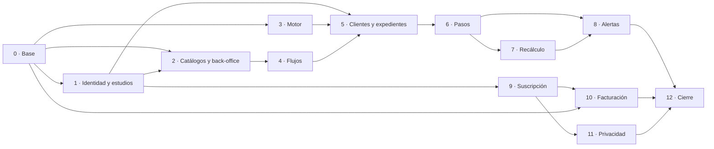

# Tareas del Backend - Asistente Legal (V1)

**Estado:** borrador v0.1 · **Fecha:** 11/11/2026

Tareas técnicas del backend (Java 21, Spring Boot 3, Maven, Flyway, PostgreSQL), bajadas desde:
- el backlog de historias (`backlog_historias_v1.md`, citado como HU-xx);
- el contrato de API (`api/openapi_v1.yaml`, citado por `operationId`);
- el modelo de datos (`modelo_de_base_de_datos_relacional.md`);
- el modelado de amenazas (`modelado_de_amenazas_v1.md`, citado por ID de amenaza).

**Tamaño:** cada tarea está pensada para 1 a 3 días de una persona. Si al empezarla resulta más grande, se parte antes de seguir.

**Formato de cada tarea:**
- **Para qué:** el resultado concreto que deja.
- **Incluye:** lo que hay que hacer.
- **Lista cuando:** cómo se verifica que está terminada.
- **Depende de:** las tareas que tienen que estar antes.

Además de sus criterios propios, toda tarea cumple la Definición de terminado del backlog: prueba de aislamiento entre estudios, prueba de permisos, validación estricta de entrada, auditoría, logs sin datos personales y análisis de seguridad en verde.

---

## Bloque 0 · Base del proyecto

### BE-01 · Proyecto base y estructura de módulos
**Para qué:** que todo el equipo construya sobre la misma estructura.
**Incluye:**
- Proyecto Maven con Java 21 y Spring Boot 3, con el *wrapper* de Maven y las versiones fijadas.
- Paquetes por módulo: `identidad`, `estudios`, `catalogos`, `calendario`, `flujos`, `motor`, `expedientes`, `alertas`, `suscripciones`, `facturacion`, `privacidad`, `auditoria`, `comun`.
- Regla de arquitectura (ArchUnit) que impide que un módulo use clases internas de otro, y que `motor` dependa de Spring o de la base.
- Endpoint de salud para el despliegue, sin información de versiones.

**Lista cuando:** `mvn verify` compila, corre la regla de arquitectura y genera el artefacto.
**Depende de:** nada.

### BE-02 · Integración continua y empaquetado
**Para qué:** que ningún cambio llegue a `main` sin pruebas ni controles de seguridad.
**Incluye:**
- Pipeline con compilación, pruebas, análisis estático, análisis de dependencias y escaneo de secretos.
- Imagen de contenedor con base mínima y versión fijada, que corre sin root.
- Bloqueo del merge si algún paso falla o hay hallazgos críticos.

**Lista cuando:** un pull request con un secreto de prueba o una dependencia vulnerable queda bloqueado.
**Depende de:** BE-01.

### BE-03 · Base de datos, Flyway y roles
**Para qué:** que las migraciones y los permisos de base queden resueltos desde el inicio.
**Incluye:**
- PostgreSQL local con Docker Compose.
- Cuatro roles:
  - `migrador`: dueño de las tablas, solo lo usa Flyway;
  - `app`: sin DDL;
  - `backoffice`: solo catálogos, calendario y flujos;
  - `jobs`.
- Flyway configurado con el rol migrador. La app arranca con el rol `app`.
- Base de pruebas de integración con Testcontainers, compartida por todos los módulos.

**Lista cuando:** las migraciones corren desde cero, y una prueba verifica que el rol `app` no puede crear ni borrar tablas.
**Depende de:** BE-01.

### BE-04 · Errores y validación de entrada
**Para qué:** que todas las respuestas de error sean uniformes y no filtren información interna.
**Incluye:**
- Manejador global que responde `application/problem+json` (RFC 9457), con los tipos del contrato y un `correlationId`.
- Jackson configurado para rechazar campos desconocidos. Bean Validation en todos los DTO de entrada.
- Errores 400, 403, 404, 409, 422, 429 y 500 con el formato del contrato, sin trazas, SQL ni rutas.

**Lista cuando:** hay pruebas para un campo extra (400), un valor fuera de rango (400), una excepción no controlada (500 genérico con `correlationId`) y otro estudio (404).
**Depende de:** BE-01.

### BE-05 · Logs, headers de seguridad y límites de tamaño
**Para qué:** que se pueda diagnosticar sin exponer datos, y que el borde quede endurecido.
**Incluye:**
- Logs JSON con campos permitidos: hora, `correlationId`, usuario, estudio, acción y resultado.
- Enmascarado de tokens, cookies, el header `Authorization` y emails.
- Headers: CSP, HSTS, `X-Content-Type-Options`, `frame-ancestors 'none'`, `Referrer-Policy` y `Permissions-Policy`.
- Límite de 1 MB por petición, y 5 MB solo en la importación de la matriz.

**Lista cuando:** una prueba que loguea una petición con cookie y token no los encuentra en la salida, y los headers están en todas las respuestas.
**Depende de:** BE-04.

### BE-06 · Rate limiting
**Para qué:** frenar la fuerza bruta y el abuso de los endpoints caros (AUT-09, MOT-05).
**Incluye:**
- Límites por IP y por usuario según la sección 6 del modelado de amenazas: login, invitaciones, vista previa del motor, exportaciones, webhooks y admin.
- Respuesta 429 con `Retry-After`.
- Librería candidata: Bucket4j. Se confirma la versión antes de agregarla.

**Lista cuando:** hay una prueba por cada grupo de límites.
**Depende de:** BE-04.

### BE-07 · Auditoría
**Para qué:** dejar registro de quién hizo qué, para el estudio y para la seguridad.
**Incluye:**
- Migración de `audit_events`, sin `UPDATE` ni `DELETE` para el rol `app`.
- Servicio `Auditoria.registrar(accion, entidad, antes, despues, motivo)` con la lista de acciones del modelo y una lista permitida de campos por entidad.
- Si la auditoría falla, la acción se revierte (misma transacción).

**Lista cuando:** una prueba verifica que un campo no permitido (por ejemplo, el email de un cliente) no se guarda en el evento.
**Depende de:** BE-03.

---

## Bloque 1 · Identidad, estudios y documentos legales

### BE-08 · Migraciones de identidad y estudios
**Para qué:** tener las tablas base de usuarios, estudios y sesiones.
**Incluye:**
- `users`, `user_identities`, `organizations`, `memberships`, `user_devices` y `user_sessions`, con sus restricciones `UNIQUE` y `CHECK` del modelo.
- `UNIQUE (provider, provider_subject)` en `user_identities`.

**Lista cuando:** las migraciones corren y las restricciones tienen pruebas.
**Depende de:** BE-03.

### BE-09 · Login con Google
**Para qué:** que el abogado entre con su cuenta de Google y se lo identifique de forma segura (AUT-01, AUT-05, AUT-08).
**Incluye:**
- Spring Security con `oauth2Login` contra Google (`iniciarLogin`). Se validan emisor, audiencia, firma y vencimiento del token de ID.
- Identificación por `sub`. Se exige `email_verified`.
- Alta de `users` y `user_identities` en el primer ingreso. Si el email cambió en Google, se actualiza sin crear otro usuario.
- El parámetro de retorno solo acepta rutas internas de una lista permitida.
- `LOGIN` y `LOGIN_RECHAZADO` en auditoría. Mensaje de rechazo genérico.

**Lista cuando:** hay pruebas con un servidor OIDC simulado para usuario nuevo, usuario existente con email cambiado, `email_verified = false` y redirección externa.
**Depende de:** BE-07, BE-08.

### BE-10 · Sesión propia, CSRF y logout
**Para qué:** que la sesión sea del backend, con vencimientos claros (AUT-02, AUT-03, AUT-04).
**Incluye:**
- Sesión persistida en `user_sessions`, con la cookie `__Host-SESSION` (`HttpOnly`, `Secure`, `SameSite=Lax`).
- Rotación del ID al autenticar.
- Vencimiento a las 8 horas de inactividad y a los 30 días como máximo.
- CSRF con el header `X-XSRF-TOKEN` en todo `POST`, `PUT`, `PATCH` y `DELETE`.
- `obtenerSesion` y `cerrarSesion`. La revocación vale desde la petición siguiente.

**Lista cuando:** hay pruebas para la sesión vencida por inactividad, la petición sin CSRF (403) y el uso de la cookie después del logout (401).
**Depende de:** BE-09.

### BE-11 · Dispositivos
**Para qué:** aplicar el límite de dispositivos del plan y permitir revocarlos (HU-05).
**Incluye:**
- Alta del dispositivo en el login.
- Al superar el límite, se cierra la sesión del dispositivo más antiguo y se marca el aviso para el usuario.
- `listarDispositivos` y `revocarDispositivo`, con `DISPOSITIVO_REVOCADO` en auditoría.

**Lista cuando:** hay una prueba con un cuarto dispositivo sobre un límite de 3, y otra que revoca un dispositivo y verifica que su sesión deja de funcionar.
**Depende de:** BE-10, BE-15.

### BE-12 · Contexto del estudio activo y variable de RLS
**Para qué:** que el estudio siempre salga de la sesión y nunca de la petición (ISO-01).
**Incluye:**
- `elegirEstudioActivo`, que verifica una membresía `ACTIVO`.
- Filtro que, en cada petición, vuelve a verificar la membresía y carga el rol.
- `SET LOCAL app.organization_id` al iniciar cada transacción. Sin estudio, la variable queda vacía.

**Lista cuando:** hay una prueba con una membresía revocada entre dos peticiones (la segunda falla) y otra que confirma que la variable se fija en cada transacción.
**Depende de:** BE-10.

### BE-13 · Row-Level Security y pruebas de aislamiento
**Para qué:** que un error en una consulta no pueda mezclar estudios (ISO-03, ISO-09).
**Incluye:**
- Políticas de RLS con `FORCE` en todas las tablas que tienen `organization_id`, ya existentes y futuras.
- Una prueba que recorre el catálogo de PostgreSQL y falla si una tabla con `organization_id` no tiene RLS forzada.
- Clase base de pruebas: dos estudios con datos, y un método para llamar a un endpoint con el usuario del otro estudio y esperar 404.
- Los intentos con un ID de otro estudio se registran como evento de seguridad (ISO-08).

**Lista cuando:** la prueba de catálogo corre en la integración continua y bloquea el merge.
**Depende de:** BE-12.

### BE-14 · Permisos por rol
**Para qué:** que cada endpoint aplique la matriz de permisos y que lo no declarado se niegue (ISO-07).
**Incluye:**
- Permisos `TITULAR`, `ABOGADO`, `ASISTENTE` y `ADMIN` según la sección 3 del modelado de amenazas, verificados en el servidor con `@PreAuthorize` o equivalente.
- Configuración que rechaza cualquier endpoint sin permisos declarados.
- Prueba que lee `x-roles` de `api/openapi_v1.yaml` y verifica, para cada operación, que un rol no permitido recibe 403.

**Lista cuando:** la prueba basada en el contrato corre para todas las operaciones implementadas.
**Depende de:** BE-12.

### BE-15 · Planes, suscripción mínima y alta del estudio
**Para qué:** que un abogado cree su estudio y arranque la prueba gratuita (HU-07).
**Incluye:**
- Migraciones de `plans` y `subscriptions`, con los planes iniciales cargados por migración.
- `crearEstudio`, de tipo `INDIVIDUAL` o `ESTUDIO`: crea el estudio, la membresía `TITULAR` y la suscripción `PRUEBA` por 30 días.
- `obtenerEstudio` y `actualizarEstudio`.

**Lista cuando:** hay una prueba que crea el estudio y verifica el rol y el vencimiento de la prueba.
**Depende de:** BE-08, BE-12.

### BE-16 · Miembros e invitaciones
**Para qué:** que el titular sume y saque miembros con seguridad (HU-08, AUT-06, AUT-10).
**Incluye:**
- `invitarMiembro`: token aleatorio de 128 bits o más, del que se guarda solo el hash; vence a los 7 días y aplica el límite de usuarios del plan (409 `limite-usuarios`).
- `aceptarInvitacion`: un solo uso, y el email de Google tiene que coincidir con el invitado.
- `listarMiembros`, `cambiarRolMiembro` y `revocarMiembro`.
- Al revocar, se cierran en la misma transacción las sesiones de ese usuario en ese estudio.
- 409 si se intenta revocar al único titular o cambiarle el rol.

**Lista cuando:** hay pruebas de token reusado, token vencido, email distinto y revocación con sesión abierta.
**Depende de:** BE-14, BE-15.

### BE-17 · Documentos legales y aceptaciones
**Para qué:** registrar qué versión aceptó cada usuario y bloquear el uso hasta que acepte (HU-06).
**Incluye:**
- Migraciones de `legal_document_versions` y `legal_acceptances`.
- `listarDocumentosVigentes`, `listarAceptacionesPendientes` y `aceptarDocumentos`. El acuerdo de encargo lo acepta solo el titular, en nombre del estudio.
- Filtro que, con aceptaciones pendientes, solo deja pasar a la sesión, los documentos y la aceptación.
- `DOCUMENTO_LEGAL_ACEPTADO` en auditoría.

**Lista cuando:** hay pruebas de usuario nuevo bloqueado, versión nueva con reaceptación y titular aceptando el acuerdo de encargo.
**Depende de:** BE-15.

### BE-18 · Perfil y preferencias de aviso
**Para qué:** que el usuario vea y corrija sus datos y elija qué recibe por email (HU-34, HU-46).
**Incluye:**
- Migración de `notification_preferences`.
- `obtenerPerfil`, `obtenerPreferencias` y `actualizarPreferencias`. Por defecto, el resumen no trae la carátula ni el cliente.

**Lista cuando:** hay una prueba que verifica los valores por defecto.
**Depende de:** BE-12.

---

## Bloque 2 · Catálogos, calendario y back-office

### BE-19 · Migraciones y datos iniciales de catálogos
**Para qué:** tener PBA, sus departamentos, el fuero laboral, los regímenes y el horario cargados.
**Incluye:**
- Migraciones de `jurisdictions`, `jurisdiction_schedules`, `judicial_departments`, `legal_branches`, `procedural_regimes`, `department_regimes` y `courts`.
- Migración con los datos iniciales: PBA, sus departamentos, Laboral, las leyes 11.653 y 15.057, y el horario de 8 a 14 con gracia hasta las 12.

**Lista cuando:** las migraciones corren y hay una consulta de prueba sobre los datos iniciales.
**Depende de:** BE-03.

### BE-20 · Seguridad del back-office
**Para qué:** que el back-office quede separado del resto y sin acceso a los datos de los estudios (BO-01, BO-02, BO-04).
**Incluye:**
- Cadena de seguridad propia para `/api/admin/v1`, que exige `system_role = ADMIN`.
- Admins solo del dominio de Google Workspace de la empresa (claim `hd`), con la verificación en dos pasos forzada por política del dominio.
- Sesión de admin de 1 hora de inactividad, y alerta al responsable en cada login de admin.
- `DataSource` con el rol de base `backoffice`. Las acciones se auditan con `actor_type = ADMIN`.

**Lista cuando:** hay pruebas de un usuario común contra `/api/admin/v1` (403), de un admin de otro dominio (rechazado) y de que el rol `backoffice` no puede leer `legal_cases`.
**Depende de:** BE-10, BE-14, BE-19.

### BE-21 · API de catálogos para los usuarios
**Para qué:** que el frontend pueda armar el alta del expediente.
**Incluye:**
- `listarJurisdicciones`, `listarDepartamentos` y `listarTribunales` (filtrado por departamento).
- `resolverRegimen`: dado un tribunal y una fecha, devuelve el régimen y avisa si es inconsistente con el del departamento.

**Lista cuando:** hay pruebas de resolución para un tribunal de la Ley 11.653, uno de la 15.057 y un caso inconsistente.
**Depende de:** BE-19.

### BE-22 · Administración de tribunales, regímenes y horarios
**Para qué:** que el admin mantenga los catálogos sin tocar la base (HU-10).
**Incluye:**
- `crearTribunal` y `actualizarTribunal`. El régimen no se puede cambiar si el tribunal ya tiene expedientes judiciales.
- `crearRegimenDepartamento` y `listarRegimenesDepartamento`. Una superposición de períodos responde 409.
- `crearHorario` y `listarHorarios`, con la norma de referencia obligatoria. El recálculo de los pasos afectados se conecta en BE-49.

**Lista cuando:** hay pruebas de superposición y de cambio de régimen bloqueado.
**Depende de:** BE-20.

### BE-23 · Calendario e inhábiles del estudio
**Para qué:** tener el calendario consultable y los días inhábiles propios de cada estudio.
**Incluye:**
- Migraciones de `holidays_calendar` y `calendar_coverage`, con la cobertura `PROVISORIO` inicial de PBA.
- `obtenerCalendario` por rango (máximo 1 año), que incluye los inhábiles del estudio activo.
- `crearInhabilEstudio` y `borrarInhabilEstudio`, con alcance `ORGANIZACION` y bajo RLS (MOT-06). El recálculo se conecta en BE-49.
- `listarCobertura` en el back-office.

**Lista cuando:** hay una prueba de que el inhábil de un estudio no aparece en el calendario de otro.
**Depende de:** BE-13, BE-19.

---

## Bloque 3 · Motor de plazos

### BE-24 · Contrato del motor y casos de prueba
**Para qué:** fijar la entrada y la salida del motor y tener los casos de prueba antes de programar el cálculo (HU-13).
**Incluye:**
- Módulo `motor` en Java puro, sin Spring ni base de datos.
- Tipos de entrada:
  - tipo de plazo;
  - inicio;
  - valor;
  - gracia;
  - prórroga;
  - tipo de límite horario.
- Contexto del cálculo: calendario, inhábiles administrativos, inhábiles del estudio, suspensiones, horario y cobertura.
- Resultado tipado: vencimiento nominal, efectivo, límite ordinario y límite con gracia; días recorridos con el motivo de cada salto; advertencias; estado del calendario.
- Validación de `MAX_VALOR` por tipo y de las combinaciones no permitidas: gracia fuera de `CON_GRACIA` y prórroga fuera de `CON_PRORROGA`.
- Los casos 1 a 23, E1 y E2 del documento de lógica como pruebas parametrizadas. Al terminar esta tarea solo pasan los de validación.

**Lista cuando:** las pruebas de validación pasan y los rechazos E1 y E2 dan el mismo mensaje que `herramientas/motor_plazos_referencia.py`.
**Depende de:** BE-01.

### BE-25 · Plazos en días
**Para qué:** calcular los plazos más usados del fuero.
**Incluye:**
- `HABILES_JUDICIALES` (R1), `CORRIDOS` (R2) y `HABILES_ADMINISTRATIVOS` (R6: las ferias no suspenden).
- Prórroga (`extension_days`) y plazo de gracia, con el límite según `CIERRE_HORARIO_JUDICIAL` o `FIN_DEL_DIA`.
- El motivo de cada día salteado: feriado, feria, asueto, inhábil del estudio o suspensión.

**Lista cuando:** pasan todos los casos de prueba de estos tipos.
**Depende de:** BE-24.

### BE-26 · Plazos en horas, meses y años, fecha fijada, anticipación y sin plazo
**Para qué:** completar los 9 tipos de plazo.
**Incluye:**
- `HORAS` desde el instante (R8).
- `MESES` y `ANIOS` (R7), con la marca `calendar_incomplete` si vencen después del calendario cargado.
- `FECHA_FIJADA`, con la advertencia `FECHA_EN_DIA_INHABIL`.
- `ANTICIPACION_HABILES_JUDICIALES` hacia atrás (R9).
- `SIN_PLAZO`.
- El estado `CALENDARIO_NO_CARGADO` cuando el tipo exige calendario y el período no está cubierto. Con cobertura `PROVISORIO`, el resultado se marca como aproximado.

**Lista cuando:** pasan los 23 casos y los rechazos E1 y E2, con los mismos resultados que el motor de referencia.
**Depende de:** BE-25.

### BE-27 · Adaptador del motor y vista previa
**Para qué:** conectar el motor con los datos reales y ofrecer la vista previa (HU-15).
**Incluye:**
- Servicio que arma el contexto del cálculo desde la base:
  - feriados por alcance;
  - inhábiles del estudio;
  - suspensiones del expediente, si las hay;
  - horario vigente a la fecha;
  - cobertura y `calendar_version`.
- `calcularPlazo`, que no guarda nada y aplica el rate limiting de BE-06.

**Lista cuando:** hay una prueba de integración que carga un feriado y una feria y obtiene el mismo resultado que el caso de prueba equivalente.
**Depende de:** BE-23, BE-26.

---

## Bloque 4 · Flujos e importación de la matriz

### BE-28 · Migraciones de flujos y lectura de una versión
**Para qué:** guardar las versiones de los flujos y que el frontend pueda mostrar el mapa.
**Incluye:**
- Migraciones de `flows`, `flow_versions`, `flow_nodes`, `flow_node_checklist_items` y `flow_transitions`.
- Una versión `PUBLICADA` no se puede modificar (trigger o permisos de base).
- `obtenerVersionFlujo`, con nodos, transiciones y checklist.
- `listarFlujos` para el back-office: cada flujo con sus versiones, estado, quién publicó y notas.

**Lista cuando:** hay una prueba de que un `UPDATE` sobre un nodo de una versión publicada falla.
**Depende de:** BE-19.

### BE-29 · Lectura segura de la planilla
**Para qué:** recibir el XLSX sin exponerse a archivos maliciosos (BO-03).
**Incluye:**
- `importarMatriz` (multipart): máximo 5 MB, y validación de que sea un ZIP de Office por sus bytes iniciales.
- Apache POI con límites de descompresión y sin entidades externas. Solo se leen valores, nunca fórmulas.
- Guardado de la planilla leída como importación en `BORRADOR`, con el SHA-256 del archivo.
- Almacenamiento del archivo en el almacenamiento privado de objetos (adaptador reutilizable para facturas y exportaciones).

**Lista cuando:** hay pruebas con un archivo renombrado (rechazado), un ZIP de descompresión excesiva (rechazado) y la matriz real del repo (aceptada).
**Depende de:** BE-20, BE-28.

### BE-30 · Validaciones de la matriz
**Para qué:** que una matriz mal armada nunca llegue a publicarse (MOT-07).
**Incluye:**
- Las validaciones de la sección 4 del documento de proyecto:
  - IDs únicos;
  - transiciones con origen y destino existentes;
  - un solo nodo inicial;
  - plazos coherentes con su tipo;
  - gracia solo en los tipos que la admiten;
  - valores dentro de `MAX_VALOR`.
- `obtenerImportacion`, con los errores por hoja y fila.

**Lista cuando:** la matriz del repo da cero errores, y los tres errores inyectados de `herramientas/matriz/verificar_excel.py` se detectan con el mismo mensaje.
**Depende de:** BE-29.

### BE-31 · Publicación de una versión del flujo
**Para qué:** convertir una importación validada en la versión que usan los expedientes nuevos.
**Incluye:**
- `publicarVersionFlujo`, con quién lo aprobó por el equipo legal y las notas del cambio.
- Solo se publica una importación sin errores. La versión anterior queda vigente para los expedientes que ya la usan.
- Auditoría con `actor_type = ADMIN`.

**Lista cuando:** hay pruebas de publicación con errores (409) y de que un expediente existente conserva la versión anterior.
**Depende de:** BE-30.

---

## Bloque 5 · Clientes y expedientes

### BE-32 · Migraciones de datos del estudio
**Para qué:** tener las tablas transaccionales con el aislamiento desde el primer día.
**Incluye:**
- `clients`, `legal_cases`, `case_parties`, `case_steps`, `case_suspensions`, `case_step_checklist_items` y `alert_settings`.
- Claves foráneas compuestas `(organization_id, id)` (ISO-02).
- El `CHECK` de `legal_cases` que admite un expediente de Ley 15.057 sin flujo.
- RLS con `FORCE` en todas (la prueba de BE-13 las cubre).
- Columna de versión para el bloqueo optimista en `case_steps`.

**Lista cuando:** hay una prueba de que asociar un expediente al cliente de otro estudio falla en la base.
**Depende de:** BE-13, BE-28.

### BE-33 · Clientes
**Para qué:** cargar y buscar los clientes del estudio (HU-16).
**Incluye:**
- `crearCliente`, `obtenerCliente`, `actualizarCliente` y `eliminarCliente` (borrado lógico; 409 si tiene expedientes activos).
- `listarClientes` con búsqueda por nombre o documento, paginada hasta 100 por página.
- Validación del formato del DNI o CUIT.

**Lista cuando:** hay pruebas de búsqueda, paginación y borrado bloqueado.
**Depende de:** BE-32.

### BE-34 · Límite de clientes activos
**Para qué:** aplicar los tramos del plan sin que dos altas simultáneas lo salteen (HU-18, PAG-04).
**Incluye:**
- Servicio `LimiteClientes`: cuenta los clientes con al menos un expediente `ACTIVO` o `PAUSADO`, bajo `SELECT … FOR UPDATE` sobre la suscripción.
- 409 `limite-clientes` solo al sumar un cliente que no contaba.
- Marca de "llegó al 80 %" para la UI.
- `LIMITE_CLIENTES_ALCANZADO` en auditoría.

**Lista cuando:** hay una prueba con dos altas concurrentes en el límite (pasa una sola) y otra con un cliente que ya contaba (pasa).
**Depende de:** BE-15, BE-33.

### BE-35 · Alta de un expediente nuevo
**Para qué:** dar de alta un expediente con el régimen y el flujo correctos (HU-17).
**Incluye:**
- `crearExpediente`: resuelve el régimen con el servicio de BE-21, y responde 422 `regimen-sin-definir` si no se puede.
- Si el régimen es inconsistente, se usa el del tribunal, con un aviso y auditado.
- Etapa previa: flujo `PREJUDICIAL` y su hito inicial. Etapa judicial: el flujo vigente del régimen.
- Régimen sin flujo publicado: el expediente se crea sin flujo.
- Aplica el límite de BE-34.

**Lista cuando:** hay pruebas de los cuatro caminos: prejudicial, judicial, sin flujo y sin régimen.
**Depende de:** BE-21, BE-31, BE-34.

### BE-36 · Alta de un expediente en curso
**Para qué:** que el abogado cargue su cartera existente (HU-19).
**Incluye:**
- Alta con fecha de interposición y uno o más hitos actuales.
- Por cada hito: Día Cero, que se calcula con el motor, o vencimiento `MANUAL` con motivo.
- Los hitos anteriores quedan en el estado "anterior a la carga".
- Si un plazo cargado ya venció, la respuesta lo marca para que la UI pregunte si se cumplió.
- `EXPEDIENTE_EN_CURSO_CARGADO` en auditoría.

**Lista cuando:** hay pruebas con dos hitos actuales, uno calculado y uno manual, y con un plazo ya vencido.
**Depende de:** BE-27, BE-35.

### BE-37 · Consulta y ciclo de vida del expediente
**Para qué:** listar, editar, terminar y reactivar expedientes (HU-20).
**Incluye:**
- `listarExpedientes`: búsqueda (también por tribunal), filtros por responsable, departamento y rol representado, paginado y `statusCounts` por pestaña. En cada fila, el nivel y los días hábiles del próximo vencimiento.
- `obtenerExpediente` y `actualizarExpediente` (409 si se cambia el tribunal con flujo judicial).
- `terminarExpediente`, con motivo y fecha obligatorios.
- `reactivarExpediente`, que aplica el límite de clientes.
- `eliminarExpediente` como borrado lógico.

**Lista cuando:** hay una prueba de que terminar el último expediente de un cliente libera su lugar en el plan.
**Depende de:** BE-35.

### BE-38 · Interposición de la demanda
**Para qué:** pasar de la etapa previa al flujo judicial (HU-21).
**Incluye:**
- `asignarFlujoJudicial`, con tribunal y fecha de interposición: resuelve el régimen, asigna la versión vigente y abre su hito inicial.
- Régimen sin flujo: queda el régimen y solo admite plazos sueltos.

**Lista cuando:** hay pruebas con la Ley 11.653 (abre el flujo) y la 15.057 (sin flujo).
**Depende de:** BE-35.

### BE-39 · Partes y suspensiones
**Para qué:** cargar contrapartes y suspensiones de plazos (HU-22, HU-28).
**Incluye:**
- `listarPartes`, `crearParte`, `actualizarParte` y `borrarParte`, con su rol procesal.
- `listarSuspensiones`, `crearSuspension` y `borrarSuspension`, con `SUSPENSION_CARGADA` en auditoría. El recálculo se conecta en BE-49.

**Lista cuando:** hay una prueba de una suspensión con la fecha de fin anterior a la de inicio (400).
**Depende de:** BE-32.

---

## Bloque 6 · Ficha del expediente y pasos

### BE-40 · Mapa del flujo con perspectiva
**Para qué:** mostrar dónde está la causa y a quién le toca actuar (HU-23).
**Incluye:**
- `obtenerMapa`: cada nodo con su estado (futuro, actual, vencido, completado, salteado, no cumplido, anulado o anterior a la carga). "Vencido" se deriva: no se guarda.
- Responsable visto desde el rol representado: "te toca", "le toca a la contraparte" o "esperando al tribunal".
- `listarPasos` y `obtenerPaso`.

**Lista cuando:** hay una prueba con el mismo flujo visto desde actor y desde demandado.
**Depende de:** BE-35.

### BE-41 · Plazo del paso
**Para qué:** cargar el Día Cero y ajustar el plazo, con el cálculo siempre en el servidor (HU-24, MOT-03, MOT-04).
**Incluye:**
- `actualizarPlazo`: recibe los datos de entrada, nunca un vencimiento calculado, salvo `MANUAL` en un paso cargado en curso.
- Un valor distinto del legal exige motivo y queda marcado como "modificado manualmente".
- Prórroga solo en plazos en días.
- `PLAZO_EDITADO` en auditoría, con los datos de entrada, la `calendar_version` y el resultado.

**Lista cuando:** hay pruebas de un vencimiento enviado por el cliente (400), un valor distinto del legal sin motivo (400) y la prórroga en `HORAS` (422).
**Depende de:** BE-27, BE-40.

### BE-42 · Avanzar de etapa
**Para qué:** mover el expediente por el camino elegido (HU-25).
**Incluye:**
- `avanzarEtapa`: valida que la transición salga del nodo del paso, completa el paso y abre todos los destinos (en paralelo si son varios).
- Fecha y hora del cargo (`filed_at`) opcional.
- Transición de cierre: no abre pasos.
- 409 `paso-no-pendiente`, y bloqueo optimista ante dos avances simultáneos.

**Lista cuando:** hay pruebas de una bifurcación en paralelo, un avance doble concurrente (pasa uno) y una transición de otro nodo (422).
**Depende de:** BE-41.

### BE-43 · Saltear y retroceder
**Para qué:** corregir el recorrido sin perder historia (HU-26).
**Incluye:**
- `saltearEtapa`, con motivo y `ETAPA_SALTEADA`.
- `retrocederEtapa`: anula los pasos que abrió y devuelve el paso a `PENDIENTE` con su vencimiento original.
- 409 `retroceso-con-dependientes` si los anulados abrieron otros pasos.
- 409 con el detalle de la actividad si falta `confirmActivity`.
- Nada se borra. `ETAPA_RETROCEDIDA` en auditoría.

**Lista cuando:** hay pruebas de los tres caminos: limpio, con dependientes y con actividad sin confirmar.
**Depende de:** BE-42.

### BE-44 · Plazos sueltos, cumplido, no cumplido y anulación
**Para qué:** cargar intimaciones y cerrar los pasos vencidos (HU-27, HU-31).
**Incluye:**
- `crearPlazoSuelto`, asociado al hito actual como contexto.
- `marcarCumplido`, con el cargo opcional.
- `registrarNoCumplido`, con motivo y la salida del hito si existe. No lo puede usar el `ASISTENTE`.
- `anularPlazoSuelto`. Ninguno de los tres cambia la posición en el flujo.

**Lista cuando:** hay pruebas de un asistente registrando "no cumplido" (403) y de un plazo suelto completado sin mover el flujo.
**Depende de:** BE-41.

### BE-45 · Checklist e historial
**Para qué:** tildar tareas y ver todo lo que pasó en el expediente (HU-29, HU-30).
**Incluye:**
- Al abrir un paso, se copian los ítems del checklist de su versión de flujo.
- `actualizarItemChecklist`, con quién y cuándo.
- `obtenerHistorial`: eventos de auditoría del expediente, paginados, solo con campos permitidos.

**Lista cuando:** hay una prueba de que el historial de un expediente no trae eventos de otro.
**Depende de:** BE-42.

---

## Bloque 7 · Recálculo y cambios de calendario

### BE-46 · Servicio de recálculo de pasos pendientes
**Para qué:** recalcular los vencimientos cuando cambia algo que los afecta.
**Incluye:**
- Recálculo por expediente, por estudio o por jurisdicción, en lotes de un solo estudio por transacción (ISO-04).
- Solo los pasos `PENDIENTE` que no sean `MANUAL`.
- Por cada vencimiento que cambia, un registro en `deadline_change_notices` con el antes, el después, la causa y la dirección (`ATRASA`, `ADELANTA`, `SIN_FECHA`). Si el resultado es el mismo, no se registra nada.

**Lista cuando:** hay una prueba de que un feriado nuevo corre un vencimiento, se registra el cambio y un paso `MANUAL` no se toca.
**Depende de:** BE-27, BE-41.

### BE-47 · Vista previa de un cambio de calendario
**Para qué:** ver el impacto antes de publicar, sobre todo los vencimientos que se atrasan (MOT-02).
**Incluye:**
- `simularCambioCalendario`: corre el recálculo sin guardar y devuelve cuántos pasos cambian, cuántos se adelantan y cuántos se atrasan, sin datos de los estudios.
- Lo ejecuta el rol `jobs`, no el de `backoffice`, para no darle a este acceso a los datos de los estudios.

**Lista cuando:** hay una prueba de que un feriado que atrasa dos vencimientos los informa como atrasos.
**Depende de:** BE-23, BE-46.

### BE-48 · Aplicar un cambio de calendario y validar la cobertura
**Para qué:** publicar el calendario de forma controlada (HU-11, MOT-01, BO-05).
**Incluye:**
- `aplicarCambioCalendario`: 409 si hay atrasos y falta `confirmDelays`. Incrementa `calendar_version`, lanza el recálculo y registra `CALENDARIO_MODIFICADO` con los valores anteriores y nuevos.
- Asueto o feria sin norma de referencia: 400.
- `actualizarCobertura`: para pasar a `OFICIAL` exige un validador distinto de quien hizo el cambio.

**Lista cuando:** hay pruebas de un cambio con atrasos sin confirmar (409) y de la cobertura `OFICIAL` con el mismo usuario (409).
**Depende de:** BE-47.

### BE-49 · Conectar el recálculo con los demás disparadores
**Para qué:** que todos los cambios que mueven plazos recalculen.
**Incluye:**
- Recálculo al crear o borrar un inhábil del estudio, al cargar o quitar una suspensión, al cambiar un horario y al reprogramar el acto de referencia de una anticipación (R9).
- `listarAvisosCambio` (con `scope`, `caseId` y `seen`) y `marcarAvisosVistos`. "Visto" es por usuario (`deadline_change_notice_reads`) y se permite en solo lectura.

**Lista cuando:** hay una prueba por cada disparador, y otra de que lo que marca un miembro no oculta el aviso a los demás.
**Depende de:** BE-22, BE-23, BE-39, BE-46.

---

## Bloque 8 · Alertas y emails

### BE-50 · Dashboard y parámetros del semáforo
**Para qué:** mostrar primero lo vencido y después lo que se viene (HU-31, HU-32, HU-33).
**Incluye:**
- `obtenerDashboard`:
  - "Vencidos sin cumplir" arriba de todo;
  - pasos en plazo de gracia;
  - rojos y amarillos según los umbrales en días hábiles;
  - oportunidades por pasos de la contraparte, si el usuario no las desactivó;
  - marca de cálculo aproximado;
  - `businessDaysRemaining` en cada tarjeta, y el mismo dato con `alertLevel` en los pasos de `obtenerMapa`;
  - parámetro `scope` (`MIOS` o `ESTUDIO`), con el valor por defecto según el rol.
- `obtenerParametrosAlertas` y `actualizarParametrosAlertas`: el rojo tiene que ser menor que el amarillo; `ALERTAS_CONFIGURADAS` en auditoría.
- Consulta con índices adecuados y un tiempo objetivo con 2.000 pasos por estudio.

**Lista cuando:** hay una prueba con un paso de cada categoría, y otra de rendimiento con el volumen objetivo.
**Depende de:** BE-40, BE-44.

### BE-51 · Infraestructura de jobs
**Para qué:** que los procesos programados corran una sola vez, por estudio, y con monitoreo (ISO-04, JOB-06).
**Incluye:**
- Programador con bloqueo distribuido (candidato: ShedLock, a confirmar versión), para que con dos instancias el job corra una sola vez.
- Unidad de trabajo por estudio, que fija la variable de RLS y aísla los errores de un estudio de los demás.
- Registro de cada ejecución, con alerta si un job no terminó a la hora esperada.

**Lista cuando:** hay una prueba con dos instancias (corre una vez) y otra con un estudio que falla (los demás siguen).
**Depende de:** BE-13.

### BE-52 · Envío de emails
**Para qué:** mandar emails transaccionales de forma confiable y sin datos de más.
**Incluye:**
- Adaptador del proveedor de email, con la credencial en el gestor de secretos.
- Plantillas con escape automático para el resumen diario, las invitaciones, la baja, el arrepentimiento, las facturas y el aviso de purga.
- Reintentos y registro del resultado, sin el contenido.
- Requisito de infraestructura: SPF, DKIM y DMARC en el dominio (JOB-01).

**Lista cuando:** hay una prueba de plantilla con un nombre que contiene HTML (sale escapado).
**Depende de:** BE-05.

### BE-53 · Resumen diario por email
**Para qué:** que el abogado se entere de sus vencimientos sin abrir la app (HU-34, JOB-02).
**Incluye:**
- Job a la hora configurada (por defecto, 07:00): por usuario, junta sus vencidos, rojos, amarillos y oportunidades de cada estudio donde está activo, con el mismo `scope` por defecto que el dashboard.
- Por defecto, solo cantidades y números de expediente; carátula y cliente, solo con la preferencia activada.
- No se envía si no hay novedades. Alerta si a las 07:30 no salió.

**Lista cuando:** hay pruebas de un usuario en dos estudios, de un día sin novedades y de la preferencia desactivada (sin carátula).
**Depende de:** BE-18, BE-50, BE-51, BE-52.

---

## Bloque 9 · Suscripción y cobro

### BE-54 · Planes, estado de la suscripción y modo de solo lectura
**Para qué:** mostrar los planes y bloquear las escrituras cuando corresponde (HU-36, HU-39, PAG-05).
**Incluye:**
- `listarPlanes` y `obtenerSuscripcion`, con "X de N clientes activos".
- Filtro que, con la suscripción en `SOLO_LECTURA` o `CANCELADA`, responde 403 `suscripcion-solo-lectura` a toda escritura. Siguen permitidos la exportación, el pago, la baja y la sesión.

**Lista cuando:** hay pruebas de una escritura en solo lectura (403) y de una exportación en solo lectura (permitida).
**Depende de:** BE-15, BE-34.

### BE-55 · Checkout con el proveedor de pagos
**Para qué:** cobrar sin que la app vea datos de tarjeta (HU-37, PAG-03, PAG-06).
**Incluye:**
- Puerto `ProveedorPagos` con un adaptador para el proveedor elegido (propuesta: Mercado Pago, a confirmar).
- `iniciarCheckout`: el precio sale de `plans` y nunca del cliente. Exige los datos fiscales antes del primer cobro.
- Credenciales del proveedor en el gestor de secretos.

**Lista cuando:** hay una prueba con el proveedor simulado de que un precio enviado por el cliente se rechaza (400 por campo desconocido).
**Depende de:** BE-54, BE-59.

### BE-56 · Webhook de pagos
**Para qué:** registrar los pagos solo cuando son reales (PAG-01, PAG-02).
**Incluye:**
- `recibirWebhookPagos`:
  - verifica la firma y la ventana de tiempo;
  - descarta los repetidos por `UNIQUE (provider, provider_event_id)`;
  - confirma el estado consultando la API del proveedor;
  - compara el importe con el plan.
- Migración de `payment_events`, en la que se guarda solo la lista permitida de campos.
- Un pago confirmado activa la suscripción y crea la factura `PENDIENTE` en la misma transacción.

**Lista cuando:** hay pruebas de firma inválida, evento repetido, importe distinto (no activa y genera alerta) y pago correcto (activa y crea la factura).
**Depende de:** BE-55.

### BE-57 · Ciclo de vida de la suscripción
**Para qué:** aplicar los plazos de prueba, mora y solo lectura sin intervención manual (HU-39).
**Incluye:**
- Job diario:
  - fin de la prueba sin plan, a `SOLO_LECTURA`;
  - cobro fallido, a `EN_MORA` con reintento 7 días;
  - después de los 7 días, a `SOLO_LECTURA` por 30 días;
  - pago durante la solo lectura, a `ACTIVA`.
- Emails de aviso en cada cambio, y la fecha de borrado visible para la UI.

**Lista cuando:** hay pruebas de cada transición con un reloj controlado.
**Depende de:** BE-51, BE-52, BE-56.

### BE-58 · Cambio de plan, baja y arrepentimiento
**Para qué:** que el titular cambie de plan o se vaya sin fricción (HU-38, HU-40, PAG-07).
**Incluye:**
- `simularCambioPlan` y `cambiarPlan`: la subida es inmediata, y la bajada queda programada (409 `bajada-supera-limite` si no entran los clientes). El job de BE-57 aplica la bajada al cambiar de período.
- `darDeBaja` y `anularBaja`: la baja rige al final del período, con número de trámite y email.
- `arrepentirse`: dentro de 10 días corridos; devuelve lo cobrado por el proveedor y dispara la nota de crédito. Fuera de plazo, 409.
- `PLAN_CAMBIADO`, `BAJA_SOLICITADA` y `ARREPENTIMIENTO_SOLICITADO` en auditoría.

**Lista cuando:** hay pruebas de bajada que no entra, baja anulada y arrepentimiento en el día 11 (409).
**Depende de:** BE-56, BE-57.

---

## Bloque 10 · Facturación electrónica (ARCA)

### BE-59 · Datos fiscales del estudio
**Para qué:** tener los datos para facturar bien (HU-42).
**Incluye:**
- Migración de `billing_profiles`.
- `obtenerDatosFiscales` y `actualizarDatosFiscales`, con validación del dígito verificador del CUIT y la condición frente al IVA.

**Lista cuando:** hay pruebas de un CUIT con dígito inválido (400).
**Depende de:** BE-15.

### BE-60 · Autenticación con ARCA (WSAA)
**Para qué:** obtener el ticket de acceso a los web services de ARCA sin exponer el certificado (FAC-01, FAC-04).
**Incluye:**
- Cliente WSAA que firma el pedido con el certificado y la clave leídos del gestor de secretos.
- Caché del ticket de acceso (unas 12 horas) en memoria. El ticket nunca va a los logs.
- Configuración separada para homologación y producción, con certificados distintos.

**Lista cuando:** se obtiene un ticket en homologación, y una prueba confirma que los logs del proceso no contienen el ticket.
**Depende de:** BE-05. Requiere el certificado de homologación (trámite en ARCA).

### BE-61 · Emisión de facturas (WSFEv1)
**Para qué:** autorizar cada factura sin duplicados ni huecos (HU-43, FAC-02, FAC-05).
**Incluye:**
- Migración de `invoices`.
- Job que toma las facturas `PENDIENTE`, consulta `FECompUltimoAutorizado` y pide el CAE con `FECAESolicitar`.
- En un reintento, si el comprobante ya estaba autorizado, lo recupera y no pide otro número.
- Tipo de comprobante según la condición del emisor y del receptor (regla a validar con el contador).
- Si ARCA no responde, la factura queda pendiente; nunca afecta el acceso del estudio.

**Lista cuando:** se emite una factura en homologación, y una prueba simula un corte después de autorizar y verifica que el reintento no duplica el número.
**Depende de:** BE-51, BE-56, BE-59, BE-60.

### BE-62 · PDF, envío, listado y notas de crédito
**Para qué:** que el titular reciba y descargue sus facturas, y que los reembolsos se documenten (HU-44, FAC-03, ISO-06).
**Incluye:**
- PDF con el código QR de ARCA, guardado en el almacenamiento privado y enviado al email de facturación, con `FACTURA_EMITIDA` en auditoría.
- `listarFacturas` y `descargarFactura` por un endpoint autenticado que verifica el estudio.
- Nota de crédito asociada para el arrepentimiento y los reembolsos. La factura autorizada no se modifica.

**Lista cuando:** hay pruebas de descarga desde otro estudio (404) y de una nota de crédito emitida en homologación.
**Depende de:** BE-29 (almacenamiento), BE-52, BE-61.

---

## Bloque 11 · Privacidad y retención

### BE-63 · Exportación de los datos del estudio
**Para qué:** que el titular se lleve todos sus datos (HU-45, JOB-03, JOB-04).
**Incluye:**
- Migración de `data_exports`.
- `pedirExportacion`, `obtenerExportacion` y `listarExportaciones` (últimos 7 días): un proceso en segundo plano genera un JSON o un XLSX con clientes, expedientes, pasos e historial.
- En el XLSX, los valores que empiezan con `=`, `+`, `-` o `@` se escapan.
- Enlace firmado, de un solo uso y válido por 24 horas. Máximo 3 pedidos por día. `DATOS_EXPORTADOS` en auditoría.

**Lista cuando:** hay pruebas de un enlace usado dos veces (rechazado), un valor con `=` (escapado) y un cuarto pedido en el día (429).
**Depende de:** BE-29 (almacenamiento), BE-51.

### BE-64 · Purga de los datos del estudio
**Para qué:** borrar los datos al terminar la relación, como dice el acuerdo de encargo (HU-41, JOB-05).
**Incluye:**
- Job: aviso al titular 7 días antes. Al cumplirse el plazo, vuelve a verificar en la misma transacción que la suscripción no se haya reactivado y borra los datos del estudio.
- Se conservan la fila del estudio, sus datos fiscales y sus facturas. `DATOS_DEL_ESTUDIO_ELIMINADOS` en auditoría.
- Constancia de la destrucción, para entregar si el titular la pide.

**Lista cuando:** hay una prueba de un estudio que vuelve a pagar el día anterior a la purga (no se borra) y otra de una purga completa (solo quedan las tablas conservadas).
**Depende de:** BE-51, BE-52, BE-57.

### BE-65 · Retención de logs, sesiones y eventos
**Para qué:** no guardar datos más tiempo del declarado en la política de privacidad.
**Incluye:**
- Job que borra las sesiones vencidas, las invitaciones vencidas, los logs de aplicación a los 90 días y los eventos de seguridad de la cuenta al año, según la tabla de retención.
- También los avisos de cambio a los 180 días y los registros de exportación a los 30.
- Los eventos de auditoría de un estudio activo no se borran.

**Lista cuando:** hay una prueba con datos de cada antigüedad.
**Depende de:** BE-51.

---

## Bloque 12 · Operación y cierre de la V1

### BE-66 · Alertas de seguridad y métricas
**Para qué:** enterarse a tiempo de un ataque o de una falla (sección 8 del modelado de amenazas).
**Incluye:**
- Métricas de errores 4xx y 5xx, latencia, jobs y emails.
- Alertas por:
  - logins rechazados repetidos;
  - intentos con IDs de otro estudio;
  - login de admin;
  - webhooks con firma inválida;
  - importe de pago distinto;
  - falla del job de alertas o de facturación.

**Lista cuando:** cada alerta tiene una prueba que la dispara en el entorno de staging.
**Depende de:** BE-13, BE-20, BE-51, BE-56.

### BE-67 · Prueba del contrato y preparación del pentest
**Para qué:** confirmar que lo implementado coincide con el contrato y llegar a la prueba de penetración sin pendientes conocidos (B5).
**Incluye:**
- Prueba que valida las peticiones y respuestas contra `api/openapi_v1.yaml`. Candidato: `swagger-request-validator` de Atlassian, a confirmar versión.
- Revisión del checklist previo al despliegue del modelado de amenazas, con cada ítem resuelto o aceptado por escrito.
- Ambiente de staging con datos ficticios para el pentest.

**Lista cuando:** la prueba del contrato pasa para todas las operaciones y el checklist no tiene ítems sin responsable.
**Depende de:** todas las anteriores.

---

## Resumen y dependencias

| Bloque | Tareas | Bloqueos externos |
| :--- | :--- | :--- |
| 0 · Base | BE-01 a BE-07 | — |
| 1 · Identidad y estudios | BE-08 a BE-18 | Cliente OAuth de Google |
| 2 · Catálogos y back-office | BE-19 a BE-23 | Dominio de Google Workspace para los admins |
| 3 · Motor | BE-24 a BE-27 | Dudas legales D28 y siguientes (cambian valores, no la estructura) |
| 4 · Flujos | BE-28 a BE-31 | Matriz validada por el abogado |
| 5 · Clientes y expedientes | BE-32 a BE-39 | — |
| 6 · Pasos | BE-40 a BE-45 | — |
| 7 · Recálculo | BE-46 a BE-49 | — |
| 8 · Alertas | BE-50 a BE-53 | Proveedor de email y dominio con SPF, DKIM y DMARC |
| 9 · Suscripción | BE-54 a BE-58 | Proveedor de pagos y precios |
| 10 · Facturación | BE-59 a BE-62 | Certificado y punto de venta de ARCA; condición fiscal del emisor |
| 11 · Privacidad | BE-63 a BE-65 | — |
| 12 · Cierre | BE-66 a BE-67 | Hosting elegido; proveedor del pentest |

**Lo que se puede hacer en paralelo:**
- El motor (BE-24 a BE-26) solo depende de BE-01: lo puede llevar una persona desde el primer día.
- La autenticación con ARCA (BE-60) depende solo de BE-05 y del certificado: conviene arrancarla temprano porque el trámite lleva tiempo.
- Los bloques 4 (flujos) y 1 (identidad) no dependen entre sí.

