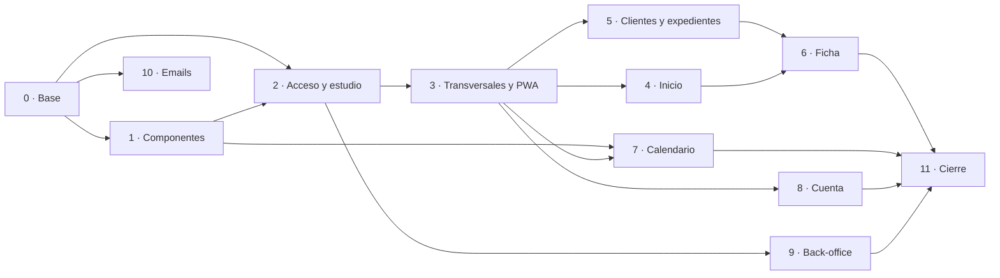

# Tareas del Frontend - Foja (V1)

**Estado:** borrador v0.1 · **Fecha:** 11/11/2026

Tareas técnicas del frontend (React como PWA), bajadas desde:
- el diseño de pantallas (`diseno_de_pantallas_v1.md`, citado como P01 a P18 y por sección, por ejemplo "3.4");
- el backlog de historias (`backlog_historias_v1.md`, citado como HU-xx);
- el contrato de API (`api/openapi_v1.yaml`, citado por `operationId`);
- la identidad visual (`identidad_y_diseno_v1.md` y `diseno/tokens.css`);
- el modelado de amenazas (`modelado_de_amenazas_v1.md`, citado por ID de amenaza).

**Tamaño:** cada tarea está pensada para 1 a 3 días de una persona. Si al empezarla resulta más grande, se parte antes de seguir.

**Formato de cada tarea:**
- **Para qué:** el resultado concreto que deja.
- **Incluye:** lo que hay que hacer.
- **Lista cuando:** cómo se verifica que está terminada.
- **Depende de:** las tareas del frontend que tienen que estar antes.
- **Backend:** las tareas de `tareas_backend_v1.md` que hacen falta para integrarla de verdad. Mientras no estén, la tarea se hace contra la API simulada (FE-07) y se integra después.

**Definición de terminado del frontend.** Además de sus criterios propios, toda tarea cumple:
1. Pruebas automatizadas de lo que agrega (componentes con Vitest y Testing Library; flujos con Playwright cuando la tarea lo pide).
2. Se ve y funciona como su maqueta en 1440 px y en 390 px de ancho, con los textos de `diseno_de_pantallas_v1.md`.
3. Sin violaciones de accesibilidad de axe en lo que agrega, y se puede usar entero con el teclado.
4. Lo que el rol no puede hacer no se muestra; lo que el plan no permite, se muestra deshabilitado con la explicación (3.6).
5. Ningún dato del estudio en `localStorage`, `sessionStorage`, IndexedDB, la caché del *service worker*, la URL (salvo IDs) ni la consola.
6. Sin `dangerouslySetInnerHTML`, sin `eval` ni HTML armado con texto, y sin scripts o estilos que inyecten etiquetas en línea (para que funcione la CSP de AUT-02).
7. Lint, tipos, pruebas, análisis de dependencias y escaneo de secretos en verde en la integración continua.

## Herramientas propuestas

React como PWA está decidido. Lo demás es una propuesta: antes de agregar cada paquete se confirma su nombre exacto en npm, la versión estable vigente y que no tenga avisos de seguridad abiertos, y se fija en el lockfile.

| Necesidad | Propuesta | Por qué |
| ----- | ----- | ----- |
| Lenguaje y compilación | TypeScript en modo estricto, Vite | Tipos generados desde el contrato; compilación rápida. |
| Rutas | React Router | Rutas anidadas y carga diferida por pantalla. |
| Datos del servidor | TanStack Query (`@tanstack/react-query`) | Caché en memoria, reintentos y estados de carga uniformes. |
| Cliente de la API | `openapi-typescript` y `openapi-fetch` | Tipos y llamadas generados desde `api/openapi_v1.yaml`, sin escribirlos a mano. |
| Formularios | React Hook Form y Zod | Validación declarativa y errores por campo. |
| PWA | `vite-plugin-pwa` | Manifest y *service worker* que solo guarda la interfaz. |
| Íconos | `lucide-react` | Definido en la identidad. |
| Fuente | Inter, archivos `woff2` servidos desde la app | Sin pedidos a Google Fonts ni a terceros (identidad, sección 5). |
| Estilos | CSS Modules con las variables de `diseno/tokens.css` | Sin librerías que inyecten `<style>` en tiempo de ejecución, por la CSP. |
| Pruebas | Vitest, Testing Library, MSW, Playwright, `@axe-core/playwright` | Unidad, API simulada, punta a punta y accesibilidad. |
| Lint | ESLint con `eslint-plugin-jsx-a11y` y reglas de seguridad de React | Accesibilidad y prohibiciones de la Definición de terminado. |

---

## Bloque 0 · Base del proyecto

### FE-01 · Proyecto base y estructura
**Para qué:** que todo el equipo construya sobre la misma estructura (HU-01).
**Incluye:**
- Proyecto con Vite, React y TypeScript estricto. Versión de Node.js fijada (`.nvmrc` y `engines`) y lockfile en el repositorio.
- Carpetas por funcionalidad: `inicio`, `expedientes`, `clientes`, `calendario`, `cuenta`, `acceso`, `backoffice`, y `comun` para los componentes, la API y las utilidades.
- Dos puntos de entrada: la app de los estudios y el back-office (ver FE-59). El código del back-office no entra en el paquete de la app.
- Variables de entorno solo para datos públicos (por ejemplo, el nombre del entorno). Ningún secreto en el frontend.

**Lista cuando:** `npm run build` genera los dos paquetes, y una prueba verifica que el paquete de la app no contiene textos del back-office.
**Depende de:** nada.

### FE-02 · Integración continua
**Para qué:** que ningún cambio llegue a `main` sin pruebas ni controles.
**Incluye:**
- Pipeline con lint, verificación de tipos, pruebas, compilación, `npm audit` (o la herramienta de análisis de dependencias del equipo) y escaneo de secretos.
- Presupuesto de tamaño: el JavaScript inicial de la app no supera 200 KB comprimido.
- Bloqueo del merge si algún paso falla o hay hallazgos críticos.

**Lista cuando:** un pull request con un secreto de prueba, una dependencia vulnerable o un paquete que supera el presupuesto queda bloqueado.
**Depende de:** FE-01.

### FE-03 · Tokens, fuente y estilos globales
**Para qué:** que la app use la identidad visual sin repetir valores.
**Incluye:**
- Importar `diseno/tokens.css` como fuente única de colores, espaciados, radios y tipografía. Si hace falta un valor nuevo, se agrega ahí y en la identidad.
- Inter en `woff2` (pesos 400, 500, 600 y 700) servida por la app, con `font-display: swap` y números tabulares para fechas.
- Estilos base: reset, foco visible (anillo de 3 px en Tinta 200), `prefers-reduced-motion` sin animaciones, texto al 200 % sin cortes.

**Lista cuando:** una página de prueba con textos y colores coincide con `diseno/vista_previa.png`, y la pestaña de red no muestra pedidos a dominios externos.
**Depende de:** FE-01.

### FE-04 · Cliente de la API
**Para qué:** llamar a la API con tipos del contrato y con las reglas de sesión y CSRF resueltas en un solo lugar.
**Incluye:**
- Tipos generados desde `api/openapi_v1.yaml` con un script (`npm run api:tipos`). La integración continua falla si el archivo generado no está al día.
- Cliente con `credentials: 'same-origin'`, el header `X-XSRF-TOKEN` (leído de la cookie `XSRF-TOKEN`) en todo `POST`, `PUT`, `PATCH` y `DELETE`, y un tiempo máximo de 15 segundos por petición.
- Lectura de `application/problem+json` a un error tipado: estado, tipo de problema, errores por campo y `correlationId`.
- Nunca se loguean cuerpos de petición ni de respuesta.

**Lista cuando:** hay pruebas de una escritura que lleva el header CSRF, de un 400 con errores por campo convertido al error tipado y de una petición que supera el tiempo máximo.
**Depende de:** FE-01.
**Backend:** BE-04, BE-10.

### FE-05 · Capa de datos y caché por estudio
**Para qué:** que los datos de un estudio nunca se vean en otro y que las pantallas se actualicen solas después de una acción (ISO-05).
**Incluye:**
- TanStack Query con claves que empiezan siempre por el estudio activo (`[organizationId, 'expedientes', …]`).
- Al cambiar de estudio, cerrar sesión o recibir un 401, se vacía toda la caché.
- Sin reintentos para errores 4xx; hasta 2 reintentos para errores de red y 5xx. Respeta `Retry-After` en los 429.
- Invalidaciones por acción documentadas en un solo archivo (por ejemplo, avanzar etapa invalida el mapa, los pasos, el dashboard y el historial del expediente).

**Lista cuando:** una prueba cambia de estudio y verifica que no queda ningún dato del anterior en la caché.
**Depende de:** FE-04.

### FE-06 · Rutas, marco de la app y navegación
**Para qué:** tener el esqueleto navegable de todas las pantallas (1.1, sección 2).
**Incluye:**
- Todas las rutas de la sección 2, con carga diferida por pantalla y una página provisoria para las que no estén hechas.
- Marco de escritorio (barra lateral de 240 px y barra superior), de tablet (barra lateral de 72 px solo con íconos) y de celular (barra inferior de 5 lugares).
- Títulos de página por ruta y anuncio del cambio de página para lectores de pantalla.

**Lista cuando:** se puede recorrer cada ruta con el teclado en los tres anchos, y una prueba de Playwright compara el marco con las capturas de P03 en 1440 y 390 px.
**Depende de:** FE-03.

### FE-07 · API simulada para desarrollo y pruebas
**Para qué:** avanzar con las pantallas sin esperar al backend, con datos iguales a los de las maquetas.
**Incluye:**
- MSW con manejadores para cada operación de la sección 2, tipados con los tipos generados.
- Datos de ejemplo del 11/11/2026 de las maquetas (GÓMEZ, LÓPEZ, PÉREZ, RUIZ, SOSA, DÍAZ), con el asueto del 13/11 en San Isidro.
- Escenarios conmutables: estudio vacío, solo lectura, límite de clientes, calendario no cargado, rol asistente, error 500.
- Solo se activa en desarrollo y en las pruebas; nunca entra al paquete de producción.

**Lista cuando:** la app arranca en desarrollo sin backend y muestra Inicio con los datos de la maqueta; una prueba verifica que el paquete de producción no incluye MSW.
**Depende de:** FE-04.

### FE-08 · Pruebas punta a punta y accesibilidad en la integración continua
**Para qué:** detectar regresiones de flujo y de accesibilidad en cada pull request.
**Incluye:**
- Playwright con dos perfiles: escritorio (1440 × 900) y celular (390 × 844).
- Revisión de axe en cada pantalla visitada por las pruebas.
- Una prueba de humo inicial: abrir Inicio con la API simulada.

**Lista cuando:** la prueba de humo corre en la integración continua y falla si se introduce un botón sin nombre accesible.
**Depende de:** FE-02, FE-06, FE-07.

---

## Bloque 1 · Componentes base

### FE-09 · Botones, íconos y etiquetas de estado
**Para qué:** que las acciones y los estados se vean igual en toda la app (identidad, sección 7).
**Incluye:**
- Botón primario, secundario, de texto, de peligro y de peligro lleno, en tamaños normal y chico, con estado "Guardando…" y deshabilitado con *tooltip*.
- Componente de ícono con el mapa de significados de la identidad (sección 6), para no elegir íconos de Lucide sueltos en cada pantalla.
- Etiqueta de estado con color, ícono y texto (vencido, atención, cumplido, oportunidad, actual, neutro).

**Lista cuando:** cada variante tiene una prueba, y ninguna etiqueta se puede crear sin texto.
**Depende de:** FE-03.

### FE-10 · Campos de formulario
**Para qué:** armar formularios rápido, con validación y errores uniformes (3.5).
**Incluye:**
- Campo con etiqueta, ayuda y error; texto, área, selector, opciones (radio), casilla e interruptor.
- Fecha (`DD/MM/AAAA` con el día de la semana) y fecha con hora (24 h), en la zona horaria `America/Argentina/Buenos_Aires`.
- Integración con React Hook Form y Zod; validación al salir del campo y al enviar.
- Errores por campo que vienen en un 400 del backend, ubicados en su campo, con el foco en el primero.
- Ayuda fija "No incluyas datos de salud ni otros datos sensibles" para los textos libres.

**Lista cuando:** hay pruebas de un 400 del backend mostrado en su campo y de una fecha cargada que no se corre de día por la zona horaria.
**Depende de:** FE-09.

### FE-11 · Diálogos y hojas inferiores
**Para qué:** confirmar acciones de forma accesible y consistente (3.4, sección 5).
**Incluye:**
- Diálogo centrado en escritorio y hoja inferior en celular, con foco atrapado, cierre con Escape y devolución del foco al botón que lo abrió.
- Variante con motivo obligatorio.
- Variante destructiva, que pide escribir el número de expediente o el nombre del cliente para habilitar el botón.
- Aviso "Tenés cambios sin guardar" al cerrar un diálogo o salir de una ruta con cambios.

**Lista cuando:** hay pruebas de foco y teclado para las tres variantes, y la destructiva no se puede confirmar sin el texto exacto.
**Depende de:** FE-10.

### FE-12 · Franjas, *toasts*, esqueletos y vacíos
**Para qué:** mostrar estados de la app sin inventar un formato en cada pantalla (3.1, 3.2, P15).
**Incluye:**
- Franja informativa, de atención, de error y de éxito, con `role="status"` o `role="alert"` según el caso.
- *Toast* de 6 segundos con acción opcional ("Deshacer"), abajo en el centro.
- Esqueletos para tarjetas, filas de tabla y paneles.
- Estado vacío con ícono, texto y acción; variante "No hay resultados con estos filtros".

**Lista cuando:** la lámina P15 se puede reproducir con estos componentes, y un lector de pantalla anuncia el *toast*.
**Depende de:** FE-09.

### FE-13 · Pestañas, chips, tablas y paginación
**Para qué:** listas y filtros iguales en todas las pantallas.
**Incluye:**
- Pestañas con contador y navegación con flechas.
- Chips de filtro, simples y con menú.
- Tabla que en celular pasa a tarjetas, con la misma información.
- Paginación con "Mostrando 1 a 20 de 57", sobre `page` y `size` del contrato.

**Lista cuando:** la tabla de P04 se arma con estos componentes en los dos anchos.
**Depende de:** FE-09.

### FE-14 · Tarjeta de vencimiento y formato de fechas
**Para qué:** que un vencimiento se lea igual en Inicio, la ficha, el calendario y los diálogos (3.10).
**Incluye:**
- Utilidades de fecha: las fechas sin hora del contrato (`YYYY-MM-DD`) se tratan como fechas locales, nunca como UTC; los instantes se muestran en la hora de Buenos Aires.
- Textos relativos: "Hoy", "En N días hábiles", "Venció el …", "Último momento: hasta hoy a las 12:00". El frontend nunca cuenta días hábiles: el número tiene que venir del backend.
- Tarjeta con su franja de estado y todas las variantes de 3.10: aproximado (borde punteado y leyenda), a confirmar, cargado a mano, plazo modificado y "Cambió: antes … ahora …".

**Lista cuando:** hay pruebas de cada variante y una prueba que corre con la zona horaria del sistema en UTC y muestra el mismo día.
**Depende de:** FE-09.
**Bloqueo:** el contrato todavía no trae los días hábiles que faltan (`DashboardItem` y `DeadlineResult` solo traen el nivel y la fecha; diseño de pantallas, sección 6). Hasta entonces, la etiqueta muestra la fecha ("Mar 17/11") en lugar de "En 3 días hábiles".

---

## Bloque 2 · Acceso, sesión y estudio

### FE-15 · Ingreso con Google
**Para qué:** que el usuario entre en un clic (P01, HU-04).
**Incluye:**
- Pantalla P01 en escritorio y celular. El botón navega a `iniciarLogin`.
- Parámetro de retorno: solo rutas internas que empiezan con `/` y no con `//`; cualquier otra cosa vuelve a `/inicio` (AUT-08).
- Mensaje de error genérico, siempre el mismo.

**Lista cuando:** hay pruebas de un retorno a `/expedientes/…` (se respeta) y a `https://otro.com` o `//otro.com` (se ignora).
**Depende de:** FE-06, FE-09.
**Backend:** BE-09.

### FE-16 · Sesión, vencimiento y cierre de sesión
**Para qué:** saber siempre quién es el usuario y reaccionar bien cuando la sesión termina (3.3, HU-05).
**Incluye:**
- `obtenerSesion` al arrancar. Sin sesión, a `/ingresar`; sin estudio, a `/bienvenida`.
- Ante un 401 en cualquier petición: diálogo "Tu sesión terminó" (P15, pieza 5), sin perder lo cargado en el formulario (queda en memoria).
- Menú del avatar y "Cerrar sesión" (`cerrarSesion`), que vacía la caché y vuelve a `/ingresar`.

**Lista cuando:** una prueba simula un 401 en medio de un formulario, vuelve a ingresar y el formulario conserva los datos.
**Depende de:** FE-05, FE-11, FE-15.
**Backend:** BE-10.

### FE-17 · Bienvenida y creación del estudio
**Para qué:** que el primer usuario cree su estudio aceptando los documentos (P02, HU-06, HU-07).
**Incluye:**
- Paso 1: documentos vigentes (`listarDocumentosVigentes`), casillas sin tildar y "Leer el texto completo" en un panel. El texto legal se muestra como texto, no como HTML.
- Paso 2: "Trabajo solo" o "Con un equipo", nombre del estudio y aviso de la prueba de 30 días.
- "Crear mi estudio" con `aceptarDocumentos` y `crearEstudio`, deshabilitado hasta completar todo.

**Lista cuando:** hay pruebas de que no se puede crear sin las tres casillas y de que, al terminar, se llega a Inicio vacío.
**Depende de:** FE-10, FE-16.
**Backend:** BE-15, BE-17.

### FE-18 · Invitaciones y nuevas versiones de documentos
**Para qué:** que un invitado entre a un estudio y que todos acepten los cambios legales antes de seguir (HU-06, HU-08).
**Incluye:**
- Ruta `/invitacion?token=`: "María te invitó a Estudio Zena como Abogado", documentos y `aceptarInvitacion`. El token se saca de la URL apenas se lee (`history.replaceState`).
- Puerta de aceptación: si `listarAceptacionesPendientes` devuelve algo, el diálogo de P15 (pieza 3) bloquea la app hasta aceptar o salir.

**Lista cuando:** hay pruebas de una invitación vencida (mensaje claro), de una invitación aceptada y de la puerta con una versión nueva.
**Depende de:** FE-17.
**Backend:** BE-16, BE-17.

### FE-19 · Selector de estudio
**Para qué:** que un usuario de varios estudios cambie entre ellos sin mezclar datos (1.3).
**Incluye:**
- Selector abajo en la barra lateral (en celular, dentro de Cuenta) con los estudios de la sesión, el plan y el rol.
- `elegirEstudioActivo`, vaciado de la caché y vuelta a Inicio.

**Lista cuando:** una prueba con dos estudios cambia de uno a otro y no queda ningún dato del primero en pantalla ni en la caché.
**Depende de:** FE-05, FE-16.
**Backend:** BE-12.

---

## Bloque 3 · Estados transversales, permisos y PWA

### FE-20 · Manejo global de errores
**Para qué:** que cada error tenga la respuesta de la tabla 3.3, sin decidirlo pantalla por pantalla.
**Incluye:**
- Traducción de cada respuesta (400, 401, 403, 404, 409, 429, 500 y sin red) al componente que corresponde.
- Página "No encontramos este expediente" (mismo mensaje para inexistente y de otro estudio) y página "No tenés permiso".
- Franja de error inesperado con el `correlationId`, sin detalles técnicos.
- Límite de error de React por ruta, para que una pantalla rota no tire abajo la app.

**Lista cuando:** hay una prueba por cada fila de la tabla 3.3.
**Depende de:** FE-12, FE-16.

### FE-21 · Permisos por rol y modo solo lectura
**Para qué:** mostrar solo lo que el rol puede hacer y bloquear las escrituras cuando el plan terminó (3.6, 3.7, HU-39).
**Incluye:**
- Mapa `operationId → roles` generado desde `x-roles` del contrato, junto con los tipos (FE-04). Un *hook* `usePuede('registrarNoCumplido')` decide si se muestra la acción.
- Modo solo lectura según el estado de la suscripción: franja de P15 (pieza 1) y botones de escritura deshabilitados con "No disponible en solo lectura". Un 403 `suscripcion-solo-lectura` activa el modo aunque la app no lo supiera.
- Ninguna de estas decisiones reemplaza los controles del backend: la UI solo oculta o deshabilita.

**Lista cuando:** hay pruebas con los tres roles sobre la ficha (el asistente no ve "No se cumplió" ni "Eliminar") y con una suscripción en solo lectura.
**Depende de:** FE-04, FE-20.
**Backend:** BE-14, BE-54.

### FE-22 · PWA y sin conexión
**Para qué:** que la app se pueda instalar y que, sin red, no aparente guardar nada (3.9, identidad sección 10).
**Incluye:**
- Manifest con nombre, colores e íconos de la identidad (192, 512, *maskable* y `apple-touch-icon`).
- *Service worker* que guarda solo los archivos de la interfaz. Las respuestas de `/api/` nunca se guardan.
- Aviso "Hay una versión nueva de Foja" con "Actualizar".
- Sin conexión: franja de P15 (pieza 4) y acciones bloqueadas; al volver, recarga los datos.

**Lista cuando:** la auditoría PWA de Lighthouse pasa, y una prueba verifica que la caché del *service worker* no tiene ninguna URL de `/api/`.
**Depende de:** FE-06, FE-12.
**Bloqueo:** los íconos definitivos dependen del logo final (identidad, pendiente 3); mientras tanto se usan los de `diseno/isotipo.svg`.

### FE-23 · Buscador global
**Para qué:** encontrar un expediente o un cliente desde cualquier pantalla (1.2).
**Incluye:**
- Buscador de la barra superior (en celular, desde la lupa) con `listarExpedientes` y `listarClientes` (`q`), a partir de 3 caracteres, con 300 ms de espera y cancelando el pedido anterior.
- Resultados agrupados (hasta 5 de cada tipo) y "Ver todos"; navegación con flechas, Enter y Escape; atajo `/`.

**Lista cuando:** hay pruebas de teclado y de que una respuesta vieja no pisa a una nueva.
**Depende de:** FE-05, FE-06.
**Backend:** BE-33, BE-37.

---

## Bloque 4 · Inicio

### FE-24 · Inicio: vencidos, próximos y oportunidades
**Para qué:** que el abogado vea primero lo urgente (P03, HU-31 a HU-33).
**Incluye:**
- `obtenerDashboard` en el orden fijo de P03: vencidos sin cumplir y último momento, próximos (rojo y amarillo), oportunidades.
- Tarjetas con FE-14; tocar una lleva a la ficha con el paso elegido (`?paso=`).
- Aviso de calendario con `calendarStatus`, estado vacío y esqueletos.
- Contador de la navegación (vencidos sin cumplir más último momento).

**Lista cuando:** con los datos de la maqueta, Inicio coincide con la captura de P03 en los dos anchos, y el contador muestra 2.
**Depende de:** FE-14, FE-20.
**Backend:** BE-50.

### FE-25 · Inicio: expedientes activos y filtro "Míos"
**Para qué:** completar Inicio con la lista corta de expedientes (P03).
**Incluye:**
- Tabla con los 10 de vencimiento más próximo (`listarExpedientes`, `sort=PROXIMO_VENCIMIENTO`) y "Ver todos".
- Chips "Míos / Todo el estudio", solo en el plan Estudio.

**Lista cuando:** la tabla coincide con la maqueta y el filtro cambia lo que muestran las tarjetas y la tabla.
**Depende de:** FE-13, FE-24.
**Backend:** BE-37, BE-50.
**Bloqueo:** el filtro necesita el parámetro de `obtenerDashboard` que falta en el contrato (diseño de pantallas, sección 6). Hasta entonces, se muestra solo "Todo el estudio".

### FE-26 · Aviso "tu vencimiento cambió"
**Para qué:** que nadie se pierda un vencimiento que se movió por un recálculo (3.8).
**Incluye:**
- Franja en Inicio ("Cambió 1 vencimiento por un asueto en San Isidro") con "Ver cambios", que lista antes y después.
- Marca "Cambió: antes … ahora …" en la tarjeta y en el paso hasta que se ve; franja roja si el cambio adelanta un vencimiento.

**Lista cuando:** hay pruebas de un cambio que atrasa y de uno que adelanta, y el aviso desaparece después de verlo.
**Depende de:** FE-24.
**Backend:** BE-46.
**Bloqueo:** faltan en el contrato las operaciones de avisos y en el modelo la tabla (diseño de pantallas, sección 6).

---

## Bloque 5 · Clientes y expedientes

### FE-27 · Lista de expedientes
**Para qué:** encontrar y filtrar los expedientes del estudio (P04, HU-20).
**Incluye:**
- Pestañas Activos, Pausados y Terminados (`status`), filtro de texto (`q`), orden (`sort`) y paginación.
- Filtros y página en la URL (`?estado=PAUSADO&q=perez&pagina=2`), para que sobrevivan a "Atrás" y se puedan compartir.
- En celular, tarjetas y el chip "Clientes".

**Lista cuando:** hay pruebas de que un filtro sobrevive a recargar la página y a "Atrás".
**Depende de:** FE-13, FE-14, FE-20.
**Backend:** BE-37.
**Bloqueo:** los filtros de responsable, departamento y rol y los contadores por pestaña necesitan cambios en el contrato (diseño de pantallas, sección 6). Mientras tanto, esos chips no se muestran.

### FE-28 · Clientes: lista y detalle
**Para qué:** ver y mantener los datos de cada cliente (P09, HU-16).
**Incluye:**
- Contador de clientes activos del plan, buscador, chips y tabla (`listarClientes`).
- Detalle (`obtenerCliente`) en panel derecho, y en celular como pantalla propia; "Editar" (`actualizarCliente`) con los campos del contrato.
- Sus expedientes y "Nuevo expediente para este cliente" (abre el alta con el cliente elegido).
- El DNI, el teléfono y el email solo aparecen en el detalle.

**Lista cuando:** hay pruebas de edición con error por campo y de la navegación al alta con el cliente cargado.
**Depende de:** FE-10, FE-13.
**Backend:** BE-33, BE-34.

### FE-29 · Eliminar, terminar, pausar y reactivar
**Para qué:** cerrar el ciclo de vida de clientes y expedientes con las confirmaciones correctas (HU-16, HU-20).
**Incluye:**
- Eliminar cliente (`eliminarCliente`) y expediente (`eliminarExpediente`): solo titular y abogado, con el diálogo destructivo. Eliminar cliente se deshabilita con la explicación si tiene expedientes activos.
- Terminar (`terminarExpediente`): motivo del contrato (sentencia, acuerdo, desistimiento, otro) y fecha; avisa si libera el lugar del cliente.
- Pausar (`actualizarExpediente` con `currentStatus`) y reactivar (`reactivarExpediente`), con el aviso de límite de clientes ante un 409.

**Lista cuando:** hay pruebas de cada acción, incluida la reactivación bloqueada por el límite.
**Depende de:** FE-11, FE-21, FE-28.
**Backend:** BE-33, BE-34, BE-37.

### FE-30 · Alta, paso 1: cliente
**Para qué:** elegir o crear el cliente del expediente (P05, HU-17).
**Incluye:**
- Indicador de pasos (Cliente, Proceso, Situación) con vuelta a pasos hechos sin perder datos.
- Buscar un cliente existente (`listarClientes`) o crear uno (`crearCliente`) sin salir del alta.
- El estado del alta vive en memoria mientras dura; no se guarda en el navegador.

**Lista cuando:** hay pruebas de ida y vuelta entre pasos sin pérdida y de un cliente creado desde el alta.
**Depende de:** FE-10, FE-28.
**Backend:** BE-33.

### FE-31 · Alta, paso 2: proceso y régimen
**Para qué:** cargar los datos del proceso y saber con qué flujo se va a trabajar (P05, HU-17, HU-18).
**Incluye:**
- Carátula, número, jurisdicción (PBA fija; CABA y Federal "Próximamente"), departamento (`listarDepartamentos`), tribunal dependiente (`listarTribunales`), rol y responsable.
- Franja de régimen con `resolverRegimen`; si no se puede resolver, lo explica y no deja seguir.
- Resumen lateral con lo cargado y si el cliente ya cuenta en el plan.

**Lista cuando:** hay pruebas de cambio de departamento (vacía el tribunal) y de un régimen que no se puede resolver.
**Depende de:** FE-30.
**Backend:** BE-21.

### FE-32 · Alta, paso 3: expediente nuevo y límite de clientes
**Para qué:** crear un expediente que arranca desde el principio del flujo (HU-17, HU-18).
**Incluye:**
- Opción "Es nuevo" y "Crear expediente" (`crearExpediente`), que lleva a la ficha.
- Ante el 409 `limite-clientes`: aviso de P15 (pieza 2) en lugar del botón, con "Cambiar de plan". Al volver del cambio de plan, el formulario sigue completo.

**Lista cuando:** hay pruebas del alta completa y del límite con regreso sin pérdida de datos.
**Depende de:** FE-31.
**Backend:** BE-34, BE-35.

### FE-33 · Alta en curso: elegir los hitos actuales
**Para qué:** cargar un expediente que ya está en trámite (P06, HU-19).
**Incluye:**
- Fecha de interposición de la demanda.
- Mapa del flujo de la versión resuelta (`obtenerVersionFlujo`) para elegir uno o más hitos actuales.
- Los anteriores se muestran como "Anteriores a la carga"; los `SIN_PLAZO`, como "Esperando al tribunal".

**Lista cuando:** hay pruebas de dos hitos actuales en paralelo y de un hito sin plazo.
**Depende de:** FE-31.
**Backend:** BE-28, BE-36.

### FE-34 · Alta en curso: Día Cero y vencimientos
**Para qué:** que cada hito cargado tenga su vencimiento correcto desde el primer día (P06, HU-19, MOT-03).
**Incluye:**
- Por cada hito actual, los datos que pide su tipo de plazo y la vista previa con `calcularPlazo`.
- "No sé el Día Cero": vencimiento y motivo, que queda como `MANUAL`.
- Si el vencimiento calculado ya pasó: "¿Se cumplió?" en el momento.
- `crearExpediente` con los hitos y sus datos de entrada. El frontend nunca envía un vencimiento calculado por él, solo los `MANUAL`.

**Lista cuando:** hay pruebas de un hito calculado, uno manual y uno vencido al cargar.
**Depende de:** FE-33, FE-37 y FE-38. Reusa la calculadora de la ficha, así que se hace después de esas dos aunque esté en este bloque.
**Backend:** BE-27, BE-36.

---

## Bloque 6 · Ficha del expediente

### FE-35 · Ficha: cabecera, pestañas y edición
**Para qué:** tener el marco de la pantalla principal de trabajo (P07, HU-20).
**Incluye:**
- Cabecera con `obtenerExpediente`: carátula, número, cliente (enlace), tribunal, rol, versión del flujo y responsable.
- "Editar datos" (`actualizarExpediente`), con el 409 del tribunal explicado; menú "Más" con las acciones de FE-29.
- Pestañas Flujo, Partes, Suspensiones e Historial como rutas (`/expedientes/:id/partes`, …).

**Lista cuando:** hay pruebas de edición y de navegación directa a cada pestaña por URL.
**Depende de:** FE-13, FE-29.
**Backend:** BE-37.

### FE-36 · Mapa del flujo
**Para qué:** que el abogado vea dónde está el expediente y qué viene (P07, HU-23).
**Incluye:**
- Lista vertical por fase con `obtenerMapa`: estados (completado, actual, futuro, vencido, anulado), de quién es cada paso y fecha.
- Fases sin actividad colapsadas ("9 hitos anteriores a la carga") y "Ver flujo completo".
- Varios hitos actuales a la vez; tocar uno lo elige en el panel de acción.
- Plazos sueltos debajo del mapa.
- Lista ordenada para lectores de pantalla ("Paso 3 de 21, …, actual, te toca a vos").

**Lista cuando:** con los datos de la maqueta, el mapa coincide con la captura de P07, y la lectura con lector de pantalla es la de 3.11.
**Depende de:** FE-14, FE-35.
**Backend:** BE-40.

### FE-37 · Panel de acción: hitos actuales y calculadora
**Para qué:** cargar los datos de un plazo y ver su vencimiento al instante (P07, HU-14, HU-15).
**Incluye:**
- Chips para elegir el hito actual cuando hay más de uno; el elegido queda en la URL (`?paso=`).
- Campos según el tipo de plazo: Día Cero para los plazos en días, fecha del hecho para meses y años, fecha y hora para horas y fecha fijada, audiencia de referencia para la anticipación, nada para `SIN_PLAZO`.
- Vista previa con `calcularPlazo`: 400 ms de espera después del último cambio, cancelación del pedido anterior y aviso amable ante un 429 (el límite es 60 por minuto).

**Lista cuando:** hay una prueba por tipo de plazo, y una prueba que tipea rápido y verifica que sale un solo pedido.
**Depende de:** FE-10, FE-36.
**Backend:** BE-27, BE-41.

### FE-38 · Resultado del cálculo y "¿Por qué vence ese día?"
**Para qué:** que el abogado entienda y confíe en el vencimiento (HU-15).
**Incluye:**
- Resultado con vencimiento, etiqueta de estado y gracia ("Si no llegás: hasta …").
- Plazo corrido trasladado ("Se puede presentar hasta …").
- Diálogo día por día con `computedDays`: días contados, salteados con su motivo y versión del calendario.
- Avisos del panel: calendario provisorio, calendario no cargado (sin fecha, con "Cargar vencimiento a mano"), a confirmar, fecha fijada en inhábil, varios demandados.

**Lista cuando:** hay una prueba por cada aviso y el diálogo coincide con el de P08 para el caso del dictamen.
**Depende de:** FE-11, FE-37.
**Backend:** BE-27.

### FE-39 · Cambiar el plazo, prórroga y vencimiento manual
**Para qué:** corregir un plazo dejando registro de por qué (HU-24).
**Incluye:**
- "Cambiar el plazo" (`actualizarPlazo`): plazo a usar y motivo obligatorio; el resultado queda marcado "Plazo modificado a mano".
- "+1 día hábil (asueto o falla del sistema)" con `extensionDays`.
- Vencimiento cargado a mano con motivo, cuando el calendario no está cargado.

**Lista cuando:** hay pruebas de cada corrección y del error por motivo vacío.
**Depende de:** FE-38.
**Backend:** BE-41.

### FE-40 · Avanzar etapa, lo cumplí y no se cumplió
**Para qué:** mover el expediente por el flujo (HU-25, HU-31).
**Incluye:**
- "Avanzar etapa" (`avanzarEtapa`): sin bifurcación ni cargo, directo con *toast* y "Deshacer"; con bifurcación, el diálogo de P08 para elegir la salida.
- "Lo cumplí" (`marcarCumplido`): fecha y hora del cargo, si fue en término o en gracia, y la oferta de avanzar.
- "No se cumplió" (`registrarNoCumplido`, solo titular y abogado): motivo y cómo sigue.
- Las mismas acciones desde las tarjetas de Inicio, con el mismo diálogo.

**Lista cuando:** hay pruebas de los tres diálogos desde la ficha y desde Inicio, y de que la tarjeta de Inicio desaparece después de la acción.
**Depende de:** FE-11, FE-21, FE-24, FE-37.
**Backend:** BE-42, BE-44.

### FE-41 · Saltear y retroceder
**Para qué:** corregir la posición en el flujo con motivo (HU-26).
**Incluye:**
- "Saltear etapa" (`saltearEtapa`) con motivo y qué queda sin hacer.
- "Retroceder etapa" (`retrocederEtapa`) con motivo y, si hay actividad, cuál se anula y la casilla de confirmación.
- "Deshacer" del *toast* de avanzar abre retroceder.
- En celular, las dos van en "Más acciones".

**Lista cuando:** hay pruebas de retroceder con y sin actividad, y desde el *toast*.
**Depende de:** FE-40.
**Backend:** BE-43.

### FE-42 · Checklist del paso
**Para qué:** que el abogado lleve las tareas y documentos de cada paso (HU-29).
**Incluye:**
- Lista con `actualizarItemChecklist`, que guarda al tildar con actualización optimista y vuelve atrás si falla.
- Quién tildó y cuándo.

**Lista cuando:** hay pruebas de un tildado que falla y vuelve atrás con el aviso.
**Depende de:** FE-37.
**Backend:** BE-45.

### FE-43 · Plazos sueltos
**Para qué:** cargar plazos que no están en el flujo, como una intimación (HU-27).
**Incluye:**
- "Agregar plazo suelto" (`crearPlazoSuelto`): qué hay que hacer, tipo, cantidad, Día Cero y gracia, con vista previa (`calcularPlazo`) antes de guardar.
- "Anular" (`anularPlazoSuelto`) con motivo.
- Los plazos sueltos aparecen en la ficha, en Inicio y en el calendario.

**Lista cuando:** hay pruebas del alta con vista previa y de la anulación.
**Depende de:** FE-38.
**Backend:** BE-44.

### FE-44 · Pestaña Partes
**Para qué:** registrar las partes del expediente (HU-22).
**Incluye:**
- Lista, alta, edición y baja (`listarPartes`, `crearParte`, `actualizarParte`, `borrarParte`) con los campos del contrato.
- Con más de un demandado, se activa el aviso de la calculadora (FE-38).

**Lista cuando:** hay pruebas del ciclo completo y del aviso de varios demandados.
**Depende de:** FE-35.
**Backend:** BE-39.

### FE-45 · Pestaña Suspensiones
**Para qué:** cargar suspensiones de plazos y ver qué cambió (HU-28).
**Incluye:**
- Lista, alta (`crearSuspension`, diálogo de P08) y baja (`borrarSuspension`).
- Después de guardar, el aviso de vencimientos que cambiaron (FE-26, o un resumen en la misma pestaña mientras FE-26 esté bloqueada).

**Lista cuando:** hay pruebas de alta con fecha "hasta" anterior a "desde" (error) y de baja.
**Depende de:** FE-35.
**Backend:** BE-39, BE-46.

### FE-46 · Pestaña Historial
**Para qué:** ver qué pasó en el expediente, quién lo hizo y por qué (HU-30).
**Incluye:**
- `obtenerHistorial` paginado, con acción, persona, fecha y motivo.
- Pasos anulados o no cumplidos, tachados.
- Los valores anteriores y nuevos que vienen del backend, como texto.

**Lista cuando:** hay pruebas de paginación y de un motivo con caracteres especiales (se muestra como texto).
**Depende de:** FE-35.
**Backend:** BE-45.

---

## Bloque 7 · Calendario

### FE-47 · Calendario mensual
**Para qué:** ver feriados, inhábiles y vencimientos del mes (P10).
**Incluye:**
- Grilla mensual con `obtenerCalendario`, selector de departamento y de mes, y franja de cobertura.
- Feriados y asuetos del sistema, inhábiles del estudio y vencimientos del usuario desde hoy, cada uno con su texto (no solo color); leyenda.
- Detalle del día tocado (qué es y su fuente). En celular, un punto por día y la lista debajo.

**Lista cuando:** con los datos de la maqueta, noviembre de 2026 coincide con la captura de P10.
**Depende de:** FE-13, FE-14.
**Backend:** BE-23.

### FE-48 · Inhábiles del estudio
**Para qué:** marcar un día en que no corren los plazos del estudio (HU-35).
**Incluye:**
- Panel con los inhábiles del estudio, motivo y quién lo cargó.
- "Marcar un día inhábil" (`crearInhabilEstudio`) y "Quitar" (`borrarInhabilEstudio`), solo titular y abogado.
- Después, los vencimientos que cambiaron.

**Lista cuando:** hay pruebas de alta y baja, y de que el asistente no ve los botones.
**Depende de:** FE-21, FE-47.
**Backend:** BE-23, BE-49.

---

## Bloque 8 · Cuenta

### FE-49 · Plan, prueba gratuita y pago
**Para qué:** que el titular vea su plan y lo pague (P11, HU-36, HU-37).
**Incluye:**
- "Tu plan" con `obtenerSuscripcion`: plan, tramo, usuarios, próximo cobro, precio y barra de clientes activos con aviso al 80 %.
- Prueba gratuita: "Te quedan N días" y "Elegir un plan".
- Pago con `iniciarCheckout`: se navega a `checkoutUrl` solo si es `https` y su dominio está en la lista permitida del proveedor; si no, error genérico. El precio nunca sale del frontend.
- Vuelta del proveedor: "Estamos confirmando tu pago" hasta que la suscripción cambia de estado.

**Lista cuando:** hay pruebas de una `checkoutUrl` con dominio no permitido (no navega) y de la vuelta con el pago pendiente.
**Depende de:** FE-13, FE-21.
**Backend:** BE-54, BE-55, BE-56.
**Bloqueo:** proveedor de pagos y precios.

### FE-50 · Cambiar de plan
**Para qué:** subir o bajar de tramo sabiendo cuánto cuesta (HU-38).
**Incluye:**
- Tramos con `listarPlanes` y precio final.
- Subir: diferencia a pagar con `simularCambioPlan` y confirmación con `cambiarPlan`.
- Bajar: programado para el próximo período; bloqueado con la explicación si los clientes activos superan el nuevo límite.

**Lista cuando:** hay pruebas de subida, bajada programada y bajada bloqueada.
**Depende de:** FE-49.
**Backend:** BE-58.

### FE-51 · Baja, anular la baja y arrepentimiento
**Para qué:** que el titular pueda irse sin trabas, como exige la ley (HU-40).
**Incluye:**
- "Dar de baja" (`darDeBaja`) siempre visible, con fechas de acceso, solo lectura y borrado; número de trámite al confirmar.
- "Anular la baja" (`anularBaja`) mientras esté programada.
- "Arrepentimiento" (`arrepentirse`) solo dentro de los 10 días corridos; número de trámite y devolución.

**Lista cuando:** hay pruebas de las tres acciones y de que el arrepentimiento no aparece el día 11.
**Depende de:** FE-49.
**Backend:** BE-58.

### FE-52 · Exportar los datos del estudio
**Para qué:** que el titular se lleve sus datos cuando quiera (HU-45).
**Incluye:**
- "Exportar en Excel" y "Exportar en JSON" (`pedirExportacion`), estado del pedido (`obtenerExportacion`) consultado cada 10 segundos mientras la pantalla está abierta y descarga cuando está lista.
- Aviso ante el límite de 3 pedidos por día (429).
- Disponible también en solo lectura.

**Lista cuando:** hay pruebas de un pedido completo, del límite diario y del uso en solo lectura.
**Depende de:** FE-49.
**Backend:** BE-63.
**Bloqueo:** para ver el estado al volver a la pantalla falta la lista de exportaciones (diseño de pantallas, sección 6).

### FE-53 · Facturación
**Para qué:** que el titular cargue sus datos fiscales y descargue sus facturas (P12, HU-42, HU-44).
**Incluye:**
- Pestaña visible solo para el titular.
- Datos fiscales (`obtenerDatosFiscales`, `actualizarDatosFiscales`): CUIT con verificación del dígito al salir del campo (ayuda, no control), condición frente al IVA, razón social, domicilio y email.
- Facturas (`listarFacturas`) con los estados mapeados como en P12 y descarga del PDF (`descargarFactura`) solo de las autorizadas.

**Lista cuando:** hay pruebas de un CUIT con dígito inválido, del mapeo de los cuatro estados y de que el abogado no ve la pestaña.
**Depende de:** FE-10, FE-13, FE-21.
**Backend:** BE-59, BE-62.

### FE-54 · Equipo
**Para qué:** que el titular sume y gestione a su equipo (P13, HU-08).
**Incluye:**
- Miembros (`listarMiembros`) con rol, estado y acciones del titular: cambiar rol (`cambiarRolMiembro`), quitar (`revocarMiembro`), invitar (`invitarMiembro`) con aviso del costo adicional, reenviar y cancelar invitaciones.
- Qué puede hacer cada rol.
- Plan Individual: mensaje para pasar al plan Estudio en lugar de la lista.

**Lista cuando:** hay pruebas de invitar, cambiar rol y quitar, y de que un abogado ve la lista sin acciones.
**Depende de:** FE-11, FE-21.
**Backend:** BE-16.

### FE-55 · Mis dispositivos
**Para qué:** que cada usuario vea dónde tiene la sesión abierta y la cierre (P13, HU-05).
**Incluye:**
- `listarDispositivos` con "Este dispositivo" marcado y último uso.
- "Cerrar sesión" en los demás (`revocarDispositivo`), con confirmación.
- Explicación del límite de 3 dispositivos.

**Lista cuando:** hay pruebas de revocar otro dispositivo y de que el actual no tiene el botón.
**Depende de:** FE-11.
**Backend:** BE-11.

### FE-56 · Perfil, avisos y semáforo
**Para qué:** que cada usuario configure sus avisos y el titular el semáforo (P14, HU-32, HU-34).
**Incluye:**
- Perfil (`obtenerPerfil`) y "Cerrar sesión".
- Resumen diario (`obtenerPreferencias`, `actualizarPreferencias`): interruptores que guardan solos con *toast*, hora de envío e "Incluir la carátula y el cliente" desactivado por defecto con su explicación.
- Semáforo (`obtenerParametrosAlertas`, `actualizarParametrosAlertas`): solo el titular edita; validación de que el rojo sea menor que el amarillo; "Volver a los valores por defecto".
- Documentos legales aceptados con fecha y versión.

**Lista cuando:** hay pruebas de cada preferencia, del semáforo inválido y de que el asistente lo ve como texto.
**Depende de:** FE-10, FE-21.
**Backend:** BE-18, BE-50.

---

## Bloque 9 · Back-office

### FE-57 · Marco del back-office
**Para qué:** que el back-office no se confunda con la app ni comparta nada con ella (P16, HU-09, BO-01).
**Incluye:**
- Paquete separado (FE-01) para el subdominio del back-office, con su propio ingreso.
- Barra lateral oscura, etiqueta del entorno (producción en rojo) y "Sin acceso a datos de los estudios".
- Puerta de acceso: sin `systemRole = ADMIN`, página "No tenés permiso" sin mostrar el menú.
- Sesión de 1 hora: diálogo de sesión vencida (FE-16) y aviso a los 55 minutos sin uso.

**Lista cuando:** hay pruebas con un usuario común (no ve nada) y con un admin.
**Depende de:** FE-06, FE-16.
**Backend:** BE-20.

### FE-58 · Calendario judicial y cobertura
**Para qué:** publicar cambios de calendario viendo antes su impacto (P16, HU-11, MOT-01).
**Incluye:**
- Nuevo cambio: filas con fecha, tipo, alcance y referencia (obligatoria para asuetos y ferias), y motivo.
- "Ver impacto" (`simularCambioCalendario`): cantidades por departamento, sin datos de los estudios.
- Con atrasos: franja roja y casilla obligatoria; "Publicar cambio" (`aplicarCambioCalendario` con `confirmDelays`).
- Cobertura (`listarCobertura`, `actualizarCobertura`): estado y "cubierto hasta"; el 409 por validador repetido, explicado.

**Lista cuando:** hay pruebas de un cambio sin atrasos, uno con atrasos sin la casilla (no se puede publicar) y la validación de cobertura.
**Depende de:** FE-10, FE-57.
**Backend:** BE-47, BE-48.

### FE-59 · Importar y publicar la matriz
**Para qué:** cargar una versión nueva del flujo sin errores (P17, HU-12).
**Incluye:**
- Zona de subida: solo `.xlsx` y hasta 5 MB, controlado antes de enviar (el control real lo hace el backend). `importarMatriz` con `multipart/form-data`.
- Resultado (`obtenerImportacion`): archivo, hora, SHA-256 abreviado y errores por hoja y fila, como texto.
- Publicar (`publicarVersionFlujo`): `approvedByLegal` y `notes`, deshabilitado con errores; aviso de versión inmutable.

**Lista cuando:** hay pruebas de un archivo de 6 MB (rechazado sin enviar), de una importación con errores y de una publicación.
**Depende de:** FE-10, FE-57.
**Backend:** BE-29, BE-30, BE-31.
**Bloqueo:** la tabla de versiones necesita la operación que falta en el contrato (diseño de pantallas, sección 6).

### FE-60 · Catálogos: tribunales, regímenes y horarios
**Para qué:** mantener los catálogos que usa el alta de expedientes (HU-10).
**Incluye:**
- Tablas con alta y edición para tribunales (`crearTribunal`, `actualizarTribunal`), regímenes por departamento (`listarRegimenesDepartamento`, `crearRegimenDepartamento`) y horarios (`listarHorarios`, `crearHorario`), con el estilo de P16.

**Lista cuando:** hay pruebas de alta y edición en cada catálogo.
**Depende de:** FE-13, FE-57.
**Backend:** BE-22.

---

## Bloque 10 · Emails

### FE-61 · Plantillas HTML de los emails
**Para qué:** entregarle al backend emails que se vean bien en los clientes de correo (P18, HU-34).
**Incluye:**
- Pasar P18 a una plantilla con tablas y estilos en línea, ancho de 600 px, logo servido desde el dominio propio, sin píxel de seguimiento ni enlaces con rastreo, y su versión de texto plano.
- Con la misma base: invitación, baja, arrepentimiento, factura y aviso de purga.
- Las variables de la plantilla se marcan para el escape automático del motor de plantillas del backend.

**Lista cuando:** las plantillas se ven bien en Gmail (web y Android), Outlook y Apple Mail, y el backend las integra con su prueba de escape.
**Depende de:** FE-03.
**Backend:** BE-52, BE-53.

---

## Bloque 11 · Calidad y cierre

### FE-62 · Flujos punta a punta
**Para qué:** asegurar los caminos de los que depende el negocio.
**Incluye:**
- Pruebas de Playwright contra la API simulada y, en staging, contra el backend real:
  - ingresar, crear el estudio y cargar el primer expediente;
  - cargar un expediente en curso con dos hitos actuales;
  - calcular, avanzar, marcar cumplido y retroceder;
  - vencido en Inicio con "No se cumplió";
  - llegar al límite de clientes y subir de plan;
  - suscripción en solo lectura y exportación.

**Lista cuando:** los seis flujos pasan en los dos perfiles en la integración continua y en staging.
**Depende de:** las tareas de cada flujo.

### FE-63 · Revisión de accesibilidad
**Para qué:** cumplir WCAG 2.1 AA de verdad, no solo lo que detecta axe (identidad, sección 11).
**Incluye:**
- Recorrido de P03, P05, P07 y P11 con teclado solo y con lector de pantalla (VoiceOver y NVDA).
- Texto al 200 %, "reducir movimiento" y contraste de los estados.
- Lista de hallazgos con responsable; los que impiden usar una función se resuelven antes del lanzamiento.

**Lista cuando:** no quedan hallazgos que impidan usar una función.
**Depende de:** FE-40, FE-49.

### FE-64 · Seguridad del cliente y CSP
**Para qué:** confirmar que el frontend funciona con los controles de seguridad activos (AUT-02, AUT-08).
**Incluye:**
- Probar la app en staging con la CSP de producción (`script-src 'self'`, sin `unsafe-inline`) y con `frame-ancestors 'none'`, sin errores en la consola.
- Verificar que no queda ningún dato del estudio en el almacenamiento del navegador ni en la caché del *service worker* después de usar la app y cerrar sesión.
- Revisión de dependencias: cada paquete del lockfile justificado, sin avisos altos o críticos abiertos.
- Revisión de que los parámetros de retorno y la `checkoutUrl` solo aceptan destinos permitidos.

**Lista cuando:** los cuatro puntos tienen evidencia (capturas o salida de las herramientas) adjunta al checklist previo al despliegue.
**Depende de:** FE-22, FE-49.
**Backend:** BE-05, BE-67.

### FE-65 · Rendimiento
**Para qué:** que la app abra rápido en un celular común con datos móviles.
**Incluye:**
- Carga diferida por ruta y por pestaña de la ficha; presupuesto de FE-02 en verde.
- Lighthouse en perfil móvil para P03 y P07: rendimiento 90 o más, y la primera pantalla útil antes de 2,5 segundos en 4G simulado.
- Listas largas (historial, expedientes) paginadas, nunca completas.

**Lista cuando:** los valores de Lighthouse se cumplen en staging y quedan registrados.
**Depende de:** FE-24, FE-36.

---

## Resumen y dependencias

| Bloque | Tareas | Bloqueos externos |
| :--- | :--- | :--- |
| 0 · Base | FE-01 a FE-08 | Decidir las herramientas propuestas |
| 1 · Componentes | FE-09 a FE-14 | — |
| 2 · Acceso y estudio | FE-15 a FE-19 | Cliente OAuth de Google (para integrar) |
| 3 · Transversales y PWA | FE-20 a FE-23 | Logo final para los íconos de la PWA |
| 4 · Inicio | FE-24 a FE-26 | Filtro "Míos" y avisos de cambio en el contrato |
| 5 · Clientes y expedientes | FE-27 a FE-34 | Filtros y contadores de expedientes en el contrato |
| 6 · Ficha | FE-35 a FE-46 | — |
| 7 · Calendario | FE-47 a FE-48 | — |
| 8 · Cuenta | FE-49 a FE-56 | Proveedor de pagos y precios; lista de exportaciones en el contrato |
| 9 · Back-office | FE-57 a FE-60 | Subdominio del back-office; lista de versiones del flujo en el contrato |
| 10 · Emails | FE-61 | Dominio propio |
| 11 · Cierre | FE-62 a FE-65 | Staging con el backend desplegado |

**Lo que se puede hacer en paralelo:**
- Con la API simulada (FE-07), los bloques 4 a 9 no esperan al backend: se integran cuando están sus tareas BE.
- Los componentes (bloque 1) los puede llevar una persona mientras otra arma la base (FE-04 a FE-08).
- Las plantillas de email (FE-61) solo dependen de los tokens.
- El back-office (bloque 9) no depende de las pantallas de los estudios: lo puede llevar otra persona desde que está el bloque 2.
- La única excepción al orden de los bloques es FE-34 (alta en curso), que espera a la calculadora de la ficha (FE-37 y FE-38).

**Huecos del contrato que frenan tareas:** filtro "Míos" (FE-25), avisos de cambio (FE-26), filtros y contadores de expedientes (FE-27), lista de exportaciones (FE-52), lista de versiones del flujo (FE-59) y días hábiles que faltan (FE-14). Están en la sección 6 de `diseno_de_pantallas_v1.md`; conviene resolverlos en el contrato antes de empezar el bloque 4.

